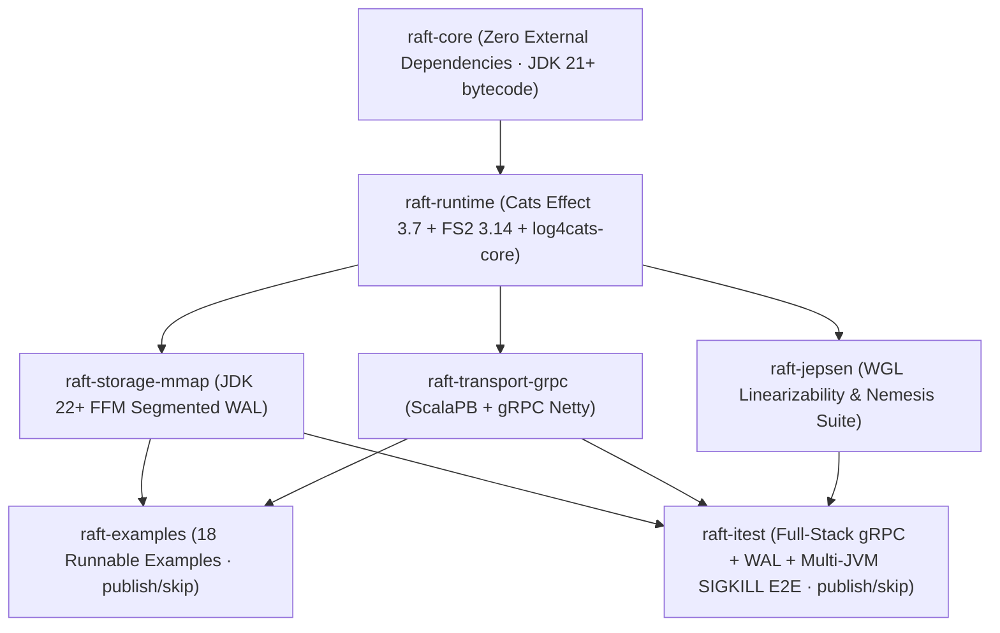

# Functional RAFT Library for Scala 3

A **Sans-I/O, deterministic** implementation of the [Raft consensus algorithm](https://raft.github.io/) in Scala 3. Storage, networking, and execution threads belong to the host system embedding the library: **`raft-core` has zero external dependencies** and isolates pure consensus safety, membership transitions, linearizable reads, and replication progress tracking behind deterministic state machines.

**Inspired by:** [tikv/raft-rs](https://github.com/tikv/raft-rs) · [OpenRaft](https://github.com/datafuselabs/openraft) · [etcd/raft](https://github.com/etcd-io/raft) · [TigerBeetle DST](https://tigerbeetle.com/) · [MicroRaft](https://microraft.io/)

---

## Why Sans-I/O Raft?

Traditional JVM Raft frameworks hijack your threads, force an opinionated RPC stack, and couple consensus correctness to background I/O callbacks. Following the Rust ecosystem (`tikv/raft-rs` and `openraft`), this library puts **consensus logic first** and leaves runtime & storage ownership to your system:

1. **Stateful Sans-I/O Driver (`RawNode` + `Ready` / `LightReady`)** — modeled directly on `tikv/raft-rs`:
   ```scala
   val store = MemStorage.create(ConfState(voters = Set(NodeId("n1"), NodeId("n2"), NodeId("n3"))))
   val raw   = RawNode(RaftConfig.default(NodeId("n1")), store)

   raw.tick()                        // logical tick — zero OS timers!
   raw.step(from, incomingMessage)   // step any RaftMessage deterministically
   if raw.hasReady then
     val rd = raw.ready()            // batch of messages, HardState, entries, snapshots, ReadStates
     store.persistReady(rd)          // host persists state & entries before persistedMessages
     val light = raw.advance(rd)     // commit advancement & follow-up messages
     raw.advanceApply()
   ```
2. **Pure Transition Function (`RaftLogic.onMessage`)** — stateless functional transitions `(NodeState, RaftMessage) => Transition(NodeState, List[Effect])` where every side effect is an immutable value.
3. **Optional Turnkey Modules** — if your host system uses Cats Effect + FS2, `raft-runtime`, `raft-storage-mmap` (JDK 22+ FFM off-heap segmented WAL), and `raft-transport-grpc` (ScalaPB + Netty HTTP/2) plug straight in without polluting `raft-core`.

---

## 7-Module Architecture



| Module | Artifact | External Dependencies (`Compile`) | Purpose |
|--------|----------|-----------------------------------|---------|
| `modules/core` | `raft-core` | **Zero** (Scala 3 stdlib only) | `RaftLogic`, `ConsensusKernel`, `RawNode`, `Ready`/`LightReady`, `ProgressTracker` (`Probe`/`Replicate`/`Snapshot` + `Inflights`), `RaftStorage`/`MemStorage`, `LogId`, `Bytes`, `JsonCodec` |
| `modules/runtime` | `raft-runtime` | `cats-effect`, `fs2-core`, `fs2-io`, `log4cats-core` | Typed `RaftNode[F, R]`, `MultiRaftNode` + `CoalescedHeartbeatConfig`, `CompactionManager`, streaming `Snapshot[F]`, `LogStore`/`StableStore`/`SnapshotStore`/`Transport` SPIs |
| `modules/storage-mmap` | `raft-storage-mmap` | `raft-runtime` (JDK `java.lang.foreign`) | Lease-safe off-heap memory-mapped segmented WAL (`Arena`/`MemorySegment`), CRC32 `MmapHardState`, torn-tail self-healing, `"RSNP"` v2 streaming snapshots |
| `modules/transport-grpc` | `raft-transport-grpc` | `scalapb-runtime-grpc`, `grpc-netty-shaded` | Protobuf wire protocol + pure `AtomicCell`-pooled Netty HTTP/2 `GrpcTransport`, `WireEnvelope.payloads` batching, `WireAck` backpressure, mTLS X.509 `sender_id` binding |
| `modules/jepsen` | *(unpublished)* | `raft-runtime` | Wing & Gong (WGL) linearizability checker, partition/crash/split-brain `NemesisScheduler`, chaos & stress harnesses |
| `modules/examples` | *(unpublished)* | `raft-storage-mmap`, `raft-transport-grpc`, `logback` | 18 runnable end-to-end examples: flagship Sharded Bank Ledger (2PC + Multi-Raft + gRPC + FFM WAL), Virtual Thread Sans-I/O, DST, KV, Lock, Transaction, and protocol demos |
| `modules/itest` | *(unpublished)* | `raft-storage-mmap`, `raft-transport-grpc`, `raft-jepsen` | Full-stack cross-module resilience, mTLS identity enforcement, and Multi-JVM `SIGKILL -9` crash-recovery E2E suites |

---

## Protocol & Correctness Capabilities

| Category | Capabilities |
|----------|--------------|
| **Core Safety (§5)** | Randomized election ticks, §5.4.1 `LogId(term, index)` up-to-date restriction, §5.3 fast conflict backtracking (`conflictTerm` / `conflictIndex`), §5.4.2 current-term `NoOp` commit rule, strict §5.3 Rule 5 follower commit clamping |
| **Disruption Prevention** | **Pre-Vote (§9.6)** two-phase elections (zero term inflation while partitioned), **Leader Stickiness (§6)**, **CheckQuorum (§6.2)** automatic minority leader step-down |
| **Linearizable Reads (§6.4)** | Quorum-confirmed **`ReadIndex`** (`ReadState` without log writes) and clock-bounded zero-RTT **`LeaseRead`** |
| **Membership & Admin** | **Joint Consensus (§6)** dual-quorum transitions (`C_old` → `C_old,new` → `C_new`), `Voter` / `Learner` / `Witness` roles, **Leadership Transfer (§3.10)** via catch-up + `TimeoutNow` |
| **Replication Engine** | Per-follower `ProgressTracker` (`Probe` → `Replicate` → `Snapshot`) with bounded `Inflights` sliding window, command batching, parallel replication, chunked streaming `InstallSnapshot` |
| **Multi-Raft Scaling** | `MultiRaftNode` group lifecycle coordinator, `GroupEnvelope` routing, FS2 `Topic`-multiplexed `MultiGroupTransport` |
| **Verification** | Seeded single-threaded **Deterministic Simulation Testing (`DeterministicSimulationSpec`)**, ScalaCheck safety property suites, and **Jepsen WGL linearizability** under partitions, crashes, and CAS contention |

---

## Quick Start

### Prerequisites

- **JDK 21+** for `raft-core` and `raft-runtime` (**JDK 25** recommended for building all modules including `raft-storage-mmap`)
- **sbt 1.12+** (Scala `3.3.9` LTS)

### Coordinates (`build.sbt`)

Artifacts are published to [GitHub Packages](https://github.com/bmscomp/raft/packages) and attached to [GitHub Releases](https://github.com/bmscomp/raft/releases) (see [CHANGELOG.md](CHANGELOG.md)):

```scala
resolvers += "GitHub Packages" at "https://maven.pkg.github.com/bmscomp/raft"

// Pure Sans-I/O consensus engine (zero transitive third-party dependencies!)
libraryDependencies += "com.github.bmscomp" % "raft-core" % "0.2.0"

// Optional Cats Effect + FS2 runtime, FFM WAL, and gRPC Netty transport
libraryDependencies ++= Seq(
  "com.github.bmscomp" % "raft-runtime"        % "0.2.0",
  "com.github.bmscomp" % "raft-storage-mmap"   % "0.2.0",
  "com.github.bmscomp" % "raft-transport-grpc" % "0.2.0"
)
```

### Pure Election in 12 Lines (`raft-core`)

```scala
import raft.state.*, raft.state.NodeState.*, raft.message.RaftMessage.*, raft.effect.Effect.*, raft.logic.RaftLogic

val cfg = RaftConfig(localId = NodeId("n1"), preVoteEnabled = false)
val s0  = Follower(term = 0, votedFor = None, leaderId = None)

val t1      = RaftLogic.onMessage(s0, ElectionTimeout, cfg, lastLogIndex = 0, lastLogTerm = 0, clusterSize = 3)
val voteReq = t1.effects.collectFirst { case Broadcast(r: RequestVoteRequest) => r }.get
val grant   = RequestVoteResponse(term = voteReq.term, voteGranted = true, isPreVote = false)
val t2      = RaftLogic.onVoteResponse(t1.state.asInstanceOf[Candidate], NodeId("n2"), grant, cfg, clusterSize = 3)
// t2.state == Leader(term = 1, ...)
```

---

## Runnable Examples (18 Included)

```bash
# Flagship full-stack Multi-Raft + gRPC + FFM MmapWalEngine + Cross-Shard 2PC Ledger
sbt "examples/runMain examples.advanced.ShardedBankLedgerExample"

# Sans-I/O RawNode on JDK Virtual Threads & Seeded Deterministic Simulation
sbt "examples/runMain examples.rawnode.RawNodeHostLoopExample"
sbt "examples/runMain examples.simulation.DeterministicSimulationExample"

# Protocol mechanics & cluster membership
sbt "examples/runMain examples.protocol.PreVoteExample"
sbt "examples/runMain examples.protocol.LogMatchingExample"
sbt "examples/runMain examples.protocol.CommitTrackingExample"
sbt "examples/runMain examples.protocol.TimerServiceExample"
sbt "examples/runMain examples.protocol.ReadIndexAndLeaseExample"
sbt "examples/runMain examples.protocol.LeadershipTransferExample"
sbt "examples/runMain examples.cluster.ThreeNodeClusterExample"
sbt "examples/runMain examples.cluster.JointConsensusExample"

# Distributed applications & Multi-Raft
sbt "examples/runMain examples.kvstore.KVStoreExample"
sbt "examples/runMain examples.lock.DistributedLockExample"
sbt "examples/runMain examples.counter.CounterWithCodecExample"
sbt "examples/runMain examples.distributed.DistributedCounterExample"
sbt "examples/runMain examples.distributed.RaftTransactionExample"
sbt "examples/runMain examples.distributed.DistributedTransactionExample"
sbt "examples/runMain examples.distributed.MultiGroupExample"
```

---

## Testing & Verification

```bash
sbt test                    # Fast unit, property, DST, WAL, gRPC, examples & E2E tests (625+ tests)
sbt "core/test"             # Pure zero-dependency raft-core suite + DeterministicSimulationSpec
sbt jepsenSmoke             # Jepsen WGL linearizability suite under partitions, restarts & CAS
sbt jepsenStress            # Long-running 7-node Jepsen chaos & leader-hunting stress suite
sbt mimaReportBinaryIssues  # Binary compatibility verification (MiMa) against v0.2.0
sbt scalafmtCheckAll scalafmtSbtCheck doc  # Formatting & API Scaladoc verification
```

---

## Documentation: *Raft: Theory and Practice* (24 Chapters)

📖 **[Read the Full Book](docs/book/README.md)** · **[Step-by-Step Tutorials](tutorials/)**

| Part | Chapters | Topics |
|------|----------|--------|
| **I — Foundations** | 1–4 | FLP & CAP, Raft fundamentals, Pre-Vote / Joint Consensus / ReadIndex, safety invariant proofs |
| **II — Architecture** | 5–7 | Pure effects-as-data design, Core API, pluggable SPI contracts |
| **III — Building** | 8–11 | Getting started, log replication & fast conflict backtracking, performance vs. safety, failure modes |
| **IV — Case Studies** | 12–15 | Linearizable KV store, TTL lock service, replicated counter, distributed transactions |
| **V — Ecosystem** | 16 | Architectural comparison with `tikv/raft-rs`, `openraft`, `etcd/raft`, HashiCorp Raft, MicroRaft |
| **VI — Operations & Testing** | 17–20 | Production troubleshooting, SPI integration, ScalaCheck properties, Jepsen WGL verification |
| **VII — Scaling** | 21 | Multi-Raft partitioning, `GroupEnvelope` routing, shared transport multiplexing |
| **VIII — Sans-I/O & DST** | 22–24 | `RawNode` & `Ready`/`LightReady` state machine, host runtime/storage integration, Deterministic Simulation Testing |

---

## Dependencies & Toolchain

| Component | Version | Scope |
|-----------|---------|-------|
| Scala | `3.3.9` (LTS) | All modules |
| sbt | `1.12.15` | Build & multi-module orchestration |
| Cats Effect / FS2 / Log4Cats | `3.7.1` / `3.14.0` / `2.8.0` | `raft-runtime` (optional host adapter) |
| ScalaPB / gRPC Netty | `0.11.21` / `1.85.1` | `raft-transport-grpc` (optional transport) |
| Logback | `1.6.7` | `raft-examples` & `Test` only |
| ScalaTest / ScalaCheck / CE Testing | `3.2.20` / `3.2.20.0` / `1.8.0` | `Test` only |

---

## License

Apache 2.0
