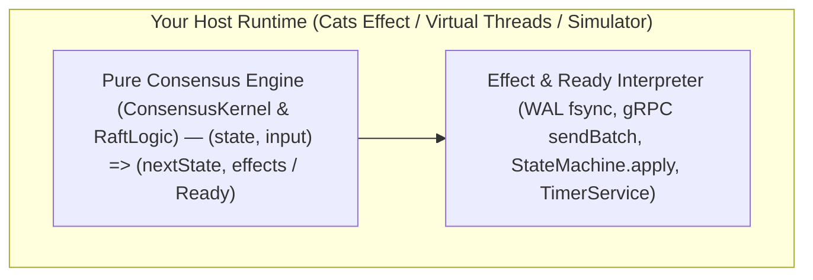

# Chapter 5: Design Philosophy

*Most Raft libraries mix protocol logic with networking, disk I/O, and timer management into a single tangled codebase. This library takes a fundamentally different approach — one borrowed from the world of functional programming — that makes it radically easier to test, port, and reason about. If you've ever wondered why testing distributed systems is so painful, this chapter explains the root cause and how to fix it.*

---

## The Insight: Side Effects Are the Enemy

Here's a question: why is it hard to test a typical Raft implementation? Think about what you'd need to do to test a single leader election:

1. Start three server processes (or threads simulating them)
2. Set up network connections between them (TCP sockets, gRPC channels, or mock transports)
3. Configure timers with specific timeouts
4. Wait for one server's election timer to fire
5. Observe the messages being sent over the network
6. Verify that the correct server becomes leader

That's a lot of infrastructure for testing about 30 lines of protocol logic. You're spending 90% of the effort on plumbing and 10% on the actual algorithm. Worse, the tests are slow (network timeouts), flaky (timer races), and hard to debug (interleaved log output from three threads).

The root cause is **side effects**. In traditional implementations, the protocol logic directly calls `socket.send()`, `disk.write()`, and `timer.schedule()`. These calls are tangled into the logic itself, making it impossible to test the protocol without the infrastructure.

This library eliminates that problem entirely.

## The Pure State Machine Pattern

The central architectural decision of this library is that every Raft protocol event is modeled as a **pure function**:

```
f(currentState, message) → (newState, effects)
```

Let's unpack what "pure" means here:

- **No side effects**: the function doesn't send messages, write to disk, or start timers. It only computes.
- **Deterministic**: given the same `currentState` and `message`, it always returns the same `(newState, effects)`.
- **Total**: it's defined for every possible input combination — no exceptions, no crashes.

The function receives the current node state and an incoming event (an RPC from another node, a timer timeout, a client request). It returns two things:

1. The **new state** of the node (an immutable data structure)
2. A **list of effects** — descriptions of work the runtime should do

The runtime — which is a separate piece of code that **you** control — is responsible for actually executing those effects (sending messages, writing to disk, etc.).



> **Note — This pattern has deep roots.** The idea of separating pure computation from side-effect execution is central to functional programming. Haskell uses monads for this; Elm uses the "Elm Architecture" (Model-View-Update); Redux in JavaScript uses reducers and middleware. In the distributed systems world, the idea of modeling a protocol as a state machine fed by inputs was formalized by Fred Schneider (1990) and is the basis of TLA+ specifications. What's unusual here is applying it to an *implementation*, not just a spec.

### Why This Matters: Four Concrete Benefits

**1. Testability — test a million cases in seconds**

Since the protocol logic is a pure function, testing it is trivially easy. No servers, no sockets, no timers. Just call the function and check the output:

```scala
val follower = Follower(term = 1, votedFor = None, leaderId = None)
val result = RaftLogic.onMessage(follower, ElectionTimeout, config, 0, 0, 3)

assert(result.state.isInstanceOf[Candidate])
assert(result.state.term == 2)
assert(result.effects.exists(_.isInstanceOf[Broadcast]))
```

You can run this test a million times in under a second. Compare that to waiting for real election timeouts.

**2. Portability — same logic everywhere**

The protocol logic has zero dependencies on any runtime infrastructure. It doesn't import `java.net.Socket`, doesn't depend on a file system, doesn't reference a specific timer library. This means:

- Use the same protocol logic on JVM (production), Scala.js (browser visualization), or GraalVM native (performance-critical scenarios)
- Swap transport implementations without touching protocol code
- Move from one storage engine to another without risk of introducing protocol bugs

**3. Composability — you choose the infrastructure**

Want gRPC for transport? Use it. Prefer HTTP/2? Use that instead. RocksDB for storage? Great. SQLite? Also fine. Your existing centralized scheduler for timers? Go ahead. The protocol logic doesn't care — it just produces effects, and you decide how to execute them.

**4. Determinism — reproduce bugs, replay traces**

Since the pure functions are deterministic, you can:
- **Record** the sequence of `(state, message)` inputs that led to a bug
- **Replay** them in a unit test to reproduce the exact scenario
- **Formally verify** protocol invariants by model-checking the pure logic

This is enormously valuable for debugging distributed systems, where bugs often involve specific orderings of concurrent events that are hard to reproduce.

## Comparison with Traditional Approaches

To make the difference concrete, here's how this library compares with traditional Raft implementations:

| Aspect | Traditional (e.g., HashiCorp Raft) | This Library |
|--------|-----------------------------------|-------------|
| **Transport** | Built-in TCP with specific framing | You provide via SPI trait |
| **Storage** | Built-in BoltDB/BadgerDB | You provide via SPI trait |
| **Timers** | Internal goroutines/threads | You provide via SPI trait |
| **Testing** | Requires mock servers, real timeouts, sleeps | Pure function calls, instant |
| **Portability** | Go runtime only | Any Scala 3 target |
| **Effect system** | Implicit side effects (I/O happens inside the function) | Explicit effect descriptors (I/O happens outside) |
| **Debugging** | Log-based, non-deterministic reproduction | Record/replay, deterministic |

> **Note — HashiCorp Raft is not "wrong".** It's a battle-tested, production-grade implementation that powers Consul, Nomad, and Vault. The tight coupling to Go's networking and storage is a deliberate design choice for their ecosystem — it makes getting started easier. The trade-off is that testing, porting, and customizing the internals is harder. This library makes the opposite trade-off: more initial setup, but much more flexibility and testability.

## Type Safety with Scala 3 Opaque Types

The library uses Scala 3's opaque types to prevent a class of bugs that are common in distributed systems code: accidentally confusing one kind of integer or string with another.

```scala
opaque type Term     = Long
opaque type LogIndex = Long
opaque type NodeId   = String
```

At runtime, these are represented as plain `Long` or `String` values — **zero overhead**, no boxing, no wrapper objects. But at compile time, they are distinct types:

```scala
val term: Term = Term(5)
val index: LogIndex = LogIndex(10)

// This would be a COMPILE ERROR:
// val bad: Term = index   ← Can't assign a LogIndex to a Term!

// You also can't accidentally pass a raw String where a NodeId is expected
```

This is important because in a Raft implementation, you're constantly working with multiple `Long` values (terms, log indices, commit indices, match indices) that have fundamentally different semantics. Swapping two of them by accident is a bug that compiles and runs but produces subtly wrong behavior — exactly the kind of bug that's hardest to diagnose in a distributed system.

> **Note — Why not just use case class wrappers?** You could wrap `Long` in a case class (`case class Term(value: Long)`), but this introduces heap allocation and boxing overhead on every term comparison, which happens on every single RPC. Opaque types give you the safety at zero cost.

## Immutability, Structural `Bytes` & Error-Accumulating Validation

All state objects, log entries, snapshot chunks, and protocol messages in `raft-core` are **deeply immutable** Scala 3 values:

- **Immutable `Bytes` (`raft.state.Bytes`)**: On the JVM, raw `Array[Byte]` fields inside `case class`es break structural equality (`==` compares array references) and allow callers to mutate shared buffers in place. `Log`, `SnapshotMetadata`, `PendingSnapshot`, and `InstallSnapshotRequest` encapsulate payloads inside `Bytes` — copying defensively at `Array[Byte]` boundaries while exposing zero-copy read-only `ByteBuffer` views and SIMD-intrinsified `Arrays.equals` / `Arrays.hashCode`.
- **Monotonic `commitIndex` Across All Roles**: Every `NodeState` (`Follower`, `PreCandidate`, `Candidate`, `Leader`) carries `commitIndex` so committed prefixes are never regressed or truncated across elections or higher-term step-downs.
- **Error-Accumulating Smart Constructors (`Validated[ConfigError, A]`)**: Configuration types (`RaftConfig.validate`, `BatchConfig.validate`, `PipelineConfig.validate`, `NodeId.validate`, `ClusterConfig.validate`) validate invariants purely without allocating stack traces, accumulating *all* invalid fields in a single `Validated.Invalid(errors: Vector[ConfigError])` pass:

```scala
import scala.concurrent.duration.*
import raft.state.{NodeId, RaftConfig, Validated}

val checked = RaftConfig.validate(
  localId = NodeId("node-1"),
  electionTimeoutMin = 150.millis,
  electionTimeoutMax = 300.millis,
  heartbeatInterval = 50.millis
)

checked match
  case Validated.Valid(cfg)      => // guaranteed valid RaftConfig
  case Validated.Invalid(errors) => // every violated invariant reported together
```

There are **zero `var`s**, **zero `while` loops**, and **zero `null`s** in `ConsensusKernel`, `RaftLogic`, `ProgressTracker`, and `JsonCodec`. The runtime holds the current state in an atomic cell (`Ref[F, NodeState]` or `AtomicReference[KernelState]`) and swaps immutable values atomically:

```scala
// In the runtime event loop (simplified)
stateRef.modify { currentState =>
  val transition = RaftLogic.onMessage(currentState, msg, config, ...)
  (transition.state, transition.effects)
}.flatMap(executeEffects)
```

This `modify` call is atomic — even if multiple messages arrive concurrently, each transition sees a consistent snapshot of the state and produces a consistent update. No data races are possible.

## The Effects Pattern: Side Effects as Data

This is the most distinctive architectural choice in the library. Instead of performing side effects (I/O, network calls, disk writes), the protocol logic returns **descriptions** of side effects as ordinary data values. These descriptions form an algebraic data type (ADT):

```scala
enum Effect:
  case SendMessage(to: NodeId, message: RaftMessage)
  case Broadcast(message: RaftMessage)
  case PersistHardState(term: Long, votedFor: Option[NodeId])
  case AppendLogs(entries: Seq[Log])
  case TruncateLog(fromIndex: Long)
  case CommitEntries(index: LogIndex)
  case BecomeLeader
  case StopLeader
  case ResetElectionTimer
  case ResetHeartbeatTimer
  // ... 18 total exhaustive, pure data cases (see Chapter 6)
```

Each `Effect` is just an immutable case value — a piece of data that says "please do X". The protocol logic constructs these effects; a separate **effect interpreter** in the runtime actually executes them:

```scala
def executeEffects(
  effects: List[Effect],
  transport: RaftTransport[IO],
  logStore: LogStore[IO],
  stableStore: StableStore[IO],
  rescheduleElection: IO[Unit],
  rescheduleHeartbeat: IO[Unit]
): IO[Unit] =
  effects.traverse_ {
    case PersistHardState(term, v) => stableStore.setHardState(Term.unsafeFrom(term), v)
    case AppendLogs(entries)       => logStore.append(entries)
    case TruncateLog(fromIdx)      => logStore.truncateFrom(LogIndex.unsafeFrom(fromIdx))
    case Broadcast(msg)            => transport.broadcast(msg)
    case SendMessage(to, msg)      => transport.send(to, msg)
    case CommitEntries(upTo)       => applyCommittedEntries(upTo)
    case ResetElectionTimer        => rescheduleElection
    case ResetHeartbeatTimer       => rescheduleHeartbeat
    case _                         => IO.unit
  }
```

Notice the critical detail on `PersistHardState`: the interpreter invokes atomic `stableStore.setHardState(term, votedFor)` (one durable `msync`/`fsync` record) rather than splitting `setCurrentTerm` and `setVotedFor` into two writes that could tear on crash.

### What Does This Buy You?

The effect interpreter is **your code**, which means you have total control over how effects are executed:

- **Observability**: log every effect before executing it. In production, this gives you a complete audit trail of every protocol decision.
- **Batching**: combine multiple `PersistHardState` + `AppendLogs` effects into a single disk write for better throughput.
- **Ordering**: always persist to disk **before** broadcasting messages. This ensures that if the node crashes between persisting and broadcasting, it can recover correctly.
- **Error handling**: if `transport.send()` fails, retry without re-running the protocol logic. The effects are already computed — you just need to retry the I/O.
- **Testing**: in tests, collect effects into a list and make assertions about them. No mock frameworks needed.

> **Note — Command/Query Separation:** If you're familiar with design patterns, the effects pattern is a specific instance of the Command pattern (GoF, 1994) combined with Command-Query Responsibility Segregation (CQRS). The protocol logic is the "query" side — it computes what should happen. The effect interpreter is the "command" side — it makes it happen. This separation is what makes the system so testable and flexible.

## The Seven Pillars of This Implementation

Beyond pure transitions, this repository applies the same systems-engineering rigor across all seven sbt modules (`raft-core`, `raft-runtime`, `raft-storage-mmap`, `raft-transport-grpc`, `raft-jepsen`, `raft-examples`, `raft-itest`). Understanding *why* each layer is built this way reveals the strong points of the library as a whole:

1. **Two-Tier Zero-Dependency Core (`RaftLogic` + `ConsensusKernel` / `RawNode`)**:
   - `RaftLogic` exposes single-step pure functions `(NodeState, RaftMessage, ...) => Transition(NodeState, List[Effect])` for transparent inspection and custom interpreters.
   - `ConsensusKernel` (`raft.kernel.ConsensusKernel`) scales that same pure discipline (`0` `var`s, `0` `while` loops, `0` `null`s, `0` runtime casts, `0` thrown exceptions) into a complete Mealy machine bundling `UnstableLog`, `ProgressTracker` (`Probe`/`Replicate`/`Snapshot` + `Inflights`), multi-chunk snapshot reassembly, Joint Consensus rollback, and an embedded **SplitMix64 PRNG** (`prngState: Long`) for deterministic election jitter — wrapped by the `tikv/raft-rs`-style `RawNode` cursor ([Chapter 22](22-sans-io-rawnode-ready.md)).
2. **Structural Persistence-Before-RPC (`Ready.messages` vs. `Ready.persistedMessages`)**:
   - Inside `ConsensusKernel`, `hasUnpersistedTermOrVote(localId)` guards every outbound RPC. Whenever `term` or `votedFor` has changed since `lastPersistedHardState`, every outbound message is automatically routed to `Ready.persistedMessages`, structurally forbidding votes or term acknowledgments from escaping before durable WAL `fsync` — while allowing safe leader `AppendEntries` to overlap with disk writes via `Ready.messages` (§10.2.1).
3. **Compile-Time Discipline & Zero-Cost Domain Safety**:
   - Built with `-Wvalue-discard`, `-Wnonunit-statement`, `-Wunused:all`, and `-Werror`, paired with zero-allocation opaque types (`Term`, `LogIndex`, `NodeId`, `GroupId`), canonical `LogId(term, index)` ordering, structural `Bytes`, stack-trace-free `RaftError`, and error-accumulating `Validated[ConfigError, A]`.
4. **Typed Runtime Outputs & Lock-Free Network Dispatch (`RaftNode[F, R]`)**:
   - `RaftNode[F, R]` carries the `StateMachine[F, R]` result type `R` all the way to the caller (`proposeAndApply(Bytes): F[Applied[R]]`), eliminating ad-hoc side-channel response maps. Consensus mutations and WAL appends run inside `Mutex[F]` in nanoseconds using an `O(1)` `TermRingBuffer`, while **all network RPCs execute outside the lock** and snapshots stream directly to disk via `FilePendingSnapshot` under `Supervisor[F]`.
5. **Off-Heap JDK FFM Storage with Lock-Free Leased Reads (`raft-storage-mmap`)**:
   - `MmapWalEngine` writes segmented `.wal` files through JDK 22+ `Arena` / `MemorySegment` off-heap buffers, guards concurrent readers with reference-counted `SegmentLease[F]` pins (zero `Arena.close()` use-after-free races without holding the write mutex), indexes up to `Long.MaxValue` via a pure immutable 2-level radix `WalIndexState`, verifies CRC32 before heap allocation, and self-heals torn uncommitted tails after `SIGKILL`.
6. **Zero-Trust Multiplexed Networking & Coalesced Heartbeats (`raft-transport-grpc` + `MultiRaftNode`)**:
   - `GrpcTransport` manages peer channels inside a lock-free `AtomicCell`, batches pipelined `AppendEntries` into single HTTP/2 `WireEnvelope.payloads` RPCs, propagates receiver queue saturation via `WireAck(accepted = false)` (`RESOURCE_EXHAUSTED` backoff), binds `WireEnvelope.sender_id` to authenticated mTLS X.509 `CN` / `DNS` / SPIFFE `URI` SANs, and packs multi-group heartbeats via `CoalescedHeartbeatConfig` with superseding eviction.
7. **Deterministic Simulation & Six-Layer Verification**:
   - Because `ConsensusKernel` has zero clocks, zero threads, and a seeded PRNG, `DeterministicSimulationSpec` and `examples.simulation.DeterministicSimulationExample` compress thousands of partitions, split-persist crashes, and `3 → 5 → 3` Joint Consensus migrations into sub-second, bit-for-bit reproducible runs ([Chapter 24](24-deterministic-simulation-testing.md)), complemented by WGL linearizability and Multi-JVM `SIGKILL -9` verification ([Chapter 20](20-jepsen-verification.md)).

## Summary

| Design Principle | How It's Implemented | Why It Matters |
|-----------------|---------------------|---------------|
| **Pure consensus cores** | `RaftLogic.onMessage` (`Transition`) & `ConsensusKernel` (`RawNode` / `Ready`) with `0` I/O and `0` `var`s | Sub-millisecond tests, seeded DST, bit-for-bit replay |
| **Explicit effects & barriers** | 18-case `Effect` ADT + `Ready.messages` vs. `Ready.persistedMessages` | Structural Persistence-Before-RPC (§5.1/§5.2) |
| **Type & value safety** | Opaque `Term`/`LogIndex`/`NodeId`/`GroupId`, `LogId`, immutable `Bytes`, `Validated` | Compile-time bug prevention at zero allocation cost |
| **Typed lock-free runtime** | `RaftNode[F, R]` → `Applied[R]`, `TermRingBuffer`, RPC dispatch outside `Mutex[F]` | No response-map hacks, no lock-held network stalls |
| **Off-heap crash-safe WAL** | `MmapWalEngine`, `SegmentLease`, radix `WalIndexState`, 280-byte `MmapHardState` | Zero-GC log I/O, lock-free reads, `SIGKILL` torn-tail healing |
| **Zero-dependency portability** | `raft-core` has **0** external compile dependencies | Embeddable on Virtual Threads, Cats Effect, ZIO, Pekko, or simulators |

---

*Next: [Chapter 6 — Core API](06-core-api.md) walks through every type and function in the library's public API, showing how the design philosophy translates into concrete code.*
