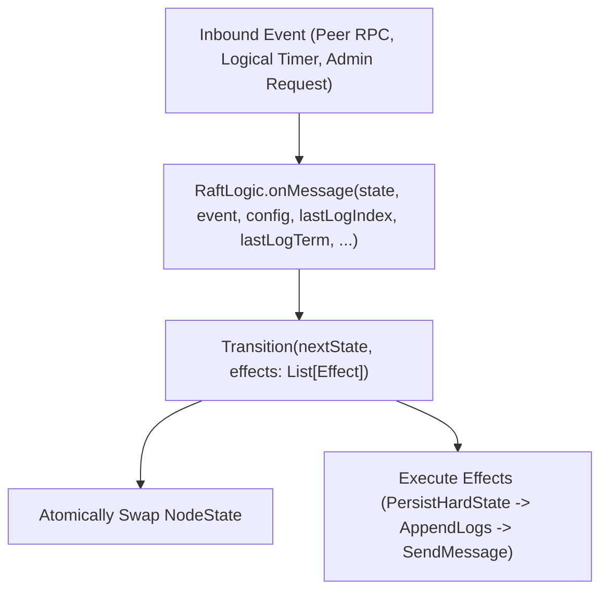
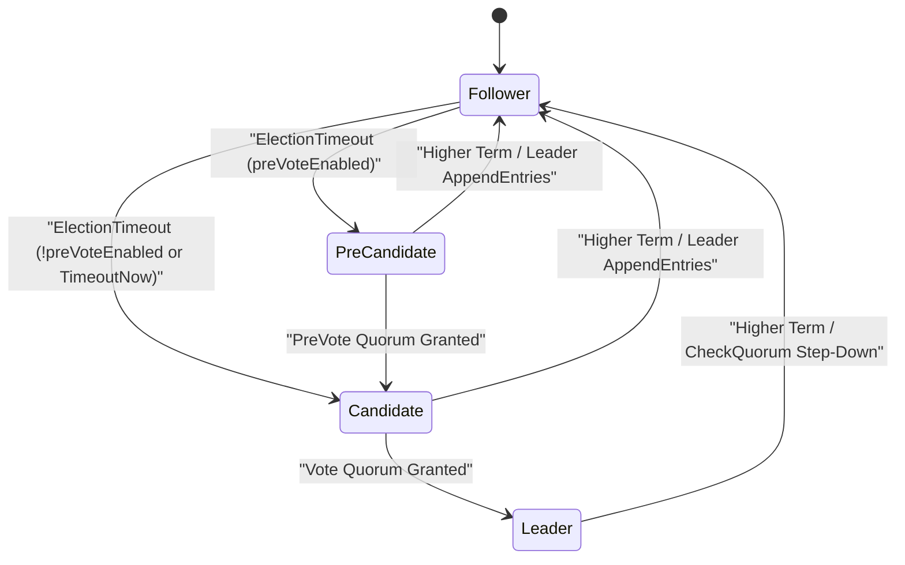
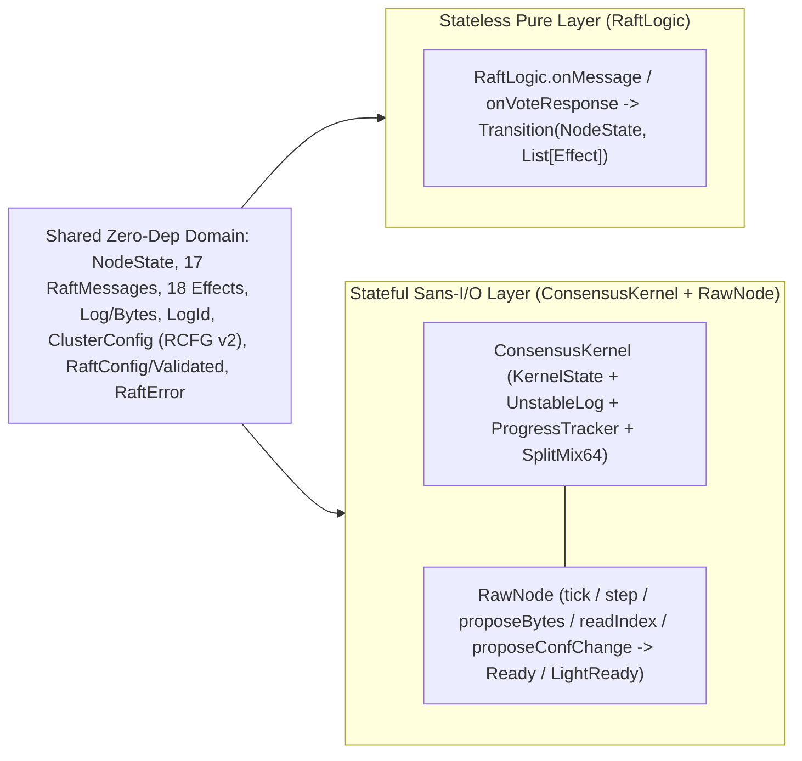

# Chapter 6: Core API

*This chapter is a complete tour of the library's public API — the types, functions, and data structures you'll work with when building distributed systems. Think of it as the reference companion to the conceptual material in Chapters 2–4. Each section connects back to the protocol concepts we've covered, so you'll see how theory maps to code.*

---

## Entry Point: `RaftLogic.onMessage`

This is the single function that drives the entire Raft protocol. Every event — a message from a peer, a timer firing, a client request — enters the system through this function:

```scala
object RaftLogic:
  def onMessage(
    state: NodeState,                       // current node role (Follower, PreCandidate, Candidate, Leader)
    message: RaftMessage,                   // incoming RPC or logical timeout event
    config: RaftConfig,                     // local node protocol configuration
    lastLogIndex: Long,                     // index of the last entry in the local log
    lastLogTerm: Long,                      // term of the last entry in the local log
    clusterSize: Int,                       // voting cluster size
    getTermAt: Long => Option[Long] = _ => None, // synchronous term lookup at log index
    sender: Option[NodeId] = None,          // authenticated sender NodeId for vote/append tracking
    clusterOpt: Option[ClusterConfig] = None // optional full ClusterConfig (Joint Consensus, Learners, Witnesses)
  ): Transition
```

> **Note — Two ways to drive `raft-core`:** You can invoke stateless `RaftLogic.onMessage` directly when managing state transitions yourself, or drive the higher-level Sans-I/O [`RawNode`](22-sans-io-rawnode-ready.md) (`tick` / `step` / `propose` / `ready` / `advance`), which pairs `RaftLogic` with `ProgressTracker` (`Probe` / `Replicate` / `Snapshot` + `Inflights`) and an unstable log overlay while keeping **zero external dependencies**.

And it returns a `Transition`:

```scala
case class Transition(state: NodeState, effects: List[Effect])
```

That's it. The entire Raft protocol is driven by calling this function in a loop. Your runtime looks like:



There's something worth noting about the `getTermAt` parameter: it's a function, not a value. The protocol logic sometimes needs to look up the term of a specific log entry (for example, to fill in the `prevLogTerm` field of an `AppendEntries` request). Rather than passing the entire log, we pass a lookup function. This keeps the interface minimal — the protocol logic only queries the log when it needs to, and only for the specific information it requires.

> **Note — Why pass log metadata separately?** You might wonder why `lastLogIndex` and `lastLogTerm` are passed as parameters rather than being derived from the log itself. The reason is the pure function architecture: the protocol logic doesn't have access to the log store (that's an SPI concern). Instead, the runtime reads these values from the log store and passes them in. This maintains the separation between pure logic and effectful I/O.

## Node States

Every node in a Raft cluster is in exactly one of four roles, modeled as an immutable Scala 3 `enum` (`raft.state.NodeState`). Crucially, **every** role carries `commitIndex` so a node's committed watermark never regresses across elections or higher-term step-downs:



Let's look at each role in detail.

### Follower

```scala
enum NodeState:
  case Follower(
    term: Long,
    votedFor: Option[NodeId] = None,
    leaderId: Option[NodeId] = None,
    commitIndex: Long = 0L
  )
```

The **default** and most common state. A follower passively responds to RPCs:
- **`AppendEntries`** from the leader: verify `(prevLogIndex, prevLogTerm)`, append entries, advance `commitIndex` strictly up to `min(leaderCommit, prevLogIndex + entries.size)`, reset election timer
- **`RequestVote`** from candidates: grant or deny vote based on term, single-vote guard, leader stickiness, and `LogId(term, index)` freshness
- **`ElectionTimeout`**: transition to `PreCandidate` (if `preVoteEnabled`) or `Candidate`

The `votedFor` field records who this node voted for in the current term (`None` if no vote was cast). Together with `term`, it forms the **hard state** that must be atomically persisted via `StableStore.setHardState` (or `Ready.hardState`) before responding to any RPC.

The `leaderId` field tracks the current leader (`None` right after a term change) so client gateways can redirect requests via `RaftError.NotLeader(leaderId)`.

### PreCandidate

```scala
  case PreCandidate(
    term: Long,
    preVotesReceived: Set[NodeId] = Set.empty,
    commitIndex: Long = 0L
  )
```

Active when `preVoteEnabled = true` (the default). The pre-candidate broadcasts `RequestVoteRequest(term = term + 1, isPreVote = true)` without incrementing its own persistent `term` or emitting `PersistHardState`. Only when `preVotesReceived` achieves a valid quorum (`hasPreVoteQuorum(cluster)` or `hasPreVoteMajority(clusterSize)`) does the node promote to `Candidate(term + 1, ...)`.

### Candidate

```scala
  case Candidate(
    term: Long,
    votesReceived: Set[NodeId] = Set.empty,
    commitIndex: Long = 0L
  )
```

A candidate has incremented its term, voted for itself (`votesReceived = Set(localId)`), persisted its hard state, and broadcast `RequestVoteRequest(isPreVote = false)`. Three events terminate candidacy:
1. **Win**: `hasQuorum(cluster)` / `hasMajority(clusterSize)` → become `Leader`
2. **Lose**: `AppendEntriesRequest` with `term >= candidate.term` (or any message with `term > candidate.term`) → `stepDown` to `Follower`
3. **Timeout**: election timer fires without a quorum → start a fresh election at `term + 1`

### Leader

```scala
  case Leader(
    term: Long,
    nextIndex: Map[NodeId, Long] = Map.empty,
    matchIndex: Map[NodeId, Long] = Map.empty,
    commitIndex: Long = 0L,
    transferTarget: Option[NodeId] = None,
    pendingReads: Map[String, PendingRead] = Map.empty,
    leaseUntil: Long = 0L,
    recentlyActive: Set[NodeId] = Set.empty
  )
```

The authoritative cluster leader. Key fields:
- **`nextIndex` / `matchIndex`**: per-follower replication cursors and confirmed watermarks used to compute `calculateCommitIndex` / `calculateCommitIndexForCluster` (supporting Joint Consensus dual majorities).
- **`transferTarget`**: when `Some(target)` (§3.10), the leader fences new client proposals (`RaftError.LeadershipTransferInProgress`), catches up `target`, and emits `TimeoutNow(target)`.
- **`pendingReads`**: in-flight §6.4 `ReadIndex` quorum-heartbeat rounds awaiting majority acknowledgment.
- **`leaseUntil` / `recentlyActive`**: monotonic lease deadline for zero-RTT `LeaseRead` and active-peer tracking for §6.2 `CheckQuorum`.

## Messages (`RaftMessage`)

All 17 protocol messages — inter-node RPCs, administrative commands, and internal logical timer events — form a single deeply immutable `sealed trait RaftMessage` with structural value equality (`==`):

```scala
sealed trait RaftMessage extends Product with Serializable

object RaftMessage:
  // Core replication & election RPCs (§5.2, §5.3, §9.6, §3.10)
  final case class AppendEntriesRequest(
    term: Long,
    leaderId: NodeId,
    prevLogIndex: Long,
    prevLogTerm: Long,
    entries: Seq[Log],
    leaderCommit: Long
  ) extends RaftMessage

  final case class AppendEntriesResponse(
    term: Long,
    success: Boolean,
    matchIndex: Long,
    conflictIndex: Option[Long] = None, // §5.3 fast term-skip hint
    conflictTerm: Option[Long] = None   // §5.3 conflicting term hint
  ) extends RaftMessage

  final case class RequestVoteRequest(
    term: Long,
    candidateId: NodeId,
    lastLogIndex: Long,
    lastLogTerm: Long,
    isPreVote: Boolean = false,
    isTransfer: Boolean = false         // true on TimeoutNow-triggered elections
  ) extends RaftMessage

  final case class RequestVoteResponse(
    term: Long,
    voteGranted: Boolean,
    isPreVote: Boolean = false
  ) extends RaftMessage

  // Chunked snapshot streaming (§7) — payload wrapped in immutable Bytes
  final case class InstallSnapshotRequest(
    term: Long,
    leaderId: NodeId,
    lastIncludedIndex: Long,
    lastIncludedTerm: Long,
    offset: Long,
    payload: Bytes,
    done: Boolean
  ) extends RaftMessage

  final case class InstallSnapshotResponse(
    term: Long,
    success: Boolean,
    matchIndex: Long = 0L
  ) extends RaftMessage

  // Leadership transfer (§3.10), ReadIndex (§6.4), Membership (§6)
  final case class TransferLeadershipRequest(term: Long, target: NodeId) extends RaftMessage
  final case class TimeoutNowRequest(term: Long, leaderId: NodeId) extends RaftMessage
  final case class ReadIndexRequest(requestId: String) extends RaftMessage
  final case class ReadIndexResponse(requestId: String, success: Boolean, readIndex: Long) extends RaftMessage
  final case class AddServerRequest(term: Long, newServer: NodeId, isLearner: Boolean = false) extends RaftMessage
  final case class AddServerResponse(term: Long, success: Boolean, leaderHint: Option[NodeId]) extends RaftMessage
  final case class RemoveServerRequest(term: Long, server: NodeId) extends RaftMessage
  final case class RemoveServerResponse(term: Long, success: Boolean, leaderHint: Option[NodeId]) extends RaftMessage

  // Internal logical timer events
  case object ElectionTimeout    extends RaftMessage
  case object HeartbeatTimeout   extends RaftMessage
  case object CheckQuorumTimeout extends RaftMessage
```

Modeling `ElectionTimeout`, `HeartbeatTimeout`, and `CheckQuorumTimeout` as `RaftMessage` values means timers require no backdoor into protocol state: every external or temporal stimulus passes through the exact same pure transition function.

> **Note — Why `isTransfer` and `(conflictIndex, conflictTerm)` matter:** `isTransfer = true` tells followers to bypass Leader Stickiness during a deliberate §3.10 leadership transfer so the handoff completes in one RTT. `conflictIndex` and `conflictTerm` let leaders skip an entire conflicting term per RTT instead of decrementing `nextIndex` one entry at a time (§5.3).

## The Effect Catalog

`Effect` is a minimal, exhaustive 18-case pure algebra — every variant below is actively emitted by `RaftLogic` transitions and carries structural value equality (`==`) with zero closure callbacks:

| Effect | When It's Produced | What the Runtime Should Do |
|--------|-------------------|---------------------------|
| `SendMessage(to, msg)` | Responding to or probing a specific peer (vote reply, per-peer heartbeat, append probe) | Deliver `msg` to node `to` via transport |
| `Broadcast(msg)` | Starting a pre-vote/election or fallback broadcast | Deliver `msg` to **all** peers |
| `PersistHardState(term, votedFor)` | Term changes or votes cast | Atomically `fsync` `term` and `votedFor` to durable storage |
| `AppendLogs(entries)` | Leader or follower appends entries | Append entries to durable log store |
| `TruncateLog(fromIndex)` | Log conflict detected (§5.3) | Remove entries at and after `fromIndex` |
| `CommitEntries(upToIndex)` | Commit index advances | Apply committed entries through `upToIndex` in index order |
| `BecomeLeader` | Election won | Cancel election timer, append `NoOp`, start leader replication |
| `StopLeader` | Higher term discovered or `CheckQuorum` step-down | Cancel leader heartbeat/quorum timers |
| `ResetElectionTimer` | Valid leader RPC received or vote granted | Restart randomized election countdown |
| `ResetHeartbeatTimer` | Periodic leader heartbeat tick | Reschedule next leader heartbeat |
| `ConfirmLeadership(term, roundId)` | `ReadIndex` round initiated on leader | Track quorum heartbeat confirmation round |
| `ReadIndexReady(id, index)` | `ReadIndex` quorum confirmed at `index` | Wait until `lastApplied >= index`, then complete client read |
| `ReadIndexRejected(id, reason, leaderHint)` | Non-leader or leader before current-term commit asked to read | Fail read fast with optional `leaderHint` |
| `RequestSnapshot(lastApplied, logSize)` | Compaction threshold reached | Capture state-machine snapshot and compact WAL prefix |
| `InstallSnapshot(metadata)` | Final `InstallSnapshotRequest` chunk accepted | Restore state machine, persist snapshot, update `ClusterConfig` |
| `TransferLeadership(target)` | Leadership transfer initiated (§3.10) | Reject new proposals while catching up `target` |
| `TimeoutNow(target)` | Target voter caught up during leadership transfer | Send `TimeoutNowRequest` so `target` campaigns immediately |
| `ApplyClusterConfig(config, index, term)` | Membership configuration appended/installed | Update active `ClusterConfig` (`C_old,new` or `C_new`) |

> **Note — Effect ordering matters.** The runtime should execute `PersistHardState` **before** `SendMessage` or `Broadcast`. The reason: if the node crashes after sending a message but before persisting the term/vote, it might restart and repeat an action that violates safety (like voting twice in the same term). Persist first, communicate second. This is a standard pattern in distributed systems, sometimes called "write-ahead".

## Configuration: `RaftConfig`

Every node is configured via an immutable `RaftConfig` instance — construct it directly or via the pure error-accumulating smart constructor `RaftConfig.validate(...)`:

```scala
final case class RaftConfig(
  localId: NodeId,
  electionTimeoutMin: FiniteDuration  = 150.millis,
  electionTimeoutMax: FiniteDuration  = 300.millis,
  heartbeatInterval: FiniteDuration   = 50.millis,
  maxEntriesPerRequest: Int           = 100,
  preVoteEnabled: Boolean             = true,
  leaderStickinessEnabled: Boolean    = true,
  leaderLeaseDuration: FiniteDuration = 100.millis,
  parallelReplicationEnabled: Boolean = true,
  batching: BatchConfig               = BatchConfig(),
  pipelining: PipelineConfig          = PipelineConfig(),
  compaction: CompactionConfig        = CompactionConfig(),
  checkQuorumEnabled: Boolean         = true,
  leaseReadEnabled: Boolean           = false,
  electionTimeoutTicks: Int           = 10,
  heartbeatIntervalTicks: Int         = 1,
  maxInboundQueueSize: Int            = 8192,
  maxPendingProposals: Int            = 8192
)
```

Here's guidance on tuning the key parameters:

| Parameter | Default | Tuning Guidance |
|-----------|---------|-----------------|
| `electionTimeoutMin/Max` | 150–300ms | At least **10× network RTT** (`500–1000ms` across WAN/AZs). Used by wall-clock runtimes (`RaftNode`). |
| `heartbeatInterval` | 50ms | Must stay strictly below `electionTimeoutMin` (rule of thumb: `electionTimeoutMin / 3`). |
| `electionTimeoutTicks` / `heartbeatIntervalTicks` | `10` / `1` | Logical tick cadence for Sans-I/O `ConsensusKernel` / `RawNode` and Deterministic Simulation Testing ([Chapter 22](22-sans-io-rawnode-ready.md)). |
| `maxEntriesPerRequest` | 100 | Maximum log entries packed into one `AppendEntriesRequest` chunk. |
| `preVoteEnabled` | `true` | **Always enable in production** to eliminate partitioned term inflation (§9.6). |
| `leaderStickinessEnabled` / `checkQuorumEnabled` | `true` / `true` | Follower-side vote guard (§6) and leader-side minority step-down (§6.2). |
| `leaseReadEnabled` / `leaderLeaseDuration` | `false` / 100ms | Enables zero-RTT local reads when `checkQuorumEnabled = true`; keep `leaderLeaseDuration < electionTimeoutMin - maxClockDrift`. |
| `maxInboundQueueSize` / `maxPendingProposals` | `8192` / `8192` | Bounded backpressure limits preventing OOM under burst load or slow disks. |

> **Note — Timing constraints:** The Raft paper formally requires: `broadcastTime ≪ electionTimeout ≪ MTBF`. The `broadcastTime` is the average time to send an RPC to all nodes (~0.5–20ms on a LAN). The MTBF (mean time between failures) is typically months or years. Your election timeout must sit comfortably between these two extremes. If the election timeout is too close to the broadcast time, followers will start elections before heartbeats arrive. If it's too close to the MTBF, the cluster might not recover from failures quickly enough.

## Cluster Configuration: `ClusterConfig`

The `ClusterConfig` type manages the cluster membership and supports the joint consensus protocol for safe membership changes:

```scala
case class ClusterConfig(
  members: Map[NodeId, NodeRole],
  jointConfig: Option[Map[NodeId, NodeRole]] = None,
  pendingConfig: Option[Map[NodeId, NodeRole]] = None
)

enum NodeRole:
  case Voter, Learner, Witness
```

During normal operation, `jointConfig` and `pendingConfig` are `None`, and `members` contains the active membership. During a joint consensus transition (Chapter 3), `jointConfig` holds the old configuration and `pendingConfig` holds the target new configuration.

Here are the key operations:

```scala
// Create a cluster from a set of voter node IDs
val config = ClusterConfig(Set(n1, n2, n3))

// Add a learner (non-voting member for catch-up)
val withLearner = config.addMember(n4, NodeRole.Learner)

// Promote a learner to voter
val promoted = withLearner.promoteLearner(n4)

// Begin joint consensus for a membership change
val newMembers = Map(
  n1 -> NodeRole.Voter,
  n2 -> NodeRole.Voter,
  n4 -> NodeRole.Voter
)
val joint     = config.beginJointConsensus(newMembers)
val completed = joint.completeJointConsensus   // switch to new config
val aborted   = joint.abortJointConsensus      // rollback to old config

// Query the configuration
config.isVoter(n1)              // true
config.isLearner(n4)            // true (before promotion)
config.contains(n5)             // false
config.hasQuorum(Set(n1, n2))   // true (2/3 majority)
config.isInJointConsensus       // false (unless mid-transition)
config.voters                   // Set(n1, n2, n3)
config.allNodes                 // Set(n1, n2, n3)
```

> **Note — Quorum During Joint Consensus:** When `isInJointConsensus` is `true`, the `hasQuorum` method requires a majority of **both** the old configuration (stored in `jointConfig`) and the current membership. This dual-quorum check is what makes joint consensus safe (Chapter 3).

## Log Entries, `Bytes`, `LogId`, and Typed `RaftError`

Log entries are deeply immutable values backed by `raft.state.Bytes` (structural `==`, SIMD-intrinsified hashing, zero-copy read-only `ByteBuffer` views):

```scala
final case class Log(
  index: Long,
  term: Long,
  logType: LogType,
  payload: Bytes
):
  def data: Array[Byte]          // defensive copy for legacy byte-array consumers
  def typedIndex: LogIndex
  def typedTerm: Term
  def stripForWitness: Log       // clears Command payload for Witness tie-breakers

enum LogType:
  case Command        // client-submitted command
  case NoOp           // leader's initial current-term barrier entry (§5.4.2)
  case Configuration  // CRC32-verified RCFG v2 ClusterConfig entry (§6)
```

Factory methods keep entry construction safe and explicit:

```scala
val clientCmd  = Log.command(index = 1, term = 1, data = "SET x=1".getBytes)
val zeroCopy   = Log.commandBytes(LogIndex.unsafeFrom(1), Term.unsafeFrom(1), Bytes.fromUtf8("SET x=1"))
val leaderInit = Log.noOp(index = 1, term = 1)
val confEntry  = Log.configuration(index = 2, term = 1, clusterConfig)
```

Alongside `Log`, `raft-core` defines three small domain primitives that eliminate subtle consensus bugs across the entire codebase:

- **`LogId(term: Term, index: LogIndex)`**: Canonical coordinate with an exact lexicographic `Ordered[LogId]` (`term` primary, `index` tiebreaker) encoding Raft's §5.4.1 up-to-date log relation.
- **`HardState(term: Long, votedFor: Option[NodeId], commitIndex: Long)`** & **`ReadState(index: Long, requestCtx: String)`**: Immutable persistence and linearizable-read descriptors emitted by `ConsensusKernel` / `RawNode`.
- **`RaftError`** (sealed `RuntimeException with NoStackTrace`): Exhaustive typed failure cases (`NotLeader(leaderId)`, `ElectionInProgress`, `LeadershipTransferInProgress(transferee)`, `ConfigurationChangeInProgress(pending)`, `LeaderNotReadyInTerm(term)`, `ProposalDropped(reason)`, `GroupNotFound(groupId)`, `StorageCorruption(reason)`) so clients and routers never parse error strings.

## Vote Response Handling

When calling `RaftLogic.onMessage` directly with a `RequestVoteResponse`, pass the voter's `NodeId` via `sender = Some(voterId)` — or invoke `RaftLogic.onVoteResponse` explicitly for deterministic, idempotent vote deduplication:

```scala
val afterVote = RaftLogic.onVoteResponse(
  state = candidate,
  voterId = NodeId("node-2"),
  resp = RequestVoteResponse(term = 1, voteGranted = true, isPreVote = false),
  config = config,
  clusterSize = 3
)
// 2nd vote in a 3-node cluster → majority reached
// afterVote.state → Leader(term = 1, ...)
// afterVote.effects → List(BecomeLeader, ...)
```

## Summary

`raft-core` provides two complementary pure entry points over the exact same domain model:



---

*Next: [Chapter 7 — The SPI Layer](07-spi-layer.md) covers the pluggable interfaces that connect pure consensus to your infrastructure: `Transport`, `LogStore`, `StableStore`, `SnapshotStore`, `StateMachine`, `TimerService`, and `MessageCodec`.*
