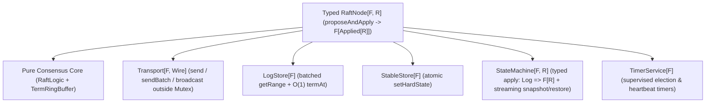
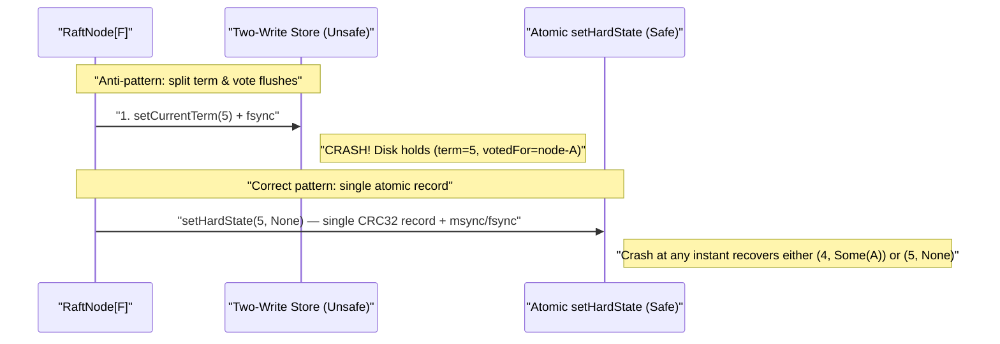

# Chapter 7: The SPI Layer

*The Service Provider Interface (SPI) is the boundary between the pure Raft protocol logic and the messy real world of networks, disks, and clocks. This chapter explains each interface, its contract, the subtle requirements for correctness, and how to implement it. Getting these implementations right is essential — a correct protocol with a buggy transport or a non-durable store is a system waiting to fail.*

---

## What Is an SPI?

The term "Service Provider Interface" comes from the Java ecosystem (dating to the JDK 1.3 era), but the concept is universal: instead of the library depending on specific implementations (e.g., gRPC, RocksDB), it depends on **abstract interfaces** that you implement to match your infrastructure. This inverts the traditional dependency direction:

```
Traditional:   Library ──depends on──→ gRPC, RocksDB, etc.
SPI approach:  Library ──depends on──→ abstract traits ←──implemented by── You
```

There are five SPIs in this library, wired together by typed `RaftNode[F, R]`:



Each SPI is parameterized by `F[_]`, the effect type from Cats Effect (typically `IO`). This means SPI implementations can express asynchronous, concurrent, and potentially failing operations in a type-safe way.

Let's go through each one in detail.

## Transport: Node-to-Node Communication

The transport handles all communication between Raft nodes. It's the most infrastructure-specific SPI — what you implement depends entirely on your deployment model (in-process actors? gRPC over the network? TCP? HTTP/2?).

### The Raw Transport Interface

The base interface is generic over a wire format `Wire` — this could be `Array[Byte]`, a Protobuf message, a JSON string, or anything else:

```scala
trait Transport[F[_], Wire]:
  def send(to: NodeId, msg: Wire): F[Unit]
  def sendBatch(to: NodeId, msgs: Seq[Wire]): F[Unit]
  def broadcast(msg: Wire): F[Unit]
  def receive: Stream[F, (NodeId, Wire)]
  def localAddress: F[String]
  def shutdown: F[Unit]
```

Let's unpack each method:

- **`send(to, msg)`**: deliver a single message to a specific peer. If the peer is unreachable, this should complete without throwing — message loss is expected in distributed systems, and the Raft protocol handles retries internally (through the heartbeat/AppendEntries cycle).

- **`sendBatch(to, msgs)`**: deliver multiple messages to a single peer as a batch. This exists as an optimization — some transports (e.g., TCP with Nagle's algorithm disabled, or gRPC streaming) can send multiple messages more efficiently than individual `send` calls. A simple implementation can just loop over `msgs` and call `send` for each one.

- **`broadcast(msg)`**: deliver a message to **all** peers. Used for election requests and heartbeats. The implementation should send to all known peers; it does **not** need to send to the local node.

- **`receive`**: an FS2 `Stream` that produces incoming messages as `(senderId, wireMessage)` pairs. The runtime consumes this stream in its event loop.

- **`localAddress`**: returns the local node's network address. Used for logging and diagnostics; not required for protocol correctness.

- **`shutdown`**: cleanly close connections and release resources.

### The RaftTransport Interface

For convenience, the library also defines a transport that works directly with `RaftMessage` values instead of raw wire bytes:

```scala
trait RaftTransport[F[_]]:
  def send(to: NodeId, msg: RaftMessage): F[Unit]
  def sendBatch(to: NodeId, msgs: Seq[RaftMessage]): F[Unit]
  def broadcast(msg: RaftMessage): F[Unit]
  def receive: Stream[F, (NodeId, RaftMessage)]
  def localAddress: F[String]
  def shutdown: F[Unit]
```

### Bridging Raw ↔ Raft with Codecs

You can convert a raw `Transport[F, Wire]` into a `RaftTransport[F]` using a codec:

```scala
// If your codec is a pure function (encode/decode don't perform I/O)
val raftTransport = Transport.withCodec(rawTransport, myCodec)

// If your codec needs I/O (e.g., schema lookup, compression)
val raftTransport = Transport.withEffectfulCodec(rawTransport, myEffectfulCodec)
```

The library provides a JSON codec out of the box (`JsonCodec`), which is useful for debugging and testing — you can inspect messages as JSON strings — but you'll likely want a binary codec (Protobuf, MessagePack, etc.) for production throughput.

### Implementation Example: gRPC

Here's a sketch of what a production transport might look like:

```scala
class GrpcTransport[F[_]: Async](
  localId: NodeId,
  peers: Map[NodeId, ManagedChannel]
) extends Transport[F, Array[Byte]]:

  def send(to: NodeId, msg: Array[Byte]): F[Unit] =
    peers.get(to) match
      case Some(channel) => sendViaGrpc(channel, msg)
      case None          => Async[F].unit  // unknown peer, silently drop

  def sendBatch(to: NodeId, msgs: Seq[Array[Byte]]): F[Unit] =
    msgs.traverse_(send(to, _))  // or optimize with streaming RPCs

  def broadcast(msg: Array[Byte]): F[Unit] =
    peers.values.toList.traverse_(ch => sendViaGrpc(ch, msg))

  def receive: Stream[F, (NodeId, Array[Byte])] =
    Stream.fromQueueUnterminated(incomingQueue)

  // ...
```

> **Note — Transport reliability:** The transport does **not** need to guarantee message delivery. Lost messages are fine — Raft is designed to tolerate them (the leader will retry via heartbeats). The transport does not need to guarantee ordering either — Raft messages carry term and index information that allows the receiver to handle reordering. However, the transport should ideally be **best-effort**: try to deliver messages promptly, but don't hang forever if a peer is unreachable.

### For Testing: `InMemTransport`

The library includes a complete in-memory transport that delivers messages instantly between nodes in the same process:

```scala
val cluster: IO[Map[NodeId, InMemTransport[IO]]] =
  InMemTransport.createCluster[IO](List(n1, n2, n3))
```

This is what the test suite uses. Messages are delivered through bounded concurrent queues — no sockets, no serialization. You can also simulate message loss, delays, and partitions by wrapping the in-memory transport.

## LogStore: Persistent Log Storage

The log store provides durable, ordered storage for the replicated log. It's split into separate reader and writer traits for flexibility (some architectures might have multiple concurrent readers but a single writer).

### LogReader

```scala
trait LogReader[F[_]]:
  def get(index: LogIndex): F[Option[Log]]
  def getRange(start: LogIndex, end: LogIndex): F[Vector[Log]]
  def lastIndex: F[LogIndex]
  def termAt(index: LogIndex): F[Option[Term]]
  def isEmpty: F[Boolean]
```

- **`get(index)`**: retrieve a single log entry by index. Returns `None` if the index has been compacted away or is beyond the end of the log.
- **`getRange(start, end)`**: retrieve a contiguous range of entries (inclusive). Returns entries in index order. Used by the leader to build `AppendEntries` requests for lagging followers.
- **`lastIndex`**: return the index of the last entry in the log. If the log is empty, returns 0.
- **`termAt(index)`**: return the term of the entry at the given index. This is used for the `prevLogTerm` field in `AppendEntries` and for the election restriction check.
- **`isEmpty`**: return `true` if the log contains no entries.

### LogWriter

```scala
trait LogWriter[F[_]]:
  def append(entries: Seq[Log]): F[Unit]
  def truncateFrom(index: LogIndex): F[Unit]
  def clear: F[Unit]
  def discardBefore(index: LogIndex): F[Unit]
```

- **`append(entries)`**: add entries to the end of the log. This must be **atomic** (all entries are appended or none) and **durable** (entries survive process restarts).
- **`truncateFrom(index)`**: remove all entries at or after the given index (inclusive). Used during §5.3 log conflict resolution when a follower's log diverges from the leader's.
- **`clear`**: remove all entries. Used when installing a snapshot that replaces the entire log.
- **`discardBefore(index)`**: discard compacted entries strictly before `index` once a durable snapshot covers them.

### LogStore (Combined)

```scala
trait LogStore[F[_]] extends LogReader[F] with LogWriter[F]
```

### The Durability Contract

This is critical: **`append` must durably persist entries before completing**. In practice, this means calling `fsync()` / `msync()` on the underlying WAL. If `append` returns and then the process crashes, the appended entries **must** still be there when the process restarts.

Why? Because the leader might tell a client "your write succeeded" immediately after the entry is replicated to a majority. If any server in that majority subsequently loses the entry due to a non-durable write, a committed entry could be lost — violating Raft's safety guarantees.

> **Note — Group-Commit Batching:** Calling `fsync()` after every single entry limits throughput to disk IOPS. Production implementations amortize sync cost by passing a batch of entries into a single `append(entries)` call (`BatchConfig` / `proposeBatchAndApply`), issuing **one** `MmapSegment.forceRange` / `WriteBatch` sync before acknowledging any entry in the batch. See `raft-storage-mmap` (`MmapWalEngine` + `StorageBackedLogStore`, [Chapter 23](23-host-system-integration.md)) for the library's production off-heap FFM implementation.

### Production Implementation Sketch: RocksDB

```scala
class RocksDBLogStore[F[_]: Sync](db: RocksDB) extends LogStore[F]:
  def append(entries: Seq[Log]): F[Unit] = Sync[F].delay {
    val batch = new WriteBatch()
    entries.foreach { e =>
      batch.put(indexToBytes(e.index), serializeLog(e))
    }
    db.write(new WriteOptions().setSync(true), batch)
    // setSync(true) ensures the write is durable (WAL fsync)
  }

  def get(index: LogIndex): F[Option[Log]] = Sync[F].delay {
    Option(db.get(indexToBytes(index))).map(deserializeLog)
  }

  def truncateFrom(index: LogIndex): F[Unit] = Sync[F].delay {
    val batch = new WriteBatch()
    val iter = db.newIterator()
    iter.seek(indexToBytes(index))
    while (iter.isValid) {
      batch.delete(iter.key())
      iter.next()
    }
    db.write(new WriteOptions().setSync(true), batch)
    iter.close()
  }

  // ...
```

### For Testing: `InMemLogStore`

```scala
val store: IO[InMemLogStore[IO]] = InMemLogStore[IO]()
```

The in-memory implementation stores entries in a `Ref[F, Vector[Log]]`. It doesn't provide durability (obviously), but it's perfect for protocol-level testing where you care about correctness of the algorithm, not persistence.

## StableStore: Hard State Persistence

The stable store persists the **hard state**: the node's current term and who it voted for. These two values are the minimum information a node needs to recover correctly after a crash.

```scala
trait StableStore[F[_]]:
  def currentTerm: F[Term]
  def setCurrentTerm(term: Term): F[Unit]
  def votedFor: F[Option[NodeId]]
  def setVotedFor(nodeId: Option[NodeId]): F[Unit]
  def hardState: F[HardState]
  def setHardState(term: Term, votedFor: Option[NodeId]): F[Unit]
```

### Why Atomic `setHardState(term, votedFor)` Is Critical for Election Safety

Suppose a node in term `4` (having previously voted for `node-A` in term `4`) receives a higher-term `RequestVote` or `AppendEntries` in term `5` and needs to persist `(term = 5, votedFor = None)`. If the runtime persists `setCurrentTerm(5)` and `setVotedFor(None)` as **two separate disk writes** (`fsync` #1 followed by `fsync` #2), an OS crash between the two flushes leaves `(term = 5, votedFor = Some(node-A))` — or conversely, if `votedFor` were written before `term`, `(term = 4, votedFor = Some(node-B))` — corrupting the cross-field invariant between `currentTerm` and `votedFor`:



`RaftNode` always invokes `stableStore.setHardState(term, votedFor)` when executing `Effect.PersistHardState` and `stableStore.hardState` on startup, guaranteeing a single `msync` / `WriteBatch` boundary on `StorageBackedStableStore`.

### Why These Two Values Matter

**Current term**: If a node forgets its current term after a restart, it might accept messages from an old term, potentially re-electing a deposed leader or accepting stale entries.

**Voted for**: If a node forgets who it voted for, it might vote **twice** in the same term — once before the crash, once after restart. This could allow two candidates to each get a majority, violating the one-leader-per-term invariant. This is one of the most commonly misunderstood safety requirements in Raft implementations.

### The Durability Contract

Like `LogStore.append`, **all writes to the stable store must be durable (fsync'd) before the effect completes**. The node must not respond to any RPC until its hard state is safely on disk.

In practice, the hard state is just two values — a `Long` and an `Option[String]`. This makes the store extremely simple: two keys in a key-value store, two entries in a SQLite database, or even two bytes in a file. The important thing is the fsync, not the data structure.

> **Note — Combining LogStore and StableStore:** In a production deployment, you might implement both `LogStore` and `StableStore` on the same underlying storage engine (e.g., RocksDB with two column families, or SQLite with two tables). This allows you to batch the hard state update and log append into a single atomic, durable write — which is both safer and faster.

### For Testing: `InMemStableStore`

```scala
val stable: IO[InMemStableStore[IO]] = InMemStableStore[IO]()
```

## StateMachine: Your Application Logic

The state machine is where Raft meets your domain. Everything up to this point — elections, log replication, commit tracking — exists to ensure that every node applies the **same commands in the same order**. The state machine is *what* gets applied.

```scala
trait StateMachine[F[_], R]:
  def apply(log: Log): F[R]
  def snapshot: F[Stream[F, Byte]]
  def restore(data: Stream[F, Byte]): F[Unit]
```

The type parameter `R` is the **result type** — what the client sees after their command is applied. Notice that `snapshot` and `restore` stream `fs2.Stream[F, Byte]` chunks rather than materializing a monolithic `Array[Byte]` in heap memory, allowing multi-gigabyte snapshots to stream directly between disk and network with constant memory overhead.

### The Determinism Contract

This is the most important contract in the entire SPI layer:

**`apply(log)` must be a deterministic function.** Given the same log entry, it must produce the same result and the same state machine mutation on every node, every time.

This means:
- **No randomness**: don't use `Random`
- **No system clock**: don't use `System.currentTimeMillis()` or `Clock.realTime`
- **No external I/O**: don't call other services, databases, or APIs
- **No floating-point non-determinism**: be careful with `Double` operations that might differ across architectures (this is rare in practice, but worth noting)

Why does this matter? Because if two nodes apply the same entry and get different results, the replicated state machines diverge — silently and permanently. The whole point of consensus is lost.

> **Note — Non-deterministic requirements:** If your application needs time or randomness, the standard approach is to include those values in the **log entry data**. For example, instead of calling `System.currentTimeMillis()` inside `apply`, the client includes the timestamp when it creates the command: `SET x=1 AT 1706900000`. This way, every node uses the same timestamp.

### Implementation Contract

- **`apply(log)`** is called exactly once per committed entry, in log index order. Its return value `R` flows straight out of `RaftNode[F, R].proposeAndApply(payload: Bytes): F[Applied[R]]`, eliminating mutable side-channel response maps. Prefer `log.payload.utf8String` or `log.payload.asReadOnlyByteBuffer` to avoid defensive array copies.
- **`snapshot`** captures a point-in-time stream (`F[Stream[F, Byte]]`) of the complete state machine state for log compaction ([Chapter 3](03-raft-advanced-theory.md)).
- **`restore(data)`** consumes the snapshot byte stream to replace the current state machine state atomically. After `restore`, subsequent `apply` calls continue from `snapshot.lastIncludedIndex + 1`.

### Example: A Key-Value Store FSM

```scala
class KvStoreFSM[F[_]: Sync](
  ref: Ref[F, Map[String, String]]
) extends StateMachine[F, Option[String]]:

  def apply(log: Log): F[Option[String]] =
    val command = parseCommand(new String(log.data))
    command match
      case Get(key) =>
        ref.get.map(_.get(key))
      case Set(key, value) =>
        ref.update(_ + (key -> value)).as(Some(value))
      case Delete(key) =>
        ref.update(_ - key).as(None)

  def snapshot: F[Stream[F, Byte]] =
    ref.get.map(state => Stream.emits(serialize(state)).covary[F])

  def restore(data: Stream[F, Byte]): F[Unit] =
    data.compile.to(Array).flatMap(bytes => ref.set(deserialize(bytes)))
```

### Example: A Counter FSM

```scala
class CounterFSM[F[_]: Sync](ref: Ref[F, Long]) extends StateMachine[F, Long]:
  def apply(log: Log): F[Long] =
    val delta = new String(log.data).toLong
    ref.updateAndGet(_ + delta)

  def snapshot: F[Stream[F, Byte]] =
    ref.get.map(v => Stream.emits(v.toString.getBytes).covary[F])

  def restore(data: Stream[F, Byte]): F[Unit] =
    data.compile.to(Array).flatMap(bytes => ref.set(new String(bytes).toLong))
```

## TimerService: Election and Heartbeat Scheduling

The timer service manages the randomized election timeouts and periodic leader heartbeats that drive Raft's liveness via cancellable Cats Effect `Fiber`s:

```scala
trait TimerService[F[_]]:
  def scheduleElection(delay: FiniteDuration, onTimeout: F[Unit]): F[Fiber[F, Throwable, Unit]]
  def scheduleHeartbeat(delay: FiniteDuration, onTimeout: F[Unit]): F[Fiber[F, Throwable, Unit]]
  def randomElectionTimeout(base: FiniteDuration): F[FiniteDuration]
```

- **`scheduleElection(delay, onTimeout)`**: schedules a one-shot election timeout firing `onTimeout` after `delay`. Returning a `Fiber[F, Throwable, Unit]` makes timer resets clean and race-free: when a valid leader heartbeat arrives, `RaftNode` simply cancels the previous election fiber and schedules a fresh one.
- **`scheduleHeartbeat(delay, onTimeout)`**: schedules a leader heartbeat firing after `delay`.
- **`randomElectionTimeout(base)`**: produces a jittered election timeout (`>= base`, typically 0–50% random jitter) to break split-vote symmetry (Raft §9.3).

The built-in `DefaultTimerService[F]` schedules via `Async[F].sleep` and accepts a seeded `cats.effect.std.Random[F]` — which means entire `RaftNode[IO, R]` clusters run deterministically under Cats Effect's `TestControl` virtual clock with zero real sleeps! Run the standalone timer walkthrough:

```bash
sbt "examples/runMain examples.protocol.TimerServiceExample"
```

## SnapshotStore, CompactionPolicy & Custom MessageCodecs

Three additional SPIs complete the production extension surface:

1. **`SnapshotStore[F]`** (`save(snapshot: Snapshot[F])`, `loadLatest`, `list`, `delete(index)`): decouples atomic snapshot persistence from the WAL so snapshots can target local disk (`StorageBackedSnapshotStore` with `"RSNP"` v2 CRC32 + directory `fsync`), NFS, or object storage.
2. **`CompactionPolicy[F]`**: pluggable policy evaluated by `CompactionManager` (e.g., `CompactionPolicy.threshold[F](5_000L)`) to trigger snapshot creation and `LogStore.discardBefore`.
3. **`SimpleMessageCodec[Wire]` / `MessageCodec[F, Wire]`**: decouples protocol messages from wire serialization. `raft-core` includes zero-dependency `JsonCodec`, `raft-transport-grpc` provides binary `ProtobufMessageCodec` and `ProtobufMultiGroupCodec`, and `examples.counter.CounterWithCodecExample` demonstrates building a custom pipe-delimited `SimpleMessageCodec[TextWireMessage]`:
   ```bash
   sbt "examples/runMain examples.counter.CounterWithCodecExample"
   ```

## Factory Pattern: Resource-Safe Creation

Each SPI has an optional factory trait for resource-managed creation using Cats Effect's `Resource`:

```scala
trait LogStoreFactory[F[_]]:
  def create(path: String): Resource[F, LogStore[F]]

trait TransportFactory[F[_], Wire]:
  def create(config: TransportConfig): Resource[F, Transport[F, Wire]]
```

`Resource` ensures that when a node shuts down, all SPIs release in strict LIFO order — background fibers cancel before `GrpcTransport` closes HTTP/2 channels and before `MmapWalEngine` retires `SegmentLease`s and closes FFM `Arena`s.

## Summary

| SPI | Purpose | Contract | Built-In Implementations |
|-----|---------|----------|-------------------------|
| **Transport** | Node-to-node messaging | Best-effort delivery; `sendBatch` for pipelined bursts | `InMemTransport`, `GrpcTransport` (`raft-transport-grpc`), `MultiGroupTransport` |
| **LogStore** | Replicated log persistence | Atomic & durable `append`, `getRange`, `truncateFrom`, `discardBefore` | `InMemLogStore`, `StorageBackedLogStore` (`MmapWalEngine`) |
| **StableStore** | Hard-state persistence | Single-flush atomic `setHardState(term, votedFor)` + `hardState` | `InMemStableStore`, `StorageBackedStableStore` (`MmapHardState`) |
| **SnapshotStore** | Atomic snapshot storage | Streaming `save`/`loadLatest` (`RSNP` v2 CRC32 + dir `fsync`) | `InMemSnapshotStore`, `StorageBackedSnapshotStore` |
| **StateMachine** | Deterministic domain FSM | Deterministic `apply: Log => F[R]`, streaming `snapshot`/`restore` | Application-defined |
| **TimerService** | Liveness scheduling | Cancellable `Fiber` timeouts + jittered `randomElectionTimeout` | `DefaultTimerService` (compatible with `TestControl`) |
| **MessageCodec** | Wire encoding | Total round-trip isomorphism `decode(encode(m)) == Right(m)` | `JsonCodec`, `ProtobufMessageCodec`, `ProtobufMultiGroupCodec` |

---

*Next: [Chapter 8 — Getting Started](08-getting-started.md) walks through building your first application with the library — from project setup and your first election to running all 18 included examples.*
