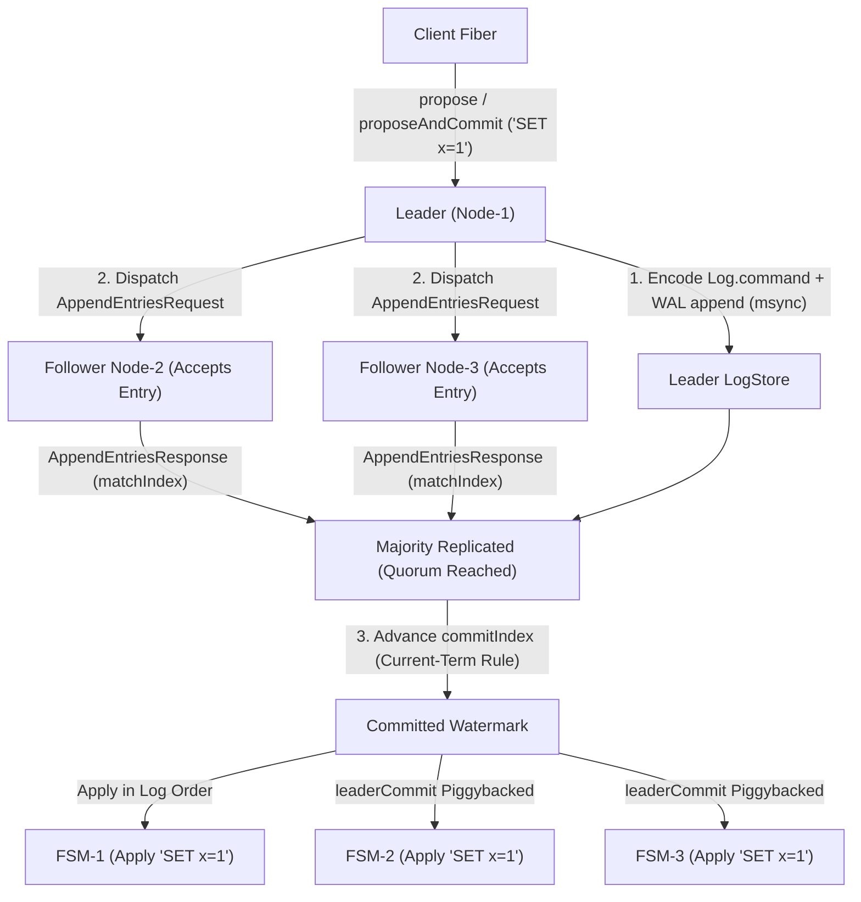
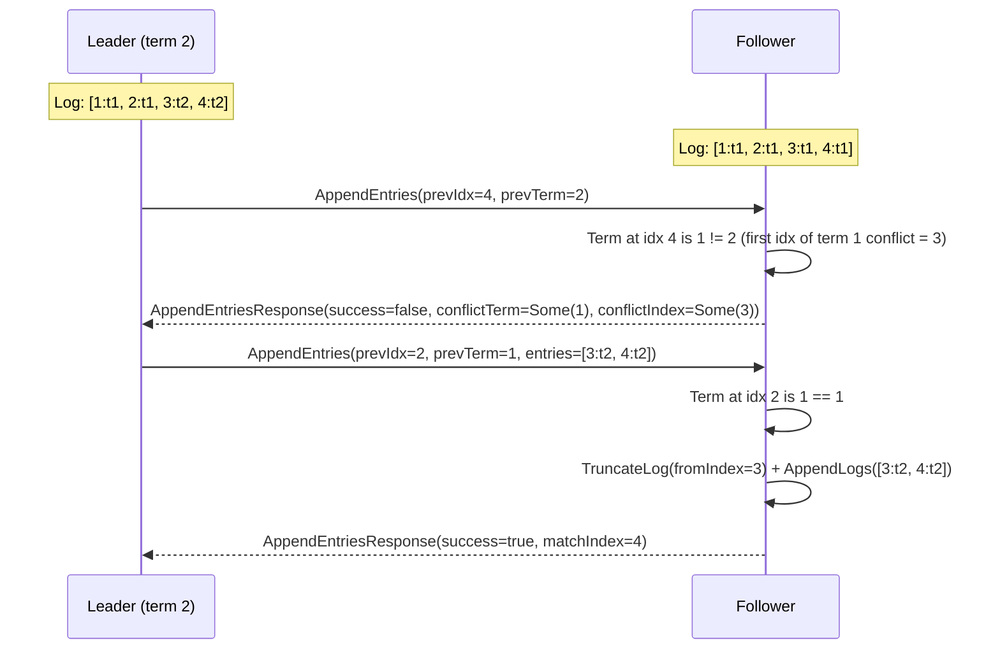
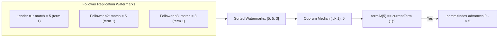
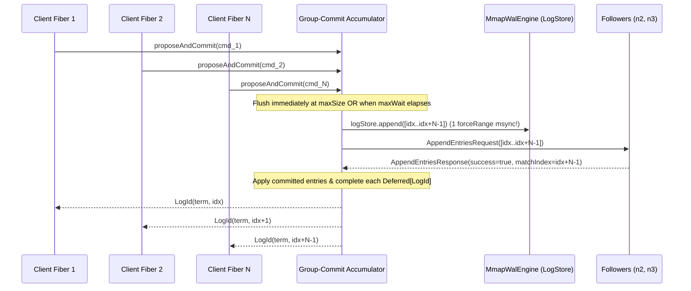
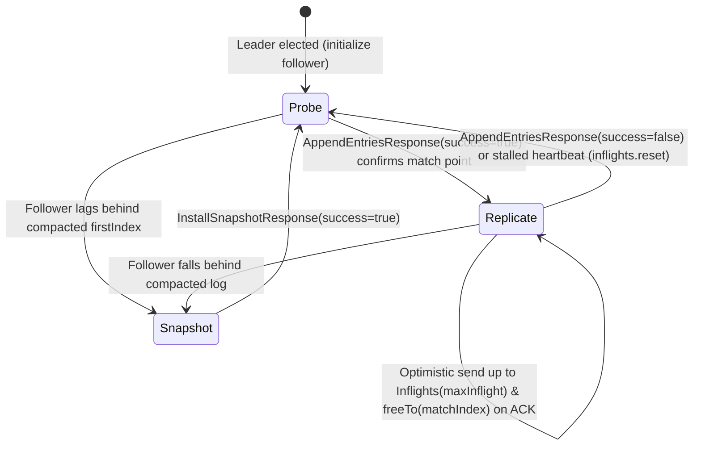
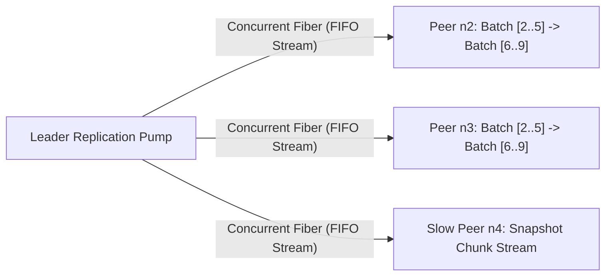

# Chapter 9: Log Replication in Practice

*Elections choose a leader; log replication is what the leader does. This chapter shows how data actually flows through the cluster — from client command to committed entry — and how to use group-commit batching, `Inflights`-bounded pipelining, and parallel replication to achieve high throughput. Every concept maps directly to library APIs you can call.*

---

## The Replication Flow: From Client to Commit

Before diving into code, let's trace the complete lifecycle of a client write through the cluster. Understanding this flow is essential for designing applications on top of Raft.



The key insight: **replication and commitment are not the same thing.** An entry is replicated when it exists in a follower's log. An entry is committed when a voting quorum has durably replicated it. Only committed entries are applied to the state machine and reported to clients. This distinction is what makes Raft safe — even if a minority of followers are slow or partitioned, the client sees success as soon as a majority persists the entry.

## Creating Log Entries

Log entries wrap your application data in Raft metadata (index, term, entry type):

```scala
import raft.state.Log

// Client commands — your application data as raw bytes
val entry1 = Log.command(index = 1, term = 1, data = "SET x=1".getBytes)
val entry2 = Log.command(index = 2, term = 1, data = "SET y=2".getBytes)

// No-op — leaders append one immediately after election (§5.4.2 / §8)
val noop = Log.noOp(index = 1, term = 1)
```

The **no-op entry** deserves explanation. When a new leader takes office, it cannot immediately mark unacknowledged entries from earlier terms as committed, even if they sit on a majority of servers (Figure 8 of Ongaro & Ousterhout). The Raft solution: the new leader appends a `NoOp` entry in its **own** term and replicates it. Once that `NoOp` is committed, Log Matching guarantees that **all preceding entries are indirectly committed** as well.

> [!NOTE]
> **Entry types matter.** The library distinguishes between `Command`, `NoOp`, and `Configuration` entry types (`LogType`). Configuration entries trigger `ClusterConfig` Joint Consensus transitions, and `NoOp` entries establish the leader's current-term commit barrier without mutating user state. Application code only submits `Command` payloads; `RaftNode` and `RawNode` generate `NoOp` and `Configuration` entries internally.

## Sending AppendEntries

The leader constructs an `AppendEntriesRequest` for each follower containing:

1. The leader's current `term` (for term fencing)
2. `prevLogIndex` and `prevLogTerm` (for the §5.3 inductive Log Matching check)
3. The slice of `entries` to append (capped by `config.maxEntriesPerRequest`)
4. `leaderCommit` (so followers advance their local `commitIndex`)

```scala
val appendReq = AppendEntriesRequest(
  term         = 1L,      // current leader term
  leaderId     = n1,      // so followers know who the leader is
  prevLogIndex = 0L,      // index immediately preceding these new entries
  prevLogTerm  = 0L,      // term of the entry at prevLogIndex
  entries      = Seq(entry1, entry2),
  leaderCommit = 0L       // leader hasn't committed anything yet
)
```

The follower processes it through `RaftLogic.onMessage` — the same pure transition function used across the protocol:

```scala
val followerTrans = RaftLogic.onMessage(
  followerState, appendReq, followerConfig,
  lastLogIndex = 0L, lastLogTerm = 0L, clusterSize = 3
)

val response = followerTrans.effects.collectFirst {
  case SendMessage(_, r: AppendEntriesResponse) => r
}.get

response.success    // true — entries accepted
response.matchIndex // 2L  — highest replicated index on this follower
```

When the follower accepts entries, the emitted effects include:
- `AppendLogs(entries)` — persist the new suffix to `LogStore`
- `ResetElectionTimer` — the leader is alive; reset the election timeout
- `SendMessage(leaderId, AppendEntriesResponse(...))` — acknowledge `matchIndex`

## Handling Log Conflicts: Fast Term-Skip Backtracking (§5.3)

Log conflicts happen when a follower holds uncommitted entries from a deposed leader that diverge from the current leader's log. Raft's inductive consistency check detects the mismatch and repairs it:



In code:

```scala
val conflictTrans = RaftLogic.onMessage(
  followerState, conflictReq, config,
  lastLogIndex = 4L, lastLogTerm = 1L, clusterSize = 3,
  getTermAt = {
    case 4L => Some(1L) // follower has term 1 at index 4 (!= leader's term 2)
    case 3L => Some(1L)
    case 2L => Some(1L) // common prefix boundary
    case 1L => Some(1L)
    case _  => None
  }
)

conflictTrans.effects.collect {
  case TruncateLog(fromIndex) => s"Truncate from index $fromIndex"
  case AppendLogs(entries)    => s"Append ${entries.size} new entries"
}
```

> [!TIP]
> **Fast conflict backtracking by term.** Instead of stepping back one index per round-trip, followers include `conflictTerm` and `conflictIndex` (the first index of that conflicting term) in `AppendEntriesResponse`. Both `RaftLogic` and `ProgressTracker.maybeDecrTo` jump across an entire conflicting term in a single RTT.

## Commit Index Advancement

The leader tracks each follower's highest replicated index (`matchIndex`). An entry is eligible for commitment once replicated on a voting quorum (including the leader itself), provided the entry belongs to the **leader's current term** (§5.4.2):



```scala
val leader = Leader(
  term = 1L,
  matchIndex = Map(
    n2 -> 5L, // follower n2 has replicated through index 5
    n3 -> 3L  // follower n3 has replicated through index 3
  ),
  commitIndex = 0L
)

val newCommit = leader.calculateCommitIndex(clusterSize = 3, getTermAt = {
  case 5L => Some(1L) // entry at index 5 is from the leader's current term
  case 3L => Some(1L)
  case _  => None
})
// newCommit == 5L
```

When `commitIndex` advances, `RaftNode` applies newly committed `Command` entries sequentially to `StateMachine.apply`, updates `lastApplied`, resolves any awaiting `proposeAndCommit` / `proposeBatchAndCommit` fibers, and wakes any `readIndex` / `leaseRead` waiters whose `readIndex <= lastApplied`.

---

## Throughput Optimizations: Group Commit, Pipelining & Parallel Dispatch

Baseline stop-and-wait replication (1 `LogStore.append` + 1 `msync` + 1 `AppendEntries` RTT per command) caps throughput at disk sync and network round-trip latency. The library implements three orthogonal optimizations modeled after `tikv/raft-rs`:

1. **Group-Commit Proposal Batching (`BatchConfig` & `proposeBatch`)** — coalesces concurrent client writes into **1 WAL `msync` + 1 batched replication pass**.
2. **Sliding-Window Pipelining (`PipelineConfig` & `Progress` / `Inflights`)** — streams up to `maxInflight` `AppendEntriesRequest` batches per follower without waiting for intermediate RTTs.
3. **Parallel Peer Dispatch (`parallelReplicationEnabled`)** — dispatches per-peer message streams concurrently across followers while strictly preserving per-peer FIFO order.

### 1. Group-Commit Batching: Amortizing WAL `msync` and RPC Framing

Without batching, 50 concurrent fibers calling `proposeAndCommit` acquire the node lock one by one, executing 50 separate `LogStore.append` calls (`50` `MmapSegment.force()` `msync` syscalls in `MmapWalEngine`!) and 50 separate `AppendEntriesRequest` broadcasts.

When `BatchConfig(enabled = true, maxSize, maxWait)` is enabled on `RaftConfig`, `RaftNode[F]` runs an asynchronous **group-commit accumulator**:



- **Smart Flush Triggers**:
  - **Idle / Burst Drain**: As soon as the first proposal wakes the accumulator, it non-blockingly drains up to `maxSize - 1` additional proposals already queued.
  - **Size Trigger (`maxSize`)**: If `accumulated.size == maxSize`, the batch flushes **immediately** with zero timer wait.
  - **Latency Bound (`maxWait`)**: Partial batches wait at most `maxWait` for stragglers before flushing (`maxWait = Duration.Zero` performs opportunistic zero-delay draining of concurrently ready items).
  - **Fast-Fail Non-Leader Check**: Calls on a `Follower` or `Candidate` fail immediately (`O(1)` lock-free state check) without entering the batch queue, and leader step-down immediately fails any queued waiters with `RaftError.NotLeader`.

You can configure transparent batching for all `propose` / `proposeAndCommit` / `submit` callers, or submit explicit batches directly via `proposeBatch` / `proposeBatchAndCommit` (and `RawNode.proposeBatch` in Sans-I/O hosts):

```scala
import scala.concurrent.duration.*
import raft.state.{BatchConfig, PipelineConfig, RaftConfig}

val config = RaftConfig(
  localId = n1,
  batching = BatchConfig(
    enabled = true,
    maxSize = 64,       // flush immediately once 64 commands accumulate
    maxWait = 5.millis  // or after 5ms for partial batches
  )
)

// Explicit batch submission on RaftNode[IO] (executes 1 LogStore.append even if BatchConfig.enabled = false):
val committedIds: IO[Vector[LogId]] =
  raftNode.proposeBatchAndCommit(Seq("SET a=1".getBytes, "SET b=2".getBytes, "SET c=3".getBytes))

// Sans-I/O batch submission on RawNode (emits 1 contiguous Ready.entries slice):
val rawIndices: Either[RaftError, Vector[Long]] =
  rawNode.proposeBatch(Seq("SET a=1".getBytes, "SET b=2".getBytes))
```

### 2. Pipelining & `ProgressTracker` (`Probe` / `Replicate` / `Snapshot` + `Inflights`)

Even with batching, large write bursts split across `maxEntriesPerRequest` chunks (or consecutive batches arriving faster than 1 network RTT) stall on WAN links if the leader waits for each `AppendEntriesResponse` before sending the next chunk.

Both `RawNode` and `RaftNode[F]` drive per-follower replication through the three-state `ProgressState` flow-control machine (`raft.logic.Progress` & `Inflights`):



- **`Probe` (Conservative Discovery)**: Used immediately after leader election or after a conflict rejection. At most **1 probe RPC** (`probeSent = true`) is in flight so the leader discovers the follower's exact match index (using §5.3 fast conflict hints) without flooding a lagging or offline node.
- **`Replicate` (`Inflights` Sliding Window)**: Once the follower confirms its match index, it enters `Replicate`:
  - When `PipelineConfig(enabled = false)` (default), `Inflights` capacity is capped at `1` (stop-and-wait: at most 1 unacknowledged `AppendEntriesRequest` batch per follower).
  - When `PipelineConfig(enabled = true, maxInflight = K)`, the leader optimistically advances the follower's pipeline send cursor across up to **`K` unacknowledged batches** via `RaftTransport.sendBatch`, recording each batch's last index in `Inflights`.
  - As ACKs arrive (`AppendEntriesResponse(success = true, matchIndex)`), `inflights.freeTo(matchIndex)` releases all acknowledged slots and immediately pumps waiting entries into the freed window.
  - Stale out-of-order ACKs (`matchIndex < matched`) are safely ignored without disturbing in-flight batches, whereas a rejection (`success = false`) immediately resets `Inflights` and transitions back to `Probe` at `matched + 1`.
- **`Snapshot` (Compacted Catch-Up)**: Pauses log replication while `SnapshotTransfer` streams chunked `InstallSnapshotRequest` frames, resuming in `Probe` once installed.

```scala
val wanConfig = RaftConfig(
  localId = n1,
  maxEntriesPerRequest = 128,
  batching = BatchConfig(enabled = true, maxSize = 256, maxWait = 5.millis),
  pipelining = PipelineConfig(
    enabled = true,
    maxInflight = 8 // up to 8 * 128 = 1,024 entries in flight per follower per RTT
  )
)
```

### 3. Parallel Replication: Concurrent Per-Peer Dispatch with Strict Per-Peer FIFO

With `parallelReplicationEnabled = true` (enabled by default), `RaftNode[F]` dispatches outbound replication and protocol sends across **distinct peers concurrently** (`parTraverse_`), while strictly preserving **sequential FIFO order for each individual peer** (`traverse_` / `sendBatch`):



A slow TCP socket or lagging follower (`n4`) never delays quorum replication between the leader and healthy followers (`n2`, `n3`), while per-peer FIFO ordering prevents self-inflicted `prevLogIndex` reordering rejections.

### Combining the Three Optimizations

| Optimization | Bottleneck Eliminated | Primary Mechanism |
| :--- | :--- | :--- |
| **Group-Commit Batching** | Per-proposal WAL `msync` + RPC framing | `BatchConfig(enabled, maxSize, maxWait)` + `proposeBatch` / `proposeBatchAndCommit` |
| **Pipelined Replication** | Sequential 1-RTT stop-and-wait stalls | `PipelineConfig(enabled, maxInflight)` + `ProgressState.Replicate` (`Inflights`) |
| **Parallel Peer Dispatch** | Head-of-line blocking across followers | `parallelReplicationEnabled = true` (concurrent across peers, FIFO per peer) |

## Summary

| Concept | API | What It Does |
| :--- | :--- | :--- |
| **Create entries** | `Log.command(index, term, data)` | Wrap application payload in Raft `(index, term)` metadata |
| **Batch propose (Runtime)** | `RaftNode.proposeBatch` / `proposeBatchAndCommit` | Coalesce multiple commands into 1 `LogStore.append` (`msync`) |
| **Batch propose (Sans-I/O)** | `RawNode.proposeBatch(commands)` | Emit contiguous commands in 1 `Ready.entries` persistence slice |
| **Group-commit config** | `BatchConfig(enabled, maxSize, maxWait)` | Transparently coalesce concurrent `propose` / `proposeAndCommit` fibers |
| **Pipelined replication** | `PipelineConfig(enabled, maxInflight)` | Stream up to `maxInflight` batches per follower via `Inflights` window |
| **Flow-control tracker** | `ProgressTracker` / `Progress` / `Inflights` | Manage `Probe`, `Replicate`, and `Snapshot` transitions per peer |
| **Parallel dispatch** | `parallelReplicationEnabled = true` | Replicate to distinct followers concurrently while keeping per-peer FIFO |

---

*Next: [Chapter 10 — Performance vs. Safety](10-performance-vs-safety.md) analyzes the exact consensus invariants preserved or relaxed by every throughput and read optimization.*
