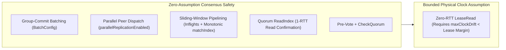
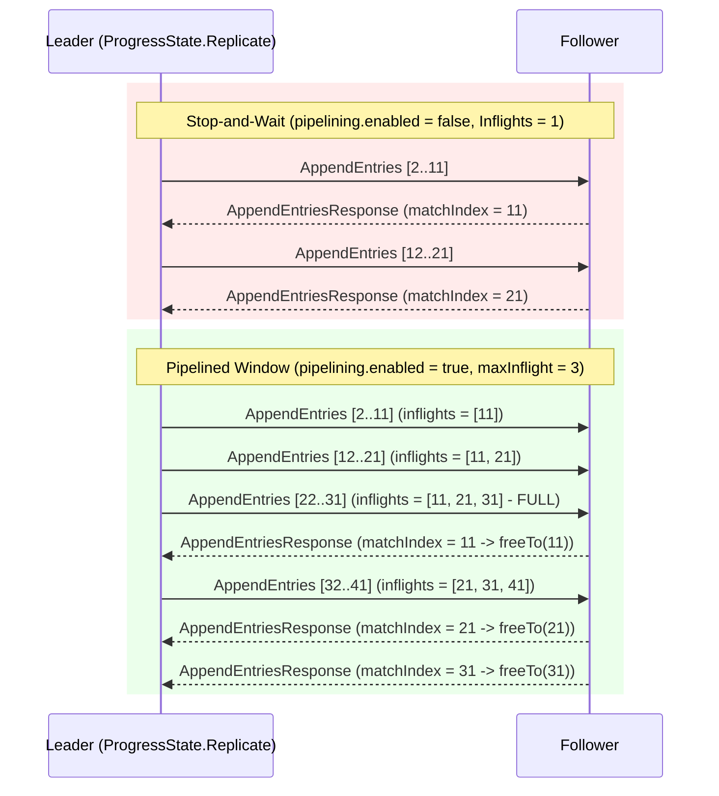
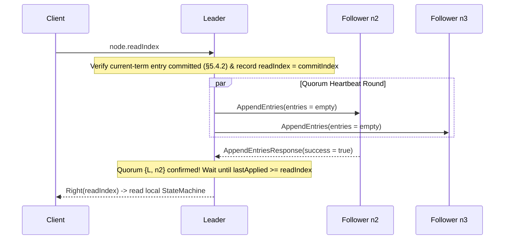

# Chapter 10: Performance vs. Safety — The Optimization Tradeoffs

*The Raft paper was designed for clarity and correctness first, throughput second. Every production Raft deployment layers systems optimizations on top of the baseline algorithm — and every optimization requires a clear accounting of which invariants hold unconditionally and which depend on protocol state or physical clock bounds. This chapter maps every optimization in the library to its exact safety proof and configuration API.*

---

## The Fundamental Tension

Raft's baseline textbook protocol makes conservative choices at every step:

- **Per-entry `fsync` / `msync`**: every client proposal flushes its own WAL write before replication.
- **Stop-and-wait replication**: the leader sends 1 `AppendEntriesRequest` per follower and waits a full network RTT before sending the next chunk.
- **Sequential peer iteration**: replication iterates through followers one by one.
- **Log-committed reads**: reads go through the Raft log as full quorum writes.

Production engines (`etcd`, TiKV's `raft-rs`, CockroachDB) achieve orders-of-magnitude higher throughput by eliminating redundant disk syncs and network round-trips while keeping Raft's five core safety properties intact:



---

## Optimization 1: Group-Commit Batching — Amortizing WAL `msync`

### The Problem

A durable `msync` / `fsync` on NVMe or cloud block storage costs `0.2ms`–`5ms`. If every concurrent `proposeAndCommit` fiber acquires the consensus lock and calls `LogStore.append(Seq(entry))` individually, write throughput hits a hard ceiling of `1 / msync_latency` (`200`–`5,000` ops/sec) regardless of CPU cores or network bandwidth.

### The Optimization

Enabling `BatchConfig` activates the group-commit accumulator inside `RaftNode[F]` (and `RawNode.proposeBatch` in Sans-I/O mode), coalescing concurrent proposals into a single contiguous `LogStore.append(entries)` slice (`1` `MmapSegment.forceRange` `msync` in `MmapWalEngine`) and a single replication broadcast:

```scala
val config = RaftConfig(
  localId = nodeId,
  batching = BatchConfig(
    enabled = true,
    maxSize = 100,      // flush immediately once 100 proposals accumulate
    maxWait = 5.millis  // or flush partial batches after at most 5ms
  )
)
```

Callers can also submit explicit batches directly via `raftNode.proposeBatch(cmds)` / `raftNode.proposeBatchAndCommit(cmds)` or `rawNode.proposeBatch(cmds)`.

### Safety Analysis

| Property | Preserved? | Why |
| :--- | :--- | :--- |
| Election Safety | ✅ Yes | Batching does not alter term or vote rules |
| Leader Append-Only | ✅ Yes | Entries are appended contiguously (`baseIdx + 1 .. baseIdx + K`) |
| Log Matching | ✅ Yes | Contiguous `(index, term)` pairs preserve inductive prefix matching |
| Leader Completeness | ✅ Yes | Entire batch is persisted before commit advancement |
| State Machine Safety | ✅ Yes | Each entry commits and applies in strict log index order |

**Group-commit batching is unconditionally safe.** Every entry in the batch is durably flushed to disk before acknowledgment; only the *amortization factor* per `msync` changes.

> [!TIP]
> **Tuning `maxWait` and `maxSize`**: Set `maxWait = 0.millis` (`Duration.Zero`) if you want **zero artificial latency** while still automatically coalescing concurrent fibers that arrive while an earlier batch is flushing to disk. Set `maxWait = 2.millis`–`10.millis` when client arrivals are bursty and maximizing IOPS efficiency is paramount.

---

## Optimization 2: Sliding-Window Pipelining (`PipelineConfig` & `Inflights`)

### The Problem

Under stop-and-wait replication (`PipelineConfig(enabled = false)`), at most 1 `AppendEntriesRequest` chunk is in flight per follower at a time. Over a `10ms` cross-AZ or `50ms` cross-region link, each follower completes at most `20`–`100` batches per second even when the network pipe is nearly idle.

### The Optimization

Enabling `PipelineConfig` configures per-follower `Inflights(maxInflight)` sliding windows in `RawNode` and `RaftNode[F]`:

```scala
val config = RaftConfig(
  localId = nodeId,
  maxEntriesPerRequest = 100,
  pipelining = PipelineConfig(
    enabled = true,
    maxInflight = 10 // up to 10 unacknowledged AppendEntries chunks per follower
  )
)
```

Once a follower transitions from `ProgressState.Probe` to `ProgressState.Replicate`, the leader dispatches up to `maxInflight` consecutive `AppendEntriesRequest` slices back-to-back via `RaftTransport.sendBatch`, optimistically advancing the follower's pipeline cursor (`Progress.optimisticUpdate`) and freeing slots via `inflights.freeTo(matchIndex)` as ACKs return:



### Safety Analysis

| Property | Preserved? | Why |
| :--- | :--- | :--- |
| Election Safety | ✅ Yes | Unaffected by replication windowing |
| Leader Append-Only | ✅ Yes | Leader log remains strictly append-only |
| Log Matching | ✅ Yes | Every pipelined chunk carries its exact `(prevLogIndex, prevLogTerm)` |
| Out-of-Order / Dropped Packets | ✅ Handled | Monotonic `maybeUpdate` ignores stale ACKs (`< matched`); rejections & stalled heartbeats reset `Inflights` -> `Probe` |
| ReadIndex Isolation | ✅ Preserved | `RaftNode` keeps conservative `Leader.nextIndex` (`matched + 1`) separate from optimistic pipeline cursors so `ReadIndex` heartbeats never reference unacknowledged optimistic indices |

---

## Optimization 3: Parallel Peer Dispatch (`parallelReplicationEnabled`)

### The Problem

Dispatching `AppendEntriesRequest` sequentially to followers means a slow or congested TCP channel to one follower delays packet transmission to healthy followers.

### The Optimization

With `parallelReplicationEnabled = true` (the default), `RaftNode[F]` groups outbound sends by target `NodeId` and dispatches **across distinct peers in parallel** (`parTraverse_`) while keeping **sends to each individual peer strictly sequential** (`traverse_` / `sendBatch`):

```scala
val config = RaftConfig(
  localId = nodeId,
  parallelReplicationEnabled = true // default
)
```

### Safety Analysis

| Property | Preserved? | Why |
| :--- | :--- | :--- |
| All 5 Raft Safety Properties | ✅ Yes | Consensus depends on per-peer log prefixes and quorum intersections, never on cross-peer arrival order; strict per-peer FIFO prevents artificial `prevLogIndex` inversions |

---

## Optimization 4: `ReadIndex` — Linearizable Reads Without Log Writes (§6.4)

### The Problem

Routing every read through `proposeAndCommit` incurs WAL `msync` and log growth for read-only queries.

### The Optimization

`RaftNode.readIndex` (and `RawNode.readIndex`) implements Ongaro §6.4:



```scala
for
  idx   <- leaderNode.readIndex
  value <- kvStateMachine.get("account:42")
yield (idx, value)
```

### Safety Analysis

| Property | Impact |
| :--- | :--- |
| Linearizability | ✅ **Strictly preserved** — heartbeat quorum proves no higher-term leader committed newer writes before `readIndex`, and Ongaro §5.4.2 check prevents stale reads right after election |
| Cost | 1 network RTT (zero disk `msync`, zero log growth) |

---

## Optimization 5: Lease-Based Reads (`leaseRead`) — Trading Clock Drift Bounds for Zero-RTT Reads

### The Problem

Even 1 network RTT per read can bottleneck geo-distributed or read-heavy workloads.

### The Optimization

When `leaseReadEnabled = true` and `checkQuorumEnabled = true`, the leader extends a monotonic lease (`Clock[F].monotonic + leaderLeaseDuration`, or logical ticks in `RawNode`) whenever a voting quorum acknowledges `AppendEntriesResponse`:

```scala
val config = RaftConfig(
  localId = nodeId,
  checkQuorumEnabled = true,
  leaseReadEnabled = true,
  leaderLeaseDuration = 100.millis // must stay strictly below electionTimeoutMin - maxClockDrift
)

// Serve in 0 RTTs when lease is valid; gracefully fall back to 1-RTT readIndex on None!
val linearizableRead: IO[Option[String]] =
  leaderNode.leaseRead.flatMap {
    case Some(_) => kvStateMachine.get("account:42")
    case None    => leaderNode.readIndex *> kvStateMachine.get("account:42")
  }
```

### Safety Analysis

> [!WARNING]
> **Lease-based reads are the ONLY optimization in this chapter that depends on bounded physical clock drift.** If the old leader's monotonic clock runs slower than followers' monotonic clocks by more than `electionTimeoutMin - leaderLeaseDuration`, a partitioned old leader could believe its lease is still active briefly after followers elect a new leader.

Keep `leaderLeaseDuration` well below `electionTimeoutMin` (e.g., `100ms` lease with `300ms` `electionTimeoutMin`) and use `readIndex` whenever strict clock-free linearizability is required.

---

## Optimization 6: Pre-Vote & CheckQuorum — Preventing Partition Disruption (§9.6 & §6.2)

```scala
val config = RaftConfig(
  localId = nodeId,
  preVoteEnabled = true,     // enabled by default (§9.6)
  checkQuorumEnabled = true  // enabled by default (§6.2)
)
```

- **Pre-Vote (`preVoteEnabled`)**: Partitioned followers ask voters `"Would you vote for me in term T+1?"` (`isPreVote = true`) *before* incrementing `currentTerm` or persisting `HardState`. Rejoining nodes never disrupt a healthy leader with inflated terms.
- **CheckQuorum (`checkQuorumEnabled`)**: Every `electionTimeoutMax` window, a leader verifies a voting quorum responded recently (`quorumRecentlyActive`); if isolated in a minority partition, it steps down to `Follower` automatically and fails pending leader waiters with `RaftError.NotLeader`.

---

## Optimization 7: Binary Protobuf Wire Framing, Single-RPC Batching & Bounded Backpressure

`raft-transport-grpc` pairs `WireEnvelope` over Netty HTTP/2 with `ProtobufMessageCodec` (`RaftWirePayload` `oneof` covering all 17 `RaftMessage` cases, including §5.3 `conflict_index` / `conflict_term` hints and §3.10 `is_transfer` flags):

```mermaid
flowchart LR
    subgraph Sender["Leader / Sender Node"]
        RM["RaftMessage / sendBatch"]
        PBC["ProtobufMessageCodec (Zero Base64)"]
        RETRY["Bounded Backoff (UNAVAILABLE / RESOURCE_EXHAUSTED)"]
        CH["AtomicCell ManagedChannel Pool (Evicts Removed Peers)"]
    end

    subgraph Receiver["Follower / Receiver Node"]
        SRV["Netty HTTP/2 + Optional mTLS Identity Interceptor"]
        BQ["Bounded Queue (GrpcConfig: 4096 / RaftConfig: 8192)"]
        DEC["ProtobufMessageCodec.decode"]
        LOOP["RaftNode[F, R] Consensus Loop"]
    end

    RM --> PBC --> RETRY --> CH
    CH -->|"1 WireEnvelope(payloads=[1..K])"| SRV
    SRV -->|"Accepted -> WireAck(true) / Full -> WireAck(false)"| BQ --> DEC --> LOOP
```



Three wire-level strengths protect throughput under burst load:
1. **Single-RPC Batch Framing (`WireEnvelope.payloads`)**: `sendBatch` packs pipelined `AppendEntries` bursts into **one** HTTP/2 `WireEnvelope` RPC rather than `N` sequential unary calls.
2. **Explicit Receiver Backpressure (`WireAck(accepted = false)`)**: When a follower's bounded `incomingQueue` saturates, the server responds with `WireAck(accepted = false)` instead of silently dropping frames; the sender treats this as transient `RESOURCE_EXHAUSTED` and applies bounded exponential backoff without tearing down healthy HTTP/2 channels.
3. **Lock-Free `AtomicCell` Channel Pool**: Replaces mutable `ConcurrentHashMap` / `synchronized` blocks with pure immutable `ChannelPoolState` transitions; `updatePeers` atomically evicts and closes retired peer channels.

---

## Optimization 8: Lock-Free Concurrency & Pre-Persist Overlap (The Systems Engineering Edge)

Most Raft throughput ceilings in real JVM services come not from the Raft algorithm itself, but from **coarse locks held across I/O** and **GC pauses caused by on-heap log buffers**. This library attacks both without touching a single safety proof:

| Technique | Layer | Why It Is Unconditionally Safe |
| :--- | :--- | :--- |
| **Pre-Persist Leader Broadcast (§10.2.1)** | `ConsensusKernel` / `RawNode` (`Ready.messages` vs. `Ready.persistedMessages`) | A leader whose term did not change may transmit `AppendEntriesRequest` in `Ready.messages` *in parallel* with its own local WAL `fsync`, because followers persist before ACKing and `advance(rd)` only counts the leader's own `matched` index *after* local persistence completes. Any term/vote change triggers `hasUnpersistedTermOrVote`, forcing **all** RPCs into `Ready.persistedMessages`. |
| **Network I/O Outside `Mutex[F]` + `TermRingBuffer`** | `RaftNode[F, R]` | Consensus transitions and WAL appends hold `Mutex[F]` for microseconds (with `O(1)` ring-buffer term lookups), then release the lock before dispatching any network RPC — eliminating lock-held socket stalls. |
| **Lock-Free Leased Off-Heap Reads (`SegmentLease`)** | `MmapWalEngine` (`raft-storage-mmap`) | `readEntry`, `readRange`, and zero-allocation `termAt` pin off-heap FFM `MemorySegment`s lock-free via `SegmentLease[F].withReader` without contending with `writeMutex`, while deferred `Arena.close()` prevents use-after-free during compaction. |

> **See optimizations live:** Run `sbt "examples/runMain examples.protocol.ReadIndexAndLeaseExample"` to compare `ReadIndex` vs. `LeaseRead` under live partitions, and `sbt "examples/runMain examples.advanced.ShardedBankLedgerExample"` to see `BatchConfig`, `PipelineConfig`, `CoalescedHeartbeatConfig`, `MmapWalEngine`, and `leaseReadFromGroup` working together at full stack.

---

## Putting It All Together: Configuration Profiles

### Conservative (Local Testing / Minimal Determinism)

```scala
val conservative = RaftConfig(
  localId = nodeId,
  preVoteEnabled = true,
  leaderStickinessEnabled = true,
  checkQuorumEnabled = true,
  batching = BatchConfig(enabled = false),
  pipelining = PipelineConfig(enabled = false),
  parallelReplicationEnabled = false,
  leaseReadEnabled = false
)
```

### Balanced Production (Recommended Default for Strict Linearizability)

```scala
val balanced = RaftConfig(
  localId = nodeId,
  preVoteEnabled = true,
  leaderStickinessEnabled = true,
  checkQuorumEnabled = true,
  maxEntriesPerRequest = 128,
  batching = BatchConfig(enabled = true, maxSize = 64, maxWait = 5.millis),
  pipelining = PipelineConfig(enabled = true, maxInflight = 6),
  parallelReplicationEnabled = true,
  leaseReadEnabled = false // Use 1-RTT readIndex for clock-free linearizability
)
```

### High-Throughput WAN / Read-Heavy (NTP/PTP Synchronized Hosts)

```scala
val highThroughput = RaftConfig(
  localId = nodeId,
  electionTimeoutMin = 300.millis,
  electionTimeoutMax = 600.millis,
  heartbeatInterval = 50.millis,
  maxEntriesPerRequest = 256,
  batching = BatchConfig(enabled = true, maxSize = 256, maxWait = 10.millis),
  pipelining = PipelineConfig(enabled = true, maxInflight = 16),
  parallelReplicationEnabled = true,
  checkQuorumEnabled = true,
  leaseReadEnabled = true,
  leaderLeaseDuration = 100.millis
)
```

---

## Summary: The Safety Spectrum

| Optimization | Bottleneck Solved | Safety Impact | Default |
| :--- | :--- | :--- | :--- |
| **Group-Commit Batching (`BatchConfig`)** | WAL `msync` & RPC framing | ✅ None — unconditionally safe | Off |
| **Pipelining (`PipelineConfig` / `Inflights`)** | Multi-RTT WAN latency | ✅ Safe via monotonic `maybeUpdate` & `Probe` fallback | Off |
| **Parallel Dispatch (`parallelReplicationEnabled`)** | Slow-peer head-of-line delay | ✅ Safe (concurrent across peers, FIFO per peer) | On |
| **`ReadIndex`** | Log writes on reads | ✅ None — 1-RTT quorum confirmation | Always available |
| **`LeaseRead` (`leaseReadEnabled`)** | 1-RTT read latency | ⚠️ Requires bounded clock drift (`< electionTimeoutMin - lease`) | Off |
| **Pre-Vote + CheckQuorum** | Partition term inflation & stale leaders | ✅ Strengthens cluster availability | On |
| **`ProtobufMessageCodec` + Bounded Queue** | Wire bloat & heap exhaustion | ✅ Pure transport & backpressure | Default in `GrpcTransport` |

---

*Next: [Chapter 11 — Failure Modes: A Practitioner's Field Guide](11-failure-modes.md) catalogs common Raft failure scenarios — leader crashes, asymmetric partitions, split votes, term inflation, and torn WAL frames — with concrete diagnostic steps and recovery guarantees.*
