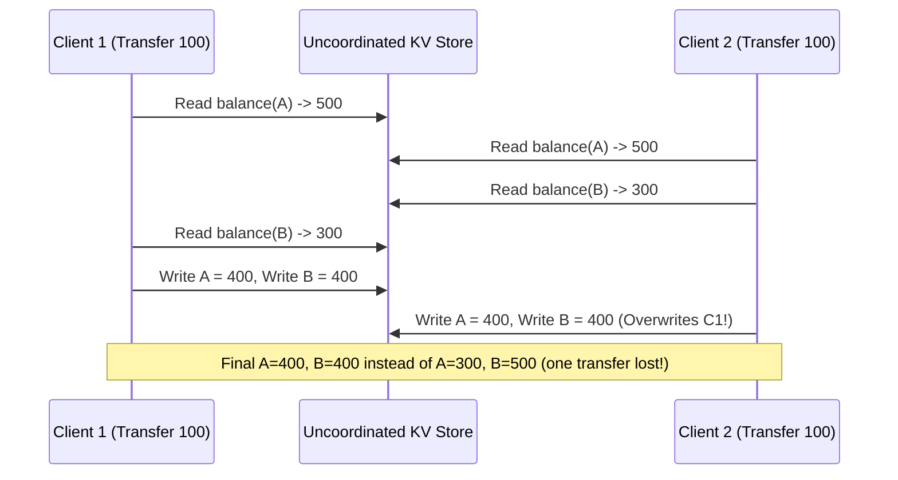
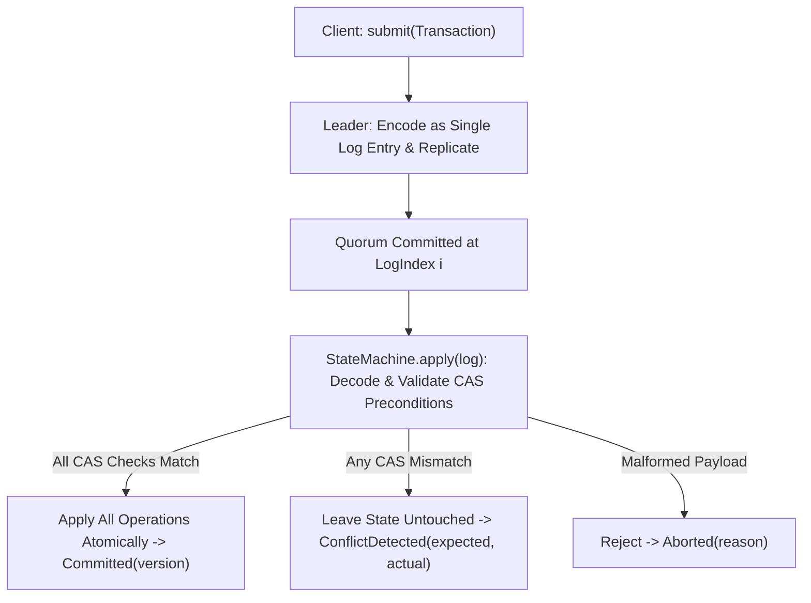
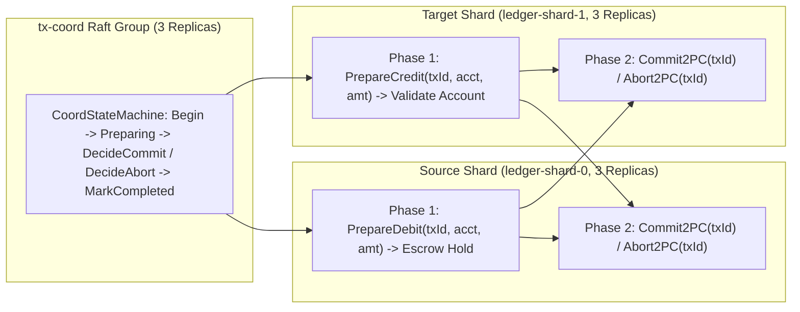

# Chapter 15: Case Study — Distributed Transactions

*Multi-key atomic operations are the hardest problem in distributed data stores. This case study builds a transactional store with optimistic concurrency control that guarantees **serializable isolation** — the strongest consistency level — by leveraging Raft's total ordering. The same pattern powers the transaction engines in CockroachDB, TiKV, and Spanner.*

---

## The Problem

A key-value store ([Chapter 12](12-case-distributed-kv.md)) lets you read and write individual keys atomically. But real applications need **multi-key atomic operations**:

- **Bank transfer**: debit account A and credit account B — both updates must succeed or neither does
- **Conditional update**: increment a counter only if a feature flag is enabled
- **Swap**: exchange the values of two keys atomically
- **Inventory check**: reserve an item only if the stock level is sufficient

Without transactions, concurrent operations on multiple keys can leave the system in an **inconsistent state**. Here is the classic lost-update anomaly when two clients concurrently transfer `100` units from `A` (`500`) to `B` (`300`):



The root cause is a **write-write conflict** — both clients read the same initial value and then overwrote each other's changes.

## Design: Transactions on a Replicated Log

The key insight: Raft's log already provides **total ordering**. Every log entry has a unique index, and entries are applied in index order on every node. If we encode each transaction as a **single log entry**, the state machine applies transactions one at a time, sequentially. This gives us **serializable isolation** — the gold standard of transaction isolation levels — essentially for free.



This design is often called **OCC** (Optimistic Concurrency Control). The "optimistic" part means: the client prepares the transaction based on its view of the state, submits it, and hopes no conflicting transaction committed in the meantime. If a conflict is detected at apply time, the transaction is rejected and the client retries. This is in contrast to **pessimistic** concurrency control (locking), which prevents conflicts by blocking concurrent access.

> **Note — Why OCC works well with Raft:** Raft already serializes all writes through a single leader. In this sequential execution model, conflict detection at apply time is simple and cheap — there's no need for lock tables, deadlock detection, or two-phase commit. The trade-off is that under high contention, many transactions may conflict and need to retry. For most workloads, though, contention is low and OCC performs excellently.

## Step 1: Transaction Types

```scala
opaque type TxnId = String
object TxnId:
  def apply(id: String): TxnId = id
  def generate: TxnId = UUID.randomUUID().toString.take(8)

enum TxnOperation:
  case Put(key: String, value: String)
  case Delete(key: String)
  case CompareAndSet(key: String, expected: Option[String], newValue: String)
  case Increment(key: String, delta: Long)

case class Transaction(
  id: TxnId,
  operations: List[TxnOperation],
  timestamp: Long = System.currentTimeMillis()
)

enum TxnResult:
  case Committed(txnId: TxnId, version: Long)
  case Aborted(txnId: TxnId, reason: String)
  case ConflictDetected(txnId: TxnId, key: String,
    expected: Option[String], actual: Option[String])
```

The `CompareAndSet` operation is the heart of conflict detection. It says: "I expect key K to have value V. If it does, update it to V'. If it doesn't, reject the entire transaction." This is a standard **CAS** (Compare-And-Swap) primitive, lifted from hardware-level atomics to distributed state.

The `Increment` operation is a convenience for the common counter pattern. Unlike `CompareAndSet`, it's commutative — two concurrent `Increment(k, 1)` operations never conflict, because they don't depend on a specific expected value. Including commutative operations alongside CAS gives the best of both worlds: conflict detection when you need it, and conflict-free updates when you don't.

## Step 2: Transaction Serialization

Each transaction is encoded as a single log entry. This is critical — if a transaction were split across multiple entries, there'd be no atomicity guarantee (other entries could slip in between):

```scala
object Transaction:
  private val SEP = "\t"
  private val OP_SEP = "\n"

  def encode(txn: Transaction): Array[Byte] =
    val ops = txn.operations.map {
      case Put(k, v)              => s"PUT$SEP$k$SEP$v"
      case Delete(k)              => s"DEL$SEP$k"
      case CompareAndSet(k, e, n) => s"CAS$SEP$k$SEP${e.getOrElse("NULL")}$SEP$n"
      case Increment(k, d)        => s"INC$SEP$k$SEP$d"
    }.mkString(OP_SEP)
    s"TXN$SEP${txn.id}$SEP${txn.timestamp}$SEP$ops".getBytes

  def decode(data: Array[Byte]): Either[String, Transaction] = ...
```

> **Note — Entry size limits:** Since each transaction is a single log entry, very large transactions (thousands of operations) can produce large entries. Most Raft implementations have a practical entry size limit (etcd defaults to 1.5 MB). If your transactions can be large, consider splitting them into independent groups or using a two-phase approach where the transaction is stored externally and the log entry contains only a reference.

## Step 3: The Transactional State Machine

The state machine maintains four pieces of state:
- **`state`**: the current key-value map (the "database")
- **`versions`**: a per-key version counter for auditing
- **`txnLog`**: a history of transaction results
- **`globalVersion`**: a monotonically increasing transaction counter

```scala
class TransactionalStore[F[_]: Sync](
  state: Ref[F, Map[String, String]],
  versions: Ref[F, Map[String, Long]],
  txnLog: Ref[F, List[TxnResult]],
  globalVersion: Ref[F, Long]
) extends StateMachine[F, TxnResult]:

  def apply(log: Log): F[TxnResult] =
    Transaction.decode(log.data) match
      case Left(err) =>
        Sync[F].pure(TxnResult.Aborted(TxnId("?"), s"Decode error: $err"))
      case Right(txn) =>
        for
          current  <- state.get
          conflict =  validatePreconditions(txn, current)
          result   <- conflict match
            case Some(err) =>
              txnLog.update(_ :+ err).as(err)
            case None =>
              for
                _  <- applyOperations(txn.operations)
                v  <- globalVersion.updateAndGet(_ + 1)
                _  <- updateVersions(txn.operations, v)
                ok =  TxnResult.Committed(txn.id, v)
                _  <- txnLog.update(_ :+ ok)
              yield ok
        yield result
```

The flow is: **validate first, apply second.** If any precondition fails, nothing is written — the entire transaction is rejected atomically.

### Precondition Validation

The `CompareAndSet` operation performs the conflict check:

```scala
private def validatePreconditions(
  txn: Transaction,
  currentState: Map[String, String]
): Option[TxnResult] =
  txn.operations.collectFirst {
    case TxnOperation.CompareAndSet(key, expected, _)
      if currentState.get(key) != expected =>
        TxnResult.ConflictDetected(
          txn.id, key, expected, currentState.get(key)
        )
  }
```

The `collectFirst` short-circuits: as soon as one CAS check fails, the entire transaction is rejected. The conflict result includes both the expected and actual values, giving the client enough information to construct a retry.

### Operation Application

If all preconditions pass, operations are applied in order:

```scala
private def applyOperations(ops: List[TxnOperation]): F[Unit] =
  ops.traverse_ {
    case TxnOperation.Put(k, v) =>
      state.update(_.updated(k, v))
    case TxnOperation.Delete(k) =>
      state.update(_ - k)
    case TxnOperation.CompareAndSet(k, _, newValue) =>
      state.update(_.updated(k, newValue))
    case TxnOperation.Increment(k, delta) =>
      state.update { s =>
        val current = s.getOrElse(k, "0").toLong
        s.updated(k, (current + delta).toString)
      }
  }
```

## Step 4: Using Transactions

### Basic Write Transaction

```scala
val putTxn = Transaction(
  id = TxnId.generate,
  operations = List(
    TxnOperation.Put("user:1", "Alice"),
    TxnOperation.Put("user:2", "Bob")
  )
)

// Encode → append to Raft log → commit → apply
val entry = Log.command(1, 1, Transaction.encode(putTxn))
val result = store.apply(entry)
// → Committed(txnId="abc123", version=1)
```

Both puts succeed atomically. If the Raft commit fails (e.g., leader loses majority), neither put takes effect.

### Atomic Transfer with CAS

This is the solution to the lost-update problem from the beginning of this chapter:

```scala
val transferTxn = Transaction(
  id = TxnId.generate,
  operations = List(
    // Both checks must pass for the transaction to commit
    TxnOperation.CompareAndSet("balance:A", Some("500"), "400"),
    TxnOperation.CompareAndSet("balance:B", Some("300"), "400")
  )
)
```

If another transaction modified `balance:A` between the client's read and this transaction's commit, the CAS detects the conflict:

```scala
val result = store.apply(entry)
// → ConflictDetected(txnId="def456", key="balance:A",
//     expected=Some("500"), actual=Some("450"))
```

The client now knows exactly what happened — some other transaction changed `balance:A` to 450. The client re-reads the current values, recomputes the transfer, and retries.

### Conditional Updates

CAS enables powerful conditional logic:

```scala
val conditionalTxn = Transaction(
  id = TxnId.generate,
  operations = List(
    // Guard: only proceed if dark mode is currently enabled
    TxnOperation.CompareAndSet("feature:dark-mode", Some("enabled"), "enabled"),
    // If the guard passes, apply these changes
    TxnOperation.Put("theme", "dark"),
    TxnOperation.Put("background", "#1a1a2e")
  )
)
// The CAS on "feature:dark-mode" acts as a read-check: if the value isn't
// "enabled", the entire transaction is rejected. The "new value" is the same
// as the expected value — it's a no-op write that still triggers validation.
```

## Consistency Guarantees

Because transactions are committed through Raft's replicated log, we get strong guarantees:

| Property | How It's Achieved |
|----------|------------------|
| **Atomicity** | Entire transaction is a single log entry — all-or-nothing |
| **Serializable isolation** | Raft's total ordering means transactions are applied one at a time, in log order |
| **Linearizable writes** | A committed transaction is replicated to a majority |
| **Read-your-writes** | After receiving `Committed`, the client's next read sees the new values |
| **Conflict detection** | CAS preconditions checked at apply time against current state |
| **Durability** | Committed entries survive any minority of node failures |

> **Note — Serializability vs. Linearizability:** These terms are often confused. **Serializability** means transactions appear to execute in some serial order. **Linearizability** means each individual operation appears to take effect at some point between its invocation and response. Our store provides **strict serializability** — the strongest possible consistency guarantee — because Raft's log defines both the serial order (serializability) and a real-time ordering (linearizability).

## Error Handling and Retry

Conflict detection with retry is the standard pattern for OCC:

```scala
import raft.RaftNode
import raft.state.Bytes

def submitWithRetry(
  leader: RaftNode[IO, TxnResult],
  store: TransactionalStore[IO],
  buildTxn: Map[String, String] => Transaction,
  maxRetries: Int = 3
): IO[TxnResult] =
  def attempt(remaining: Int): IO[TxnResult] =
    for
      _            <- leader.readIndex          // linearizable read barrier before building CAS preconditions
      currentState <- store.getAll
      txn          =  buildTxn(currentState)
      applied      <- leader.proposeAndApply(Bytes.copyFrom(Transaction.encode(txn)))
      finalResult  <- applied.value match
        case c: TxnResult.ConflictDetected if remaining > 0 =>
          IO.println(s"Conflict on ${c.key}, retrying ($remaining left)...") *>
            IO.sleep(10.millis) *>
            attempt(remaining - 1)
        case other => IO.pure(other)
    yield finalResult

  attempt(maxRetries)
```

Notice the two-line discipline that makes OCC strictly serializable in production: `leader.readIndex` ensures `store.getAll` never reads stale state from a partitioned leader, and `leader.proposeAndApply` returns the exact `Applied[TxnResult]` directly from the committed log entry!

The `buildTxn` function takes the current state and builds a transaction based on the latest values. On conflict, the function is called again with the updated state, producing a new transaction with the correct expected values.

> **Note — Exponential backoff:** The `10.millis` sleep is simple but naive. In production, use exponential backoff with jitter to avoid thundering herd problems when many clients conflict on the same keys simultaneously. A good formula: `min(maxBackoff, initialBackoff * 2^attempt) * (0.5 + random(0.5))`.

## Scaling Beyond One Group: Cross-Shard 2PC over Multi-Raft (`ShardedBankLedgerExample`)

Single-log OCC guarantees strict serializability when all keys in a transaction belong to the **same** Raft group (as shown in `DistributedTransactionExample` locally and `RaftTransactionExample` across a 3-node Raft cluster). When accounts are partitioned across multiple Raft groups (`MultiRaftNode`), a transfer between `acct-1` (on `ledger-shard-0`) and `acct-2` (on `ledger-shard-1`) spans two independent consensus logs.

Classic textbook Two-Phase Commit (2PC) suffers from a fatal flaw: **the coordinator is a single point of failure**. If the coordinator crashes after participants vote `Prepared` but before broadcasting `Commit`/`Abort`, participants remain blocked holding locks indefinitely.

`examples.advanced.ShardedBankLedgerExample` (1,529 lines — the repository's flagship full-stack application) eliminates that flaw by running the 2PC coordinator itself inside a dedicated Raft group (`tx-coord`), integrating **every production module** (`raft-core`, `raft-runtime`, `raft-storage-mmap`, `raft-transport-grpc`):



### Anatomy of the Flagship Architecture

1. **4 Groups × 3 Physical Hosts = 12 Replicas on 3 Single-Port gRPC Servers**: Each host (`host-1`, `host-2`, `host-3`) runs `GrpcTransport.multiGroupResource` with `CoalescedHeartbeatConfig(enabled = true, flushInterval = 12.millis, maxBatchSize = 32, coalesceResponses = true)` and 4 independent `MmapWalEngine` directories (12 total WAL engines with `CompactionPolicy.threshold(20L)`), allocated *before* `MultiRaftNode` in the `Resource` stack so storage always outlives consensus fibers during shutdown.
2. **Escrow Holds (`availableBalance = balance - reservedFor`)**: In `LedgerShardStateMachine`, `PrepareDebit(txId, acct, amt)` never mutates the committed balance directly — it records an immutable `Hold(txId, acct, amt, isDebit = true)` after verifying `availableBalance >= amt`. Concurrent transfers against the same account cannot double-spend escrowed funds, and `Abort2PC(txId)` cleanly releases the hold.
3. **Same-Shard Fast Path**: When `shardForAccount(from) == shardForAccount(to)`, `ShardedLedgerCluster.transfer` bypasses `tx-coord` completely and commits a single-entry `SameShardTransfer` in one consensus round.
4. **Snapshotted `(clientId, seqNum)` Exactly-Once Sessions**: `ShardState` stores `sessions: Map[String, (Long, LedgerResponse)]` *inside* the same binary snapshot stream (`snapshot`/`restore`) as `balances`, `holds`, and `resolvedTxs`. Even if a client retries a deposit *after* a leader failover and WAL compaction, `withSessionDedup` replays the cached `LedgerResponse` without double-crediting the account.
5. **Deterministic Crash Recovery (`injectInterrupted2PC` & `recoverInFlightTransactions`)**: If a coordinator host crashes mid-2PC, `recoverInFlightTransactions` performs a linearizable `readIndexFromGroup(CoordGroup)` on the surviving `tx-coord` leader, rolls back any `Preparing`/`Aborted` transactions via idempotent `Abort2PC`, and rolls forward any `Committed` decisions via idempotent `Commit2PC` — guaranteeing **global conservation of money** (`auditGlobalBalances`) with zero leaked holds.
6. **Group-Commit Batching & Zero-RTT `LeaseRead` Audits**: Account seeding batches proposals via `proposeBatchAndCommitToGroup` (`BatchConfig(maxSize = 16, maxWait = 5.millis)` + `PipelineConfig(maxInflight = 6)`), and reads attempt `leaseReadFromGroup` (0 RTTs) with automatic fallback to `readIndexFromGroup` (1 RTT), while `rebalanceLeadership` spreads shard leaders evenly across all three physical hosts.

See [Tutorial 16 — Building a Multi-Shard Transactional Ledger with Raft-Backed 2PC](../../tutorials/16-cross-shard-2pc-ledger.md) and [Appendix B](appendix-b-examples-catalog.md) for the full code walkthrough.

## Run the Examples

```bash
# 1. Local multi-key OCC state machine (5 scenarios: transfer, CAS ok, CAS conflict, atomic Increment, 4-op txn)
sbt "examples/runMain examples.distributed.DistributedTransactionExample"

# 2. 3-node Raft-replicated TransactionalStore proving identical convergence on multi-key CAS transfers
sbt "examples/runMain examples.distributed.RaftTransactionExample"

# 3. Flagship full-stack Multi-Raft + single-port gRPC + 12 FFM MmapWalEngines + Cross-Shard 2PC Bank Ledger
sbt "examples/runMain examples.advanced.ShardedBankLedgerExample"
```

---

*Next: [Chapter 16 — State of the Art: Raft Libraries Compared](16-state-of-the-art.md) surveys the major Raft implementations across Go, Rust, Java, and Scala, comparing architectures, feature sets, and trade-offs.*
