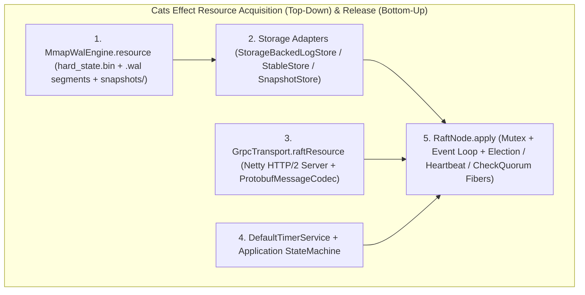
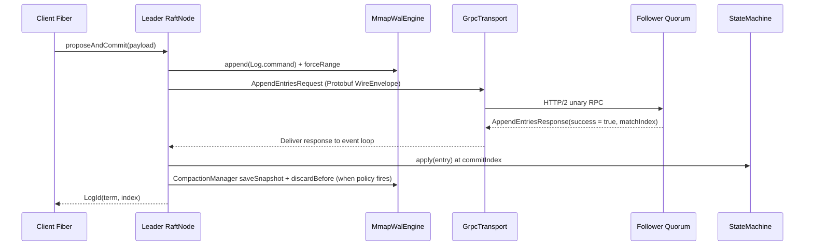
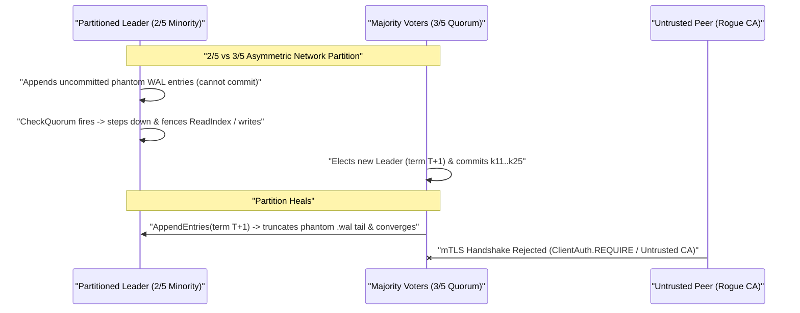
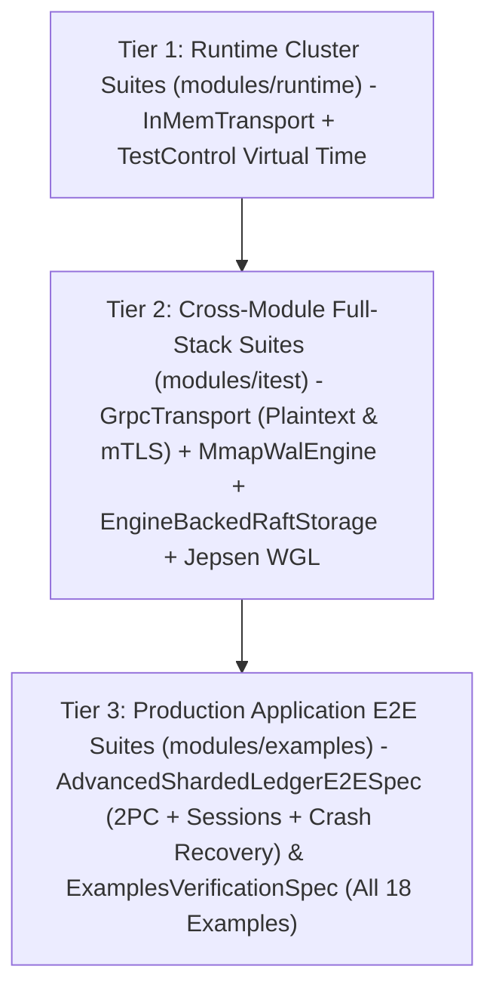
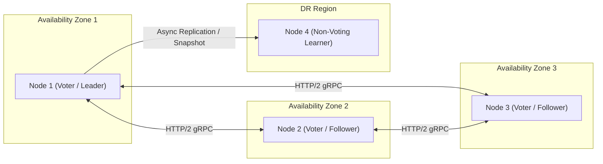

# Chapter 18: End-to-End Integration & Full-Stack Cluster Lifecycle

*Previous chapters explored the pure `RaftLogic` state machine, the `RawNode` Sans-I/O harness, the SPI contracts, the FFM `MmapWalEngine`, and the Netty `GrpcTransport`. This chapter shows how all layers compose into a production `Resource` hierarchy using typed `RaftNode[F, R]`, how crash recovery reconstructs exact cluster state from disk, and how multi-tier integration suites verify every seam.*

---

## Composing the Full Stack as a Cats Effect `Resource`

A running Raft node owns multiple stateful lifecycles: memory-mapped `Arena` segments, HTTP/2 Netty servers and `ManagedChannel` pools, background election/heartbeat/quorum-check fibers, and an inbound RPC event loop. Wrapping each layer in `cats.effect.Resource` guarantees **deterministic LIFO teardown** — on shutdown or error, `RaftNode` cancels its fibers and fails in-flight client `Deferred`s *before* `GrpcTransport` closes sockets and *before* `MmapWalEngine` unmaps `MemorySegment` arenas:



### Production Wiring Example

```scala
import java.nio.charset.StandardCharsets
import java.nio.file.Path
import scala.concurrent.duration.*

import cats.effect.{IO, IOApp, Ref, Resource}
import fs2.{Chunk, Stream}

import raft.RaftNode
import raft.impl.DefaultTimerService
import raft.spi.{CompactionPolicy, StateMachine, TransportConfig}
import raft.state.*
import raft.storage.{
  StorageBackedLogStore,
  StorageBackedSnapshotStore,
  StorageBackedStableStore
}
import raft.storage.mmap.MmapWalEngine
import raft.transport.grpc.{GrpcConfig, GrpcTransport}

final class KvStore(ref: Ref[IO, Map[String, String]])
    extends StateMachine[IO, Unit]:

  def apply(log: Log): IO[Unit] =
    log.payload.utf8String.split("=", 2) match
      case Array(k, v) => ref.update(_.updated(k, v))
      case _           => IO.unit

  def snapshot: IO[Stream[IO, Byte]] =
    ref.get.map { entries =>
      val bytes = entries.toSeq
        .sortBy(_._1)
        .map((k, v) => s"$k=$v")
        .mkString("\n")
        .getBytes(StandardCharsets.UTF_8)
      Stream.chunk(Chunk.array(bytes)).covary[IO]
    }

  def restore(data: Stream[IO, Byte]): IO[Unit] =
    data.compile.to(Array).flatMap { bytes =>
      val text = new String(bytes, StandardCharsets.UTF_8)
      val restored =
        if text.isEmpty then Map.empty[String, String]
        else
          text
            .split("\n")
            .flatMap { line =>
              line.split("=", 2) match
                case Array(k, v) => Some(k -> v)
                case _           => None
            }
            .toMap
      ref.set(restored)
    }

  def get(key: String): IO[Option[String]] = ref.get.map(_.get(key))

object ProductionNode:

  def resource(
      localId: NodeId,
      dataDir: Path,
      bindPort: Int,
      peers: Map[NodeId, String],
      bootstrapCluster: ClusterConfig
  ): Resource[IO, (RaftNode[IO, Unit], KvStore)] =
    for
      engine <- MmapWalEngine.resource[IO](dataDir)
      logStore = StorageBackedLogStore(engine)
      stableStore = StorageBackedStableStore(engine)
      snapStore = StorageBackedSnapshotStore(engine)

      grpcCfg = GrpcConfig(
        host = "0.0.0.0",
        port = bindPort,
        maxInboundQueueSize = 4096
      )
      transportCfg = TransportConfig(
        localId = localId,
        bindAddress = s"0.0.0.0:$bindPort",
        peers = peers - localId
      )
      grpcPair <- GrpcTransport.raftResource[IO](grpcCfg, transportCfg)
      (_, raftTransport) = grpcPair

      timerSvc <- Resource.eval(DefaultTimerService[IO])
      smRef <- Resource.eval(Ref.of[IO, Map[String, String]](Map.empty))
      kv = new KvStore(smRef)

      raftCfg = RaftConfig(
        localId = localId,
        electionTimeoutMin = 150.millis,
        electionTimeoutMax = 300.millis,
        heartbeatInterval = 50.millis,
        compaction = CompactionConfig(
          level = CompactionLevel.Custom,
          snapshotChunkSize = 64 * 1024,
          retainedEntries = 250L,
          policy = Some(CompactionPolicy.threshold[IO](5_000L))
        )
      )

      node <- RaftNode[IO](
        config = raftCfg,
        cluster = bootstrapCluster,
        transport = raftTransport,
        logStore = logStore,
        stableStore = stableStore,
        stateMachine = kv,
        timerService = timerSvc,
        snapshotStoreOpt = Some(snapStore)
      )
      _ <- Resource.eval(node.start)
    yield (node, kv)
```

---

## End-to-End Write, Compaction, and Crash-Recovery Path

When a client calls `proposeAndCommit` on the active leader, every layer participates in strict causal order:



> [!IMPORTANT]
> **Persistence before external visibility.** `RaftNode` persists `HardState` (`term`, `votedFor`) atomically via `StableStore.setHardState` and flushes log entries via `LogStore.append` before emitting outbound RPCs or completing client `Deferred`s.

### Crash Recovery Sequence on Restart

When a node crashes (`SIGKILL` or power loss) and restarts against an existing `MmapWalEngine` directory, `MmapWalEngine.open` and `RaftNode.start` cooperate in four deterministic phases:

1. **HardState Recovery**: `MmapHardState` reads and CRC32-verifies the 280-byte `hard_state.bin` layout, restoring `(term, votedFor, commitIndex)` with hardware-aligned 8-byte `MemorySegment` accesses (`currentTerm` at offset `0`, `crc32` at offset `268`, and `commitIndex` at offset `272`).
2. **Torn-Tail Self-Healing & WAL Index Recovery**: `MmapSegment.openForRecovery` truncates any uncommitted torn tail left by an abrupt `SIGKILL -9` (`index > commitIndex`) while failing fast with `CorruptedEntryException` on mid-log/committed bit-rot. `MmapWalEngine` then validates `index.ckpt` (`"WIDX"` v1 header + CRC32), rebuilding the 2-level 64-bit `WalIndexState` from `.wal` segments if `index.ckpt` is missing or torn.
3. **Snapshot, `TermRingBuffer` & Membership Restoration**: `RaftNode.start` loads the highest numeric `snapshot-%020d.bin` via `SnapshotStore.loadLatest`, streams it into `StateMachine.restore`, advances `lastApplied` to `snap.lastIncludedIndex`, seeds its `O(1)` `TermRingBuffer`, and reconstructs the active `ClusterConfig` from the snapshot header plus any post-snapshot `LogType.Configuration` WAL entries.
4. **Follower Catch-Up**: The node enters `Follower(hs.term, hs.votedFor, None)`. On the next leader `AppendEntriesRequest`, `commitIndex` advances and `applyCommittedEntries` replays only the uncompacted tail `(snap.lastIncludedIndex + 1 .. commitIndex)` in a single batched `getRange` call onto the restored `StateMachine`.

> **Run the full production stack right now:** `sbt "examples/runMain examples.advanced.ShardedBankLedgerExample"` boots 3 hosts × 4 Raft groups (12 `MmapWalEngine` instances + 3 single-port `GrpcTransport.multiGroupResource` servers + `CoalescedHeartbeatConfig` + cross-shard 2PC + crash recovery) end-to-end!

---

## Live Partition Fencing, Self-Healing Storage & Mutual TLS (`EndToEndClusterResilienceSpec`)

Beyond happy-path replication, production clusters face asymmetric WAN partitions, torn checkpoint files, Sans-I/O host loops, and untrusted network peers. `EndToEndClusterResilienceSpec` exercises four full-stack resilience scenarios over live Netty HTTP/2 sockets and off-heap FFM `MmapWalEngine` directories:



1. **5-Node Live Partition, Split-Brain Fencing & `PreVote` Rejoin**: Injects a directional `2/5` vs `3/5` partition over live gRPC transports while nodes write to real `.wal` files. Verifies that uncommitted writes on the minority leader cannot commit, `readIndex` is fenced, `CheckQuorum` steps the isolated leader down, the `3/5` majority elects a new leader and commits new batches, healing truncates the stale uncommitted `.wal` entries on disk, and a `1/5` isolated follower running `PreVote` rejoins without inflating the cluster's `HardState.currentTerm`.
2. **Sans-I/O `RawNode` + `EngineBackedRaftStorage` + Live `GrpcTransport`**: Drives a 3-node zero-dependency `RawNode` cluster directly over `EngineBackedRaftStorage` (`MmapWalEngine`) and `GrpcTransport.raftResource` (`ProtobufMessageCodec`), verifying batch replication, `readIndex`, `compactTo` snapshot truncation, hard leader crash, and full disk recovery.
3. **On-Disk `WIDX` (`index.ckpt`) Corruption Self-Healing**: Commits `1,050` entries across rotated `.wal` segments to trigger automatic `index.ckpt` creation (`>= 1,000` entries), stops a follower, flips payload bytes inside `index.ckpt` on disk, commits `50` additional entries on the surviving quorum, and restarts the follower — verifying automatic `.wal` replay fallback and convergence across all `1,100` keys.
4. **End-to-End Mutual TLS (`mTLS`) & Rogue Peer Rejection**: Generates a cluster Root CA, PKCS#8 node keys, and X.509 SAN certificates (`serverAuth,clientAuth`), runs a 3-node encrypted cluster (`useTls = true`, `tlsClientAuth = true`, `tlsTrustCertPath = Some(ca.crt)`), and proves that a rogue peer signed by an untrusted CA attempting a spoofed `term = 9999` `AppendEntriesRequest` is rejected at the TLS handshake layer (`ClientAuth.REQUIRE`).

---

## Multi-Tier Integration Testing Architecture

The repository verifies runtime, cross-module SPI factories, and application examples across three complementary end-to-end tiers:



| Tier | Module | Transport & Storage | What It Proves |
|------|--------|---------------------|----------------|
| **Runtime Cluster Suites** | `raft-runtime` (`modules/runtime/src/test/scala/raft/integration/`) | Partitionable `InMemTransport` + `InMemLogStore` / `InMemSnapshotStore` + `TestControl` | Virtual-time deterministic elections, 50-fiber concurrent `proposeAndCommit`, `CheckQuorum` minority step-down, `readIndex` / `leaseRead` safety, `transferLeadership`, `3 -> 5` Joint Consensus, leader self-removal, multi-chunk `SnapshotTransfer`, group-commit batching, `Inflights` pipelining, and `MultiRaftNode` coalesced heartbeats |
| **Full-Stack Cross-Module Suites** | `raft-itest` (`FullStackGrpcMmapClusterSpec`, `MultiRaftGrpcMmapClusterSpec`, `FullLibraryEndToEndSpec`, `EndToEndClusterResilienceSpec`) | Live Netty HTTP/2 `GrpcTransport` (plaintext & Mutual TLS) + `GrpcTransportFactory` + FFM `MmapWalEngine` + `EngineBackedRaftStorage` | SPI factory wiring, Learner staging + chunked `InstallSnapshot`, `3 -> 5 -> 3` live Joint Consensus, `proposeConfChangeToGroup` per-shard migration, 5-node live partition split-brain fencing & `.wal` conflict truncation, Sans-I/O `RawNode` over `MmapWalEngine` + gRPC, `WIDX` `index.ckpt` corruption self-healing, Mutual TLS (`mTLS`) rogue peer rejection, and concurrent WGL linearizability (`Write`, `Read`, `CAS`) |
| **Application & Flagship Example Suites** | `raft-examples` (`AdvancedShardedLedgerE2ESpec`, `ExamplesVerificationSpec`) | 3-host `MultiRaftNode` + `GrpcTransport.multiGroupResource` + 12 `MmapWalEngine` stores | Cross-shard atomic 2PC conservation of money, `(clientId, seqNum)` idempotency across WAL snapshot compaction & leader transfer, mid-2PC coordinator crash recovery (`Preparing` rollback & `Committed` roll-forward), and continuous verification of all 18 runnable examples |

### Deterministic Virtual-Time Cluster Tests with `TestControl`

Because `DefaultTimerService` schedules timeouts via `Async[F].sleep` and accepts a seeded `cats.effect.std.Random[F]`, entire multi-node `RaftNode[IO]` elections and commits can execute inside Cats Effect's `TestControl.executeEmbed` in milliseconds of CPU time with **zero wall-clock sleeps**:

```scala
import cats.effect.testkit.TestControl
import raft.integration.RuntimeClusterHarness

val program = RuntimeClusterHarness
  .clusterResource(
    allIds = List(NodeId("n1"), NodeId("n2"), NodeId("n3")),
    initialClusterFor = _ => ClusterConfig(Set(NodeId("n1"), NodeId("n2"), NodeId("n3"))),
    deterministicSeed = Some(42L)
  )
  .use { cluster =>
    for
      (_, leader) <- cluster.awaitLeader()
      logId       <- leader.proposeAndCommit("k=v".getBytes("UTF-8"))
      readIdx     <- leader.readIndex
    yield assert(readIdx >= logId.index)
  }

TestControl.executeEmbed(program).unsafeRunSync()
```

---

## WAN & Multi-AZ Deployment Tuning



For cross-AZ and cross-region deployments:

- **Timeout Ratio (`electionTimeoutMin >= 5 * heartbeatInterval`)**: Keep `heartbeatInterval` at least 3x the p99 inter-AZ RTT so transient TCP retransmissions never trigger spurious `PreVote` rounds.
- **Dynamic Peer Updates (`GrpcTransport.updatePeers`)**: Whenever `proposeConfChange` adds or decommissions nodes, invoke `updatePeers` so Netty `ManagedChannel`s to removed hosts are evicted cleanly without socket leaks.
- **Remote `Learner` Replicas**: Place `NodeRole.Learner` replicas in distant DR regions so cross-continent links receive continuous WAL/snapshot replication without adding WAN latency to local write quorums.

---

*Next: [Chapter 19 — Property-Based Testing](19-property-based-testing.md) shows how ScalaCheck generators verify wire codecs, state invariants, and protocol transitions across randomized inputs.*
