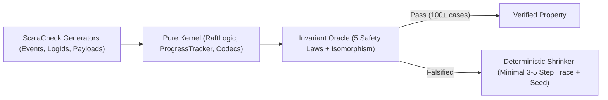

# Chapter 19: Property-Based Testing for Raft

*Raft's correctness rests on a handful of precise safety invariants. This chapter shows how to express those invariants as machine-checkable properties using ScalaCheck, then throw thousands of random message schedules at them. If any schedule violates an invariant, you have a bug — and the test gives you the exact sequence that triggers it.*

---

## Why Property-Based Testing Matters for Consensus

Unit tests verify specific scenarios you thought of. Property-based tests verify invariants across scenarios **you didn't think of**. For a consensus algorithm, this distinction is critical: the dangerous bugs are the ones that emerge from unusual message orderings, partial failures, and timing coincidences — exactly the scenarios that are hard to enumerate by hand.

The library's pure functional design makes property-based testing unusually practical. Since `RaftLogic.onMessage` is a pure function with no side effects, you can:

1. **Generate** random sequences of Raft events (elections, votes, heartbeats, appends)
2. **Apply** them to the pure state machine
3. **Assert** that safety invariants hold after every transition
4. **Shrink** failing cases to the minimal reproduction

No mocks, no timeouts, no network simulators. Just functions and data.



## The Five Safety Properties

The Raft paper (§5.2) defines five properties that a correct implementation must satisfy. These are our test targets:

| Property | Invariant | Informal Meaning |
|----------|-----------|-----------------|
| **Election Safety** | At most one leader per term | Two nodes can't both think they're leading in the same term |
| **Leader Append-Only** | A leader never overwrites or deletes entries in its log | Leaders only append; followers may truncate |
| **Log Matching** | If two logs have entries with the same index and term, all preceding entries are identical | Agreement at any point implies agreement on the entire prefix |
| **Leader Completeness** | If an entry is committed in a term, that entry is present in the logs of all leaders in later terms | Elected leaders always have all committed data |
| **State Machine Safety** | If a server has applied a log entry at a given index, no other server will ever apply a different entry at that index | Different nodes never apply conflicting commands |

## Setting Up the Test Infrastructure

### The Simulated Cluster

```scala
import org.scalacheck.*
import org.scalacheck.Prop.*
import raft.state.*
import raft.state.NodeState.*
import raft.message.RaftMessage.*
import raft.logic.RaftLogic

case class SimulatedNode(
  id: NodeId,
  state: NodeState,
  log: Vector[Log],
  commitIndex: Long,
  appliedEntries: Vector[Log]
)

case class SimulatedCluster(
  nodes: Map[NodeId, SimulatedNode],
  history: Vector[String]
):
  def leaders: Map[Long, Set[NodeId]] =
    nodes.values.collect {
      case n if n.state.isInstanceOf[Leader] =>
        n.state.asInstanceOf[Leader].term -> n.id
    }.groupMap(_._1)(_._2).view.mapValues(_.toSet).toMap
```

### The Event Generator

```scala
object RaftEventGen:

  val nodeIds = List(NodeId("n1"), NodeId("n2"), NodeId("n3"))

  val electionTimeout: Gen[RaftMessage] = Gen.const(ElectionTimeout)
  val heartbeatTimeout: Gen[RaftMessage] = Gen.const(HeartbeatTimeout)

  def voteResponse(term: Long): Gen[RaftMessage] =
    for
      granted <- Gen.oneOf(true, false)
    yield RequestVoteResponse(term = term, voteGranted = granted, isPreVote = false)

  def appendResponse(term: Long): Gen[RaftMessage] =
    for
      success <- Gen.oneOf(true, false)
      idx     <- Gen.choose(0L, 100L)
    yield AppendEntriesResponse(
      term = term, success = success, matchIndex = idx
    )

  def randomEvent(currentTerm: Long): Gen[RaftMessage] =
    Gen.frequency(
      3 -> electionTimeout,
      2 -> heartbeatTimeout,
      2 -> voteResponse(currentTerm),
      2 -> appendResponse(currentTerm),
      1 -> voteResponse(currentTerm + 1)  // messages from higher terms
    )
```

## Property 1: Election Safety

```scala
property("Election Safety: at most one leader per term") =
  forAll(Gen.listOfN(100, RaftEventGen.randomEvent(0))) { events =>
    val cluster = events.foldLeft(initialCluster) { (cluster, event) =>
      applyEventToRandomNode(cluster, event)
    }

    // Check: for every term, at most one node is Leader
    cluster.leaders.forall { (term, leaderSet) =>
      leaderSet.size <= 1
    }
  }
```

This property generates 100 random Raft events, applies each one to a randomly chosen node, and then checks that no term has two leaders. ScalaCheck will run this with hundreds of different random sequences.

## Property 2: Log Matching

```scala
property("Log Matching: same index+term implies same prefix") =
  forAll(Gen.listOfN(200, RaftEventGen.randomEvent(0))) { events =>
    val cluster = events.foldLeft(initialCluster) { (cluster, event) =>
      applyEventToRandomNode(cluster, event)
    }

    val logs = cluster.nodes.values.map(_.log).toList

    // For every pair of logs, check the Log Matching Property
    logs.combinations(2).forall { case List(log1, log2) =>
      val commonIndices = (0 until math.min(log1.size, log2.size))

      commonIndices.forall { i =>
        if log1(i).term == log2(i).term then
          // Same index and term → all preceding entries must also match
          (0 to i).forall(j => log1(j) == log2(j))
        else
          true // different terms at this index, no constraint
      }
    }
  }
```

## Property 3: Leader Append-Only

```scala
property("Leader Append-Only: leaders never delete entries") =
  forAll(Gen.listOfN(50, RaftEventGen.randomEvent(0))) { events =>
    val (_, preserved) =
      events.foldLeft((initialCluster, Map.empty[NodeId, Vector[Log]], true)) {
        case ((cluster, prevLeaderLogs, ok), event) =>
          val updated = applyEventToRandomNode(cluster, event)
          val (nextLogs, stepOk) = updated.nodes.foldLeft((prevLeaderLogs, ok)) {
            case ((accLogs, accOk), (id, node)) =>
              node.state match
                case _: Leader =>
                  val prefixValid = accLogs.get(id).forall(prev => node.log.startsWith(prev))
                  (accLogs.updated(id, node.log), accOk && prefixValid)
                case _ =>
                  (accLogs - id, accOk)
          }
          (updated, nextLogs, stepOk)
      }
    preserved
  }
```

## Property 4: Leader Completeness

```scala
property("Leader Completeness: committed entries survive in every future leader's log") =
  forAll(Gen.listOfN(120, RaftEventGen.randomEvent(0))) { events =>
    val (_, _, valid) =
      events.foldLeft((initialCluster, Map.empty[Long, Log], true)) {
        case ((cluster, committedHistory, ok), event) =>
          val updated = applyEventToRandomNode(cluster, event)
          // Record every newly committed (index -> Log) across the cluster
          val nextCommitted = updated.nodes.values.foldLeft(committedHistory) { (acc, node) =>
            node.log.filter(_.index <= node.commitIndex).foldLeft(acc) { (m, e) =>
              m.updated(e.index, e)
            }
          }
          // Every active Leader in term > entry.term MUST contain that exact committed entry
          val leadersComplete = updated.nodes.values.forall { node =>
            node.state match
              case l: Leader =>
                nextCommitted.values.forall { committed =>
                  l.term <= committed.term ||
                    node.log.exists(e => e.index == committed.index && e == committed)
                }
              case _ => true
          }
          (updated, nextCommitted, ok && leadersComplete)
      }
    valid
  }
```

## Property 5: State Machine Safety

```scala
property("State Machine Safety: no conflicting applies") =
  forAll(Gen.listOfN(100, RaftEventGen.randomEvent(0))) { events =>
    val cluster = events.foldLeft(initialCluster) { (cluster, event) =>
      applyEventToRandomNode(cluster, event)
    }

    val allApplied = cluster.nodes.values.map(_.appliedEntries).toList

    // For every index, all nodes that applied an entry at that index
    // applied the SAME entry
    val maxIdx = allApplied.map(_.size).maxOption.getOrElse(0)
    (0 until maxIdx).forall { i =>
      val entriesAtI = allApplied.flatMap(_.lift(i))
      entriesAtI.distinct.size <= 1
    }
  }
```

## Algebraic & Codec Isomorphism Laws Beyond Event Traces

Event-schedule properties catch multi-step state machine bugs, while **algebraic law properties** verify the mathematical building blocks that `RaftLogic` and `RawNode` rely on:

### 1. Lexicographic Total Order on `LogId` (§5.4.1 Election Restriction)

Raft's Election Restriction compares candidate and voter logs by `(lastLogTerm, lastLogIndex)`. If `LogId.compare` ever violated transitivity or antisymmetry, three nodes could form a voting cycle where none can win, or worse, grant a vote to a stale log (`TypesAndDomainSpec`):

```scala
forAll(logIdGen, logIdGen, logIdGen) { (a, b, c) =>
  a.compare(a) shouldBe 0
  a.compare(b).sign shouldBe -b.compare(a).sign
  if a <= b && b <= c then (a <= c) shouldBe true
}
```

### 2. Joint Consensus Commit Monotonicity (`ProgressTracker`)

During a Joint Consensus transition $C_{\text{old},\text{new}}$, `maximalCommittedIndex` computes $\min(\text{committed}(C_{\text{old}}), \text{committed}(C_{\text{new}}))$. Advancing any peer's `matched` index by $\Delta > 0$ must never cause the joint quorum commit index to regress (`ReadyAndProgressTrackerSpec`):

```scala
forAll(matchGen) { case (m1, m2, m3, m4, m5, delta) =>
  val c0 = base.maximalCommittedIndex
  val c1 = base.updateProgress(n2, p => p.copy(matched = p.matched + delta)).maximalCommittedIndex
  c1 should be >= c0
}
```

### 3. Wire-Codec, Envelope & Stateful WAL Model-Checking Laws

- **Wire-Codec Isomorphism (`JsonCodecPropertySpec` & `ProtobufMessageCodecSpec`)**: Generates all 17 `RaftMessage` variants populated with arbitrary `Bytes` payloads, ASCII control characters (`0x00`–`0x1f`), quotes, backslashes, and multi-byte UTF-8 symbols, asserting exact structural equality (`==` works natively on `Log` and `InstallSnapshotRequest` because payloads live inside `Bytes`!):
  $$\forall m \in \text{RaftMessage}: \quad \text{decode}(\text{encode}(m)) = \text{Right}(m)$$
- **Binary Envelope Round-Trips (`ClusterConfig` `"RCFG"` v2 & `SnapshotMetadata` `"RSNP"` v1/v2)**: Verifies that arbitrary UTF-8 `NodeId`s (including delimiters `'|'`, `','`, `':'`) and CRC32 corruption flips round-trip or fail fast with typed errors.
- **Stateful Off-Heap WAL Model-Checking (`MmapWalEngineStatefulPropertySpec`)**: Generates random command sequences (`appendEntries`, segment rotation, `truncateFrom`, `discardBefore`, `saveSnapshot`, cold restart) against a live `MmapWalEngine` on disk and verifies every read matches a pure `Vector[Log]` reference oracle bit-for-bit!

## Running the Properties

```scala
// Pure protocol, algebraic, and wire-codec property suites:
// - modules/core/src/test/scala/raft/logic/SafetyPropertySpec.scala
// - modules/core/src/test/scala/raft/state/TypesAndDomainSpec.scala
// - modules/core/src/test/scala/raft/raw/ReadyAndProgressTrackerSpec.scala
// - modules/core/src/test/scala/raft/codec/JsonCodecPropertySpec.scala
// - modules/transport-grpc/src/test/scala/raft/transport/grpc/ProtobufMessageCodecSpec.scala
```

```bash
sbt "testOnly *SafetyPropertySpec *TypesAndDomainSpec *ReadyAndProgressTrackerSpec *Codec*Spec"
```

ScalaCheck will run each property 100 times by default (configurable via `minSuccessfulTests`). If a property fails, ScalaCheck **shrinks** the input to find the minimal failing case — typically reducing a 100-event sequence to 3-5 events that trigger the bug.

## Interpreting Failures

When a property-based test fails, ScalaCheck reports the **seed** and **shrunk input**:

```
! Raft Safety.Election Safety: Falsified after 42 tests
> ARG_0: List(ElectionTimeout, ElectionTimeout, VoteResponse(term=1, true))
> Seed: 1234567890
```

You can reproduce the exact failure:

```scala
property("...").check(Test.Parameters.default.withInitialSeed(1234567890))
```

Because the logic is pure, this reproduces deterministically. No flaky tests, no timing dependencies, no "it works on my machine."

> **Note — From Property Tests to Full Deterministic Simulation.** Property-based tests complement scenario tests and lead naturally to full **Deterministic Simulation Testing (DST)** — where an entire multi-node `RawNode` cluster, lossy/reordering network, partition nemesis, and crash-recovery storage loop execute deterministically from a single 64-bit seed. See [Chapter 24 — Deterministic Simulation Testing](24-deterministic-simulation-testing.md) and `DeterministicSimulationSpec` for the complete architecture.

---

*Next: [Chapter 20 — Jepsen-Style Verification](20-jepsen-verification.md) introduces the gold standard for proving consensus correctness under real-world fault injection.*
