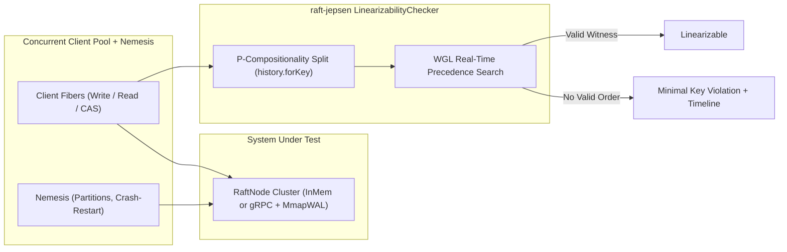
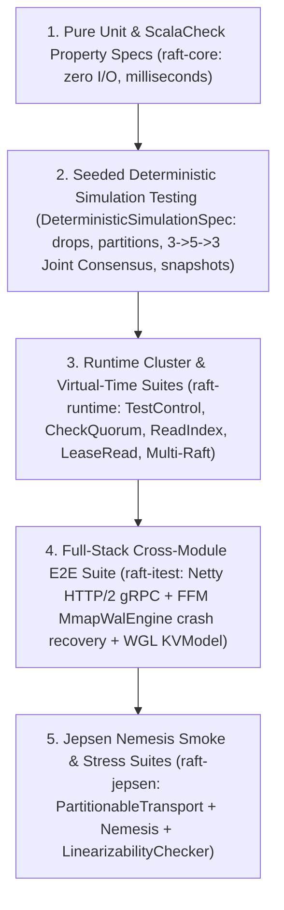

# Chapter 20: Jepsen-Style & WGL Linearizability Verification

*Unit tests, ScalaCheck properties, and single-threaded deterministic simulations prove that the pure consensus state machine obeys its invariants. Yet real distributed systems fail at the boundaries between concurrency, network sockets, disk persistence, and process restarts. This chapter explains how the library's `raft-jepsen` module implements Wing & Gong / Lowe (WGL) linearizability verification with P-compositionality, and how `raft-itest` proves linearizability across live gRPC + FFM `MmapWalEngine` clusters.*

---

## What Linearizability Demands

[Jepsen](https://jepsen.io), pioneered by Kyle Kingsbury, popularized black-box linearizability testing under fault injection. Instead of asserting internal implementation details, clients record a concurrent **history** of `[Invoke, Ok / Fail / Info]` operations with monotonic real-time timestamps, and a model checker proves whether there exists **some sequential ordering** of operations that:

1. **Preserves Real-Time Precedence**: If operation `A` completed (`Ok`) at `t1` strictly before operation `B` was invoked (`Invoke`) at `t2` (`t1 < t2`), then `A` must appear before `B` in the linearization.
2. **Conforms to the Sequential Specification**: Replaying the linearized sequence against a single-threaded reference model (`KVModel`, `RegisterModel`, or `CounterModel`) produces the exact return value observed by every operation.



### Anatomy of a Stale-Read Violation

Why do consensus implementations violate linearizability in practice? Almost always on the **read path** during partitions:

```mermaid
sequenceDiagram
    participant C1 as Client 1
    participant L1 as Partitioned Old Leader (Term 5)
    participant L2 as New Majority Leader (Term 6)
    participant C2 as Client 2

    Note over L1,L2: Network partition isolates L1 from {F1, F2}; {F1, F2} elect L2
    C1->>L2: Write("x", "v2") [t=10]
    L2-->>C1: Ok [t=20]
    C2->>L1: Read("x") [t=25]
    Note over L1: BUG if L1 reads local memory without ReadIndex quorum check!
    L1-->>C2: Stale "v1" [t=30]
```

Because `Write("x", "v2")` completed at `t=20` before `Read("x")` was invoked at `t=25`, real-time precedence forces `Write("x", "v2")` before `Read("x")`. Observing `"v1"` violates `KVModel`. Our library prevents this via two complementary defenses:

- **`ReadIndex` Quorum Confirmation (§6.4)**: `RaftNode.readIndex` broadcasts a heartbeat round and suspends until a voting quorum confirms leadership in the current term *and* `lastApplied >= confirmedCommitIndex`.
- **`CheckQuorum` Step-Down (§6.2)**: `RaftNode` periodically fires `CheckQuorumTimeout`; an isolated minority leader that fails to hear from a voting quorum steps down to `Follower` and fails pending leader requests.

---

## Inside `raft-jepsen`: Histories, Models, and P-Compositionality

The `modules/jepsen` module provides a self-contained linearizability checker and fault-injection harness in pure Scala 3.

### 1. Recording Operations (`History` & `OpType`)

Every client attempt emits two events sharing a unique invocation `index`:

```scala
import raft.jepsen.checker.{History, OpFunction, OpType, Operation}

val ops = Vector(
  Operation(1L, process = 1, OpType.Invoke, OpFunction.Write, "acct-0", Some("100"), None, 100L),
  Operation(1L, process = 1, OpType.Ok,     OpFunction.Write, "acct-0", Some("100"), Some("ok"), 210L),
  Operation(2L, process = 2, OpType.Invoke, OpFunction.Read,  "acct-0", None,        None, 220L),
  Operation(2L, process = 2, OpType.Ok,     OpFunction.Read,  "acct-0", None,        Some(Some("100")), 310L)
)

val history = History(ops)
```

| `OpType` | Meaning in Linearizability Checking |
|----------|-------------------------------------|
| `Invoke` | Client dispatched the request at monotonic timestamp `t_inv` |
| `Ok` | Cluster confirmed execution before `t_comp`; must take effect at a single point in `[t_inv, t_comp]` |
| `Fail` | Definite rejection without side effects; never mutates model state |
| `Info` | Indeterminate outcome (network timeout, leader step-down mid-flight); stripped via `withoutInfo` or treated as open-ended |

### 2. Reference Sequential Models (`SequentialModel`)

`raft-jepsen` ships three ready-to-use `SequentialModel` specifications:

- **`KVModel`**: Multi-key string map supporting `Read` (`Option[String]`), `Write` (`"ok"`), and `CAS` (`(expected, newVal)` returning `"ok"` or `"failed"`).
- **`RegisterModel`**: Arbitrary-typed per-key single-value register (`Read`, `Write`, `CAS`).
- **`CounterModel`**: Monotonic `Long` counter (`Read`, atomic increment `Write`, and `CAS`).

### 3. Exploiting P-Compositionality (`LinearizabilityChecker`)

General linearizability checking is NP-complete in the number of concurrent operations. However, Maurice Herlihy and Jeannette Wing proved **locality (P-compositionality)**: a history `H` over independent single-key registers is linearizable *if and only if* for every key `k`, the single-key projection `H|k` (`history.forKey(k)`) is linearizable!

`LinearizabilityChecker.check(history, KVModel)` partitions a multi-key workload by key (`history.keys`), runs bounded real-time-precedence DFS per key independently, and either returns a complete `witness` ordering or pinpoints the exact offending key and minimal timeline (`history.timeline`).

---

## Proving Full-Stack Linearizability Over gRPC + `MmapWalEngine`

In `modules/itest` (`FullStackGrpcMmapClusterSpec`), four concurrent client fibers execute interleaved `proposeAndCommit` writes and quorum `readIndex` reads over **real HTTP/2 Netty `GrpcTransport` sockets** and **real FFM `MmapWalEngine` disk segments**, feeding the recorded `History` directly into `LinearizabilityChecker`:

```scala
val checkResult = LinearizabilityChecker.check(history, KVModel)
assert(checkResult.linearizable, s"Violation: ${checkResult.violation}\n${history.timeline}")
```

Alongside WGL linearizability, `FullStackGrpcMmapClusterSpec` exercises:

1. **Live Cluster Expansion + gRPC Snapshot Streaming**: Committing 35 entries across rotated `4 KB` `.wal` segments, compacting via `StorageBackedSnapshotStore`, booting an empty 4th gRPC + `MmapWalEngine` node, running `proposeConfChange`, and verifying chunked `InstallSnapshotRequest` delivery over Netty HTTP/2.
2. **Hard Leader Crash & Disk Recovery**: Closing the active leader's `RaftNode`, Netty `Server`, and `MmapWalEngine`, verifying the surviving 2-node majority elects a higher-term failover leader and commits 15 new writes while the dead port returns gRPC `UNAVAILABLE`, then restarting the crashed node on its **same TCP port and on-disk WAL directory** and proving full state convergence.

---

## The Five-Layer Verification Pyramid

Every layer in this repository reinforces the others without duplicating slow I/O unnecessarily:



| Verification Layer | Command | Typical Runtime | Primary Faults Caught |
|--------------------|---------|-----------------|-----------------------|
| **Core Unit & Properties** | `sbt core/test` | `< 3s` | Term/vote rules, codec round-trips, `Ready`/`ProgressTracker` edge cases |
| **Seeded DST Chaos** | `sbt "core/testOnly *DeterministicSimulationSpec"` | `~1.2s` | Multi-step interleavings across partitions, Joint Consensus, WAL compaction, and snapshot installation |
| **Runtime Cluster Suites** | `sbt "runtime/testOnly raft.integration.*"` | `~5s` | Fiber races, `Deferred` completion, `CheckQuorum` step-down, `leaseRead` expiry, `MultiGroupTransport` demux |
| **Full-Stack gRPC + WAL** | `sbt itest/test` | `~6s` | Protobuf wire framing, Netty reconnect backoff, FFM `.wal` rotation, on-disk snapshot + WAL crash recovery |
| **Jepsen Smoke & Stress** | `sbt jepsenSmoke` / `sbt jepsenStress` | `5s – 60s` | Sustained random partition/heal schedules under multi-client WGL linearizability |

---

*Next: [Chapter 21 — Multi-Raft Group Design](21-multi-raft-groups.md) shows how multiple independent Raft consensus groups share physical nodes and network connections via `MultiRaftNode` and `MultiGroupTransport`.*
