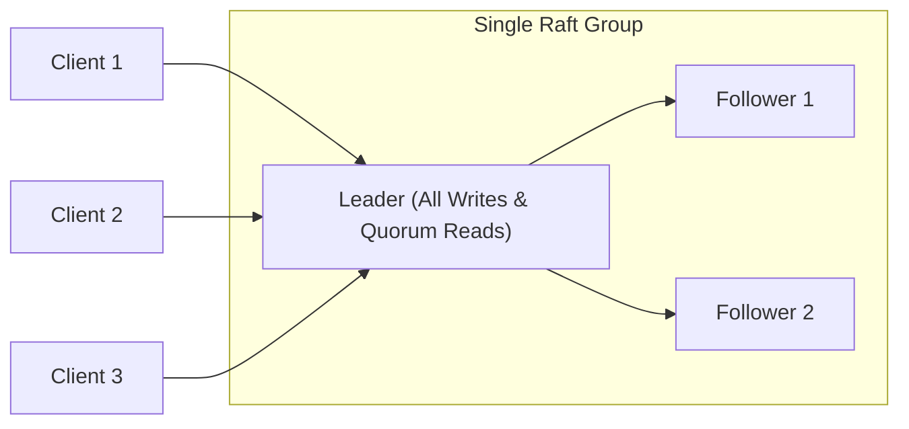
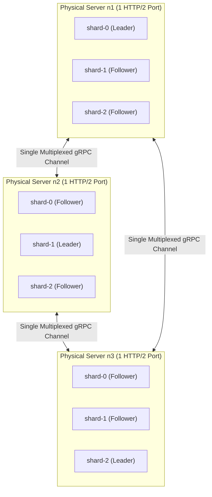
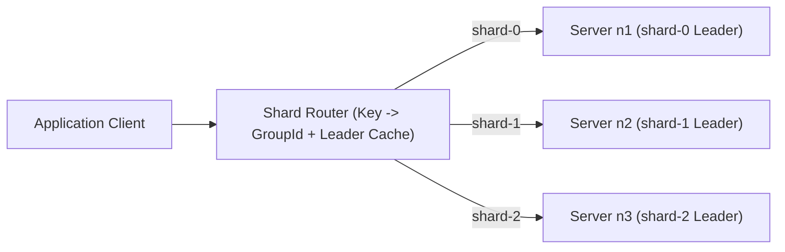
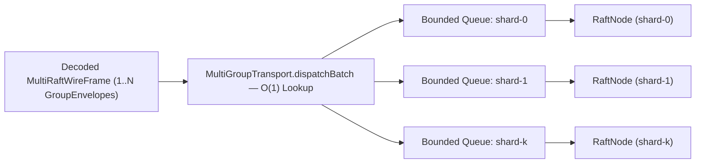

# Chapter 21: Multi-Raft Group Design, Native Protobuf Multiplexing & Coalesced Heartbeats

*A single Raft group provides linearizable consistency for one replicated state machine, but hits fundamental ceilings: all writes flow through one leader, the full dataset must fit on every replica, and throughput is bounded by a single consensus log. This chapter shows how to partition state across hundreds or thousands of independent Raft groups — and how `MultiRaftNode`, `ProtobufMultiGroupCodec`, and per-host **Coalesced Heartbeats** (`CoalescedHeartbeatConfig`) eliminate the `O(G * M)` connection and heartbeat storms encountered in production systems like CockroachDB and TiKV.*

---

## Why a Single Group Isn't Enough

A single Raft group has three structural bottlenecks:



| Bottleneck | Root Cause | Impact |
| :--- | :--- | :--- |
| **Write throughput** | Every proposal serializes through one leader's log | Capped at one host's NIC/NVMe budget |
| **Storage capacity** | Every voter stores the entire state machine | Dataset bounded by a single server's disk |
| **Failure blast radius** | Leader election pauses the entire log | All keys stall simultaneously during failover |

## The Multi-Raft Architecture

**Multi-Raft** partitions the keyspace into independent consensus groups (**shards** or **ranges**). Each group maintains its own `HardState`, WAL, `SnapshotStore`, and `ClusterConfig`, while sharing physical servers and a single multiplexed transport mesh:



In this topology:
- Each **Raft group** owns a disjoint key partition (for example, `shard-0` owns `[a, h)`, `shard-1` owns `[h, p)`, `shard-2` owns `[p, z)`).
- Each **physical server** hosts replicas from many groups via `MultiRaftNode[F]`.
- **Shard leadership is balanced** across servers (`rebalanceLeadership`) so every machine contributes leader CPU and WAL bandwidth.

---

## Partitioning & Cross-Group Coordination

### Range vs. Hash Partitioning

| Strategy | Assignment Rule | Strengths | Tradeoffs |
| :--- | :--- | :--- | :--- |
| **Range Partitioning** (CockroachDB, TiKV) | Contiguous lexicographic key intervals `[startKey, endKey)` | Efficient ordered range scans; natural dynamic range splits & merges | Sequential key writes (e.g., monotonic timestamps) can hotspot one shard |
| **Consistent Hash Partitioning** | `ring.ceilingEntry(hash(key))` across virtual nodes | Uniform write spread regardless of key distribution | Cross-key range queries fan out across all shards |

### Routing & Cross-Group Transactions



A single Raft group guarantees linearizability for any operation confined to its key range. When an atomic transfer spans multiple groups — for example, transferring \$100 from `account:alice` (`shard-0`) to `account:bob` (`shard-1`) — layer **Two-Phase Commit (2PC)** or Percolator-style write intents on top of Raft, where the transaction coordinator record itself lives inside a Raft group so coordinator crashes never block recovery.

---

## Solving the Two Multi-Raft Scaling Storms

Naively hosting `G = 1,000` Raft groups across `M = 3` servers triggers two notorious distributed-systems pathologies:

1. **The Socket Explosion (`G * (M - 1)` TCP Connections)**: Opening separate gRPC channels per group creates thousands of TLS handshakes, HTTP/2 keep-alive ping loops, and Netty buffer pools.
2. **The Idle Heartbeat Storm (`O(G * M)` RPCs/sec)**: With `heartbeatInterval = 50ms`, 1,000 idle groups emit `2,000` outbound `AppendEntriesRequest`s + `2,000` `AppendEntriesResponse`s every `50ms` = **`80,000` RPCs/sec when zero clients are writing**.

The library eliminates both bottlenecks through **three coordinated layers**:

### Layer 1: `O(1)` Per-Group Bounded Mailboxes (`MultiGroupTransport`)

Inbound envelopes never broadcast through a shared `O(G)` pub-sub topic. Instead, `MultiGroupTransport` routes each `GroupEnvelope` by `GroupId` in `O(1)` into a per-group bounded `Queue`:



- **Zero Startup Drops**: Early election or heartbeat frames arriving before a newly created shard's stream fiber starts pulling are buffered cleanly in its mailbox.
- **Fault Isolation (`tryOffer`)**: A slow state machine on `shard-k` cannot backpressure the shared gRPC reader serving `shard-0 .. shard-(k-1)`.
- **Clean Teardown**: `removeGroup(groupId)` purges both the inbound mailbox and any queued outbound heartbeats for that shard.

### Layer 2: Per-Host Coalesced Heartbeats (`CoalescedHeartbeatConfig`)

When `CoalescedHeartbeatConfig(enabled = true)` is active on `MultiGroupTransport`, unicast empty `AppendEntriesRequest` heartbeats (and optionally `AppendEntriesResponse` ACKs when `coalesceResponses = true`) targeting the same peer server are coalesced into a single wire batch:

```mermaid
sequenceDiagram
    participant S0 as shard-0 Leader (on n1)
    participant S1 as shard-1 Leader (on n1)
    participant SK as shard-k Leader (on n1)
    participant Coal as n1 Heartbeat Coalescer
    participant Net as GrpcTransport (1 HTTP/2 RPC)
    participant N2 as Server n2 (MultiGroupTransport)

    S0->>Coal: Empty AppendEntries(term=3, prevIdx=120, commit=120) -> n2
    S1->>Coal: Empty AppendEntries(term=5, prevIdx=84, commit=84) -> n2
    SK->>Coal: Empty AppendEntries(term=2, prevIdx=410, commit=408) -> n2
    Note over Coal: Deduplicate per (dest, groupId); flush at flushInterval or maxBatchSize

    Coal->>Net: CoalescedHeartbeatBatchProto (from=n1, to=n2, beats=[shard-0, shard-1, shard-k])
    Net->>N2: 1 WireEnvelope HTTP/2 Frame
    N2->>N2: dispatchBatch fans out to shard-0, shard-1, shard-k mailboxes
```

#### Critical Consensus Safety Invariants in the Coalescer

1. **Zero Delay for Data & Elections**: `RequestVote*`, non-empty `AppendEntriesRequest` (`entries.nonEmpty`), `InstallSnapshot*`, and `TimeoutNowRequest` **bypass** the coalescer immediately.
2. **Superseding Eviction (`envelopesSuperseded`)**: If `shard-0` queues an idle heartbeat `(prevLogIndex = 120)` for `n2`, and `2ms` later a client write dispatches `AppendEntriesRequest(prevLogIndex = 120, entries = [121])` to `n2`, `MultiGroupTransport` **atomically evicts** the queued heartbeat for `(n2, shard-0)` before sending the data frame — saving wire bytes and guaranteeing the older heartbeat never arrives after entry `121`.
3. **Window Deduplication**: If a shard emits both a periodic `HeartbeatTimeout` and a `ReadIndex` heartbeat within the same `flushInterval`, the coalescer retains the latest `(term, prevLogIndex, leaderCommit)` for `(dest, groupId)` so one ACK satisfies both `CheckQuorum` and `ReadIndex`.

### Layer 3: Native Binary `MultiRaftWireFrame` (`ProtobufMultiGroupCodec` & `GrpcTransport.multiGroupResource`)

In `raft-transport-grpc`, `ProtobufMultiGroupCodec` encodes Multi-Raft traffic into a three-case Protobuf `MultiRaftWireFrame` over `WireEnvelope`:

| `MultiRaftWireFrame` Variant | When Emitted | Wire Efficiency |
| :--- | :--- | :--- |
| **`Single`** (`MultiGroupEnvelopeProto`) | Unicast elections, single-chunk writes, broadcasts | Zero text delimiter parsing; raw binary `ByteString` payloads |
| **`Batch`** (`MultiGroupBatchProto`) | `RaftTransport.sendBatch` (`Inflights` pipelined replication bursts) | Sends all `maxInflight` chunks for a shard in **1 gRPC `WireEnvelope` call** |
| **`CoalescedHeartbeat`** (`CoalescedHeartbeatBatchProto`) | Flushed multi-group empty heartbeats or heartbeat ACKs between `(from, to)` | Encodes `from_id` and `to_id` **once** per host pair; strips nested `RaftWirePayload` wrappers (`> 35%` smaller than `N` individual envelopes) |

---

## Complete Production Wiring (`GrpcTransport.multiGroupResource` + `MultiRaftNode`)

```scala
import scala.concurrent.duration.*
import cats.effect.{IO, Resource}
import raft.multigroup.*
import raft.spi.TransportConfig
import raft.state.*
import raft.transport.grpc.{GrpcConfig, GrpcTransport}

def startMultiRaftHost(
    localId: NodeId,
    port: Int,
    peers: Map[NodeId, String]
): Resource[IO, (GrpcTransport[IO], MultiGroupTransport[IO], MultiRaftNode[IO])] =
  for
    pair <- GrpcTransport.multiGroupResource[IO](
      grpcConfig = GrpcConfig(
        host = "0.0.0.0",
        port = port,
        maxInboundQueueSize = 8192
      ),
      transportConfig = TransportConfig(
        localId = localId,
        bindAddress = s"0.0.0.0:$port",
        peers = peers - localId,
        connectionTimeout = 1.second
      ),
      coalescing = CoalescedHeartbeatConfig(
        enabled = true,
        flushInterval = 10.millis,
        maxBatchSize = 256,
        coalesceResponses = true
      ),
      maxGroupQueueSize = 2048
    )
    (grpc, mgTransport) = pair
    coordinator <- MultiRaftNode.resource[IO](localId, mgTransport)
  yield (grpc, mgTransport, coordinator)
```

### Shard Operations, Typed Groups & Active Leader Rebalancing

`MultiRaftNode[F]` serializes group lifecycle transitions (`createGroup`, `createTypedGroup[R]`, `removeGroup`, `shutdown`) atomically via `AtomicCell[F, Map[GroupId, ...]]` with resource-safe rollback (`0` TOCTOU races, `0` leaked fibers if a shard fails to start). Callers can register strongly typed groups via `createTypedGroup[R](groupId, TypedGroupConfig[F, R]): F[RaftNode[F, R]]`, execute group-scoped writes (`proposeAndApplyToGroup`, `proposeBatchAndCommitToGroup`), run per-shard membership migrations (`proposeConfChangeToGroup`), serve quorum/lease reads (`readIndexFromGroup` / `leaseReadFromGroup`), and rebalance leaders:

```scala
val preferredPlacement: Map[GroupId, NodeId] = Map(
  GroupId("shard-0") -> NodeId("n1"),
  GroupId("shard-1") -> NodeId("n2"),
  GroupId("shard-2") -> NodeId("n3")
)

for
  // Commit a batch of commands to shard-0
  ids <- coordinator.proposeBatchAndCommitToGroup(
    GroupId("shard-0"),
    Seq("k1=v1".getBytes, "k2=v2".getBytes)
  )
  // Serve a linearizable quorum read index from shard-0
  rIdx <- coordinator.readIndexFromGroup(GroupId("shard-0"))
  // Transfer leadership of any locally led shard whose preferred host differs
  initiatedTransfers <- coordinator.rebalanceLeadership(preferredPlacement)
  // Inspect live heartbeat coalescer compression metrics
  stats <- mgTransport.coalescerStats
yield (ids, rIdx, initiatedTransfers, stats)
```

## Runnable Multi-Raft Walkthroughs

Two runnable examples in `modules/examples` demonstrate Multi-Raft from minimal in-memory multiplexing up to a full production stack:

1. **Sharded KV with Dynamic Group Lifecycle (`examples.distributed.MultiGroupExample`)**
   ```bash
   sbt "examples/runMain examples.distributed.MultiGroupExample"
   ```
   Creates a 3-host `MultiGroupTransport.createInMemoryCluster` with `CoalescedHeartbeatConfig(enabled = true, flushInterval = 10.millis, maxBatchSize = 16)`, provisions `shard-0` (keys `a`–`m`) and `shard-1` (keys `n`–`z`) across all 3 hosts (6 Raft state machines sharing 3 transport endpoints), routes writes (`alice`, `bob`, `nancy`, `zara`) to each shard's elected leader via `proposeAndCommitToGroup`, verifies `readIndexFromGroup` on both shards, hot-adds and cleanly removes `shard-2` at runtime, and proves all 3 replicas of both shards converge identically.

2. **Flagship Production Stack: Multi-Shard Transactional Bank Ledger (`examples.advanced.ShardedBankLedgerExample`)**
   ```bash
   sbt "examples/runMain examples.advanced.ShardedBankLedgerExample"
   ```
   Runs `tx-coord` + 3 `ledger-shard-*` groups across 3 single-port `GrpcTransport.multiGroupResource` servers and 12 independent `MmapWalEngine` stores, demonstrating `CoalescerStats`, `rebalanceLeadership`, `proposeBatchAndCommitToGroup`, `leaseReadFromGroup` → `readIndexFromGroup` fallback, and cross-shard atomic 2PC with crash recovery ([Chapter 15](15-case-distributed-transactions.md)).

## Summary

| Component | Package / Module | Role |
| :--- | :--- | :--- |
| **`GroupId` / `GroupEnvelope`** | `raft.state` / `raft.multigroup` | Zero-cost opaque shard ID and group-tagged envelope |
| **`CoalescedHeartbeatConfig` / `CoalescerStats`** | `raft.multigroup` (`raft-runtime`) | Per-host heartbeat batching, deduplication, and superseding eviction |
| **`MultiGroupTransport[F]`** | `raft.multigroup` (`raft-runtime`) | `O(1)` bounded per-group mailboxes + batch wire sender + heartbeat coalescer |
| **`MultiRaftNode[F]`** | `raft.multigroup` (`raft-runtime`) | Dynamic shard lifecycle, group writes/reads, and `rebalanceLeadership` |
| **`BinaryGroupAwareCodec`** | `raft.multigroup` (`raft-runtime`) | Transport-agnostic length-prefixed binary `GroupEnvelope` framing |
| **`ProtobufMultiGroupCodec`** | `raft.transport.grpc` (`raft-transport-grpc`) | Native Protobuf `MultiRaftWireFrame` (`Single`, `Batch`, `CoalescedHeartbeat`) |
| **`GrpcTransport.multiGroupResource`** | `raft.transport.grpc` (`raft-transport-grpc`) | Turnkey single-port Netty HTTP/2 Multi-Raft server & channel pool |

---

*Next: [Chapter 22 — Sans-I/O `RawNode` & `Ready` Protocol](22-sans-io-rawnode-ready.md) dives into embedding zero-dependency `raft-core` directly inside custom event loops and deterministic simulators.*
