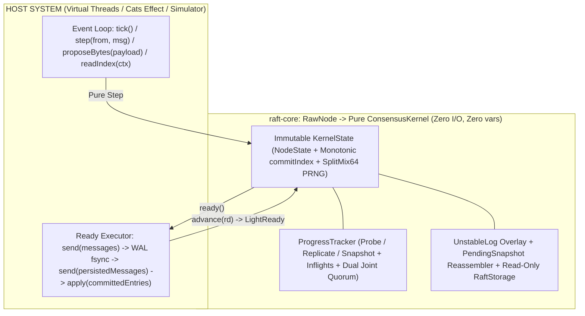
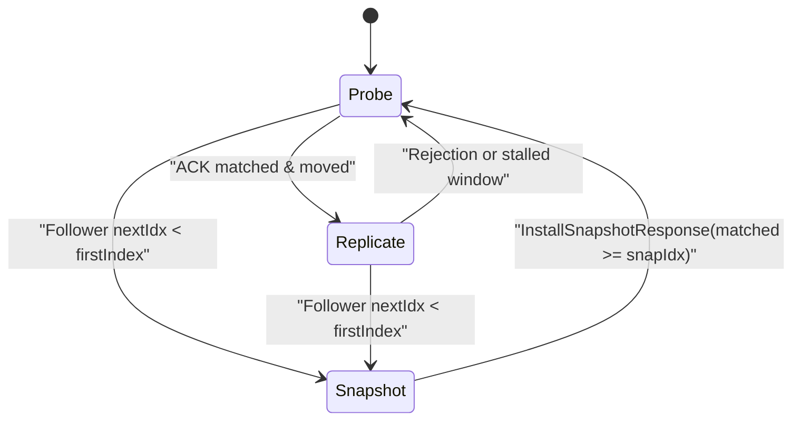
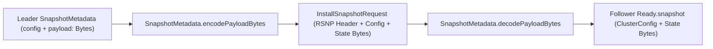

# Chapter 22: The Sans-I/O `RawNode` & `Ready` Architecture

*Why the strongest Raft implementations in the industry — `etcd/raft` in Go and `tikv/raft-rs` in Rust — refuse to own threads, sockets, or disk files, and how `raft-core`'s `RawNode`, `Ready`, `LightReady`, and `ProgressTracker` bring that exact Sans-I/O discipline to Scala 3 with zero external dependencies.*

---

## Why Consensus Should Never Own Your Runtime

In the JVM ecosystem, distributed consensus libraries have historically been packaged as heavyweight **frameworks**: importing one pulls in a specific RPC stack, thread-pool scheduler, serialization library, logging facade, and on-disk storage engine. When you embed such a framework inside an existing database, message broker, or actor system, two runtimes immediately fight over threads, backpressure, memory budgets, and `fsync` batching.

The Rust ecosystem (`tikv/raft-rs` and `openraft`, building on `etcd/raft`) inverted this relationship through **Sans-I/O consensus**:

1. **Consensus owns pure state and protocol correctness** — terms, quorums, log matching, conflict backtracking, leader completeness, `ReadIndex`, `CheckQuorum`, `LeadershipTransfer`, and Joint Consensus (`C_old,new` -> `C_new`).
2. **The host system owns I/O and scheduling** — WAL durability, network sockets, timers, batching, state-machine execution, and concurrency primitives (JDK 25 Virtual Threads, Cats Effect, ZIO, Pekko/Akka, Netty event loops, or single-threaded deterministic simulators).

In this library, `raft-core` has **zero third-party dependencies** (`libraryDependencies` is empty in `Compile`). You can drive consensus at two levels:

- **`RaftLogic`**: Pure stateless functions `(NodeState, RaftMessage, ...) => Transition(NodeState, List[Effect])` for single-step transition inspection.
- **`ConsensusKernel` & `RawNode`**: `ConsensusKernel` (`raft.kernel.ConsensusKernel`) is a **100% pure, `var`-free Mealy state machine** `(KernelState, input, RaftStorage) => KernelState` combining role transitions, `ProgressTracker` (`Probe` / `Replicate` / `Snapshot` + `Inflights`), SplitMix64 election jitter, multi-chunk snapshot reassembly, Joint Consensus rollback, and `Witness` payload stripping. `RawNode` is a thin ~120-line cursor over `ConsensusKernel` emitting atomic `Ready` and `LightReady` work batches.

---

## Architectural Overview



 Notice a critical directional rule borrowed from `tikv/raft-rs`:

> **`RawNode` only *reads* from `RaftStorage`; it never mutates storage directly.**

Every new log entry proposed on a leader or received on a follower is buffered in `RawNode`'s in-memory unstable overlay until emitted in `Ready.entries`. Only after your host system writes `Ready.entries` and `Ready.hardState` to durable storage and calls `rawNode.advance(ready)` does `RawNode` treat those entries as persisted in `RaftStorage`.

---

## The `RaftStorage` Read-Only Contract

`RawNode` queries committed/persisted log history through a minimal synchronous read view:

```scala
package raft.raw

import raft.state.{ClusterConfig, HardState, Log, SnapshotMetadata}

trait RaftStorage:
  def initialState: (HardState, ClusterConfig)
  def entries(low: Long, high: Long, maxBytes: Long = Long.MaxValue): Vector[Log]
  def term(index: Long): Option[Long]
  def firstIndex: Long
  def lastIndex: Long
  def snapshotMetadata: Option[SnapshotMetadata]
```

Why synchronous? Because consensus state machines need fast `term(prevLogIndex)` checks on every RPC. In production systems (TiKV, CockroachDB, etcd), recent log tails and term indices are cached in memory alongside the WAL, while compacted cold prefixes live in snapshots. `raft-core` includes `MemStorage` as an in-memory reference implementation.

---

## Inside `ProgressTracker`: `Probe`, `Replicate`, and `Snapshot`

A naive Raft leader blasts `AppendEntries` to every peer on every write regardless of whether that peer is online, lagging by 500,000 entries, or recovering from a partition. `RawNode` instead tracks each voter, learner, and witness through a 3-state machine modeled on `tikv/raft-rs`:



1. **`Probe`**: Used right after an election or after a rejection/packet drop. At most **one** probe RPC is in flight (`paused = true` until ACK/NACK). Rejections carry `(conflictTerm, conflictIndex)` hints so the leader jumps backward over entire conflicting terms in a single RTT instead of decrementing `nextIndex` one entry at a time.
2. **`Replicate`**: Entered once a follower confirms its exact `matchIndex`. The leader optimistically advances `nextIndex` and pipelines multiple `AppendEntries` batches concurrently, bounded by a zero-allocation `Inflights` ring buffer (`config.pipelining.maxInflight`) for natural backpressure. For `NodeRole.Witness` peers, `ConsensusKernel` automatically strips `LogType.Command` payload bytes (`Log.stripForWitness`) while preserving `(index, term)` metadata and `Configuration` entries.
3. **`Snapshot`**: Entered when a follower requires an entry older than `storage.firstIndex` (already compacted). Replication pauses while single-chunk or multi-chunk `InstallSnapshot` RPCs bring the follower up to `pendingSnapshot`.

> [!IMPORTANT]
> **Structural `hasUnpersistedTermOrVote` Guard (§5.1 / §5.2)** & **Configuration Truncation Rollback (§4.1)**:
> Inside `ConsensusKernel.enqueueMessage`, whenever `currentHardState.term != lastPersistedHardState.term` or `votedFor` has changed, **every** outbound message (even a read-only higher-term heartbeat reply) is automatically routed to `Ready.persistedMessages` so a node can never externally acknowledge a new term before flushing `HardState` to disk. Similarly, whenever an uncommitted `LogType.Configuration` (`RCFG` v2 binary + CRC32) entry is truncated by a new leader's `AppendEntries`, both `ConsensusKernel` and `MemStorage` deterministically reconstruct the active `ClusterConfig` from the latest snapshot plus surviving log entries.

---

## The `Ready` / `LightReady` Lifecycle and Persist-Before-Send Safety

One of the deadliest bugs in hand-rolled Raft engines is **sending an RPC response before flushing `HardState` or `entries` to disk**:

- If a node sends `RequestVoteResponse(voteGranted = true)` *before* `fsync`ing `votedFor`, crashes, and restarts, it can vote for a **different** candidate in the same term -> **split-brain (two leaders in one term)**.
- If a follower sends `AppendEntriesResponse(success = true, matchIndex = 10)` *before* `fsync`ing entry 10, crashes, and loses entry 10, the leader may commit entry 10 without a durable majority -> **lost committed write**.

`Ready` prevents this class of bugs structurally by splitting outbound messages into **two separate vectors**:

```scala
final case class Ready(
    softState: Option[SoftState] = None,
    hardState: Option[HardState] = None,
    truncateFromIndex: Option[Long] = None,
    entries: Vector[Log] = Vector.empty,
    snapshot: Option[SnapshotMetadata] = None,
    messages: Vector[OutboundMessage] = Vector.empty,          // Safe BEFORE fsync (leader parallel append)
    persistedMessages: Vector[OutboundMessage] = Vector.empty, // MUST send AFTER fsync!
    committedEntries: Vector[Log] = Vector.empty,
    readStates: Vector[ReadState] = Vector.empty
)
```

- **`messages`** (pre-persist): Outbound `AppendEntriesRequest`s from a leader whose term hasn't changed. Under Raft §10.2.1 (*Parallel Disk Write & Network Send*), the leader may transmit these to followers *concurrently* with its own local WAL `fsync`!
- **`persistedMessages`** (post-persist): `RequestVoteRequest`, `RequestVoteResponse`, and follower `AppendEntriesResponse` ACKs. Your host loop **must** flush `snapshot`, `truncateFromIndex`, `entries`, and `hardState` to stable storage *before* transmitting `persistedMessages`.

### Exact 6-Step Host Loop

```scala
if rawNode.hasReady then
  val rd = rawNode.ready()

  // 1. Optional: transmit optimistic leader messages concurrently with disk write
  sendOverNetwork(rd.messages)

  // 2. Persist snapshot, log truncation, unstable entries, and HardState (fsync!)
  rd.snapshot.foreach(wal.installSnapshotMetadata)
  rd.truncateFromIndex.foreach(wal.truncateFrom)
  if rd.entries.nonEmpty then wal.append(rd.entries)
  rd.hardState.foreach(wal.writeHardState)
  wal.fsync()

  // 3. Transmit messages that depend on durable HardState & log entries
  sendOverNetwork(rd.persistedMessages)

  // 4. Apply committed entries in order, then serve linearizable ReadStates
  rd.committedEntries.foreach { entry =>
    if entry.logType == LogType.Command then stateMachine.apply(entry.payload)
  }
  rd.readStates.foreach(serveReadState)

  // 5. Notify RawNode that Ready was persisted & applied; drain LightReady
  val light = rawNode.advance(rd)
  light.commitIndex.foreach(wal.updateCommitIndex)
  sendOverNetwork(light.messages)
  light.committedEntries.foreach { entry =>
    if entry.logType == LogType.Command then stateMachine.apply(entry.payload)
  }
```

### Why `LightReady` Exists

When a leader persists its own `Ready.entries` and calls `rawNode.advance(rd)`, the leader's own `matchIndex` advances to `lastLogIndex`:
- In a **1-node cluster**, that local flush immediately achieves quorum (1/1), advancing `commitIndex` and yielding `committedEntries` right inside `LightReady` — zero extra ticks required!
- When a **Joint Consensus** `C_old,new` entry commits during `advance`, `RawNode` automatically appends and broadcasts `C_new` in `LightReady.messages`.

---

## Inside `ConsensusKernel`: The Zero-`var` Mealy Engine Behind `RawNode`

`RawNode` itself is only ~120 lines — an `AtomicReference[KernelState]` cursor delegating 100% of protocol transitions to `raft.kernel.ConsensusKernel`. Understanding `KernelState` reveals why this design is unusually resilient:

- **Composite Log View (`UnstableLog` + `RaftStorage`)**: `UnstableLog(truncateFrom, entries, pendingSnapshot)` buffers unpersisted deltas purely in memory. `ConsensusKernel.termAt`, `lastLogIndex`, and `entriesBetween` layer `UnstableLog` seamlessly over read-only `RaftStorage` without ever mutating storage before the host calls `persistReady(rd)`.
- **Pure SplitMix64 Election Jitter (`prngState: Long`)**: Every randomized election timeout in `[electionTimeoutTicks, 2 * electionTimeoutTicks)` is computed purely from `prngState` via `ConsensusKernel.nextRandomizedTimeout` — eliminating hidden `java.util.Random` / `System.nanoTime()` calls so identical `(KernelState, input)` sequences are bit-for-bit identical across machines and JVMs.
- **Direct Functional Embedding**: Host systems built on Cats Effect `AtomicCell`, ZIO `Ref`, or pure functional actors can even call `ConsensusKernel` directly without `RawNode`'s `AtomicReference` wrapper.

---

## Self-Describing Snapshot Envelopes (`RSNP`) in `RawNode`

When a follower lags behind `storage.firstIndex`, a Sans-I/O leader must transmit **both** the compacted `ClusterConfig` (voters, learners, witnesses) **and** the serialized state-machine snapshot bytes inside `InstallSnapshotRequest.payload` (`Bytes`).

`SnapshotMetadata` provides a zero-dependency binary envelope (`magic = "RSNP"`, version `1` for in-memory `RawNode` frames via `encodePayloadBytes`/`decodePayloadBytes`, and version `2` streaming headers via `encodeStreamingHeader` for `raft-runtime` / `MmapWalEngine` disk streams):



On receipt, `ConsensusKernel` decodes the envelope, updates its `ProgressTracker` membership immediately if `config` is present, and surfaces the complete `SnapshotMetadata(lastIncludedIndex, lastIncludedTerm, config, payload)` in `Ready.snapshot` so the host loop can atomically restore its state machine and truncate obsolete WAL entries.

---

## Runnable Walkthrough: `RawNodeHostLoopExample` (JDK 25 Virtual Threads)

Run the standalone zero-Cats-Effect Sans-I/O cluster demo:

```bash
sbt "examples/runMain examples.rawnode.RawNodeHostLoopExample"
```

`RawNodeHostLoopExample.scala` (204 lines) imports **only** `raft-core` and standard `java.util.concurrent`:
1. Spawns 3 `VirtualThreadReplica` actors via `Executors.newVirtualThreadPerTaskExecutor()`, each owning a `LinkedBlockingQueue[HostEvent]` (`Tick`, `Inbound(from, msg)`, `Propose(bytes, reply)`, `Stop`) and a `RawNode(config, MemStorage)`.
2. Drives logical time cleanly with `inbox.poll(20, TimeUnit.MILLISECONDS)` — calling `raw.tick()` on poll timeout and `raw.step(from, msg)` on inbound delivery, with zero OS timer threads or mutex locks.
3. Executes the canonical 5-step `drainReadyCycle()` (`softState` → `dispatch(rd.messages)` → `storage.persistReady(rd)` → `dispatch(rd.persistedMessages)` → `applyEntries(rd.committedEntries)` → `raw.advance(rd)` → `LightReady`), proving how cleanly `raft-core` embeds inside any host concurrency model.

---

## Summary

| Component | Role | Inspiration |
|-----------|------|-------------|
| `ConsensusKernel` | 100% pure, `0`-`var` Mealy consensus engine (`KernelState`, `UnstableLog`, SplitMix64 PRNG) | Functional Mealy machines & TLA+ actions |
| `RawNode` | Thin cursor over `ConsensusKernel` (`tick`, `step`, `proposeBytes`, `proposeBatchBytes`, `readIndex`, `transferLeader`, `proposeConfChange`) | `tikv/raft-rs` `RawNode` |
| `Ready` | Point-in-time batch separating `messages` (pre-sync) from `persistedMessages` (post-sync via `hasUnpersistedTermOrVote`) | `etcd/raft` & `tikv/raft-rs` `Ready` |
| `LightReady` | Immediate post-persistence commit & broadcast follow-up returned by `advance(rd)` | `tikv/raft-rs` `LightReady` |
| `ProgressTracker` | `Probe` / `Replicate` / `Snapshot` per-peer state + `Inflights` + Joint Consensus dual quorum | `tikv/raft-rs` `ProgressTracker` |

---

*Next: [Chapter 23 — Host-System Integration Blueprints](23-host-system-integration.md) shows concrete patterns for wiring `raft-core` into Virtual Threads, Cats Effect (`raft-runtime`), memory-mapped WALs (`raft-storage-mmap`), and gRPC (`raft-transport-grpc`).*
