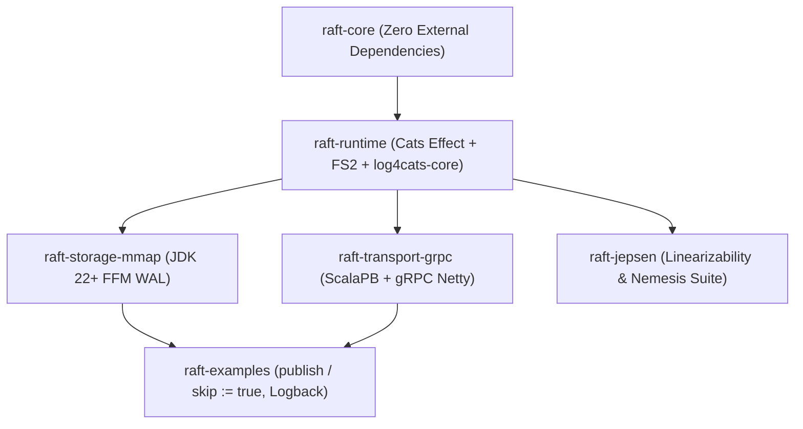
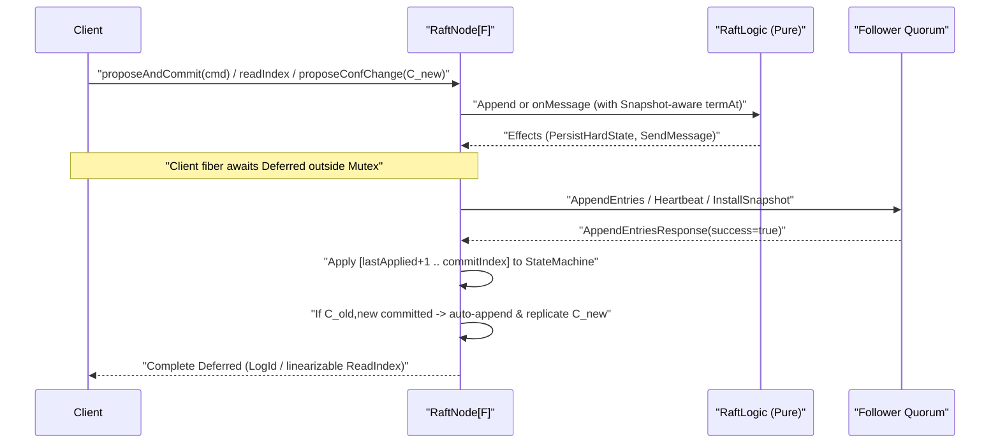

# Chapter 23: Host-System Integration Blueprints

*How the 6-module architecture lets you adopt only what you need — from embedding pure `raft-core` on JDK 25 Virtual Threads to assembling a full Cats Effect + FFM Mmap WAL + Netty gRPC cluster.*

---

## The 6-Module Architecture

To keep the consensus core dependency-free while offering production-ready building blocks, the repository is organized into six sbt modules:



| Module | Artifact | JDK Target | External Compile Dependencies | When to Choose |
|--------|----------|------------|-------------------------------|----------------|
| `modules/core` | `raft-core` | **JDK 21+** | **None (0 JARs)** | Embedding Raft inside your own actor system, Netty/Nio event loop, ZIO, Ox/Virtual Threads, or deterministic simulator |
| `modules/runtime` | `raft-runtime` | **JDK 21+** | `cats-effect`, `fs2-core`, `fs2-io`, `log4cats-core` | Turnkey functional runtime (`RaftNode`, `MultiRaftNode`, streaming `Snapshot[F]`, `CompactionManager`) |
| `modules/storage-mmap` | `raft-storage-mmap` | **JDK 22+/25** | `raft-runtime` (JDK `java.lang.foreign` FFM API) | Off-heap memory-mapped segmented WAL + CRC32 crash recovery |
| `modules/transport-grpc` | `raft-transport-grpc` | **JDK 22+/25** | `grpc-netty-shaded`, `scalapb-runtime-grpc` | Persistent HTTP/2 peer channels with Protobuf framing |
| `modules/jepsen` | *(internal)* | JDK 25 | `raft-runtime`, `scalatest` | Wing & Gong linearizability checker + partition/crash nemesis suite |
| `modules/examples` | *(internal)* | JDK 25 | All modules + `logback-classic` | 17 runnable end-to-end examples |

---

## Blueprint 1: Zero-Dependency JDK 25 Virtual Threads (`raft-core` Only)

When your host system manages its own threads and sockets, depend **only** on `raft-core`:

```scala
libraryDependencies += "com.github.bmscomp" %% "raft-core" % "<version>"
```

Because `RawNode` is intentionally not thread-safe (zero internal locks), the cleanest host architecture is **one Virtual Thread + one `BlockingQueue` mailbox per Raft group**:

1. Network reader threads decode wire bytes via `JsonCodec.byteCodec` (or your own Protobuf/FlatBuffers codec) and `offer(Inbound(sender, msg))` into the group's mailbox.
2. Client threads submit writes via `offer(Propose(bytes, replyPromise))`.
3. `inbox.poll(tickIntervalMs, MILLISECONDS)` drives `raw.tick()` on timeout or `raw.step(from, msg)` on arrival, followed by `if raw.hasReady then drainReady()`.

Because a single Virtual Thread owns `RawNode`, all consensus mutations are serialized without mutex contention, while thousands of Raft groups can run concurrently on a handful of carrier OS threads.

> **Runnable Reference:** See `modules/examples/src/main/scala/examples/rawnode/RawNodeHostLoopExample.scala` (`sbt "examples/runMain examples.rawnode.RawNodeHostLoopExample"`).

---

## Blueprint 2: Cats Effect + Custom Storage & Transport (`raft-runtime`)

If your service is already built on Typelevel Cats Effect 3 and FS2, `raft-runtime` provides `RaftNode[F]` and `MultiRaftNode[F]` over clean SPIs:

- **`LogStore[F]` & `StableStore[F]`**: Backed by RocksDB, PostgreSQL/SQLite, LMDB, or `raft-storage-mmap`.
- **`Transport[F, Wire]`**: Backed by `raft-transport-grpc`, HTTP/2, WebSockets, or `MultiGroupTransport[F]` for multi-group multiplexing.
- **`StateMachine[F, R]`**: Streaming `snapshot: F[Stream[F, Byte]]` and `restore(data: Stream[F, Byte]): F[Unit]` so large state snapshots never require contiguous heap arrays.

Typed consensus errors (`RaftError.NotLeader(leaderHint)`, `RaftError.ElectionInProgress`, `RaftError.LeadershipTransferInProgress(target)`, `RaftError.LeaderNotReadyInTerm(term)`, `RaftError.ConfigurationChangeInProgress(pending)`) let your RPC gateway route or retry client requests deterministically without string parsing.

### End-to-End `RaftNode[F]` Coordination Lifecycle

`RaftNode[F]` serializes state transitions under an internal `Mutex[F]` while suspending client fibers **outside** the lock via cancellable `Deferred` promises:



Key runtime invariants handled automatically by `RaftNode[F]`:
- **Two-Stage `ReadIndex` Barrier**: `node.readIndex` first awaits quorum heartbeat confirmation (`Effect.ReadIndexReady(id, commitIdx)`) and then suspends in `readApplyWaiters` until `lastApplied >= commitIdx`, ensuring the local `StateMachine` reflects all writes committed before the read started.
- **Zero-RTT Monotonic `leaseRead`**: When `leaseReadEnabled = true` and `checkQuorumEnabled = true`, quorum `AppendEntriesResponse` ACKs extend a monotonic `Clock[F].monotonic` deadline by `leaderLeaseDuration`; `node.leaseRead` returns `Some(commitIndex)` locally while the lease is valid and `None` upon expiry so callers can seamlessly fall back to `node.readIndex`.
- **Automatic Joint Consensus Finalization & Self-Removal Step-Down**: Calling `node.proposeConfChange(targetCluster)` automatically enters `C_old,new` when voter sets change, appends and commits `C_new` once `C_old,new` commits, steps down immediately if `C_new` removes the active leader from `voters`, and resolves the caller's `F[LogId]` once `C_new` is durably committed.

---

## Blueprint 3: Off-Heap Memory-Mapped WAL (`raft-storage-mmap`)

`MmapWalEngine` uses JDK's Foreign Function & Memory (`java.lang.foreign.Arena` + `MemorySegment`) API for zero-copy, off-heap segmented write-ahead logging:

- **Segmented rotation**: When an active segment (`wal-0000000001.seg`) fills past `segmentSize`, `MmapWalEngine` automatically syncs it and rotates to `wal-0000000002.seg`.
- **Zero-copy CRC32**: Checksums are computed directly over `MemorySegment.asSlice(...).asByteBuffer()` without allocating intermediate byte arrays or sharing non-thread-safe `CRC32` instances.
- **Compaction & crash recovery**: `discardBefore(snapshotIndex)` unmaps and deletes obsolete segment files while writing an index checkpoint; on restart, `recoverFromWal` parses actual segment IDs from filenames so compacted logs recover seamlessly from any starting segment number.

```scala
import java.nio.file.Paths
import cats.effect.IO
import raft.storage.{StorageBackedLogStore, StorageBackedStableStore}
import raft.storage.mmap.MmapWalEngine

val storageResource =
  MmapWalEngine.resource[IO](Paths.get("/var/lib/raft/group-0")).map { engine =>
    val logStore    = new StorageBackedLogStore[IO](engine)
    val stableStore = new StorageBackedStableStore[IO](engine)
    (logStore, stableStore)
  }
```

---

## Blueprint 4: Netty HTTP/2 Transport (`raft-transport-grpc`)

`GrpcTransport.resource[F]` binds a Netty HTTP/2 gRPC server (`RaftServiceGrpc.SendEnvelope`) and maintains a lazy pool of persistent `ManagedChannel` connections to peers:

```scala
import cats.effect.IO
import raft.codec.JsonCodec
import raft.spi.{Transport, TransportConfig}
import raft.state.NodeId
import raft.transport.grpc.{GrpcConfig, GrpcTransport}

val local = NodeId("node-1")
val peers = Map(
  NodeId("node-2") -> "10.0.1.12:9090",
  NodeId("node-3") -> "10.0.1.13:9090"
)

val raftTransportResource =
  GrpcTransport
    .resource[IO](
      GrpcConfig(host = "0.0.0.0", port = 9090),
      TransportConfig(local, "0.0.0.0:9090", peers)
    )
    .map(raw => Transport.withCodec(raw, JsonCodec.byteCodec))
```

Notice two operational details built into `GrpcTransport`:
1. **Dynamic membership routing**: Call `grpcTransport.updatePeers(newMap)` whenever a Joint Consensus configuration change adds or retires nodes.
2. **Fault isolation**: If peer `node-3` crashes or is network-partitioned, `send(node-3, msg)` logs and absorbs the `UNAVAILABLE` status so `broadcast` continues replicating to `node-2` without disrupting the leader's event loop.

---

## Integration Checklist Before Production

1. **Batch `fsync` per `Ready`**, never per log entry: persist `truncateFromIndex`, all `entries`, and `hardState` in one write batch before sending `persistedMessages`.
2. **Fence stale leaders on reads**: always serve linearizable reads via `ReadIndex` (`rawNode.readIndex(ctx)`) or `LeaseRead` with `checkQuorumEnabled = true`, waiting until `lastApplied >= readState.index` before reading local state-machine state.
3. **Bound in-memory logs via snapshots**: trigger `compactTo` / `CompactionManager` periodically so `RaftStorage` stays bounded and restarted followers replay seconds of WAL rather than hours.

---

*Next: [Chapter 24 — Deterministic Simulation Testing for Consensus](24-deterministic-simulation-testing.md) shows how Sans-I/O `RawNode` unlocks FoundationDB/TigerBeetle-style seeded chaos simulation in milliseconds.*
