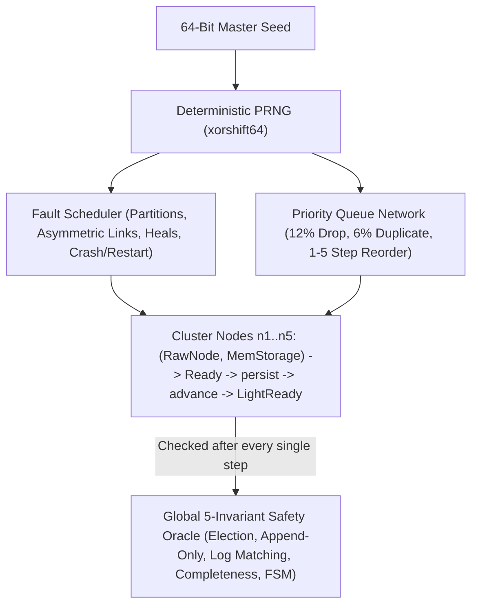

# Chapter 24: Deterministic Simulation Testing for Consensus

*How FoundationDB, TigerBeetle, and `raft-core` compress hours of multi-node network partitions, packet reordering, and crash-restarts into sub-second single-threaded runs — with 100% reproducible 64-bit seeds.*

---

## Beyond Unit Tests and Wall-Clock Integration Tests

Distributed consensus bugs rarely live on the happy path. They hide at the intersection of **three simultaneous anomalies**:

> *"Leader A in term 3 sends a pipelined batch `[2, 3]`, packet `[2, 3]` is dropped while `nextIndex` already advanced to 4, A gets partitioned, Leader B wins term 5 and commits entry 2, the partition heals, and Follower C receives an empty heartbeat with `prevLogIndex = 1, leaderCommit = 2` while still holding unverified stale entry 2 from term 3."*

Try catching that with traditional testing:
- **Unit tests** only test scenarios a human author explicitly imagined.
- **Wall-clock multi-threaded chaos tests (like Jepsen)** are indispensable for testing real concurrency and I/O adapters, but take seconds to minutes per schedule and are **non-deterministic** when OS thread scheduling shifts by 1 millisecond.

**Deterministic Simulation Testing (DST)** — pioneered by **FoundationDB** and popularized by **TigerBeetle (VOPR)** and Rust's **MadSim** — gives you a superpower:

1. Run an entire 3- or 5-node `RawNode` cluster on **one single thread**.
2. Replace wall-clock time with logical ticks (`rawNode.tick()`).
3. Route every `OutboundMessage` through a **seeded simulated network** that drops, duplicates, delays, reorders, and asymmetrically partitions packets according to a deterministic PRNG (`xorshift64`).
4. Periodically **crash and restart** nodes by discarding their in-memory `RawNode` and reconstructing a fresh `RawNode` from their durable `MemStorage` (`HardState` + persisted `Log` entries).
5. Assert all **five Raft safety invariants** after *every single step*.

If Seed `2` fails at Step `127` in CI, re-running Seed `2` on your laptop six months later executes the **exact same instruction sequence** and hits Step `127` in **under 5 milliseconds**.

---

## Anatomy of `raft-core`'s Deterministic Simulator

Because `RawNode` accepts an `initialSeed: Long` for its internal election-timeout jitter PRNG and performs zero I/O, the entire simulator is ~200 lines of pure Scala (`DeterministicSimulationSpec`):



---

## Real Consensus Subtlety Caught by DST in This Codebase

During development of `RawNode`, running `DeterministicSimulationSpec` across 16 adversarial seeds caught **two subtle consensus bugs** within 0.8 seconds — both classic subtle pitfalls documented in Raft literature:

### Bug 1: Receiver Step 5 `commitIndex` Bound on Empty Heartbeats (Seed 2, Step 127)

Section 5.3 (Figure 2, *AppendEntries RPC — Receiver implementation, Rule 5*) of the Raft paper states:

> *If `leaderCommit > commitIndex`, set `commitIndex = min(leaderCommit, index of last new entry)`.*

Notice the exact phrasing: **index of last *new* entry** (`req.prevLogIndex + req.entries.length`), **NOT** `lastLogIndex` of the follower's unverified tail!

What happened on Seed 2, Step 127?
1. Node `n3` accepted an uncommitted entry at `index = 2, term = 3` from an old leader before a partition.
2. In `term = 5`, new leader `n1` committed a *different* entry at `index = 2, term = 5` on `{n1, n2}`, then sent an initial heartbeat to `n3` with `prevLogIndex = 1, prevLogTerm = 1, entries = [], leaderCommit = 2`.
3. `n3` matched `(index = 1, term = 1)`! Because `entries` was empty, `n3` had **not yet verified or overwritten `index = 2`**. Had `n3` clamped `leaderCommit` against `lastLogIndex` (`2`) instead of `prevLogIndex + entries.size` (`1`), `n3` would immediately commit its stale `term = 3` entry at `index = 2` -> **State Machine Safety violation!**
4. Clamping strictly to `math.min(req.leaderCommit, req.prevLogIndex + req.entries.size)` (and clamping `leaderCommit <= prevLogIndex` on probes) eliminated the bug completely.

### Bug 2: Pipelined `Replicate` Stall Under Packet Loss

When a follower is in `ProgressState.Replicate`, the leader optimistically advances `nextIndex = lastLogIndex + 1` as it pipelines batches `[2..4]`. If all in-flight packets `[2..4]` are dropped by the network:
- On the next heartbeat tick, the follower responds with `AppendEntriesResponse(success = true, matchIndex = 1)`.
- Because `matchIndex` did not advance (`moved == false`) and `matchIndex (1) < lastLogIndex (4)`, a leader that keeps the follower in `Replicate` with `nextIndex = 5` will never resend `[2..4]`!
- Transitioning `Replicate -> Probe` (resetting `nextIndex = matchIndex + 1`) whenever `!moved && matched < lastLogIndex` — matching `tikv/raft-rs`'s `handle_heartbeat_response` — immediately recovers full liveness after arbitrary packet loss.

---

## Checking All Five Safety Invariants Continuously

Unlike black-box tests that only inspect final cluster state, a white-box DST harness inspects global state after **every single simulated step**:

1. **Election Safety**: Record `(term -> nodeId)` whenever any node enters `NodeState.Leader`; assert no two distinct `NodeId`s ever lead in the same `term`.
2. **Leader Append-Only**: Snapshot a leader's persisted + unstable log entries on every step while it remains leader in `term`; assert its log at step $t+1$ always has step $t$'s log as an exact prefix.
3. **Log Matching**: Across every pair of nodes $(A, B)$ and every index $i$ present in both logs, if `logA(i).term == logB(i).term`, assert `logA(k) == logB(k)` for all $k \le i$.
4. **Leader Completeness**: Whenever any entry $(i, \text{term}, \text{payload})$ becomes committed on *any* node, record it in a global `committedTruth: Map[Long, Log]` map; assert every subsequent `Leader` with `currentTerm > entry.term` already possesses that exact entry at index $i$.
5. **State Machine Safety**: Record every `Log` emitted in `Ready.committedEntries` / `LightReady.committedEntries` per node; assert no two nodes ever apply differing `(index, term, data)` tuples.

---

## Running DST Locally and in CI

- **Fast PR gate** (~850ms):
  ```bash
  sbt "core/testOnly raft.dst.DeterministicSimulationSpec"
  ```
- **Standalone runnable demo**:
  ```bash
  sbt "examples/runMain examples.simulation.DeterministicSimulationExample"
  ```
- **Defense in depth**: Combine millisecond-fast **DST** (`raft-core`) with concurrent **WGL Linearizability + Nemesis chaos testing** (`sbt jepsenSmoke` / `sbt jepsenStress` in `raft-jepsen`) so both pure protocol logic and concurrent `Cats Effect` runtime scheduling are continuously verified.
