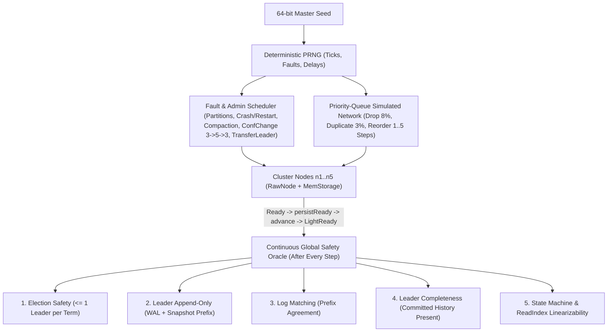
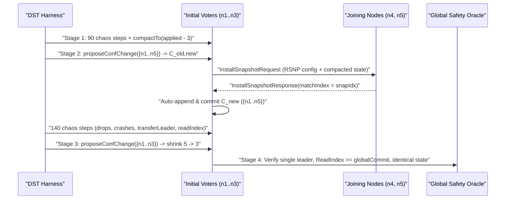

# Chapter 24: Deterministic Simulation Testing for Consensus

*How FoundationDB, TigerBeetle, and `raft-core` compress hours of multi-node network partitions, packet reordering, dynamic Joint Consensus, snapshot transfers, and crash-restarts into sub-second single-threaded runs — with 100% reproducible 64-bit seeds.*

---

## Beyond Unit Tests and Wall-Clock Integration Tests

Distributed consensus bugs rarely live on the happy path. They hide at the intersection of **three simultaneous anomalies**:

> *"Leader A in term 3 sends a pipelined batch `[2, 3]`, packet `[2, 3]` is dropped while `nextIndex` already advanced to 4, A gets partitioned, Leader B wins term 5 and commits entry 2, the partition heals, and Follower C receives an empty heartbeat with `prevLogIndex = 1, leaderCommit = 2` while still holding unverified stale entry 2 from term 3."*

Try catching that with traditional testing:
- **Unit tests** only test scenarios a human author explicitly imagined.
- **Wall-clock multi-threaded chaos tests (like Jepsen)** are indispensable for testing real concurrency and I/O adapters, but take seconds to minutes per schedule and are **non-deterministic** when OS thread scheduling shifts by 1 millisecond.

**Deterministic Simulation Testing (DST)** — pioneered by **FoundationDB** and popularized by **TigerBeetle (VOPR)** and Rust's **MadSim** — gives you a superpower:

1. Run an entire 3- or 5-node `RawNode` cluster on **one single thread**.
2. Replace wall-clock time with logical ticks (`rawNode.tick()`).
3. Route every `OutboundMessage` through a **seeded simulated network** that drops, duplicates, delays, reorders, and asymmetrically partitions packets according to a deterministic PRNG (`SplitMix64` / seeded `Random`).
4. Periodically **compact logs**, **expand and shrink membership (`3 -> 5 -> 3`)**, **transfer leadership**, **issue `ReadIndex` queries**, and **crash/restart nodes** from durable `MemStorage` (`SnapshotMetadata` + `HardState` + persisted `Log` entries).
5. Assert all **five Raft safety invariants** plus **`ReadIndex` linearizability** after *every single step*.

If Seed `203` fails at Step `127` in CI, re-running Seed `203` on your laptop six months later executes the **exact same instruction sequence** and hits Step `127` in **under 5 milliseconds**.

---

## Anatomy of `raft-core`'s Deterministic Simulator

Because `RawNode` accepts an `initialSeed: Long` for its internal election-timeout jitter PRNG and performs zero I/O, the entire simulator in `DeterministicSimulationSpec` runs deterministically in memory:



---

## Real Consensus Subtleties Caught by DST in This Codebase

Running `DeterministicSimulationSpec` across adversarial seeds surfaced **four classic consensus subtleties** documented in Raft literature:

### Bug 1: Receiver Step 5 `commitIndex` Bound on Empty Heartbeats (Seed 2, Step 127)

Section 5.3 (Figure 2, *AppendEntries RPC — Receiver implementation, Rule 5*) of the Raft paper states:

> *If `leaderCommit > commitIndex`, set `commitIndex = min(leaderCommit, index of last new entry)`.*

Notice the exact phrasing: **index of last *new* entry** (`req.prevLogIndex + req.entries.length`), **NOT** `lastLogIndex` of the follower's unverified tail!

What happened on Seed 2, Step 127?
1. Node `n3` accepted an uncommitted entry at `index = 2, term = 3` from an old leader before a partition.
2. In `term = 5`, new leader `n1` committed a *different* entry at `index = 2, term = 5` on `{n1, n2}`, then sent an initial heartbeat to `n3` with `prevLogIndex = 1, prevLogTerm = 1, entries = [], leaderCommit = 2`.
3. `n3` matched `(index = 1, term = 1)`. Because `entries` was empty, `n3` had **not yet verified or overwritten `index = 2`**. Had `n3` clamped `leaderCommit` against `lastLogIndex` (`2`) instead of `prevLogIndex + entries.size` (`1`), `n3` would immediately commit its stale `term = 3` entry at `index = 2` — a **State Machine Safety violation**!
4. Clamping strictly to `math.min(req.leaderCommit, req.prevLogIndex + req.entries.size)` (and clamping `leaderCommit <= prevLogIndex` on probes) eliminated the bug completely.

### Bug 2: Pipelined `Replicate` Stall Under Packet Loss

When a follower is in `ProgressState.Replicate`, the leader optimistically advances `nextIndex = lastLogIndex + 1` as it pipelines batches `[2..4]`. If all in-flight packets `[2..4]` are dropped by the network:
- On the next heartbeat tick, the follower responds with `AppendEntriesResponse(success = true, matchIndex = 1)`.
- Because `matchIndex` did not advance (`moved == false`) and `matchIndex (1) < lastLogIndex (4)`, a leader that keeps the follower in `Replicate` with `nextIndex = 5` will never resend `[2..4]`.
- Transitioning `Replicate -> Probe` (resetting `nextIndex = matchIndex + 1`) whenever `!moved && matched < lastLogIndex` — matching `tikv/raft-rs`'s `handle_heartbeat_response` — immediately recovers full liveness after arbitrary packet loss.

### Bug 3: Lease Revocation Upon Initiating Leadership Transfer (`TimeoutNowRequest`)

Leader leases (`leaseReadEnabled = true`) rely on follower **leader stickiness**: followers reject `RequestVote` RPCs while their election timeout has not elapsed since the last valid leader heartbeat. However, `TimeoutNowRequest` (§3.10) intentionally sets `isTransfer = true` on the transferee's `RequestVoteRequest` so the transferee can win an election **immediately** without waiting for `electionTimeoutTicks`.

If the outgoing leader retains `leaseUntil > logicalTick` after calling `transferLeader(target)`, a partitioned outgoing leader could still serve a stale local lease read *after* `target` has already won the new term and committed writes! Clearing `leaseUntil = 0L` immediately in both `RawNode.transferLeader` and `RaftLogic.onTransferLeadership` forces any concurrent read on the outgoing leader onto quorum `ReadIndex` verification, preserving strict linearizability.

### Bug 4: `prevIdx = 0` Snapshot Bypass When an Empty Voter Joins After Compaction (Seed 201, Step 144)

When expanding a cluster (`3 -> 5` Joint Consensus) *after* the initial 3 voters compacted entries `1..5` (`firstIndex = 6`), brand-new voter `n4` starts with an empty log (`matched = 0`). After `n4` rejects the initial probe with `conflictIndex = 1`, the leader decrements `n4`'s `nextIdx` to `1`:
- Computing `prevIdx = nextIdx - 1 = 0` queries `termAt(0)`, which by Raft's empty-log sentinel convention always returns `Some(0L)`!
- An overly narrow guard `if pr.nextIdx < firstAvail && prevTermOpt.isEmpty` evaluated to `false` at `nextIdx = 1` because `termAt(0)` was defined (`Some(0L)`), causing the leader to skip `InstallSnapshotRequest` and send `AppendEntriesRequest(prevLogIndex = 0, entries = [6, 7, ...])` — creating a 5-entry hole at the head of `n4`'s state machine!
- Requiring `(pr.nextIdx < firstAvail || prevTermOpt.isEmpty) && storage.snapshotMetadata.isDefined` (and retrying dropped snapshots when a heartbeat ACK reports `matched < snapIdx`) closed both the safety hole and the packet-drop stall.

---

## Full-Feature Chaos: Joint Consensus (`3 -> 5 -> 3`), Compaction, `InstallSnapshot`, and `ReadIndex`

Beyond static 3-node and 5-node clusters, `DeterministicSimulationSpec` runs a **multi-stage full-feature chaos suite** across seeds `201..206`:



1. **Snapshot State Transfer**: When `compactNodeLog` truncates a node's WAL prefix via `MemStorage.compactTo`, it serializes the applied `EntryFingerprint` prefix directly into `SnapshotMetadata.data`. Lagging or newly added voters (`n4`, `n5`) automatically receive `InstallSnapshotRequest` frames carrying the `RSNP` binary envelope, restore their simulated state machines from `Ready.snapshot`, and verify every restored entry against `committedHistory`.
2. **Dynamic Joint Consensus (`3 -> 5 -> 3`)**: The cluster expands from `{n1, n2, n3}` to `{n1..n5}` via `C_old,new -> C_new` auto-finalization, runs 140 steps of partitions/crashes/transfers, and then shrinks back to `{n1, n2, n3}` — automatically stepping down `n4` or `n5` if either holds leadership when `C_{1..3}` commits.
3. **`ReadIndex` Linearizability Oracle**: Every time `readIndex(ctx)` is invoked on any live leader (even a stale leader inside a minority partition!), the harness records `minRequiredIdx = max(committedHistory.keys)`. Whenever `Ready.readStates` emits `ReadState(index, ctx)`, the oracle asserts `index >= minRequiredIdx` — proving stale leaders never emit stale read states.

---

## Checking All Five Safety Invariants Continuously

Unlike black-box tests that only inspect final cluster state, a white-box DST harness inspects global state after **every single simulated step**:

1. **Election Safety**: Record `(term -> nodeId)` whenever any node enters `NodeState.Leader`; assert no two distinct `NodeId`s ever lead in the same `term`.
2. **Leader Append-Only**: Snapshot a leader's persisted log entries on every step while it remains leader in `term`; assert every entry remains identical in either the WAL suffix or compacted snapshot.
3. **Log Matching**: Across every pair of nodes $(A, B)$ and every index $i$ present in both logs, if `logA(i).term == logB(i).term`, assert `logA(k) == logB(k)` for all $k \le i$.
4. **Leader Completeness**: Whenever any entry $(i, \text{term}, \text{payload})$ becomes committed on *any* node, record it in `committedHistory`; assert every subsequent `Leader` with `currentTerm > entry.term` possesses that exact entry in its WAL or installed snapshot.
5. **State Machine Safety**: Record every `Log` applied via `Ready.committedEntries`, `LightReady.committedEntries`, or `Ready.snapshot`; assert no two nodes ever apply differing `(index, term, data)` tuples.

---

## Running DST Locally and in CI

- **Fast PR gate** (~1s):
  ```bash
  sbt "core/testOnly raft.dst.DeterministicSimulationSpec"
  ```
- **Standalone runnable demo**:
  ```bash
  sbt "examples/runMain examples.simulation.DeterministicSimulationExample"
  ```
- **Defense in depth**: Combine millisecond-fast **DST** (`raft-core`) with concurrent **WGL Linearizability + Nemesis chaos testing** (`sbt jepsenSmoke` / `sbt jepsenStress` in `raft-jepsen`) and full-stack **gRPC + FFM WAL crash-recovery suites** (`modules/itest`) so pure protocol logic, fiber scheduling, and native I/O adapters are all continuously verified.
