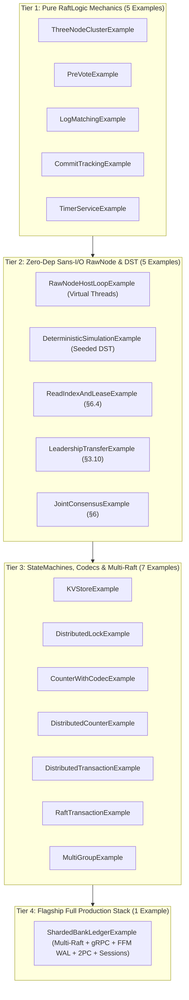

# Appendix B: Annotated Guide to All 18 Runnable Examples

*Every concept in this book is backed by runnable, continuously verified Scala 3 code under `modules/examples/src/main/scala/examples/` (`ExamplesVerificationSpec` + `AdvancedShardedLedgerE2ESpec`). This appendix catalogs all 18 examples by architectural tier, explains the exact Raft protocol strength and implementation design choice each one proves, and charts four guided learning paths.*

---

## How the 18 Examples Map to the Architecture



Run the automated test suites that verify all 18 examples end-to-end:

```bash
sbt "examples/test"
```

---

## Tier 1: Pure `RaftLogic` Protocol Mechanics (5 Examples)

These five examples isolate individual Raft invariants using stateless `RaftLogic.onMessage` transitions — zero sockets, zero disk files, microsecond execution.

### 1. `ThreeNodeClusterExample`
- **Command:** `sbt "examples/runMain examples.cluster.ThreeNodeClusterExample"`
- **Source:** `modules/examples/src/main/scala/examples/cluster/ThreeNodeClusterExample.scala`
- **Book Chapters:** [Chapter 2](02-raft-fundamentals.md), [Chapter 6](06-core-api.md), [Chapter 8](08-getting-started.md)
- **What Happens:** Manually steps three in-memory `Follower` values (`node-1`, `node-2`, `node-3`, `preVoteEnabled = false`) through a complete election: `ElectionTimeout` on `node-1` emits `PersistHardState(1, Some(node-1))` + `Broadcast(RequestVoteRequest)` → `node-2` and `node-3` grant votes → `node-1` achieves 2/3 majority, promotes to `Leader(term = 1)`, and emits initial heartbeat `AppendEntriesRequest`s.
- **Design Strength Proved:** Demonstrates how pure `(NodeState, RaftMessage) => Transition(NodeState, List[Effect])` separates protocol correctness from networking and thread scheduling.

### 2. `PreVoteExample`
- **Command:** `sbt "examples/runMain examples.protocol.PreVoteExample"`
- **Source:** `modules/examples/src/main/scala/examples/protocol/PreVoteExample.scala`
- **Book Chapters:** [Chapter 3](03-raft-advanced-theory.md), [Chapter 11](11-failure-modes.md)
- **What Happens:** Runs four scenarios: (1) `Follower(term = 5)` on `ElectionTimeout` with `preVoteEnabled = true` enters `PreCandidate(term = 5)` without mutating `HardState` and probes peers for term `6` (`isPreVote = true`); (2) collects 2 peer pre-votes in a 5-node cluster (3/5 majority) before promoting to `Candidate(term = 6)`; (3) contrasts `preVoteEnabled = false`; (4) subjects a partitioned node to three timeouts — term stays frozen at `5` with Pre-Vote vs. inflating `5 → 6 → 7 → 8` without it.
- **Design Strength Proved:** Proves §9.6 Pre-Vote eliminates healing-partition leader disruption while requiring zero extra RPC types (reusing `RequestVoteRequest.isPreVote`).

### 3. `LogMatchingExample`
- **Command:** `sbt "examples/runMain examples.protocol.LogMatchingExample"`
- **Source:** `modules/examples/src/main/scala/examples/protocol/LogMatchingExample.scala`
- **Book Chapters:** [Chapter 2](02-raft-fundamentals.md), [Chapter 4](04-safety-proofs-implemented.md), [Chapter 9](09-log-replication-practice.md)
- **What Happens:** Exercises all four §5.3 follower consistency-check branches using an injected pure `getTermAt: Long => Option[Long]`: (1) empty log (`prevLogIndex = 0`) accepts; (2) matching `(prevLogIndex = 5, prevLogTerm = 2)` accepts and emits `AppendLogs`; (3) short log (`prevLogIndex = 100` vs `lastLogIndex = 50`) rejects; (4) term conflict at index `10` (follower term `3` vs leader term `4`) rejects to trigger backtracking and truncation.
- **Design Strength Proved:** Shows how Raft's inductive Log Matching Property verifies arbitrarily long log prefixes in `O(1)` per RPC, and how injecting `getTermAt` decouples protocol validation from any storage engine.

### 4. `CommitTrackingExample`
- **Command:** `sbt "examples/runMain examples.protocol.CommitTrackingExample"`
- **Source:** `modules/examples/src/main/scala/examples/protocol/CommitTrackingExample.scala`
- **Book Chapters:** [Chapter 2](02-raft-fundamentals.md), [Chapter 4](04-safety-proofs-implemented.md), [Chapter 9](09-log-replication-practice.md)
- **What Happens:** Initializes a 5-node `Leader(term = 5)` (`nextIndex = 101`, `matchIndex = 0`), records follower replication progress (`100, 100, 75, 50`), computes the quorum median `75` via `calculateCommitIndex(5, getTermAt)` (enforcing §5.4.2's current-term rule), broadcasts `leaderCommit = 75` via `HeartbeatTimeout`, and feeds that heartbeat to a follower to emit `CommitEntries(LogIndex(75))`.
- **Design Strength Proved:** Illustrates why replication and commitment are separate phases, and how `Leader.calculateCommitIndex` encodes Raft's Figure 8 defense in pure arithmetic.

### 5. `TimerServiceExample`
- **Command:** `sbt "examples/runMain examples.protocol.TimerServiceExample"`
- **Source:** `modules/examples/src/main/scala/examples/protocol/TimerServiceExample.scala`
- **Book Chapters:** [Chapter 2](02-raft-fundamentals.md), [Chapter 7](07-spi-layer.md)
- **What Happens:** Uses `DefaultTimerService[IO]` to (1) generate five randomized election timeouts (breaking FLP symmetry), (2) fire an election fiber, (3) cancel an election fiber mid-flight when a heartbeat arrives (proving zero spurious firing), and (4) chain periodic 50ms heartbeat fibers.
- **Design Strength Proved:** Demonstrates cancellable `Fiber`-based timer resets (`TimerService[F]`) compatible with Cats Effect's `TestControl` virtual clock.

---

## Tier 2: Zero-Dependency Sans-I/O `RawNode`, Virtual Threads & DST (5 Examples)

These five examples import **zero Cats Effect or FS2 runtime code**, exercising `raft-core`'s `RawNode` (`ConsensusKernel`), `MemStorage`, `Ready` / `LightReady`, and `ProgressTracker` directly.

### 6. `RawNodeHostLoopExample`
- **Command:** `sbt "examples/runMain examples.rawnode.RawNodeHostLoopExample"`
- **Source:** `modules/examples/src/main/scala/examples/rawnode/RawNodeHostLoopExample.scala`
- **Book Chapters:** [Chapter 5](05-design-philosophy.md), [Chapter 22](22-sans-io-rawnode-ready.md), [Chapter 23](23-host-system-integration.md)
- **What Happens:** Runs a 3-node cluster on JDK 25 Virtual Threads (`Executors.newVirtualThreadPerTaskExecutor()`), each owning a `LinkedBlockingQueue[HostEvent]` and a `RawNode`. Drives logical ticks via `inbox.poll(20, MILLISECONDS)` and executes the canonical 5-step `drainReadyCycle()` (`softState` → `rd.messages` → `storage.persistReady(rd)` → `rd.persistedMessages` → `rd.committedEntries` → `raw.advance(rd)` → `LightReady`), proposing and converging 3 KV writes across all 3 actors.
- **Design Strength Proved:** Proves `raft-core` is genuinely framework-agnostic (zero third-party JARs) and enforces the `Ready.messages` vs. `Ready.persistedMessages` Persistence-Before-RPC barrier cleanly inside a host-owned event loop.

### 7. `DeterministicSimulationExample`
- **Command:** `sbt "examples/runMain examples.simulation.DeterministicSimulationExample"`
- **Source:** `modules/examples/src/main/scala/examples/simulation/DeterministicSimulationExample.scala`
- **Book Chapters:** [Chapter 5](05-design-philosophy.md), [Chapter 24](24-deterministic-simulation-testing.md)
- **What Happens:** Simulates a 5-node `RawNode` cluster on **one single thread** for 300 discrete steps under seed `20261115L`, injecting 10% packet drops, 1–3 tick delays/reordering, 45-step partition toggles, and 70-step crash-restarts from `MemStorage`. Asserts Election Safety and State Machine Safety after *every step*, then executes the entire 300-step simulation a second time and asserts `require(run1 == run2)`.
- **Design Strength Proved:** Proves FoundationDB / TigerBeetle-style **bit-for-bit deterministic replay** enabled by `ConsensusKernel`'s `0`-`var` pure design and embedded SplitMix64 PRNG.

### 8. `ReadIndexAndLeaseExample`
- **Command:** `sbt "examples/runMain examples.protocol.ReadIndexAndLeaseExample"`
- **Source:** `modules/examples/src/main/scala/examples/protocol/ReadIndexAndLeaseExample.scala`
- **Book Chapters:** [Chapter 3](03-raft-advanced-theory.md), [Chapter 10](10-performance-vs-safety.md), [Chapter 11](11-failure-modes.md)
- **What Happens:** Runs two 3-node `RawNode` clusters side by side: (1) `leaseReadEnabled = false` confirms `ReadIndex` in 1 heartbeat RTT when healthy and immediately **blocks** reads when the leader is partitioned; (2) `leaseReadEnabled = true` serves zero-RTT local `ReadState`s while the `CheckQuorum` lease is active, then steps the isolated leader down to `Follower` once 22 ticks elapse without quorum.
- **Design Strength Proved:** Makes the latency vs. clock-bound safety trade-off of Raft §6.4 and §6.2 `CheckQuorum` tangible and observable in one deterministic run.

### 9. `LeadershipTransferExample`
- **Command:** `sbt "examples/runMain examples.protocol.LeadershipTransferExample"`
- **Source:** `modules/examples/src/main/scala/examples/protocol/LeadershipTransferExample.scala`
- **Book Chapters:** [Chapter 3](03-raft-advanced-theory.md), [Chapter 11](11-failure-modes.md)
- **What Happens:** Elects `node-1`, isolates `node-3` while committing `"tx-1"` and `"tx-2"`, reconnects `node-3`, and invokes `transferLeader(node-3)`. Proves that (a) writes to `node-1` during transfer are immediately fenced (`Left(RaftError.LeadershipTransferInProgress)`), (b) `node-1` catches up `node-3` and sends `TimeoutNowRequest`, and (c) `node-3` wins leadership in **zero election-timeout ticks**.
- **Design Strength Proved:** Demonstrates §3.10 zero-downtime planned handoffs (used for rolling upgrades and `MultiRaftNode.rebalanceLeadership`).

### 10. `JointConsensusExample`
- **Command:** `sbt "examples/runMain examples.cluster.JointConsensusExample"`
- **Source:** `modules/examples/src/main/scala/examples/cluster/JointConsensusExample.scala`
- **Book Chapters:** [Chapter 3](03-raft-advanced-theory.md), [Chapter 11](11-failure-modes.md)
- **What Happens:** Migrates a live cluster from `{n1, n2, n3}` directly to `{n2, n3, n4, n5}` via `proposeConfChange(targetMembers)` — entering dual-quorum `C_old,new` (`isInJointConsensus == true`), automatically appending and committing `C_new` inside `LightReady` once `C_old,new` commits, and committing `"post-reconfig-write"` across the new 4-voter quorum.
- **Design Strength Proved:** Proves safe simultaneous multi-node add+remove reconfiguration (§6) via `ProgressTracker`'s dual-quorum voting and commit math.

---

## Tier 3: Application `StateMachine`s, Codecs & Multi-Raft (7 Examples)

These examples show how real distributed services layer onto `StateMachine[F, R]`, `SimpleMessageCodec`, `RaftLogic`, and `MultiRaftNode`.

### 11. `KVStoreExample`
- **Command:** `sbt "examples/runMain examples.kvstore.KVStoreExample"`
- **Source:** `modules/examples/src/main/scala/examples/kvstore/KVStoreExample.scala`
- **Book Chapters:** [Chapter 12](12-case-distributed-kv.md)
- **What Happens:** Implements `KVStateMachine[F]` (`StateMachine[F, KVResult]`) with `Put`, `Delete`, `Get`, `CAS`, and sorted streaming `snapshot` / `restore`. Runs a two-phase Pre-Vote → Real Vote election via `RaftLogic.onMessage(..., clusterOpt = Some(cluster))`, logs 3 `Put`s + 1 `Delete`, and verifies state transitions.
- **Design Strength Proved:** Clean separation between consensus replication, command encoding, and typed `StateMachine[F, KVResult]` domain logic.

### 12. `DistributedLockExample`
- **Command:** `sbt "examples/runMain examples.lock.DistributedLockExample"`
- **Source:** `modules/examples/src/main/scala/examples/lock/DistributedLockExample.scala`
- **Book Chapters:** [Chapter 13](13-case-distributed-lock.md)
- **What Happens:** Implements `LockStateMachine[F]` (`Acquire`, `Release`, `Heartbeat`, owner checks, TTL expiration, streaming `snapshot`/`restore`) and exercises mutual exclusion: `client-1` acquires `resource-a` → `client-2` is denied → `client-1` releases → `client-2` acquires.
- **Design Strength Proved:** Shows how consensus log ordering turns distributed mutual exclusion into a ~100-line sequential state machine (with Raft's `LogIndex` doubling as a monotonic fencing token).

### 13. `CounterWithCodecExample`
- **Command:** `sbt "examples/runMain examples.counter.CounterWithCodecExample"`
- **Source:** `modules/examples/src/main/scala/examples/counter/CounterWithCodecExample.scala`
- **Book Chapters:** [Chapter 7](07-spi-layer.md), [Chapter 14](14-case-distributed-counter.md)
- **What Happens:** Implements a custom pipe-delimited `SimpleMessageCodec[TextWireMessage]` alongside `CounterStateMachine[IO]`, executes a Pre-Vote/Vote election, applies `Increment(10)`, `Increment(5)`, `Decrement(3)` → `12`, and round-trip encodes/decodes a `RequestVoteRequest(isPreVote = true)`.
- **Design Strength Proved:** Proves protocol messages are completely decoupled from wire serialization via `MessageCodec`.

### 14. `DistributedCounterExample`
- **Command:** `sbt "examples/runMain examples.distributed.DistributedCounterExample"`
- **Source:** `modules/examples/src/main/scala/examples/distributed/DistributedCounterExample.scala`
- **Book Chapters:** [Chapter 14](14-case-distributed-counter.md)
- **What Happens:** Builds a full 3-node in-memory cluster (`SimulatedNode` + `SimulatedNetwork` `Queue` bus + explicit `Effect` interpreter), runs Pre-Vote + Vote election, replicates `Increment`, `Increment`, `Add(10)`, `Decrement`, propagates commit via `HeartbeatTimeout`, and proves all 3 replicas converge to `11`.
- **Design Strength Proved:** Bridges single-node `RaftLogic` calls to a complete multi-node message-passing cluster and effect executor.

### 15. `DistributedTransactionExample`
- **Command:** `sbt "examples/runMain examples.distributed.DistributedTransactionExample"`
- **Source:** `modules/examples/src/main/scala/examples/distributed/DistributedTransactionExample.scala`
- **Book Chapters:** [Chapter 15](15-case-distributed-transactions.md)
- **What Happens:** Implements an atomic multi-key `TransactionalStore[F]` with two-phase local OCC validation (check all `CompareAndSet` preconditions before applying `Put` / `Delete` / `CompareAndSet` / `Increment`) and versioned `snapshot`/`restore`, running 5 scenarios (transfer, CAS success, CAS conflict leaving state untouched, commutative `Increment`, and 4-op user-creation + audit transaction).
- **Design Strength Proved:** Shows how encoding an entire multi-key transaction as **one Raft log entry** delivers strict serializability with zero lock tables or deadlock detection.

### 16. `RaftTransactionExample`
- **Command:** `sbt "examples/runMain examples.distributed.RaftTransactionExample"`
- **Source:** `modules/examples/src/main/scala/examples/distributed/RaftTransactionExample.scala`
- **Book Chapters:** [Chapter 15](15-case-distributed-transactions.md)
- **What Happens:** Replicates `TransactionalStore[IO]` across a 3-node `RaftTransactionNode` cluster via `RaftLogic`, elects `node-1` via Pre-Vote + Vote, replicates account creation and a multi-key CAS transfer (`alice: 1000→800`, `bob: 500→700`, `audit:transfer`), commits via `HeartbeatTimeout`, and asserts all 3 nodes hold identical database maps.
- **Design Strength Proved:** Connects single-shard OCC state machines to full 3-node Raft log replication (contrasting cleanly with cross-shard 2PC in `ShardedBankLedgerExample`).

### 17. `MultiGroupExample`
- **Command:** `sbt "examples/runMain examples.distributed.MultiGroupExample"`
- **Source:** `modules/examples/src/main/scala/examples/distributed/MultiGroupExample.scala`
- **Book Chapters:** [Chapter 21](21-multi-raft-groups.md)
- **What Happens:** Boots a 3-host `MultiGroupTransport` mesh with `CoalescedHeartbeatConfig(enabled = true, flushInterval = 10.millis, maxBatchSize = 16)`, runs 3 `MultiRaftNode` coordinators hosting `shard-0` (`a`–`m`) and `shard-1` (`n`–`z`), commits sharded writes (`alice`, `bob`, `nancy`, `zara`), verifies `readIndexFromGroup` on both shards, hot-adds and removes `shard-2` dynamically, and asserts full 3-replica convergence on both shards.
- **Design Strength Proved:** Cleanest blueprint for horizontal Multi-Raft sharding, `O(1)` per-group bounded mailboxes, coalesced heartbeats, and dynamic shard lifecycle management.

---

## Tier 4: Flagship Full Production Stack (1 Example)

### 18. `ShardedBankLedgerExample` *(1,529 Lines — Every Production Module Combined)*
- **Command:** `sbt "examples/runMain examples.advanced.ShardedBankLedgerExample"`
- **Source:** `modules/examples/src/main/scala/examples/advanced/ShardedBankLedgerExample.scala`
- **Book Chapters:** [Chapter 15](15-case-distributed-transactions.md), [Chapter 18](18-end-to-end-integration.md), [Chapter 21](21-multi-raft-groups.md), [Chapter 23](23-host-system-integration.md)
- **Modules Exercised:** `raft-core` + `raft-runtime` + `raft-storage-mmap` + `raft-transport-grpc`
- **Architecture & Execution Flow:**
  1. Boots 3 physical hosts (`host-1..3`) with single-port Netty HTTP/2 `GrpcTransport.multiGroupResource` (`ProtobufMultiGroupCodec` + `CoalescedHeartbeatConfig(flushInterval = 12.millis, maxBatchSize = 32, coalesceResponses = true)`) and 12 independent off-heap FFM `MmapWalEngine` stores (`tx-coord` + `ledger-shard-0..2` × 3 hosts, `CompactionPolicy.threshold(20L)`), with `BatchConfig(maxSize = 16, maxWait = 5.millis)` and `PipelineConfig(maxInflight = 6)`.
  2. Batch-seeds 6 bank accounts (`acct-1..6`, 1,000 each = 6,000) via `proposeBatchAndCommitToGroup` and balances shard leadership evenly across hosts via `rebalanceLeadership`.
  3. Executes cross-shard 2PC transfers (`tx-coord` logs `Begin` → shards lock escrow `Hold`s via `PrepareDebit`/`PrepareCredit` → `tx-coord` logs `DecideCommit`/`DecideAbort` → idempotent `Commit2PC`/`Abort2PC` → `MarkCompleted`), same-shard single-entry fast-path transfers, an intentional overdraft (`5,000`) proving clean 2PC hold release on abort, and a retried deposit (`cli-pos`, `seq = 1`, `+150`) proving snapshotted `(clientId, seqNum)` exactly-once idempotency.
  4. Runs linearizable `auditGlobalBalances` (`leaseReadFromGroup` with `readIndexFromGroup` fallback) proving exact conservation of money (`6,150`), `0` leaked escrow holds, and live `CoalescerStats` heartbeat compression — while `AdvancedShardedLedgerE2ESpec` additionally tests host crash-restart on the same TCP port & WAL directory and mid-2PC coordinator recovery (`injectInterrupted2PC` + `recoverInFlightTransactions`).
- **Design Strength Proved:** Demonstrates that every design idea in this book — pure consensus safety, typed `StateMachine`s, off-heap FFM WAL compaction, single-port multiplexed gRPC with coalesced heartbeats, Raft-backed fault-tolerant 2PC, and snapshotted client sessions — composes seamlessly into a real, crash-resilient distributed transactional database.

---

## Guided Learning Paths

| Reader Profile | Recommended Example Order | Companion Chapters |
|----------------|--------------------------|-------------------|
| **Protocol Theorist** | `ThreeNodeClusterExample` → `LogMatchingExample` → `CommitTrackingExample` → `PreVoteExample` → `ReadIndexAndLeaseExample` → `JointConsensusExample` → `LeadershipTransferExample` | Chapters 1–4, 9–11 |
| **Sans-I/O Systems Engineer** | `RawNodeHostLoopExample` → `DeterministicSimulationExample` → `JointConsensusExample` → `ReadIndexAndLeaseExample` | Chapters 5–6, 22–24 |
| **Distributed Apps Developer** | `KVStoreExample` → `DistributedLockExample` → `CounterWithCodecExample` → `DistributedCounterExample` → `DistributedTransactionExample` → `RaftTransactionExample` | Chapters 7–8, 12–15 |
| **Production Multi-Raft Architect** | `MultiGroupExample` → `ShardedBankLedgerExample` → `sbt itest/test` → `sbt jepsenSmoke` | Chapters 10, 17–21, 23 |
