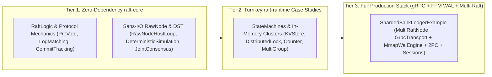

# Examples

This directory contains runnable, end-to-end verified examples demonstrating every layer of the Functional RAFT Library — from zero-dependency Sans-I/O `RawNode` loops and deterministic chaos simulation up to a full production **Multi-Shard Transactional Bank Ledger** over Netty HTTP/2 gRPC and JDK FFM `MmapWalEngine`.

## Architecture Tiers Covered by Examples



---

## Examples Overview

| Example | Package / File | Key Concepts |
|---------|----------------|--------------|
| **Sharded Bank Ledger (Flagship)** | `advanced/ShardedBankLedgerExample.scala` | 3-host `MultiRaftNode` + single-port `GrpcTransport.multiGroupResource` (`CoalescedHeartbeatConfig`) + `MmapWalEngine` snapshots + group-commit batching + Cross-Shard 2PC + `(clientId, seqNum)` idempotency + crash recovery |
| **RawNode Host Loop** | `rawnode/RawNodeHostLoopExample.scala` | Zero-dependency Sans-I/O `Ready` / `LightReady` host loop on JDK Virtual Threads |
| **Deterministic Simulation** | `simulation/DeterministicSimulationExample.scala` | Seeded single-threaded 5-node chaos simulator with packet drops, partitions, crash-restarts, and bit-for-bit replay |
| **ReadIndex & LeaseRead** | `protocol/ReadIndexAndLeaseExample.scala` | Quorum-verified `ReadIndex` vs. zero-RTT `LeaseRead` & `CheckQuorum` step-down (§6.4) |
| **Leadership Transfer** | `protocol/LeadershipTransferExample.scala` | Catch-up replication, proposal fencing, and zero-downtime `TimeoutNow` handoff (§3.10) |
| **Joint Consensus** | `cluster/JointConsensusExample.scala` | Dual-quorum `C_old,new` -> `C_new` live cluster migration (`{n1,n2,n3} -> {n2,n3,n4,n5}`) (§6) |
| **Multi-Group Sharded KV** | `distributed/MultiGroupExample.scala` | 3-node `MultiRaftNode` cluster with `CoalescedHeartbeatConfig`, shard routing (`a-m` / `n-z`), `readIndexFromGroup`, and dynamic shard lifecycle |
| **Raft Transactions** | `distributed/RaftTransactionExample.scala` | 3-node replicated `TransactionalStore` with optimistic CAS conflict detection |
| **Distributed Transactions** | `distributed/DistributedTransactionExample.scala` | Multi-key atomic `Put` / `Delete` / `CompareAndSet` / `Increment` & versioned snapshots |
| **Distributed Counter** | `distributed/DistributedCounterExample.scala` | 3-node Pre-Vote + Vote election, `AppendEntries` replication, and `CommitEntries` convergence |
| **KV Store** | `kvstore/KVStoreExample.scala` | `StateMachine[F, KVResult]` with `Put`, `Delete`, `CAS`, and snapshot/restore |
| **Distributed Lock Service** | `lock/DistributedLockExample.scala` | Mutual-exclusion locks with TTL expiration, reentrant renewal, and owner verification |
| **Counter with Custom Codec** | `counter/CounterWithCodecExample.scala` | Custom wire format via `SimpleMessageCodec[TextWireMessage]` |
| **3-Node Cluster** | `cluster/ThreeNodeClusterExample.scala` | Pure `RaftLogic.onMessage` 3-voter election and heartbeat acknowledgment |
| **Pre-Vote Protocol** | `protocol/PreVoteExample.scala` | Two-phase `PreCandidate -> Candidate` election preventing partitioned term inflation (§9.6) |
| **Log Matching** | `protocol/LogMatchingExample.scala` | `prevLogIndex` / `prevLogTerm` consistency checks and conflict rejection (§5.3) |
| **Commit Tracking** | `protocol/CommitTrackingExample.scala` | Majority `matchIndex` median calculation and current-term commit rule (§5.4.2) |
| **Timer Service** | `protocol/TimerServiceExample.scala` | Randomized election jitter and cancellable `DefaultTimerService` fibers |

---

## Flagship Advanced Example: `ShardedBankLedgerExample`

`examples/advanced/ShardedBankLedgerExample.scala` integrates **every production module** (`raft-core`, `raft-runtime`, `raft-storage-mmap`, `raft-transport-grpc`) into a multi-shard payment clearing platform:

- **Multiplexed Single-Port gRPC**: 3 physical servers (`host-1`, `host-2`, `host-3`), each multiplexing `tx-coord` + 3 `ledger-shard-*` groups over one Netty HTTP/2 port using `ProtobufMultiGroupCodec` and `CoalescedHeartbeatConfig`.
- **Off-Heap FFM Storage & Compaction**: 12 independent `MmapWalEngine` instances (`hard_state.bin`, segmented `.wal` files, and `RSNP` snapshots preserving balances, active 2PC holds, and client session tables).
- **Group-Commit Batching & Pipelining**: Concurrent proposals coalesce via `BatchConfig` (`proposeBatchAndCommitToGroup`) and stream across `PipelineConfig` `Inflights`.
- **Cross-Shard Atomic 2PC + Crash Recovery**: Escrows source funds via `PrepareDebit`, logs atomic commit/abort decisions in `tx-coord`, applies idempotent `Commit2PC` / `Abort2PC`, and recovers interrupted mid-flight transactions via `recoverInFlightTransactions`.

```bash
# Run the interactive flagship demo
sbt "examples/runMain examples.advanced.ShardedBankLedgerExample"

# Run the dedicated E2E test suite for the flagship example + all 17 examples
sbt "examples/test"
```

---

## Running All 18 Examples

```bash
# Flagship full-stack Multi-Raft + gRPC + MmapWalEngine + 2PC ledger
sbt "examples/runMain examples.advanced.ShardedBankLedgerExample"

# Sans-I/O RawNode & Deterministic Simulation (zero Cats Effect dependencies)
sbt "examples/runMain examples.rawnode.RawNodeHostLoopExample"
sbt "examples/runMain examples.simulation.DeterministicSimulationExample"

# Protocol mechanics & cluster reconfiguration
sbt "examples/runMain examples.protocol.PreVoteExample"
sbt "examples/runMain examples.protocol.LogMatchingExample"
sbt "examples/runMain examples.protocol.CommitTrackingExample"
sbt "examples/runMain examples.protocol.TimerServiceExample"
sbt "examples/runMain examples.protocol.ReadIndexAndLeaseExample"
sbt "examples/runMain examples.protocol.LeadershipTransferExample"
sbt "examples/runMain examples.cluster.ThreeNodeClusterExample"
sbt "examples/runMain examples.cluster.JointConsensusExample"

# Application case studies & Multi-Raft
sbt "examples/runMain examples.kvstore.KVStoreExample"
sbt "examples/runMain examples.lock.DistributedLockExample"
sbt "examples/runMain examples.counter.CounterWithCodecExample"
sbt "examples/runMain examples.distributed.DistributedCounterExample"
sbt "examples/runMain examples.distributed.RaftTransactionExample"
sbt "examples/runMain examples.distributed.DistributedTransactionExample"
sbt "examples/runMain examples.distributed.MultiGroupExample"
```
