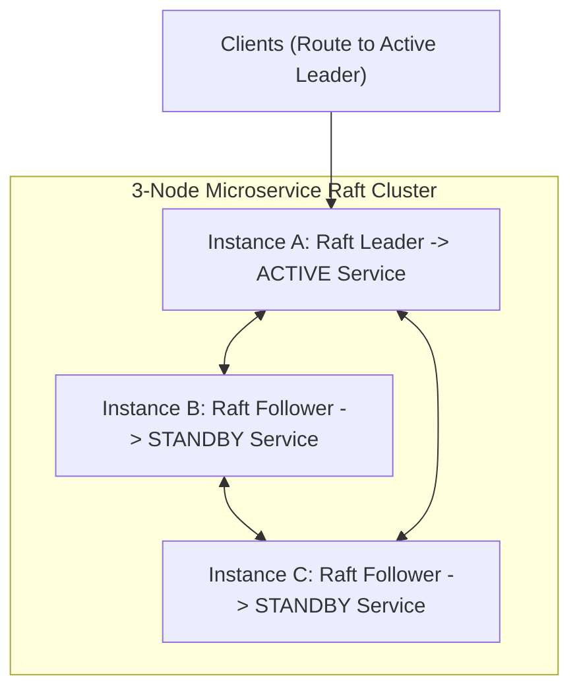
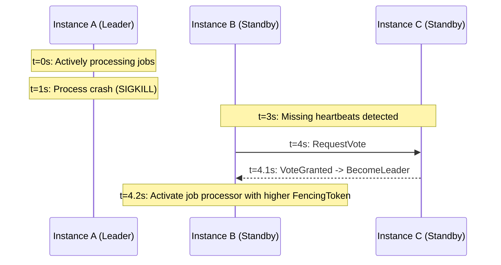
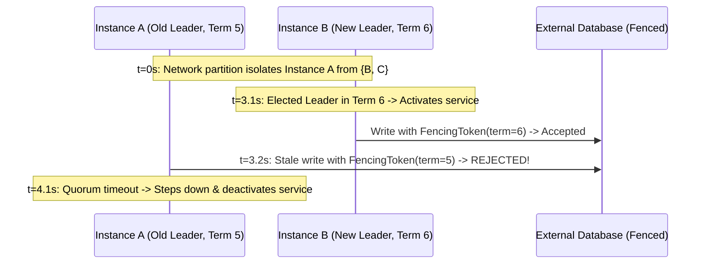
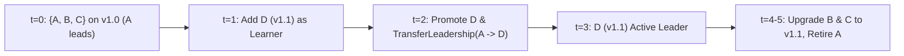

# Tutorial 2: Leader Election for Microservices

*How to guarantee exactly one active instance of a service — the pattern behind Kubernetes controller managers, database primaries, and job schedulers.*

---

## The Problem

Many distributed applications need a **single active leader** from a pool of identical instances:

- **Database primary**: Only one instance writes; replicas serve reads
- **Job scheduler**: Only one instance schedules cron jobs to avoid duplicate execution
- **Payment processor**: Only one instance processes the payment queue to prevent double charges
- **Cache warmer**: Only one instance pre-populates an expensive cache

The naive approach — "whichever instance starts first is the leader" — fails catastrophically:

1. **No failure detection**: If the leader crashes, no one takes over
2. **Split-brain**: After a network partition heals, two instances both think they're the leader
3. **No handoff**: When deploying a new version, the old leader and new leader overlap

Traditional solutions use a distributed lock (Redis, ZooKeeper), but locks have their own problems: what happens when the lock holder crashes without releasing the lock? What timeout do you set? Too short and you get false failovers; too long and you get extended downtime.

## Why Raft Is Better Than a Lock

Raft's leader election isn't just a lock — it's a **continuously validated lease** with automatic failover:

| Feature | Distributed lock | Raft leader election |
|---------|-----------------|---------------------|
| **Failure detection** | Relies on TTL expiration | Heartbeat-based, configurable timeout |
| **Failover speed** | Wait for full TTL | Election completes in ~1 RTT after detection |
| **Split-brain prevention** | Depends on clock accuracy | Guaranteed by quorum voting — no clocks needed |
| **Controlled handoff** | Release + re-acquire (gap) | Leadership transfer — seamless, zero-gap |
| **Fencing** | Must implement separately | Term number is a built-in fencing token |

## Architecture



The key insight: **the application service is active only on the Raft leader node.** When leadership changes, the service activates on the new leader and deactivates on the old one.

## The Fencing Token Pattern

When a leader starts doing work (processing jobs, writing to a database), it must prove it's still the leader at the time the work takes effect. A **fencing token** is a monotonically increasing number that external systems can use to reject stale leaders:

```scala
import raft.state.NodeState
import raft.state.NodeState.*

case class FencingToken(term: Long, nodeId: NodeId):
  def isNewerThan(other: FencingToken): Boolean =
    this.term > other.term ||
    (this.term == other.term && this.nodeId != other.nodeId)

def currentFencingToken(state: NodeState, nodeId: NodeId): Option[FencingToken] =
  state match
    case Leader(term, _) => Some(FencingToken(term, nodeId))
    case _               => None
```

The Raft **term** is a perfect fencing token because:
- It's monotonically increasing across the cluster
- Only one leader exists per term (Election Safety)
- A deposed leader's term is always lower than the current leader's term

### Using fencing tokens with external systems

```scala
def processPayment(payment: Payment, token: FencingToken): IO[Unit] =
  for
    // Include the fencing token in the database write
    _ <- database.execute(
      """INSERT INTO payments (id, amount, fencing_term, fencing_node)
        |VALUES (?, ?, ?, ?)
        |ON CONFLICT (id) DO UPDATE
        |SET amount = EXCLUDED.amount
        |WHERE payments.fencing_term < EXCLUDED.fencing_term""".stripMargin,
      payment.id, payment.amount, token.term, token.nodeId.value
    )
  yield ()
```

If a stale leader (term 5) tries to write after the new leader (term 6) has already written, the `WHERE` clause rejects the stale write. No split-brain data corruption.

## Implementation: The Leader Lifecycle

### Step 1: Detect leadership changes

The `BecomeLeader` effect signals that this node just won an election. Use it to activate your service:

```scala
import raft.effect.Effect
import raft.effect.Effect.*
import cats.effect.{IO, Ref}

enum ServiceState:
  case Active(term: Long, cancelToken: IO[Unit])
  case Standby

class LeaderLifecycleManager(
  serviceStateRef: Ref[IO, ServiceState],
  nodeId: NodeId
):

  def interpretEffect(effect: Effect, currentTerm: Long): IO[Unit] =
    effect match
      case BecomeLeader =>
        activateService(currentTerm)

      case PersistHardState(newTerm, _) if newTerm > currentTerm =>
        // Stepped down — deactivate if we were the leader
        deactivateService()

      case _ => IO.unit

  private def activateService(term: Long): IO[Unit] =
    for
      _ <- deactivateService()  // clean up any prior state
      _ <- IO.println(s"[$nodeId] Became leader in term $term — activating service")

      // Start the active service (e.g., a job processor)
      fiber <- startJobProcessor(term).start
      cancelToken = fiber.cancel

      _ <- serviceStateRef.set(ServiceState.Active(term, cancelToken))
    yield ()

  private def deactivateService(): IO[Unit] =
    serviceStateRef.getAndSet(ServiceState.Standby).flatMap {
      case ServiceState.Active(term, cancel) =>
        IO.println(s"[$nodeId] Stepping down from term $term — deactivating") *>
        cancel  // cancel the running service fiber
      case ServiceState.Standby =>
        IO.unit
    }

  private def startJobProcessor(term: Long): IO[Unit] =
    val token = FencingToken(term, nodeId)
    fs2.Stream
      .repeatEval(processNextJob(token))
      .handleErrorWith { e =>
        fs2.Stream.eval(
          IO.println(s"[$nodeId] Job processor error: ${e.getMessage}")
        )
      }
      .compile
      .drain

  private def processNextJob(token: FencingToken): IO[Unit] =
    for
      job <- jobQueue.dequeue
      _   <- IO.println(s"Processing job ${job.id} with fencing token $token")
      _   <- processPayment(job.payment, token)
    yield ()
```

### Step 2: Graceful leadership transfer

When deploying a new version, you don't want 10 seconds of downtime while the old leader's election timeout expires. Use leadership transfer for a seamless handoff:

```scala
import raft.effect.Effect.TransferLeadership

def gracefulShutdown(targetNode: NodeId): IO[Unit] =
  for
    _ <- IO.println(s"Initiating leadership transfer to $targetNode")
    // This produces a TransferLeadership effect, followed by TimeoutNow
    // The target node starts an election immediately (no timeout wait)
    _ <- raftNode.transferLeadership(targetNode)
    _ <- deactivateService()
  yield ()
```

The transfer protocol:
1. Leader stops accepting new writes
2. Leader replicates all pending entries to the target
3. Leader sends `TimeoutNow` to the target
4. Target immediately starts an election (no random timeout)
5. Target wins (its log is up-to-date) → `BecomeLeader` effect fires on the target

**Result**: Zero-gap leadership handoff. The old leader deactivates, the new leader activates, and the service is never interrupted.

## State Machine: Minimal

For leader-election-only use cases, the state machine is trivial — you don't need to replicate data, just maintain leadership:

```scala
class LeaderElectionStateMachine extends StateMachine[IO, Unit]:
  def apply(log: Log): IO[Unit] = IO.unit   // no-ops only
  def snapshot: IO[Array[Byte]] = IO.pure(Array.empty)
  def restore(data: Array[Byte]): IO[Unit] = IO.unit
```

The Raft log still serves a purpose: the leader's initial no-op entry (appended on `BecomeLeader`) confirms leadership and allows the leader to commit entries from prior terms.

## Configuration for Leader Election

When using Raft purely for leader election (not data replication), tune the configuration for fast failover:

```scala
val config = RaftConfig(
  localId = nodeId,

  // Fast failure detection — detect leader loss in ~2 seconds
  heartbeatInterval = 200.millis,
  electionTimeoutMin = 2000.millis,
  electionTimeoutMax = 4000.millis,

  // Pre-Vote prevents a rejoining node from disrupting the leader
  preVoteEnabled = true,

  // Leader stickiness prevents unnecessary elections from eager followers
  leaderStickinessEnabled = true,

  // No data replication optimizations needed
  batching = BatchConfig(enabled = false),
  pipelining = PipelineConfig(enabled = false),
  parallelReplicationEnabled = false
)
```

### Timeout tuning guide

| Environment | Heartbeat | Election timeout | Rationale |
|------------|-----------|-----------------|-----------|
| Same datacenter | 100ms | 1-2s | Low latency, fast detection |
| Cross-datacenter | 500ms | 5-10s | High latency, avoid false failovers |
| Cloud (shared VMs) | 200ms | 2-5s | Noisy neighbors cause jitter |

The rule of thumb from the Raft paper: `electionTimeout >> heartbeatInterval × 10`. This ensures that occasional heartbeat delays don't trigger spurious elections.

## Failure Scenarios

### Scenario 1: Leader process crash



**Downtime**: ~3-4 seconds (configurable via election timeout). The fencing token ensures that any in-flight work from Instance A is safely rejected by external systems.

### Scenario 2: Network partition



**Brief overlap**: Between t=3.1 and t=4.1, both A and B think they're the leader. This is where fencing tokens are critical — Instance A's writes with term 5 are rejected by any system that has already seen term 6.

### Scenario 3: Rolling deployment



**Result**: Zero-downtime deployment with controlled leadership transfer. At no point is the service interrupted.

## Production Considerations

### Health checks

Expose the leadership state as a health check endpoint:

```scala
def healthCheck: IO[HealthStatus] =
  serviceStateRef.get.map {
    case ServiceState.Active(term, _) =>
      HealthStatus(healthy = true, role = "leader", term = term)
    case ServiceState.Standby =>
      HealthStatus(healthy = true, role = "standby", term = 0)
  }
```

Load balancers can route traffic only to the active leader, or distribute read traffic to standby instances.

### Monitoring alerts

| Metric | Alert threshold | Meaning |
|--------|----------------|---------|
| Elections per hour | > 5 | Unstable leader — check network or timeouts |
| Time since last leadership change | < 60s (repeated) | Flapping — increase election timeout |
| Service activation latency | > 5s | Slow startup — optimize service initialization |
| Fencing token rejections | > 0 | Split-brain detected — investigate network |

---

*Next: [Tutorial 3 — Replicated Task Queue](03-replicated-task-queue.md) — ensuring every task executes exactly once, even when workers crash.*
