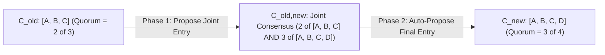
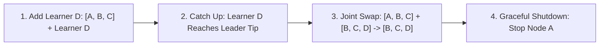
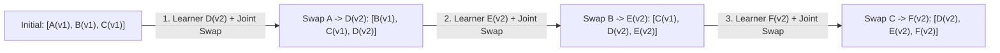
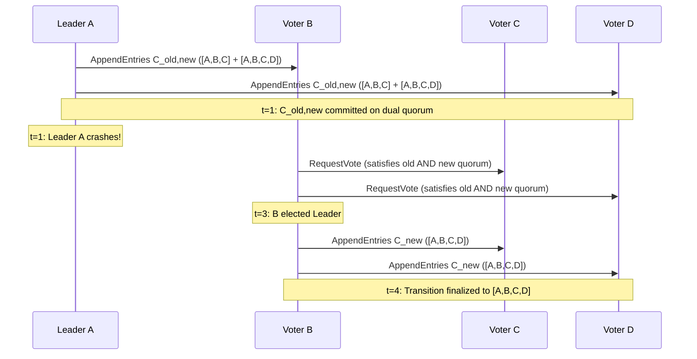
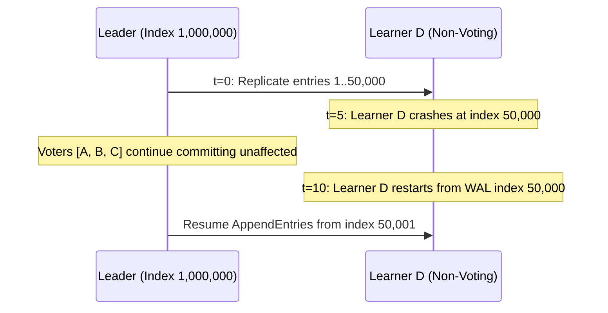
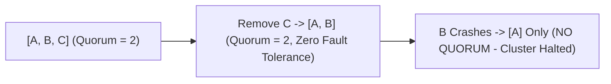

# Tutorial 5: Cluster Membership Management

*How to add servers, remove servers, and replace the entire cluster — without losing a single write. The operational runbook you wish existed for every consensus system.*

---

## The Problem

Every Raft cluster eventually needs membership changes:

- **Scaling up**: Adding a 4th and 5th node for higher read throughput and fault tolerance
- **Replacing hardware**: Swapping out a failing disk by moving a node to a new server
- **Rolling upgrades**: Replacing nodes one-by-one with a new software version
- **Scaling down**: Removing an unnecessary node to save costs

The danger is **split-brain during the transition**. If you naively change from a 3-node cluster to a 4-node cluster, there's a moment where:
- Old config (3 nodes): quorum = 2
- New config (4 nodes): quorum = 3
- A majority of the old config (2 nodes) and a majority of the new config (3 nodes) could overlap by **only 1 node** — meaning two independent majorities could elect two leaders

This isn't theoretical. The Raft paper dedicates an entire section (§6) to this problem, and real systems (including early etcd versions) have hit it in production.

## Joint Consensus: The Safe Approach

The library implements **joint consensus** (Raft §6), where membership changes go through a two-phase protocol that guarantees no two majorities can exist simultaneously:

1. **Phase 1 (`C_old -> C_old,new`)**: Commit a joint configuration entry where **both** the old majority and the new majority must agree.
2. **Phase 2 (`C_old,new -> C_new`)**: Once `C_old,new` commits, commit the final configuration entry where the new quorum takes effect.

During the joint phase (`C_old,new`), every decision (election, commit) requires agreement from **both** a majority of the old config **and** a majority of the new config. This eliminates split-brain by construction.



## The ClusterConfig Type

The library's `ClusterConfig` encodes the cluster membership state:

```scala
import raft.state.{ClusterConfig, NodeId, NodeRole}

// A normal (non-transitioning) configuration
val threeNodeCluster = ClusterConfig(
  voters = Set(NodeId("A"), NodeId("B"), NodeId("C"))
)

// Entering joint consensus toward a 4-node configuration
val jointConfig = threeNodeCluster.beginJointConsensus(
  Map(
    NodeId("A") -> NodeRole.Voter,
    NodeId("B") -> NodeRole.Voter,
    NodeId("C") -> NodeRole.Voter,
    NodeId("D") -> NodeRole.Voter
  )
)

// Finalizing after the joint entry commits
val fourNodeCluster = jointConfig.completeJointConsensus
```

Key invariants enforced by the library:
- Each member holds an explicit `NodeRole` (`Voter`, `Learner`, or `Witness`)
- During joint consensus (`isInJointConsensus == true`), `jointConfig` retains `C_old` while `pendingConfig` holds `C_new` — `hasQuorum` requires majorities in **both** simultaneously (`Voter` + `Witness` members count toward quorum)
- `RawNode` automatically appends and commits the `C_new` configuration entry once the `C_old,new` joint entry is committed

## Operational Runbook: Adding a Node

### Step 1: Start the new node as a learner

A learner receives the log but doesn't vote. This lets it catch up without affecting quorum:

```scala
val newNodeId = NodeId("D")

// On the leader: add D as a learner first so it catches up without affecting quorum
val learnerConfig = currentConfig.addMember(newNodeId, NodeRole.Learner)
// Via Sans-I/O RawNode:
rawNode.proposeConfChange(learnerConfig)
```

**Why learner first?** If you add D directly as a voter, it starts with an empty log while A, B, C have millions of entries. Until D catches up, you effectively have a 4-node cluster where only 3 nodes can participate in quorum — one slow node can stall commits.

### Step 2: Wait for the learner to catch up

Monitor the learner's log replication progress:

```scala
def isLearnerCaughtUp(
  leaderLastIndex: Long,
  learnerMatchIndex: Long,
  threshold: Long = 100  // within 100 entries
): Boolean =
  leaderLastIndex - learnerMatchIndex <= threshold
```

The leader tracks `matchIndex` for all followers, including learners. Wait until the gap is small enough that the transition will be fast:


### Step 3: Promote to voter via joint consensus

```scala
val targetConfig = ClusterConfig(
  Set(NodeId("A"), NodeId("B"), NodeId("C"), NodeId("D"))
)
rawNode.proposeConfChange(targetConfig)
```

This appends a **joint configuration entry** (`C_old,new`) to the log. Once committed:
- Elections and commits require a majority of `{A,B,C}` **and** a majority of `{A,B,C,D}`
- `RawNode` automatically appends and replicates the **final configuration entry** (`C_new`): `voters = {A,B,C,D}`, `isInJointConsensus = false`

### Step 4: Verify the final configuration

After both config entries are committed, the cluster is in its new configuration:

```scala
def verifyConfig(config: ClusterConfig): IO[Unit] =
  for
    _ <- IO.println(s"Voters: ${config.voters.map(_.value).mkString(", ")}")
    _ <- IO.println(s"Joint: ${config.isInJointConsensus}")
    _ <- IO.println(s"Voting size: ${config.votingMembers.size}")
    _ <- IO.println(s"Majority size: ${config.majoritySize}")
  yield ()

// Expected output:
// Voters: A, B, C, D
// Joint: false
// Voting size: 4
// Majority size: 3
```

## Operational Runbook: Removing a Node

### Step 1: Transfer leadership (if removing the leader)

You **cannot** remove the leader from the cluster while it's the leader. Transfer leadership first:

```scala
// If removing node A (the leader), transfer to B first
raftNode.transferLeadership(NodeId("B"))
// Wait for BecomeLeader on node B
```

### Step 2: Initiate removal via joint consensus

```scala
val targetMembers = Map(
  NodeId("B") -> NodeRole.Voter,
  NodeId("C") -> NodeRole.Voter
)
rawNode.proposeConfChange(targetMembers)
```

### Step 3: Shut down the removed node

After the final config `{B, C}` is committed, node A is no longer part of the cluster:

```scala
// On node A: graceful shutdown
raftNode.shutdown()
```

**Important**: Node A may still receive messages from B and C during the transition. It should handle them gracefully — the `PersistHardState` effect with a higher term will cause it to step down.

### Safety considerations when going from 3 → 2 nodes

A 2-node cluster has **no fault tolerance** — losing either node loses quorum. This is generally not recommended for production. Instead:

- Replace: Remove A, add D → maintain 3-node cluster
- Scale down: Remove A, then remove B → go to 1-node mode (no replication)

## Operational Runbook: Replacing a Node

The safest approach is **add-then-remove**:



This can be done as a single joint consensus transition:

```scala
// Replace A with D in one Joint Consensus transition
val targetMembers = Map(
  NodeId("B") -> NodeRole.Voter,
  NodeId("C") -> NodeRole.Voter,
  NodeId("D") -> NodeRole.Voter
)
rawNode.proposeConfChange(targetMembers)
```

The cluster never drops below 3 voters, and fault tolerance is maintained throughout.

## Operational Runbook: Rolling Upgrade

Upgrade every node in the cluster without downtime:



At every step, the cluster has 3 voters and can tolerate 1 failure. The upgrade is fully reversible at any point by adding v1 nodes back.

### Automation script

```scala
def rollingUpgrade(
  oldNodes: List[NodeId],
  newNodes: List[NodeId],
  raftNode: RaftNodeApi
): IO[Unit] =
  oldNodes.zip(newNodes).foldLeft(IO.unit) { case (prev, (old, replacement)) =>
    prev *> replaceNode(old, replacement, raftNode)
  }

def replaceNode(
  oldNode: NodeId,
  newNode: NodeId,
  raftNode: RaftNodeApi
): IO[Unit] =
  for
    // Add new node as learner
    config <- raftNode.currentConfig
    _ <- raftNode.proposeConfigChange(
      config.copy(learners = config.learners + newNode)
    )

    // Wait for catch-up
    _ <- waitForCatchUp(newNode, raftNode)

    // Transfer leadership if needed
    leader <- raftNode.currentLeader
    _ <- if leader == oldNode then raftNode.transferLeadership(newNode)
         else IO.unit

    // Replace in joint consensus
    updatedConfig <- raftNode.currentConfig
    newVoters = updatedConfig.voters - oldNode + newNode
    _ <- raftNode.proposeConfigChange(
      ClusterConfig(
        voters = newVoters,
        oldVoters = Some(updatedConfig.voters),
        learners = updatedConfig.learners - newNode
      )
    )

    // Shut down old node
    _ <- IO.println(s"Shutting down ${oldNode.value}")
  yield ()
```

## Failure Scenarios

### Scenario 1: Leader crash during joint consensus



**What happens**: The joint consensus protocol survives leader failure. The committed joint entry is in B's log, so the new leader knows to complete the transition. If the joint entry hadn't been committed, the old config remains — the change is simply aborted.

### Scenario 2: New node fails during catch-up



**What happens**: Learners are non-voting — D's failure doesn't affect the cluster. D can restart and catch up at its own pace. If D can't catch up (e.g., persistent hardware issue), simply remove the learner:

```scala
val config = currentConfig.copy(learners = currentConfig.learners - newNodeId)
raftNode.proposeConfigChange(config)
```

### Scenario 3: Removing a node that's needed for quorum



**What happens**: The cluster is permanently stuck — writes are impossible, reads may be stale. This is why removing nodes is dangerous.

**Prevention**: Always add a replacement before removing a node. The safe flow is:
1. Add D → `[A, B, C, D]` (quorum = 3, can lose 1)
2. Remove C → `[A, B, D]` (quorum = 2, can lose 1)

Never: Remove C → `[A, B]` (quorum = 2, can lose 0)

## Pre-Change Checklist

Before any membership change:

- [ ] All current voters are healthy and replicating
- [ ] Leader is stable (no recent elections in the last 60 seconds)
- [ ] The change won't reduce fault tolerance below acceptable levels
- [ ] A rollback plan exists (which node to add back if the change fails)
- [ ] Monitoring is in place for:
  - Election frequency (spike = transition problem)
  - Commit latency (spike = quorum issues)
  - Log replication lag (growing = new node can't keep up)

## Production Considerations

### Witness nodes

For cross-datacenter deployments, witnesses provide quorum participation without full data replication:

```scala
val geoConfig = ClusterConfig(
  Map(
    NodeId("dc1-a") -> NodeRole.Voter,
    NodeId("dc1-b") -> NodeRole.Voter,
    NodeId("dc2-a") -> NodeRole.Voter,
    NodeId("dc2-witness") -> NodeRole.Witness
  )
)
```

Witnesses vote in elections and contribute to quorum decisions (`votingMembers`) without storing the full state-machine payload.

### Configuration entry compaction

Configuration changes are stored as `LogType.Configuration` entries. During log compaction (snapshotting), the active configuration is preserved inside `SnapshotMetadata`:

```scala
case class SnapshotMetadata(
  lastIncludedIndex: Long,
  lastIncludedTerm: Long,
  config: Option[ClusterConfig] = None // active configuration at snapshot time
)
```

A node restoring from a snapshot must use this configuration, not whatever was in its previous hard state.

### Monitoring membership transitions

| Metric | Normal | Alert |
|--------|--------|-------|
| Joint consensus duration | < 5s | > 30s — new node may be slow |
| Learner catch-up rate | > 1000 entries/s | < 100 entries/s — network bottleneck |
| Elections during transition | 0 | > 0 — check network stability |
| Config changes in last hour | 1-2 | > 5 — possible flapping |

---

*Next: [Tutorial 6 — Replicated Event Log & Event Sourcing](06-event-sourcing.md) — building an ordered, durable event stream with materialized views.*
