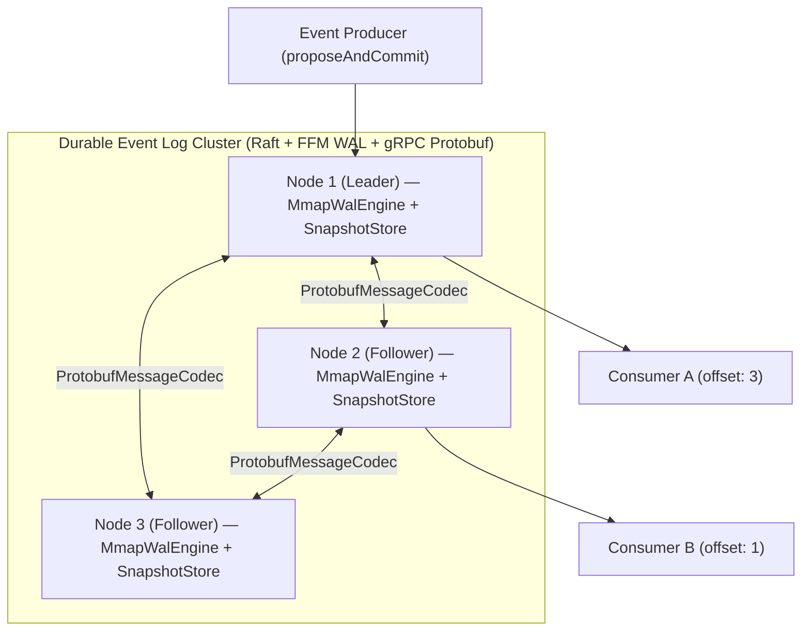

# Tutorial 6: Replicated Event Log & Event Sourcing

*How to build an ordered, durable event stream that multiple consumers read from — the pattern behind Apache Kafka, EventStoreDB, and every event-driven architecture.*

---

## The Problem

Event sourcing stores every state change as an immutable event rather than overwriting the current state. The challenges:

- **Total ordering**: Events must have a single, agreed-upon order across all consumers
- **Durability**: Once published, events must never be lost
- **Gap-free reads**: Consumers must see every event, in order, without skipping any
- **Fan-out**: Multiple independent consumers read the same stream at different speeds

Traditional message brokers solve this with partitioned logs (Kafka), but require a separate cluster. When your data volume fits on a single partition, running a full Kafka cluster is heavy infrastructure for what's fundamentally a replicated log — which is exactly what Raft maintains internally.

## Why Raft Is a Natural Fit

Raft's replicated log **is** an event log. The leap is small:

| Event sourcing concept | Raft concept |
|----------------------|--------------|
| Event | Log entry |
| Event sequence number | Log index |
| Publish | `propose` a command |
| Subscribe from offset | Read entries from a log index |
| Total order | Raft's log matching property |
| Durability | Committed = replicated to majority |

The state machine becomes the **event processor** — it receives committed events in order and updates materialized views.

## Architecture



## Event Encoding

```scala
import java.nio.charset.StandardCharsets
import java.time.Instant

case class EventId(value: Long) extends AnyVal

enum DomainEvent:
  case OrderPlaced(orderId: String, customerId: String, total: BigDecimal)
  case OrderShipped(orderId: String, trackingNumber: String)
  case OrderCancelled(orderId: String, reason: String)
  case InventoryAdjusted(sku: String, delta: Int)

case class EventEnvelope(
  eventType: String,
  payload: String,
  producerId: String,
  idempotencyKey: String,    // for deduplication
  timestamp: Long            // wall-clock at publish time (informational only)
)

object EventEnvelope:
  def encode(env: EventEnvelope): Array[Byte] =
    s"${env.eventType}|${env.producerId}|${env.idempotencyKey}|${env.timestamp}|${env.payload}"
      .getBytes(StandardCharsets.UTF_8)

  def decode(data: Array[Byte]): EventEnvelope =
    val parts = new String(data, StandardCharsets.UTF_8).split("\\|", 5)
    EventEnvelope(parts(0), parts(4), parts(1), parts(2), parts(3).toLong)
```

> **Determinism note**: The `timestamp` field is captured at publish time (when the producer creates the event), not at apply time. This ensures all nodes see the same timestamp for the same event.

## State Machine: Materialized View Builder

The state machine processes events to build queryable views:

```scala
import cats.effect.{IO, Ref}
import raft.state.Log
import raft.spi.StateMachine

case class OrderView(
  orderId: String,
  customerId: String,
  total: BigDecimal,
  status: String,
  trackingNumber: Option[String]
)

case class EventLogState(
  orders: Map[String, OrderView],
  inventoryLevels: Map[String, Int],
  lastProcessedIndex: Long,
  processedKeys: Set[String]    // idempotency tracking
)

class EventSourcedStateMachine(stateRef: Ref[IO, EventLogState])
    extends StateMachine[IO, String]:

  def apply(log: Log): IO[String] =
    val envelope = EventEnvelope.decode(log.data)

    // Idempotency: skip already-processed events
    stateRef.get.flatMap { state =>
      if state.processedKeys.contains(envelope.idempotencyKey) then
        IO.pure(s"DUPLICATE:${envelope.idempotencyKey}")
      else
        processEvent(envelope, log.index)
    }

  private def processEvent(env: EventEnvelope, logIndex: Long): IO[String] =
    env.eventType match
      case "OrderPlaced" =>
        val parts = env.payload.split(",")
        val view = OrderView(parts(0), parts(1), BigDecimal(parts(2)),
                             "placed", None)
        stateRef.modify { state =>
          val updated = state.copy(
            orders = state.orders + (parts(0) -> view),
            lastProcessedIndex = logIndex,
            processedKeys = state.processedKeys + env.idempotencyKey
          )
          (updated, s"OK:OrderPlaced:${parts(0)}")
        }

      case "OrderShipped" =>
        val parts = env.payload.split(",")
        stateRef.modify { state =>
          val updated = state.orders.get(parts(0)) match
            case Some(order) =>
              state.copy(
                orders = state.orders +
                  (parts(0) -> order.copy(
                    status = "shipped",
                    trackingNumber = Some(parts(1))
                  )),
                lastProcessedIndex = logIndex,
                processedKeys = state.processedKeys + env.idempotencyKey
              )
            case None => state
          (updated, s"OK:OrderShipped:${parts(0)}")
        }

      case "InventoryAdjusted" =>
        val parts = env.payload.split(",")
        stateRef.modify { state =>
          val current = state.inventoryLevels.getOrElse(parts(0), 0)
          val updated = state.copy(
            inventoryLevels = state.inventoryLevels +
              (parts(0) -> (current + parts(1).toInt)),
            lastProcessedIndex = logIndex,
            processedKeys = state.processedKeys + env.idempotencyKey
          )
          (updated, s"OK:InventoryAdjusted:${parts(0)}")
        }

      case _ =>
        IO.pure(s"UNKNOWN:${env.eventType}")

  def snapshot: IO[Array[Byte]] =
    stateRef.get.map { state =>
      // Serialize the materialized views, not the event history
      val orderLines = state.orders.map { (id, o) =>
        s"ORDER|$id|${o.customerId}|${o.total}|${o.status}|${o.trackingNumber.getOrElse("")}"
      }
      val invLines = state.inventoryLevels.map { (sku, qty) =>
        s"INV|$sku|$qty"
      }
      (s"IDX:${state.lastProcessedIndex}" +:
        (orderLines ++ invLines).toVector)
        .mkString("\n")
        .getBytes(StandardCharsets.UTF_8)
    }

  def restore(data: Array[Byte]): IO[Unit] =
    // Restore materialized views from snapshot
    IO.unit // simplified for tutorial
```

### The CQRS pattern

This naturally implements Command Query Responsibility Segregation (CQRS):

- **Command side**: Events are published through Raft consensus (`propose`)
- **Query side**: Materialized views are read from the local state machine (via ReadIndex or lease reads)
- **Separation**: The event log is the source of truth; views are derived and can be rebuilt from events

## Consumer Offset Tracking

Consumers track their position in the event stream:

```scala
case class ConsumerPosition(
  consumerId: String,
  lastProcessedIndex: Long
)

class EventConsumer(
  consumerId: String,
  stateMachine: EventSourcedStateMachine,
  positionRef: Ref[IO, Long]
):
  def poll(batchSize: Int = 100): IO[Vector[EventEnvelope]] =
    for
      lastIndex <- positionRef.get
      state     <- stateMachine.stateRef.get
      // Only return events up to the state machine's last processed index
      available  = state.lastProcessedIndex - lastIndex
      count      = math.min(available, batchSize).toInt
    yield
      // In production, you'd read directly from the log store
      // Here we return a count of available events
      Vector.empty // placeholder — actual implementation reads from LogStore

  def acknowledge(upToIndex: Long): IO[Unit] =
    positionRef.set(upToIndex)
```

### Replaying from the beginning

A powerful property of event sourcing: any consumer can replay the entire history by resetting its offset to 0. This enables:

- **New materialized views**: Deploy a new service, replay all events to build its state
- **Bug fixes**: Correct a view builder bug, replay from the beginning with the fixed logic
- **Analytics**: Process the full history for reports or machine learning

## Failure Scenarios

### Scenario 1: Producer retry creates duplicate event

```
t=0   Producer publishes OrderPlaced (idempotency key: "order-42-v1")
t=1   Event committed, but producer's connection drops before ACK
t=2   Producer retries with same idempotency key: "order-42-v1"
t=3   State machine: processedKeys contains "order-42-v1" → DUPLICATE
```

The idempotency key ensures exactly-once semantics from the producer's perspective.

### Scenario 2: Consumer crashes mid-batch

```
t=0   Consumer at offset 100, reads events 101-200
t=5   Consumer processes events 101-150, then crashes
t=10  Consumer restarts, resumes from offset 100 (last acknowledged)
t=11  Consumer re-processes events 101-150 (must be idempotent)
```

Consumer-side processing must be idempotent or use the transactional outbox pattern (process + acknowledge atomically).

## Production Considerations

### Event schema evolution

Events are immutable — you can't change published events. Handle schema changes with:
- **Upcasting**: Transform old event formats to new ones during deserialization
- **Versioned event types**: `OrderPlaced.v1`, `OrderPlaced.v2`
- **Optional fields**: Add new fields with defaults; never remove fields

### Log compaction and retention

The event log grows unboundedly. Manage it with:
- **Snapshotting**: Capture the materialized view state, compact the log up to the snapshot index
- **Retention policy**: Keep the last N events or the last T time period
- **Archived events**: Move old events to cold storage (S3) before compacting

### Scaling with Multi-Raft Groups

Partition events by stream (like Kafka partitions):

```scala
def groupForStream(streamName: String): GroupId =
  val hash = streamName.hashCode.abs % 16
  GroupId(s"events-$hash")
```

Each group is an independent, ordered event stream. Cross-stream ordering requires a separate coordination mechanism (vector clocks, causal ordering).

### Production Durability: Wiring `MmapWalEngine` + `StorageBackedSnapshotStore` + `GrpcTransport`

For long-lived event streams exceeding millions of events, wire all three storage SPIs (`LogStore`, `StableStore`, and `SnapshotStore`) to a single `MmapWalEngine` directory and pair `GrpcTransport.raftResource` (`ProtobufMessageCodec`) for zero-Base64 binary replication:

```scala
import java.nio.file.Path
import cats.effect.{IO, Resource}
import raft.RaftNode
import raft.impl.DefaultTimerService
import raft.spi.TransportConfig
import raft.state.{ClusterConfig, CompactionConfig, CompactionPolicy, NodeId, RaftConfig}
import raft.storage.{
  StorageBackedLogStore,
  StorageBackedSnapshotStore,
  StorageBackedStableStore
}
import raft.storage.mmap.MmapWalEngine
import raft.transport.grpc.{GrpcConfig, GrpcTransport}

def durableEventNode(
    localId: NodeId,
    dataDir: Path,
    grpcPort: Int,
    peers: Map[NodeId, String],
    stateMachine: EventSourcedStateMachine
): Resource[IO, RaftNode[IO]] =
  for
    walEngine <- MmapWalEngine.resource[IO](dataDir)
    logStore = StorageBackedLogStore(walEngine)
    stableStore = StorageBackedStableStore(walEngine)
    snapshotStore = StorageBackedSnapshotStore(walEngine)
    (_, raftTransport) <- GrpcTransport.raftResource[IO](
      GrpcConfig(host = "127.0.0.1", port = grpcPort),
      TransportConfig(localId, s"127.0.0.1:$grpcPort", peers)
    )
    timerService <- DefaultTimerService[IO]
    config = RaftConfig.default(localId).copy(
      compaction = CompactionConfig(policy = CompactionPolicy.Threshold(10_000))
    )
    cluster = ClusterConfig((peers.keySet + localId).map(_ -> raft.state.NodeRole.Voter).toMap)
    node <- RaftNode.resource[IO, String](
      config = config,
      cluster = cluster,
      transport = raftTransport,
      logStore = logStore,
      stableStore = stableStore,
      stateMachine = stateMachine,
      timerService = timerService,
      snapshotStore = Some(snapshotStore)
    )
  yield node
```

Under the hood, `MmapWalEngine` guarantees:
- **Checksummed `hard_state.bin`**: CRC32-verified `(term, votedFor)` with atomic single-`msync` writes.
- **20-digit snapshot naming (`snapshot-%020d.bin`)**: Numeric `lastIncludedIndex` ordering so event logs smoothly cross `1,000,000+` compacted events without lexicographic sorting bugs.
- **Self-healing `"WIDX"` index checkpoints**: Atomic `index.ckpt.tmp -> index.ckpt` swaps that fall back automatically to `.wal` segment replay if interrupted by power loss.

---

*Next: [Tutorial 7 — Distributed Lease Service](07-distributed-lease-service.md) — time-bound resource ownership for coordinating access to shared resources.*
