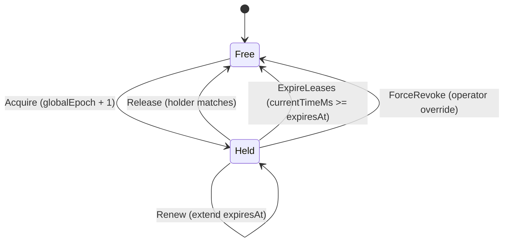

# Tutorial 7: Distributed Lease Service

*How to grant time-bound, exclusive access to shared resources — the pattern behind DynamoDB conditional writes, GCS object locks, and Kubernetes lease-based leader election.*

---

## The Problem

Many distributed operations need temporary, exclusive ownership of a resource:

- **Database migration**: Only one process runs `ALTER TABLE` at a time
- **File processing**: Only one worker processes a given file from S3
- **Cache warming**: Only one instance rebuilds an expensive cache
- **API rate coordination**: One service owns a resource's rate budget for a time window

Unlike a permanent lock, a **lease** has a built-in expiration. If the holder crashes without releasing it, the lease automatically becomes available — no manual intervention needed.

### Leases vs. locks

| Property | Lock | Lease |
|----------|------|-------|
| Duration | Indefinite | Time-bounded (TTL) |
| Crash recovery | Requires manual release or timeout hack | Automatic — TTL expires |
| Renewal | N/A | Holder can extend before expiration |
| Fencing | Must implement separately | Built into the lease version/epoch |

### Lease Lifecycle



## Command Design

```scala
import java.nio.charset.StandardCharsets

case class ResourceId(value: String) extends AnyVal
case class LeaseId(value: String) extends AnyVal

enum LeaseCommand:
  case Acquire(
    resourceId: ResourceId,
    leaseId: LeaseId,
    holderId: String,
    durationMs: Long
  )
  case Renew(
    resourceId: ResourceId,
    leaseId: LeaseId,
    holderId: String,
    extensionMs: Long
  )
  case Release(resourceId: ResourceId, leaseId: LeaseId, holderId: String)
  case ForceRevoke(resourceId: ResourceId, reason: String)
  case ExpireLeases(currentTimeMs: Long)

object LeaseCommand:
  def encode(cmd: LeaseCommand): Array[Byte] =
    cmd match
      case Acquire(rid, lid, hid, dur) =>
        s"ACQ|${rid.value}|${lid.value}|$hid|$dur"
      case Renew(rid, lid, hid, ext) =>
        s"RNW|${rid.value}|${lid.value}|$hid|$ext"
      case Release(rid, lid, hid) =>
        s"REL|${rid.value}|${lid.value}|$hid"
      case ForceRevoke(rid, reason) =>
        s"RVK|${rid.value}|$reason"
      case ExpireLeases(ts) =>
        s"EXP|$ts"
    }.getBytes(StandardCharsets.UTF_8)

  def decode(data: Array[Byte]): LeaseCommand =
    val parts = new String(data, StandardCharsets.UTF_8).split("\\|")
    parts(0) match
      case "ACQ" => Acquire(ResourceId(parts(1)), LeaseId(parts(2)),
                            parts(3), parts(4).toLong)
      case "RNW" => Renew(ResourceId(parts(1)), LeaseId(parts(2)),
                          parts(3), parts(4).toLong)
      case "REL" => Release(ResourceId(parts(1)), LeaseId(parts(2)), parts(3))
      case "RVK" => ForceRevoke(ResourceId(parts(1)), parts(2))
      case "EXP" => ExpireLeases(parts(1).toLong)
```

## State Machine

```scala
import cats.effect.{IO, Ref}
import raft.state.Log
import raft.spi.StateMachine

case class Lease(
  leaseId: LeaseId,
  resourceId: ResourceId,
  holderId: String,
  acquiredAt: Long,      // log index when acquired
  expiresAt: Long,       // timestamp from the Acquire command + durationMs
  epoch: Long            // monotonic — incremented on each acquisition
)

case class LeaseState(
  leases: Map[ResourceId, Lease],
  globalEpoch: Long,
  history: Vector[(Long, ResourceId, String)]  // (epoch, resource, event)
)

class LeaseStateMachine(stateRef: Ref[IO, LeaseState])
    extends StateMachine[IO, String]:

  def apply(log: Log): IO[String] =
    val cmd = LeaseCommand.decode(log.data)
    cmd match
      case LeaseCommand.Acquire(rid, lid, holderId, durationMs) =>
        stateRef.modify { state =>
          state.leases.get(rid) match
            case Some(existing) if existing.holderId != holderId =>
              // Resource is held by someone else — reject
              (state, s"REJECTED:${rid.value}:held_by=${existing.holderId}")
            case Some(existing) if existing.holderId == holderId =>
              // Same holder re-acquiring — extend (idempotent)
              val newEpoch = state.globalEpoch + 1
              val lease = existing.copy(
                leaseId = lid,
                expiresAt = log.index + durationMs,
                epoch = newEpoch
              )
              val newState = state.copy(
                leases = state.leases + (rid -> lease),
                globalEpoch = newEpoch,
                history = state.history :+ (newEpoch, rid, "reacquired")
              )
              (newState, s"ACQUIRED:${rid.value}:epoch=$newEpoch")
            case None =>
              // Resource is free — grant the lease
              val newEpoch = state.globalEpoch + 1
              val lease = Lease(lid, rid, holderId, log.index,
                               log.index + durationMs, newEpoch)
              val newState = state.copy(
                leases = state.leases + (rid -> lease),
                globalEpoch = newEpoch,
                history = state.history :+ (newEpoch, rid, "acquired")
              )
              (newState, s"ACQUIRED:${rid.value}:epoch=$newEpoch")
        }

      case LeaseCommand.Renew(rid, lid, holderId, extensionMs) =>
        stateRef.modify { state =>
          state.leases.get(rid) match
            case Some(lease) if lease.holderId == holderId && lease.leaseId == lid =>
              val extended = lease.copy(
                expiresAt = lease.expiresAt + extensionMs
              )
              (state.copy(leases = state.leases + (rid -> extended)),
               s"RENEWED:${rid.value}:expires=${extended.expiresAt}")
            case Some(_) =>
              (state, s"NOT_OWNER:${rid.value}:$holderId")
            case None =>
              (state, s"NOT_FOUND:${rid.value}")
        }

      case LeaseCommand.Release(rid, lid, holderId) =>
        stateRef.modify { state =>
          state.leases.get(rid) match
            case Some(lease) if lease.holderId == holderId =>
              val newState = state.copy(
                leases = state.leases - rid,
                history = state.history :+ (lease.epoch, rid, "released")
              )
              (newState, s"RELEASED:${rid.value}")
            case _ =>
              (state, s"RELEASE_FAILED:${rid.value}")
        }

      case LeaseCommand.ForceRevoke(rid, reason) =>
        stateRef.modify { state =>
          val newState = state.copy(
            leases = state.leases - rid,
            history = state.history :+ (state.globalEpoch, rid, s"revoked:$reason")
          )
          (newState, s"REVOKED:${rid.value}:$reason")
        }

      case LeaseCommand.ExpireLeases(currentTimeMs) =>
        stateRef.modify { state =>
          val (expired, active) = state.leases.partition { (_, lease) =>
            lease.expiresAt <= currentTimeMs
          }
          val events = expired.map { (rid, lease) =>
            (lease.epoch, rid, "expired")
          }.toVector
          (state.copy(leases = active, history = state.history ++ events),
           s"EXPIRED:${expired.size}")
        }

  def snapshot: IO[Array[Byte]] =
    stateRef.get.map { state =>
      state.leases.map { (rid, l) =>
        s"${rid.value}|${l.leaseId.value}|${l.holderId}|${l.acquiredAt}|${l.expiresAt}|${l.epoch}"
      }.mkString("\n").getBytes(StandardCharsets.UTF_8)
    }

  def restore(data: Array[Byte]): IO[Unit] =
    stateRef.set(LeaseState(Map.empty, 0, Vector.empty)) // simplified
```

## The Epoch as a Fencing Token

Every lease acquisition increments the `globalEpoch`. This epoch serves as a fencing token — external systems can verify that a lease holder's operation is still valid:

```scala
case class LeaseProof(resourceId: ResourceId, epoch: Long)

def withLease[A](
  proof: LeaseProof,
  operation: IO[A]
): IO[Either[String, A]] =
  for
    state <- stateRef.get
    result <- state.leases.get(proof.resourceId) match
      case Some(lease) if lease.epoch == proof.epoch =>
        operation.map(Right(_))
      case Some(lease) =>
        IO.pure(Left(s"Stale epoch: held=${lease.epoch}, yours=${proof.epoch}"))
      case None =>
        IO.pure(Left(s"No active lease for ${proof.resourceId.value}"))
  yield result
```

### Renewal pattern

Holders should renew leases well before expiration:

```scala
def leaseRenewalLoop(
  resourceId: ResourceId,
  leaseId: LeaseId,
  holderId: String,
  ttlMs: Long,
  renewalFraction: Double = 0.5  // renew at 50% of TTL
): fs2.Stream[IO, Unit] =
  val renewInterval = (ttlMs * renewalFraction).toLong.millis
  fs2.Stream
    .fixedDelay[IO](renewInterval)
    .evalMap { _ =>
      val cmd = LeaseCommand.Renew(resourceId, leaseId, holderId, ttlMs)
      raftNode.propose(Log.Command(0, 0, LeaseCommand.encode(cmd)))
    }
```

## Failure Scenarios

```mermaid
sequenceDiagram
    participant W1 as Holder 1
    participant LS as Lease Service (Raft)
    participant W2 as Holder 2
    participant Res as Shared Resource (Fenced)

    W1->>LS: Acquire("db-migrate", ttl=30s)
    LS-->>W1: ACQUIRED (epoch = 1)
    Note over W1,LS: Network partition isolates Holder 1
    W1--xLS: Renew("db-migrate") blocked
    Note over LS: ExpireLeases -> "db-migrate" expires
    W2->>LS: Acquire("db-migrate", ttl=30s)
    LS-->>W2: ACQUIRED (epoch = 2)
    W2->>Res: Execute migration (epoch = 2) -> Accepted
    Note over W1,Res: Partition heals; Holder 1 sends delayed write
    W1->>Res: Execute migration (epoch = 1)
    Res-->>W1: Rejected (Stale epoch: held = 2, yours = 1)
```

### Scenario 1: Lease holder crashes

The lease's TTL expires, and any pending operation with the old epoch is rejected by the fencing token check. A new holder can acquire the lease immediately after expiration.

### Scenario 2: Network partition prevents renewal

The holder is partitioned from the Raft cluster. Its renewal commands can't reach the leader. The lease expires, a new holder acquires it. When the partition heals, the old holder's fencing token (epoch) is stale — its operations are rejected.

### Scenario 3: Leader crash during acquisition

If the `Acquire` command is committed before the crash, the lease is granted. If not, the client's `propose` times out and the client retries — the same `leaseId` prevents duplicate acquisitions.

## Production Considerations

- **TTL tuning**: Too short → frequent renewals add load. Too long → slow recovery after crashes. Start with 30 seconds, renew at 15 seconds.
- **Monitoring**: Track lease count, renewal success rate, and expiration rate. A spike in expirations signals network or process health issues.
- **Hierarchical leases**: For fine-grained resources, use path-based resource IDs (`/db/table/partition-42`) and acquire parent leases for batch operations.

---

*Next: [Tutorial 8 — Service Registry & Health Checking](08-service-registry.md) — Consul-like service discovery with health-aware routing.*
