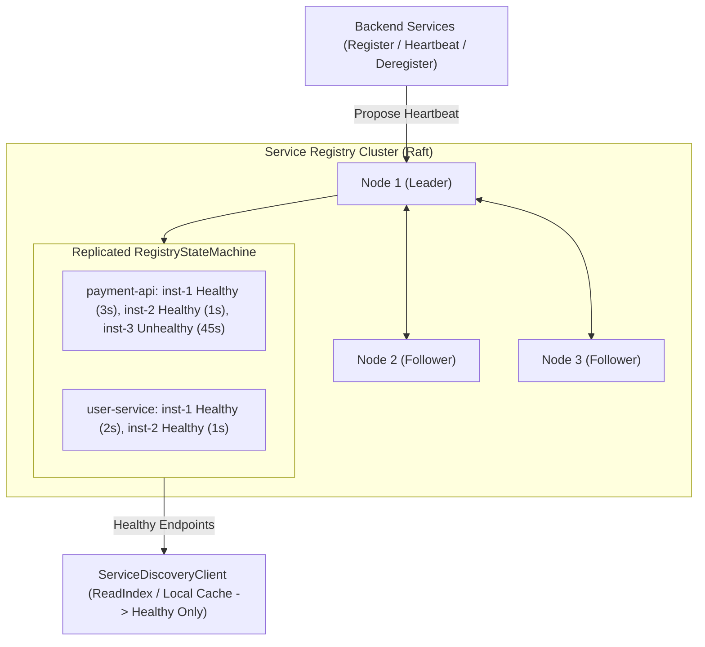

# Tutorial 8: Service Registry & Health Checking

*How to build a Consul-like service discovery system where services register themselves, report health, and clients always route to healthy instances.*

---

## The Problem

In a microservices architecture, services need to find each other:

- The **payment service** needs the current address of the **fraud detection service**
- Load balancers need the list of **healthy** backend instances
- After a deployment, old instances must be deregistered and new ones discovered

Static configuration files fail because addresses change with deployments, scaling, and failures. DNS-based discovery has TTL caching issues. A dedicated **service registry** with **health checking** solves both problems.

## Architecture



## Command Design

```scala
import java.nio.charset.StandardCharsets

case class ServiceName(value: String) extends AnyVal
case class InstanceId(value: String) extends AnyVal

enum RegistryCommand:
  case Register(
    service: ServiceName,
    instanceId: InstanceId,
    address: String,
    port: Int,
    metadata: Map[String, String],
    healthTtlMs: Long
  )
  case Deregister(service: ServiceName, instanceId: InstanceId)
  case Heartbeat(service: ServiceName, instanceId: InstanceId, timestampMs: Long)
  case MarkUnhealthy(service: ServiceName, instanceId: InstanceId, reason: String)
  case ExpireUnhealthy(currentTimeMs: Long)
  case Lookup(service: ServiceName, onlyHealthy: Boolean)

object RegistryCommand:
  def encode(cmd: RegistryCommand): Array[Byte] =
    cmd match
      case Register(svc, iid, addr, port, meta, ttl) =>
        val metaStr = meta.map((k, v) => s"$k=$v").mkString(";")
        s"REG|${svc.value}|${iid.value}|$addr|$port|$metaStr|$ttl"
      case Deregister(svc, iid) =>
        s"DRG|${svc.value}|${iid.value}"
      case Heartbeat(svc, iid, ts) =>
        s"HBT|${svc.value}|${iid.value}|$ts"
      case MarkUnhealthy(svc, iid, reason) =>
        s"UNH|${svc.value}|${iid.value}|$reason"
      case ExpireUnhealthy(ts) =>
        s"EXP|$ts"
      case Lookup(svc, healthy) =>
        s"LKP|${svc.value}|$healthy"
    }.getBytes(StandardCharsets.UTF_8)

  def decode(data: Array[Byte]): RegistryCommand =
    val parts = new String(data, StandardCharsets.UTF_8).split("\\|", -1)
    parts(0) match
      case "REG" =>
        val meta = if parts(5).isEmpty then Map.empty[String, String]
                   else parts(5).split(";").map { kv =>
                     val p = kv.split("=", 2); p(0) -> p(1)
                   }.toMap
        Register(ServiceName(parts(1)), InstanceId(parts(2)),
                 parts(3), parts(4).toInt, meta, parts(6).toLong)
      case "DRG" => Deregister(ServiceName(parts(1)), InstanceId(parts(2)))
      case "HBT" => Heartbeat(ServiceName(parts(1)), InstanceId(parts(2)),
                              parts(3).toLong)
      case "UNH" => MarkUnhealthy(ServiceName(parts(1)), InstanceId(parts(2)),
                                  parts(3))
      case "EXP" => ExpireUnhealthy(parts(1).toLong)
      case "LKP" => Lookup(ServiceName(parts(1)), parts(2).toBoolean)
```

## State Machine

```scala
import cats.effect.{IO, Ref}
import raft.state.Log
import raft.spi.StateMachine

enum HealthStatus:
  case Healthy
  case Unhealthy(reason: String)
  case Unknown

case class ServiceInstance(
  instanceId: InstanceId,
  address: String,
  port: Int,
  metadata: Map[String, String],
  health: HealthStatus,
  lastHeartbeat: Long,
  healthTtlMs: Long,
  registeredAt: Long
)

case class RegistryState(
  services: Map[ServiceName, Map[InstanceId, ServiceInstance]],
  totalRegistered: Long,
  totalDeregistered: Long
)

class RegistryStateMachine(stateRef: Ref[IO, RegistryState])
    extends StateMachine[IO, String]:

  def apply(log: Log): IO[String] =
    val cmd = RegistryCommand.decode(log.data)
    cmd match
      case RegistryCommand.Register(svc, iid, addr, port, meta, ttl) =>
        stateRef.modify { state =>
          val instance = ServiceInstance(
            iid, addr, port, meta,
            HealthStatus.Healthy, log.index, ttl, log.index
          )
          val svcInstances = state.services.getOrElse(svc, Map.empty)
          val updated = state.copy(
            services = state.services + (svc -> (svcInstances + (iid -> instance))),
            totalRegistered = state.totalRegistered + 1
          )
          (updated, s"REGISTERED:${svc.value}/${iid.value}@$addr:$port")
        }

      case RegistryCommand.Deregister(svc, iid) =>
        stateRef.modify { state =>
          val svcInstances = state.services.getOrElse(svc, Map.empty) - iid
          val updated =
            if svcInstances.isEmpty then
              state.copy(
                services = state.services - svc,
                totalDeregistered = state.totalDeregistered + 1
              )
            else
              state.copy(
                services = state.services + (svc -> svcInstances),
                totalDeregistered = state.totalDeregistered + 1
              )
          (updated, s"DEREGISTERED:${svc.value}/${iid.value}")
        }

      case RegistryCommand.Heartbeat(svc, iid, timestampMs) =>
        stateRef.modify { state =>
          val updated = for
            instances <- state.services.get(svc)
            instance  <- instances.get(iid)
          yield
            val refreshed = instance.copy(
              lastHeartbeat = timestampMs,
              health = HealthStatus.Healthy
            )
            state.copy(
              services = state.services +
                (svc -> (instances + (iid -> refreshed)))
            )
          (updated.getOrElse(state), s"HEARTBEAT:${svc.value}/${iid.value}")
        }

      case RegistryCommand.MarkUnhealthy(svc, iid, reason) =>
        stateRef.modify { state =>
          val updated = for
            instances <- state.services.get(svc)
            instance  <- instances.get(iid)
          yield
            val unhealthy = instance.copy(
              health = HealthStatus.Unhealthy(reason)
            )
            state.copy(
              services = state.services +
                (svc -> (instances + (iid -> unhealthy)))
            )
          (updated.getOrElse(state), s"UNHEALTHY:${svc.value}/${iid.value}")
        }

      case RegistryCommand.ExpireUnhealthy(currentTimeMs) =>
        stateRef.modify { state =>
          val updated = state.services.map { (svc, instances) =>
            val checked = instances.map { (iid, inst) =>
              val expired = currentTimeMs - inst.lastHeartbeat > inst.healthTtlMs
              if expired && inst.health == HealthStatus.Healthy then
                iid -> inst.copy(
                  health = HealthStatus.Unhealthy("heartbeat timeout")
                )
              else
                iid -> inst
            }
            svc -> checked
          }
          (state.copy(services = updated), "HEALTH_CHECK_COMPLETE")
        }

      case RegistryCommand.Lookup(svc, onlyHealthy) =>
        stateRef.get.map { state =>
          state.services.get(svc) match
            case Some(instances) =>
              val filtered =
                if onlyHealthy then
                  instances.filter(_._2.health == HealthStatus.Healthy)
                else instances
              filtered.values
                .map(i => s"${i.instanceId.value}@${i.address}:${i.port}")
                .mkString(",")
            case None => "NO_INSTANCES"
        }

  def snapshot: IO[Array[Byte]] =
    stateRef.get.map { state =>
      state.services.flatMap { (svc, instances) =>
        instances.map { (iid, inst) =>
          s"${svc.value}|${iid.value}|${inst.address}|${inst.port}|${inst.lastHeartbeat}"
        }
      }.mkString("\n").getBytes(StandardCharsets.UTF_8)
    }

  def restore(data: Array[Byte]): IO[Unit] =
    stateRef.set(RegistryState(Map.empty, 0, 0))
```

## Client SDK: Service Discovery

```scala
class ServiceDiscoveryClient(registryNode: RaftNodeApi):

  def register(
    service: ServiceName,
    instanceId: InstanceId,
    address: String,
    port: Int,
    metadata: Map[String, String] = Map.empty,
    healthTtlMs: Long = 30_000
  ): IO[Unit] =
    val cmd = RegistryCommand.Register(service, instanceId, address, port,
                                       metadata, healthTtlMs)
    registryNode.propose(Log.Command(0, 0, RegistryCommand.encode(cmd))).void

  def discover(service: ServiceName): IO[List[ServiceInstance]] =
    // Use ReadIndex for consistent discovery
    for
      _     <- registryNode.submitReadIndex(s"lookup-${service.value}")
      state <- registryRef.get
      instances = state.services
        .getOrElse(service, Map.empty)
        .values
        .filter(_.health == HealthStatus.Healthy)
        .toList
    yield instances

  def heartbeatLoop(
    service: ServiceName,
    instanceId: InstanceId,
    interval: FiniteDuration = 10.seconds
  ): fs2.Stream[IO, Unit] =
    fs2.Stream
      .fixedDelay[IO](interval)
      .evalMap { _ =>
        val now = System.currentTimeMillis()
        val cmd = RegistryCommand.Heartbeat(service, instanceId, now)
        registryNode.propose(Log.Command(0, 0, RegistryCommand.encode(cmd)))
      }
      .void
```

### Client-side caching

For high-frequency lookups, cache the registry state locally and watch for changes:

```scala
class CachedServiceDiscovery(
  underlying: ServiceDiscoveryClient,
  cacheRef: Ref[IO, Map[ServiceName, List[ServiceInstance]]],
  refreshInterval: FiniteDuration = 5.seconds
):
  def discover(service: ServiceName): IO[List[ServiceInstance]] =
    cacheRef.get.map(_.getOrElse(service, List.empty))

  def refreshLoop: fs2.Stream[IO, Unit] =
    fs2.Stream
      .fixedDelay[IO](refreshInterval)
      .evalMap { _ =>
        for
          state <- registryRef.get
          cache = state.services.map { (svc, instances) =>
            svc -> instances.values.filter(_.health == HealthStatus.Healthy).toList
          }
          _ <- cacheRef.set(cache)
        yield ()
      }
```

## Failure Scenarios

### Service instance crashes without deregistering

The heartbeat TTL expires → health check sweeper marks it unhealthy → clients stop routing to it. Recovery time = TTL duration (default 30s). For faster detection, reduce the TTL and increase heartbeat frequency.

### Registry leader crashes

New leader is elected with the same state machine. All registrations survive. Heartbeat commands in-flight during the crash are lost, but the service instances will re-send heartbeats on the next interval.

## Production Considerations

- **DNS integration**: Resolve service names to addresses via DNS SRV records backed by the registry
- **Load balancing metadata**: Include weight, zone, and version in instance metadata for weighted or zone-aware routing
- **Graceful shutdown**: Deregister before stopping the process to avoid serving traffic to a shutting-down instance
- **Health check diversity**: Support TCP, HTTP, and gRPC health checks — submit the check result as a `Heartbeat` or `MarkUnhealthy` command

---

*Next: [Tutorial 9 — Sharded Counter with Multi-Raft](09-sharded-counter-multi-raft.md) — scaling beyond a single Raft group using the library's Multi-Raft API.*
