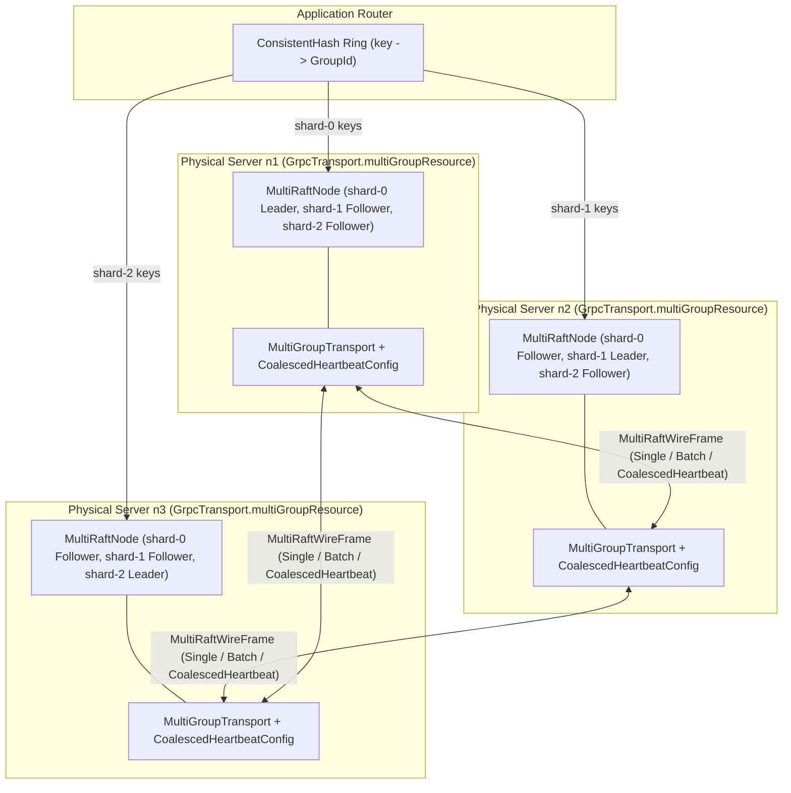
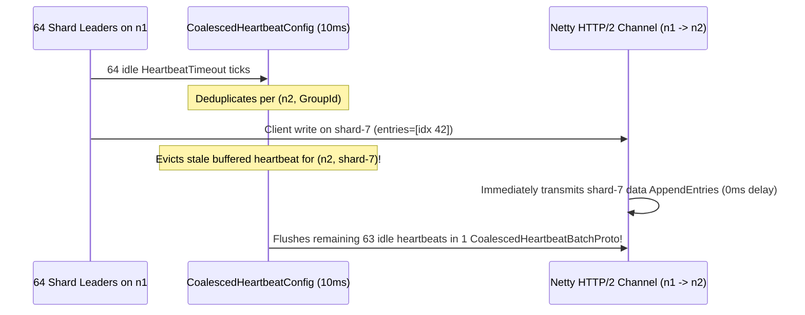

# Tutorial 9: Sharded Counter with Multi-Raft, Native Protobuf gRPC & Coalesced Heartbeats

*How to scale a strongly consistent counter beyond single-leader limits by partitioning keys across independent Raft groups — multiplexing all shards over one Netty HTTP/2 connection per host pair, coalescing idle heartbeats, and balancing shard leaders across servers.*

---

## The Problem

A single Raft group serializes all writes through one leader's WAL and state machine. For high-cardinality counters — ad impressions, API quota tracking, or real-time telemetry — one shard eventually saturates a single server's disk IOPS or CPU.

The solution is **Multi-Raft sharding**: partition keys across `G` independent Raft groups (`shard-0 .. shard-(G-1)`), host replicas of every shard on `MultiRaftNode[IO]`, multiplex all inter-node traffic over **1 gRPC channel per server pair**, and enable **Coalesced Heartbeats** (`CoalescedHeartbeatConfig`) so idle shards don't flood the network with `O(G)` timer RPCs.

## Architecture



---

## Step 1: Deterministic Counter State Machine

Each shard runs its own isolated `CounterStateMachine` implementing the streaming `StateMachine[IO, Unit]` SPI:

```scala
import java.nio.charset.StandardCharsets
import cats.effect.{IO, Ref}
import fs2.{Chunk, Stream}
import raft.spi.StateMachine
import raft.state.Log

enum CounterCommand:
  case Increment(key: String, delta: Long)
  case Decrement(key: String, delta: Long)
  case Reset(key: String)

object CounterCommand:
  def encode(cmd: CounterCommand): Array[Byte] = cmd match
    case Increment(k, d) => s"INC|$k|$d".getBytes(StandardCharsets.UTF_8)
    case Decrement(k, d) => s"DEC|$k|$d".getBytes(StandardCharsets.UTF_8)
    case Reset(k)        => s"RST|$k".getBytes(StandardCharsets.UTF_8)

  def decode(data: Array[Byte]): Option[CounterCommand] =
    new String(data, StandardCharsets.UTF_8).split("\\|", 3) match
      case Array("INC", k, d) => d.toLongOption.map(Increment(k, _))
      case Array("DEC", k, d) => d.toLongOption.map(Decrement(k, _))
      case Array("RST", k)    => Some(Reset(k))
      case _                  => None

final class CounterStateMachine(stateRef: Ref[IO, Map[String, Long]])
    extends StateMachine[IO, Unit]:

  def apply(log: Log): IO[Unit] =
    CounterCommand.decode(log.data) match
      case Some(CounterCommand.Increment(key, delta)) =>
        stateRef.update(m => m.updated(key, m.getOrElse(key, 0L) + delta))
      case Some(CounterCommand.Decrement(key, delta)) =>
        stateRef.update(m => m.updated(key, m.getOrElse(key, 0L) - delta))
      case Some(CounterCommand.Reset(key)) =>
        stateRef.update(_.updated(key, 0L))
      case None =>
        IO.unit

  def snapshot: IO[Stream[IO, Byte]] =
    stateRef.get.map { m =>
      val bytes = m.toSeq
        .sortBy(_._1)
        .map { case (k, v) => s"$k|$v" }
        .mkString("\n")
        .getBytes(StandardCharsets.UTF_8)
      Stream.chunk(Chunk.array(bytes)).covary[IO]
    }

  def restore(data: Stream[IO, Byte]): IO[Unit] =
    data.compile.to(Array).flatMap { bytes =>
      val text = new String(bytes, StandardCharsets.UTF_8)
      val parsed =
        if text.isEmpty then Map.empty[String, Long]
        else
          text
            .split("\n")
            .toList
            .flatMap { line =>
              line.split("\\|", 2) match
                case Array(k, v) => v.toLongOption.map(k -> _)
                case _           => None
            }
            .toMap
      stateRef.set(parsed)
    }

  def get(key: String): IO[Long] =
    stateRef.get.map(_.getOrElse(key, 0L))
```

---

## Step 2: Booting a Multiplexed Multi-Raft Host with Coalesced Heartbeats

### Option A: In-Memory Cluster (Unit & Integration Tests)

`MultiGroupTransport.createInMemoryCluster` wires `N` virtual hosts together with optional `CoalescedHeartbeatConfig` in a single `Resource`:

```scala
import scala.concurrent.duration.*
import cats.effect.Resource
import raft.multigroup.{CoalescedHeartbeatConfig, MultiGroupTransport, MultiRaftNode}
import raft.state.NodeId

val nodes = List(NodeId("n1"), NodeId("n2"), NodeId("n3"))

val testCluster: Resource[IO, Map[NodeId, MultiRaftNode[IO]]] =
  for
    transports <- MultiGroupTransport.createInMemoryCluster[IO](
      nodeIds = nodes,
      coalescing = CoalescedHeartbeatConfig(
        enabled = true,
        flushInterval = 10.millis,
        maxBatchSize = 128,
        coalesceResponses = true
      )
    )
    coordinators <- nodes
      .traverse(id => MultiRaftNode.resource[IO](id, transports(id)).map(id -> _))
      .map(_.toMap)
  yield coordinators
```

### Option B: Production Netty gRPC + `ProtobufMultiGroupCodec`

In production, `GrpcTransport.multiGroupResource` binds **one TCP port per server** and automatically packs coalesced heartbeats into compact `CoalescedHeartbeatBatchProto` frames and pipelined write bursts into `MultiGroupBatchProto` frames:

```scala
import raft.spi.TransportConfig
import raft.transport.grpc.{GrpcConfig, GrpcTransport}

def productionHost(
    localId: NodeId,
    port: Int,
    peers: Map[NodeId, String]
): Resource[IO, MultiRaftNode[IO]] =
  for
    pair <- GrpcTransport.multiGroupResource[IO](
      grpcConfig = GrpcConfig(host = "0.0.0.0", port = port),
      transportConfig = TransportConfig(
        localId = localId,
        bindAddress = s"0.0.0.0:$port",
        peers = peers - localId
      ),
      coalescing = CoalescedHeartbeatConfig(
        enabled = true,
        flushInterval = 10.millis,
        maxBatchSize = 256,
        coalesceResponses = true
      )
    )
    (_, mgTransport) = pair
    coordinator <- MultiRaftNode.resource[IO](localId, mgTransport)
  yield coordinator
```

---

## Step 3: Provisioning Shards & Balancing Leadership

Provision `numShards` groups on each host and call `rebalanceLeadership` so shard leaders spread evenly across servers:

```scala
import raft.impl.{DefaultTimerService, InMemLogStore, InMemSnapshotStore, InMemStableStore}
import raft.multigroup.GroupConfig
import raft.state.{BatchConfig, ClusterConfig, GroupId, PipelineConfig, RaftConfig}

val numShards = 6
val clusterCfg = ClusterConfig(nodes.toSet)

def createShardsOnHost(
    localId: NodeId,
    coordinator: MultiRaftNode[IO]
): IO[Map[GroupId, CounterStateMachine]] =
  (0 until numShards).toList
    .traverse { shardIdx =>
      val gid = GroupId(s"counter-shard-$shardIdx")
      for
        timerSvc <- DefaultTimerService[IO]
        logStore <- InMemLogStore[IO]()
        stableStore <- InMemStableStore[IO]()
        snapStore <- InMemSnapshotStore[IO]()
        sm <- Ref.of[IO, Map[String, Long]](Map.empty).map(new CounterStateMachine(_))
        raftCfg = RaftConfig(
          localId = localId,
          batching = BatchConfig(enabled = true, maxSize = 64, maxWait = 3.millis),
          pipelining = PipelineConfig(enabled = true, maxInflight = 6)
        )
        _ <- coordinator.createGroup(
          gid,
          GroupConfig(
            raftConfig = raftCfg,
            cluster = clusterCfg,
            logStore = logStore,
            stableStore = stableStore,
            stateMachine = sm,
            timerService = timerSvc,
            snapshotStore = Some(snapStore)
          )
        )
      yield gid -> sm
    }
    .map(_.toMap)

// Round-robin preferred leader assignment: 2 shard leaders per physical node!
val preferredLeaders: Map[GroupId, NodeId] =
  (0 until numShards).map { i =>
    GroupId(s"counter-shard-$i") -> nodes(i % nodes.size)
  }.toMap
```

---

## Step 4: Consistent-Hash Routing, Linearizable Writes & Reads

```scala
import java.util.TreeMap

final class ConsistentHashRouter(numShards: Int, virtualNodes: Int = 150):
  private val ring = new TreeMap[Int, GroupId]()
  for shard <- 0 until numShards; vn <- 0 until virtualNodes do
    val token = s"counter-shard-$shard-vn-$vn".hashCode
    val _ = ring.put(token, GroupId(s"counter-shard-$shard"))

  def shardForKey(key: String): GroupId =
    val entry = ring.ceilingEntry(key.hashCode)
    if entry != null then entry.getValue else ring.firstEntry().getValue

def incrementLinearizable(
    router: ConsistentHashRouter,
    leaderCoordinator: MultiRaftNode[IO],
    key: String,
    delta: Long
): IO[Unit] =
  val gid = router.shardForKey(key)
  val payload = CounterCommand.encode(CounterCommand.Increment(key, delta))
  leaderCoordinator.proposeAndCommitToGroup(gid, payload).void

def readCounterLinearizable(
    router: ConsistentHashRouter,
    leaderCoordinator: MultiRaftNode[IO],
    localShards: Map[GroupId, CounterStateMachine],
    key: String
): IO[Long] =
  val gid = router.shardForKey(key)
  leaderCoordinator.readIndexFromGroup(gid) *> localShards(gid).get(key)
```

---

## How Coalesced Heartbeats Protect Tail Latency Under Scale



## Production Checklist

- **Shard Sizing**: Start with `2x`–`8x` shards per physical node so leadership spreads evenly across CPU cores and disks.
- **Per-Shard WAL Isolation**: Give each shard its own `MmapWalEngine` directory (`baseDir.resolve(shardId.value)`) or partition compaction schedules so snapshot creation doesn't spike simultaneously on all shards.
- **Monitor `mgTransport.coalescerStats`**: Verify `envelopesCoalesced / batchesFlushed` matches your active leader count per peer host, confirming heartbeats are coalescing into single frames.

---

*Next: [Tutorial 10 — Exactly-Once Delivery with Client Sessions](10-client-sessions.md) — preventing duplicate counter increments when clients retry across leader failovers.*
