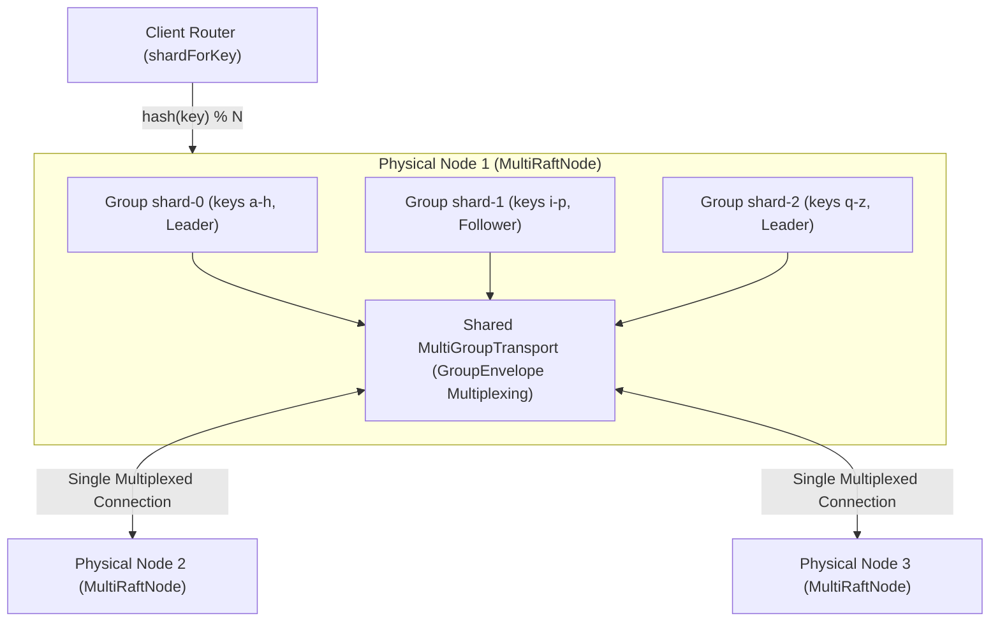

# Tutorial 9: Sharded Counter with Multi-Raft

*How to scale a simple counter to millions of increments per second by partitioning across multiple Raft groups — using the library's `MultiRaftNode` and `GroupEnvelope` API for the first time.*

---

## The Problem

A single Raft group can process ~10,000 writes per second (limited by consensus round-trips). For use cases like ad impression counting, social media likes, or real-time analytics, this isn't enough.

The solution: **sharding**. Partition the counter space across multiple independent Raft groups, each handling a subset of keys. Each group runs its own leader election and log, so write throughput scales linearly with the number of groups.

## Architecture



Three physical nodes, each running a `MultiRaftNode` that hosts all shard groups. Each group has its own leader — leadership is distributed across nodes for balanced load.

## Using the Multi-Raft API

### Step 1: Create the coordinator

```scala
import cats.effect.IO
import raft.state.{GroupId, NodeId}
import raft.multigroup.{MultiRaftNode, MultiGroupTransport, GroupConfig}

val localId = NodeId("node-1")

for
  transport <- MultiGroupTransport.inMemory[IO](localId)
  coordinator <- MultiRaftNode[IO](localId, transport)
yield coordinator
```

### Step 2: Create shard groups

```scala
val numShards = 8

def createShards(coordinator: MultiRaftNode[IO]): IO[Unit] =
  (0 until numShards).toList.traverse_ { shardId =>
    val groupId = GroupId(s"counter-shard-$shardId")
    val config = GroupConfig[IO](
      raftConfig = raftConfig,
      cluster = clusterConfig,
      logStore = InMemLogStore[IO],
      stableStore = InMemStableStore[IO],
      stateMachine = new CounterStateMachine(Ref.unsafe(CounterState.empty)),
      timerService = InMemTimerService[IO],
      metrics = RaftMetrics.noop[IO]
    )
    coordinator.createGroup(groupId, config)
  }
```

### Step 3: Route commands to the correct shard

```scala
def shardForKey(key: String): GroupId =
  val hash = math.abs(key.hashCode % numShards)
  GroupId(s"counter-shard-$hash")

def increment(coordinator: MultiRaftNode[IO], key: String, delta: Long): IO[Unit] =
  val groupId = shardForKey(key)
  val cmd = CounterCommand.Increment(key, delta)
  coordinator.submitToGroup(groupId, CounterCommand.encode(cmd))

def getCount(coordinator: MultiRaftNode[IO], key: String): IO[Long] =
  val groupId = shardForKey(key)
  for
    maybeNode <- coordinator.getGroup(groupId)
    node      <- IO.fromOption(maybeNode)(
                   new RuntimeException(s"Shard ${groupId.value} not found"))
    // Read from the shard's state machine
    count     <- readFromStateMachine(node, key)
  yield count
```

### The GroupEnvelope wire format

When Node 1 sends a message for shard-2 to Node 3, the transport wraps it:

```scala
import raft.multigroup.GroupEnvelope
import raft.message.RaftMessage

// The transport automatically creates this envelope:
val envelope = GroupEnvelope(
  groupId = GroupId("counter-shard-2"),
  from = NodeId("node-1"),
  message = appendEntriesRequest  // standard Raft RPC
)

// On Node 3, the MultiGroupTransport demultiplexes:
// 1. Extract groupId from the envelope
// 2. Route the message to the correct RaftNode within MultiRaftNode
// 3. The RaftNode processes it as a normal Raft message
```

This is the CockroachDB/TiKV pattern: **one TCP connection per node pair, multiplexed across all groups**.

## Command and State Machine

```scala
import java.nio.charset.StandardCharsets

enum CounterCommand:
  case Increment(key: String, delta: Long)
  case Decrement(key: String, delta: Long)
  case Reset(key: String)
  case Get(key: String)

object CounterCommand:
  def encode(cmd: CounterCommand): Array[Byte] = cmd match
    case Increment(k, d) => s"INC|$k|$d".getBytes(StandardCharsets.UTF_8)
    case Decrement(k, d) => s"DEC|$k|$d".getBytes(StandardCharsets.UTF_8)
    case Reset(k)        => s"RST|$k".getBytes(StandardCharsets.UTF_8)
    case Get(k)          => s"GET|$k".getBytes(StandardCharsets.UTF_8)

  def decode(data: Array[Byte]): CounterCommand =
    val parts = new String(data, StandardCharsets.UTF_8).split("\\|")
    parts(0) match
      case "INC" => Increment(parts(1), parts(2).toLong)
      case "DEC" => Decrement(parts(1), parts(2).toLong)
      case "RST" => Reset(parts(1))
      case "GET" => Get(parts(1))

case class CounterState(counters: Map[String, Long])
object CounterState:
  val empty = CounterState(Map.empty)

class CounterStateMachine(stateRef: Ref[IO, CounterState])
    extends StateMachine[IO, String]:

  def apply(log: Log): IO[String] =
    val cmd = CounterCommand.decode(log.data)
    cmd match
      case CounterCommand.Increment(key, delta) =>
        stateRef.modify { state =>
          val current = state.counters.getOrElse(key, 0L)
          val updated = state.copy(counters = state.counters + (key -> (current + delta)))
          (updated, s"OK:${current + delta}")
        }

      case CounterCommand.Decrement(key, delta) =>
        stateRef.modify { state =>
          val current = state.counters.getOrElse(key, 0L)
          val updated = state.copy(counters = state.counters + (key -> (current - delta)))
          (updated, s"OK:${current - delta}")
        }

      case CounterCommand.Reset(key) =>
        stateRef.modify { state =>
          (state.copy(counters = state.counters + (key -> 0L)), "OK:0")
        }

      case CounterCommand.Get(key) =>
        stateRef.get.map { state =>
          s"VALUE:${state.counters.getOrElse(key, 0L)}"
        }

  def snapshot: IO[Array[Byte]] =
    stateRef.get.map { state =>
      state.counters.map { (k, v) => s"$k|$v" }
        .mkString("\n")
        .getBytes(StandardCharsets.UTF_8)
    }

  def restore(data: Array[Byte]): IO[Unit] =
    val lines = new String(data, StandardCharsets.UTF_8).split("\n")
    val counters = lines.filter(_.nonEmpty).map { line =>
      val parts = line.split("\\|")
      parts(0) -> parts(1).toLong
    }.toMap
    stateRef.set(CounterState(counters))
```

## Cross-Shard Aggregation

To get the total count across all shards (e.g., "total page views"):

```scala
def totalAcrossShards(
  coordinator: MultiRaftNode[IO],
  key: String
): IO[Long] =
  for
    groups <- coordinator.listGroups
    counts <- groups.toList.traverse { groupId =>
      coordinator.getGroup(groupId).flatMap {
        case Some(node) => readFromStateMachine(node, key).handleError(_ => 0L)
        case None       => IO.pure(0L)
      }
    }
  yield counts.sum
```

> **Consistency note**: This cross-shard read is **not linearizable** — each shard is read independently, and their states may be at different points in time. For most analytics use cases, this eventual consistency is acceptable. For strict cross-shard consistency, you'd need a distributed transaction protocol on top of Raft.

## Shard Rebalancing

When scaling from 8 to 16 shards, use consistent hashing to minimize key movement:

```scala
import java.util.TreeMap

class ConsistentHash(numShards: Int, virtualNodes: Int = 150):
  private val ring = new TreeMap[Int, GroupId]()

  for shard <- 0 until numShards; vn <- 0 until virtualNodes do
    val key = s"counter-shard-$shard-vn-$vn"
    ring.put(key.hashCode, GroupId(s"counter-shard-$shard"))

  def shardForKey(key: String): GroupId =
    val hash = key.hashCode
    val entry = ring.ceilingEntry(hash)
    if entry != null then entry.getValue
    else ring.firstEntry().getValue
```

When adding shard 8-15, only ~50% of keys need to move (compared to ~87.5% with modulo hashing).

## Failure Scenarios

### One shard's leader crashes

Only that shard's writes are affected. The other 7 shards continue operating independently. After election (~2-4 seconds), the shard resumes with a new leader. This is the key benefit of Multi-Raft: **fault isolation**.

### An entire physical node fails

All groups hosted on that node lose a replica. Groups where the failed node was the leader elect new leaders. Groups where it was a follower continue with reduced replication. As long as a majority survives per group, all groups remain available.

## Production Considerations

- **Shard count**: Start with 2× your expected node count. 3 nodes → 8 shards. 5 nodes → 16 shards.
- **Hot shards**: If one key receives disproportionate traffic, it bottlenecks its shard. Use per-key sub-sharding or batch local increments before committing.
- **Group lifecycle**: Use `coordinator.removeGroup` to cleanly shut down a shard during rebalancing, and `coordinator.createGroup` to start new ones.
- **Connection efficiency**: `MultiGroupTransport` shares connections. 3 nodes with 16 shards = 3 connections, not 48.

---

*Next: [Tutorial 10 — Exactly-Once Delivery with Client Sessions](10-client-sessions.md) — the missing piece for truly safe client interactions with your Raft cluster.*
