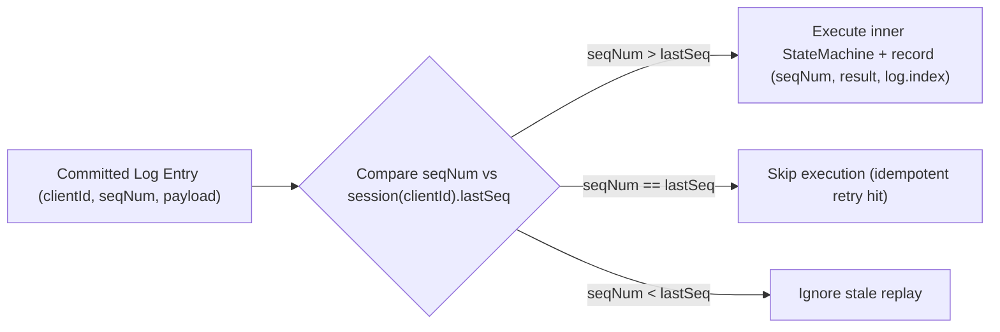

# Tutorial 10: Exactly-Once Delivery with Client Sessions

*How to guarantee that a retried client command never executes twice — implementing the replicated session deduplication table used by etcd, ZooKeeper, CockroachDB, and TiKV on top of `RaftNode[F]`.*

---

## The Problem: Consensus Alone Is At-Least-Once for Clients

Raft guarantees that every committed log entry is applied **once per state machine** in identical order across all replicas. However, the network between the **client** and the **leader** can drop the leader's acknowledgment *after* the entry commits:

```mermaid
sequenceDiagram
    participant C as Client A
    participant L1 as Leader 1
    participant L2 as Failover Leader 2

    C->>L1: proposeAndCommit("transfer 100 USD Alice->Bob", seq=42)
    Note over L1: Quorum commits entry at index 88; Alice debited 100 USD
    L1--xC: ACK lost (leader crash or TCP reset)
    Note over C: Outcome indeterminate — client MUST retry seq=42!
    C->>L2: proposeAndCommit("transfer 100 USD Alice->Bob", seq=42)
    Note over L2: Without session table: debits Alice a SECOND 100 USD!
    Note over L2: With replicated session table: sees seq=42 cached -> returns stored receipt!
    L2-->>C: Cached receipt ("OK:tx-88")
```

Without client session tracking inside the replicated `StateMachine`, retrying after a timeout or `ProposalDropped` risks applying non-idempotent commands twice (charging Alice \$200 instead of \$100).

---

## Replicated Session Deduplication Architecture

Every client attaches a `(ClientId, sequenceNumber)` header to its command payload. Inside `StateMachine.apply`, the state machine consults a replicated `Map[ClientId, SessionEntry]` **before** mutating domain state:



Because `SessionState` lives inside the `StateMachine` — and is serialized inside `StateMachine.snapshot` / `restore` — every follower, compacted snapshot, and crash-recovered `MmapWalEngine` node preserves identical deduplication state!

---

## Complete Implementation on `RaftNode[IO]`

### 1. Wire Framing for Session-Tagged Commands

```scala
import java.nio.ByteBuffer
import java.nio.charset.StandardCharsets

final case class ClientId(value: String)

final case class TaggedCommand(
    clientId: ClientId,
    sequenceNumber: Long,
    payload: Array[Byte]
)

object TaggedCommand:
  def encode(cmd: TaggedCommand): Array[Byte] =
    val cidBytes = cmd.clientId.value.getBytes(StandardCharsets.UTF_8)
    val buf = ByteBuffer.allocate(4 + cidBytes.length + 8 + cmd.payload.length)
    buf.putInt(cidBytes.length)
    buf.put(cidBytes)
    buf.putLong(cmd.sequenceNumber)
    buf.put(cmd.payload)
    buf.array()

  def decode(bytes: Array[Byte]): TaggedCommand =
    val buf = ByteBuffer.wrap(bytes)
    val cidLen = buf.getInt()
    val cidBytes = new Array[Byte](cidLen)
    buf.get(cidBytes)
    val seqNum = buf.getLong()
    val payload = new Array[Byte](buf.remaining())
    buf.get(payload)
    TaggedCommand(
      ClientId(new String(cidBytes, StandardCharsets.UTF_8)),
      seqNum,
      payload
    )
```

### 2. Snapshot-Safe `SessionAwareStateMachine`

Notice how both `snapshot` and `restore` use streaming `fs2.Stream[IO, Byte]` and persist **both** the inner domain snapshot and the session deduplication table so `CompactionManager` log truncation never erases recent client receipts:

```scala
import java.nio.ByteBuffer
import java.nio.charset.StandardCharsets
import cats.effect.{IO, Ref}
import fs2.{Chunk, Stream}
import raft.spi.StateMachine
import raft.state.Log

final case class SessionEntry(
    lastSequenceNumber: Long,
    lastResult: String,
    lastActivityIndex: Long
)

final class SessionAwareStateMachine[R](
    inner: StateMachine[IO, R],
    sessionsRef: Ref[IO, Map[ClientId, SessionEntry]],
    encodeResult: R => String,
    maxSessionAgeEntries: Long = 50_000L
) extends StateMachine[IO, String]:

  def apply(log: Log): IO[String] =
    val tagged = TaggedCommand.decode(log.data)
    sessionsRef.get.flatMap { sessions =>
      sessions.get(tagged.clientId) match
        case Some(entry) if tagged.sequenceNumber == entry.lastSequenceNumber =>
          IO.pure(entry.lastResult)

        case Some(entry) if tagged.sequenceNumber < entry.lastSequenceNumber =>
          IO.pure(s"STALE:${entry.lastSequenceNumber}")

        case _ =>
          for
            rawResult <- inner.apply(log.copy(data = tagged.payload))
            rendered = encodeResult(rawResult)
            _ <- sessionsRef.update { cur =>
              val updated = cur.updated(
                tagged.clientId,
                SessionEntry(tagged.sequenceNumber, rendered, log.index)
              )
              // Deterministic log-index TTL eviction (identical across all replicas!)
              updated.filter { case (_, e) =>
                log.index - e.lastActivityIndex <= maxSessionAgeEntries
              }
            }
          yield rendered
    }

  def readSessionReceipt(clientId: ClientId, seqNum: Long): IO[Option[String]] =
    sessionsRef.get.map { sessions =>
      sessions
        .get(clientId)
        .filter(_.lastSequenceNumber == seqNum)
        .map(_.lastResult)
    }

  def snapshot: IO[Stream[IO, Byte]] =
    for
      innerStream <- inner.snapshot
      innerBytes <- innerStream.compile.to(Array)
      sessions <- sessionsRef.get
    yield
      val sessionLines = sessions.toSeq
        .sortBy(_._1.value)
        .map { case (cid, e) =>
          s"${cid.value}\t${e.lastSequenceNumber}\t${e.lastActivityIndex}\t${e.lastResult}"
        }
        .mkString("\n")
        .getBytes(StandardCharsets.UTF_8)
      val buf = ByteBuffer.allocate(4 + innerBytes.length + 4 + sessionLines.length)
      buf.putInt(innerBytes.length)
      buf.put(innerBytes)
      buf.putInt(sessionLines.length)
      buf.put(sessionLines)
      Stream.chunk(Chunk.array(buf.array())).covary[IO]

  def restore(data: Stream[IO, Byte]): IO[Unit] =
    data.compile.to(Array).flatMap { all =>
      val buf = ByteBuffer.wrap(all)
      val innerLen = buf.getInt()
      val innerBytes = new Array[Byte](innerLen)
      buf.get(innerBytes)
      val sessLen = buf.getInt()
      val sessBytes = new Array[Byte](sessLen)
      buf.get(sessBytes)

      val parsedSessions =
        val text = new String(sessBytes, StandardCharsets.UTF_8)
        if text.isEmpty then Map.empty[ClientId, SessionEntry]
        else
          text
            .split("\n")
            .flatMap { line =>
              line.split("\t", 4) match
                case Array(cid, seq, idx, res) =>
                  Some(ClientId(cid) -> SessionEntry(seq.toLong, res, idx.toLong))
                case _ => None
            }
            .toMap

      inner.restore(Stream.chunk(Chunk.array(innerBytes)).covary[IO]) *>
        sessionsRef.set(parsedSessions)
    }
```

> [!IMPORTANT]
> **Never use wall-clock `System.currentTimeMillis()` to expire sessions inside `StateMachine.apply`!** Different nodes apply the same log entry at slightly different wall-clock instants, which would cause state-machine divergence across replicas. Always base deterministic eviction on `log.index` (as shown above with `maxSessionAgeEntries`) or on a timestamp explicitly recorded inside the replicated `Log` entry.

### 3. Retry-Safe Client Wrapper Using `proposeAndCommit` & `NotLeader` Hints

On `RaftNode[IO]`, followers reject writes with `RaftError.NotLeader(Some(leaderId))`, allowing the client to immediately route to the hinted leader while preserving the **exact same `sequenceNumber`** across retries:

```scala
import java.util.concurrent.atomic.AtomicLong
import scala.concurrent.duration.*
import cats.effect.IO
import raft.RaftNode
import raft.state.{NodeId, RaftError}

final class ExactlyOnceClient(
    clientId: ClientId,
    nodes: Map[NodeId, (RaftNode[IO], SessionAwareStateMachine[?])]
):
  private val seqGen = new AtomicLong(0L)

  def execute(payload: Array[Byte], maxAttempts: Int = 10): IO[String] =
    val seqNum = seqGen.incrementAndGet()
    val wireBytes = TaggedCommand.encode(TaggedCommand(clientId, seqNum, payload))
    attempt(nodes.keys.head, seqNum, wireBytes, maxAttempts)

  private def attempt(
      targetId: NodeId,
      seqNum: Long,
      wireBytes: Array[Byte],
      remaining: Int
  ): IO[String] =
    if remaining <= 0 then
      IO.raiseError(new RuntimeException(s"Exhausted retries for seq=$seqNum"))
    else
      val (raftNode, localSm) = nodes(targetId)
      raftNode.proposeAndCommit(wireBytes).attempt.flatMap {
        case Right(_) =>
          // Linearizable local receipt lookup on the node that just committed & applied wireBytes
          localSm.readSessionReceipt(clientId, seqNum).flatMap {
            case Some(result) => IO.pure(result)
            case None         => IO.raiseError(new RuntimeException("Session evicted"))
          }

        case Left(RaftError.NotLeader(Some(leaderHint))) if nodes.contains(leaderHint) =>
          attempt(leaderHint, seqNum, wireBytes, remaining - 1)

        case Left(_) =>
          val nextTarget = nodes.keys.find(_ != targetId).getOrElse(targetId)
          IO.sleep(50.millis) *> attempt(nextTarget, seqNum, wireBytes, remaining - 1)
      }
```

---

## Verifying All Three Failure Scenarios

| Failure Timing | What Happens on Retry (`seq = 42`) | Transfers Executed |
|----------------|------------------------------------|--------------------|
| **Leader commits, response lost, client retries same leader** | `sessions(clientId).lastSequenceNumber == 42` hits cache immediately; `inner.apply` is skipped | **1** (\$100) |
| **Leader commits, crashes before ACK, client retries new leader** | New leader already replicated log entry `#88` (including `SessionEntry(42, ...)`); retry hits cache on new leader | **1** (\$100) |
| **Leader crashes before replicating to quorum, client retries new leader** | Uncommitted entry `#88` is absent on new leader; retry commits `seq = 42` for the first time | **1** (\$100) |

---

*Next: [Tutorial 11 — Snapshot & Log Compaction Cookbook](11-snapshot-compaction.md) — bounding WAL disk usage while keeping lagging followers synchronized.*
