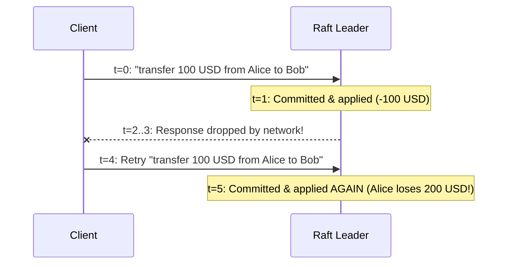
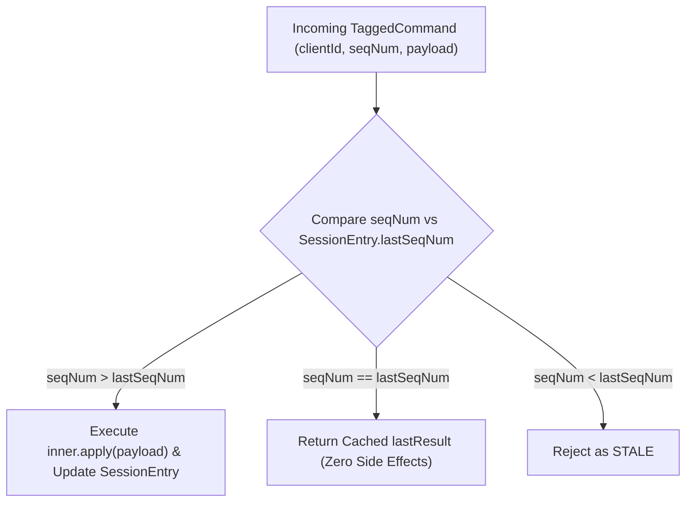
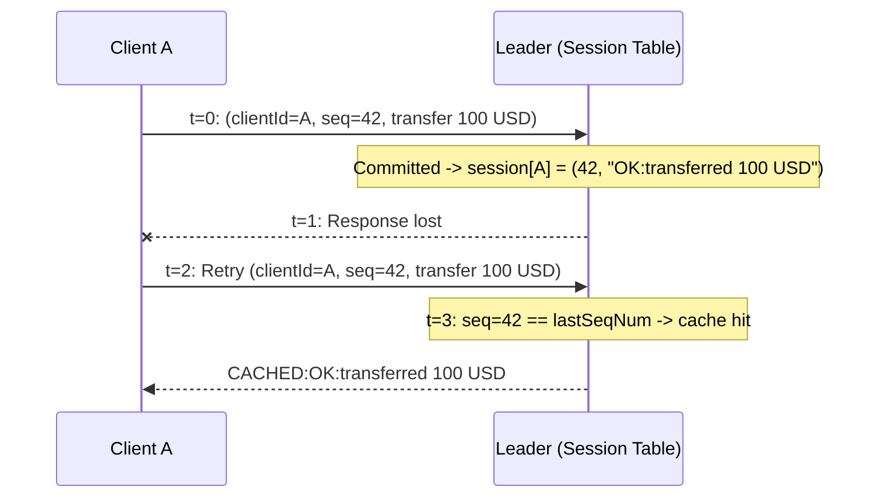
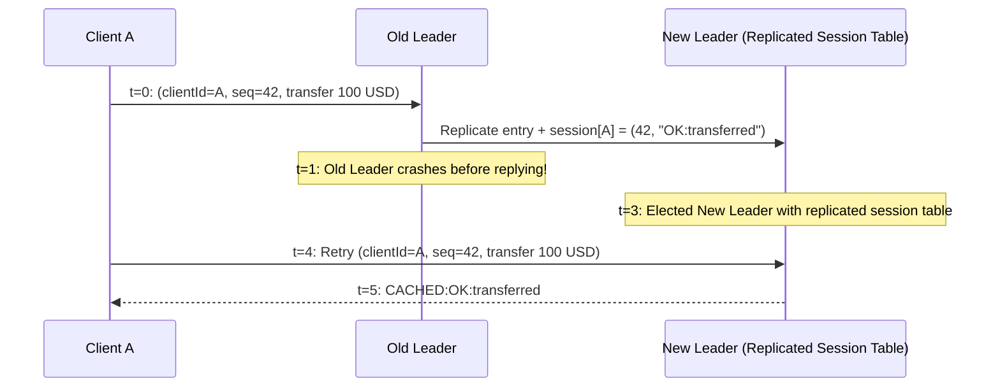
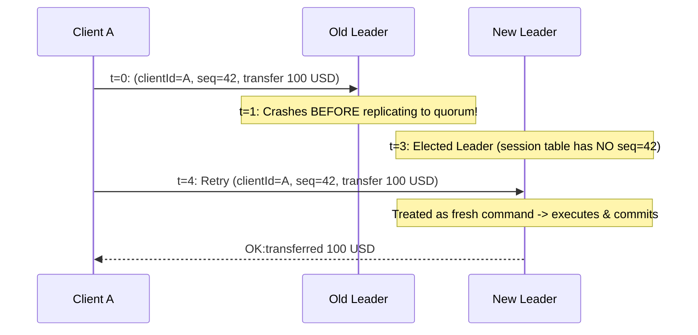

# Tutorial 10: Exactly-Once Delivery with Client Sessions

*How to guarantee that a client's retried request doesn't execute twice — the session table pattern used by etcd, ZooKeeper, and every production Raft system.*

---

## The Problem

Consider this sequence:



The Raft consensus layer guarantees that committed commands are durable and applied exactly once **within the cluster**. But the client doesn't know whether its command was committed or not. Its only safe option is to retry — and retries cause duplicates.

This isn't a theoretical concern. Every production Raft system (etcd, CockroachDB, TiKV) implements client sessions to solve it.

## The Session Table Pattern

The idea is simple: track what the cluster has already done for each client inside the replicated state machine.

| `ClientId` | `LastSeqNum` | `LastResult` |
|------------|--------------|--------------|
| `client-A` | `42` | `"OK:transferred \$100"` |
| `client-B` | `17` | `"OK:balance=\$350"` |
| `client-C` | `3` | `"ERR:insufficient funds"` |



Every client command carries a `(clientId, sequenceNumber)` pair. The state machine checks:

1. If `seqNum > lastSeqNum` → execute the command, store the result
2. If `seqNum == lastSeqNum` → return the stored result (this is a retry)
3. If `seqNum < lastSeqNum` → reject as stale (client bug or replay attack)

## Implementation

### Client-side: Tagging requests

```scala
import java.util.concurrent.atomic.AtomicLong

case class ClientId(value: String) extends AnyVal

class RaftClient(clientId: ClientId, raftNode: RaftNodeApi):
  private val seqCounter = new AtomicLong(0)

  def execute(command: Array[Byte]): IO[String] =
    val seqNum = seqCounter.incrementAndGet()
    val tagged = TaggedCommand.encode(
      TaggedCommand(clientId, seqNum, command)
    )
    raftNode.propose(Log.Command(0, 0, tagged)).flatMap { result =>
      if result.startsWith("RETRY:") then
        // Possible stale response — retry with SAME seqNum
        IO.sleep(100.millis) *> retryWithSeq(seqNum, command)
      else
        IO.pure(result)
    }

  private def retryWithSeq(seqNum: Long, command: Array[Byte]): IO[String] =
    val tagged = TaggedCommand.encode(
      TaggedCommand(clientId, seqNum, command)
    )
    raftNode.propose(Log.Command(0, 0, tagged))
```

### Wire format

```scala
import java.nio.charset.StandardCharsets

case class TaggedCommand(
  clientId: ClientId,
  sequenceNumber: Long,
  payload: Array[Byte]
)

object TaggedCommand:
  def encode(cmd: TaggedCommand): Array[Byte] =
    val header = s"${cmd.clientId.value}|${cmd.sequenceNumber}|"
      .getBytes(StandardCharsets.UTF_8)
    header ++ cmd.payload

  def decode(data: Array[Byte]): TaggedCommand =
    val str = new String(data, StandardCharsets.UTF_8)
    val firstPipe = str.indexOf('|')
    val secondPipe = str.indexOf('|', firstPipe + 1)
    val clientId = ClientId(str.substring(0, firstPipe))
    val seqNum = str.substring(firstPipe + 1, secondPipe).toLong
    val payload = data.drop(secondPipe + 1)
    TaggedCommand(clientId, seqNum, payload)
```

### State machine: Deduplication layer

Wrap any existing state machine with session tracking:

```scala
import cats.effect.{IO, Ref}
import raft.state.Log
import raft.spi.StateMachine

case class SessionEntry(
  lastSequenceNumber: Long,
  lastResult: String,
  lastActivityIndex: Long   // for session expiration
)

case class SessionState(
  sessions: Map[ClientId, SessionEntry],
  maxSessions: Int = 10_000
)

class SessionAwareStateMachine[R](
  inner: StateMachine[IO, R],
  sessionRef: Ref[IO, SessionState],
  resultToString: R => String = (r: R) => r.toString
) extends StateMachine[IO, String]:

  def apply(log: Log): IO[String] =
    val tagged = TaggedCommand.decode(log.data)

    sessionRef.get.flatMap { sessions =>
      sessions.sessions.get(tagged.clientId) match
        case Some(entry) if tagged.sequenceNumber == entry.lastSequenceNumber =>
          // Duplicate — return cached result without re-executing
          IO.pure(s"CACHED:${entry.lastResult}")

        case Some(entry) if tagged.sequenceNumber < entry.lastSequenceNumber =>
          // Stale — reject
          IO.pure(s"STALE:seq=${tagged.sequenceNumber}:expected>${entry.lastSequenceNumber}")

        case _ =>
          // New command — execute and cache result
          for
            result <- inner.apply(log.copy(data = tagged.payload))
            resultStr = resultToString(result)
            _ <- sessionRef.update { state =>
              val entry = SessionEntry(
                tagged.sequenceNumber,
                resultStr,
                log.index
              )
              state.copy(
                sessions = state.sessions + (tagged.clientId -> entry)
              )
            }
          yield resultStr
    }

  def snapshot: IO[Array[Byte]] =
    for
      innerSnap <- inner.snapshot
      sessions  <- sessionRef.get
      sessionSnap = sessions.sessions.map { (cid, entry) =>
        s"${cid.value}|${entry.lastSequenceNumber}|${entry.lastResult}|${entry.lastActivityIndex}"
      }.mkString("\n").getBytes(StandardCharsets.UTF_8)
      // Combine inner snapshot + session snapshot
      combined = s"${innerSnap.length}\n".getBytes(StandardCharsets.UTF_8) ++
                 innerSnap ++ sessionSnap
    yield combined

  def restore(data: Array[Byte]): IO[Unit] =
    // Restore both inner state and session table from snapshot
    inner.restore(data) // simplified — production would split the data
```

### Why the session table must be replicated

The session table is part of the state machine — it's replicated via Raft like any other state. This is critical because:

- After a leader failure, the new leader has the same session table
- A retried request that reaches the new leader sees the same cached response
- The deduplication guarantee survives any single-node failure

If the session table were local to the leader, a leader change would lose all session state, and retries would re-execute.

## Session Lifecycle

### Registration

Clients register a session before sending commands:

```scala
enum SessionCommand:
  case OpenSession(clientId: ClientId, ttlMs: Long)
  case CloseSession(clientId: ClientId)
  case KeepAlive(clientId: ClientId, timestampMs: Long)
```

### Expiration

Sessions that don't send `KeepAlive` within their TTL are expired. This bounds memory usage:

```scala
def expireSessions(state: SessionState, currentIndex: Long, maxAge: Long): SessionState =
  val active = state.sessions.filter { (_, entry) =>
    currentIndex - entry.lastActivityIndex < maxAge
  }
  state.copy(sessions = active)
```

### Sequence number overflow

With `Long` sequence numbers (2^63), a client sending 1 million requests per second won't overflow for ~292,000 years. This is not a practical concern.

## Failure Scenarios

### Scenario 1: Client retries to same leader



Result: Transfer happens exactly once.

### Scenario 2: Client retries to new leader



Result: Transfer happens exactly once, despite leader change.

### Scenario 3: Command was never committed



Result: Transfer happens exactly once. The first attempt was lost (never committed), and the retry is treated as a new command.

## Integrating with Other Tutorials

The session table pattern wraps **any** state machine. Apply it to previous tutorials:

```scala
// Configuration service with exactly-once writes
val configSM = new ConfigStateMachine(configRef)
val sessionConfigSM = new SessionAwareStateMachine(configSM, sessionRef)

// Task queue with deduplicated enqueue
val taskSM = new TaskQueueStateMachine(queueRef)
val sessionTaskSM = new SessionAwareStateMachine(taskSM, sessionRef)

// Rate limiter with deduplicated recording
val rateSM = new RateLimitStateMachine(rateRef)
val sessionRateSM = new SessionAwareStateMachine(rateSM, sessionRef)
```

## Production Considerations

- **Session table size**: With 10,000 concurrent clients and one cached response per client, the table is ~1MB. This is negligible compared to application state.
- **Response size**: Cache only a summary/ID, not the full response body. Large responses should use a reference (e.g., "result stored at key X").
- **Client library**: Embed the session logic in a client library so application developers don't need to manage sequence numbers manually.
- **Idempotency keys vs. sessions**: For HTTP APIs, idempotency keys (Tutorial 6) are simpler. Sessions are better for persistent, long-lived client connections (gRPC streams, WebSockets).

---

*Next: [Tutorial 11 — Snapshot & Log Compaction Cookbook](11-snapshot-compaction.md) — managing log growth in long-running production clusters.*
