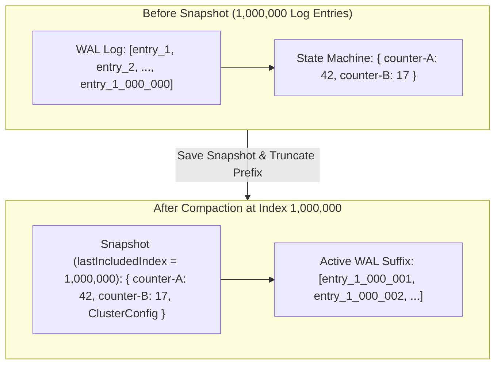
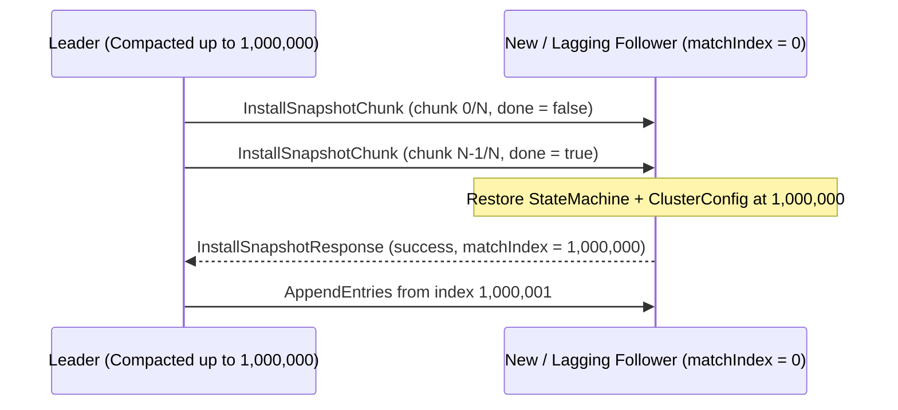

# Tutorial 11: Snapshot & Log Compaction Cookbook

*How to manage log growth in long-running Raft clusters — when to snapshot, how to stream snapshots to new nodes, and compaction strategies that won't disrupt your service.*

---

## The Problem

The Raft log grows with every write. After a million operations, the log contains a million entries — even if the actual state is just a small key-value map. Without compaction:

- **Disk usage grows without bound**: 1,000 writes/sec × 1KB each = 86 GB/day
- **Node recovery takes forever**: A new node must replay 86 GB of log to catch up
- **Startup time increases**: Even existing nodes re-apply the log on restart

## What Snapshotting Does

A snapshot captures the **current state machine state** at a specific log index, then discards all log entries up to that index:



## When to Snapshot

### Strategy 1: Entry count threshold

```scala
class SnapshotManager(
  stateMachine: StateMachine[IO, ?],
  logStore: LogStore[IO],
  threshold: Long = 10_000  // snapshot every 10K entries
):
  def checkAndSnapshot(lastApplied: Long, lastSnapshotIndex: Long): IO[Unit] =
    if lastApplied - lastSnapshotIndex >= threshold then
      for
        _    <- IO.println(s"Snapshotting at index $lastApplied")
        data <- stateMachine.snapshot
        _    <- logStore.saveSnapshot(lastApplied, data)
        _    <- logStore.compactUpTo(lastApplied)
        _    <- IO.println(s"Compacted log up to index $lastApplied")
      yield ()
    else IO.unit
```

### Strategy 2: Byte size threshold

```scala
def checkBySize(logStore: LogStore[IO], maxBytes: Long = 100_000_000): IO[Boolean] =
  for
    size <- logStore.approximateSize
    shouldSnapshot = size > maxBytes
  yield shouldSnapshot
```

### Strategy 3: Time-based

```scala
def periodicSnapshot(interval: FiniteDuration = 5.minutes): fs2.Stream[IO, Unit] =
  fs2.Stream
    .fixedDelay[IO](interval)
    .evalMap { _ =>
      for
        data <- stateMachine.snapshot
        idx  <- lastAppliedRef.get
        _    <- logStore.saveSnapshot(idx, data)
        _    <- logStore.compactUpTo(idx)
      yield ()
    }
```

### Which strategy to use?

| Strategy | Best for | Trade-off |
|----------|----------|-----------|
| Entry count | Write-heavy workloads | Predictable snapshot frequency |
| Byte size | Variable entry sizes | Adapts to payload differences |
| Time-based | Mixed workloads | Simple, but may snapshot too often or too rarely |

In practice, **combine** them: snapshot when entry count exceeds 10K **OR** every 5 minutes, whichever comes first.

## Snapshot Serialization

The snapshot format must be self-contained — a new node should be able to reconstruct its entire state from a snapshot alone:

```scala
case class SnapshotMetadata(
  lastIncludedIndex: Long,
  lastIncludedTerm: Long,
  currentConfig: ClusterConfig,
  snapshotVersion: Int = 1       // for format evolution
)

case class FullSnapshot(
  metadata: SnapshotMetadata,
  stateData: Array[Byte]         // serialized state machine
)

object FullSnapshot:
  def serialize(snap: FullSnapshot): Array[Byte] =
    val metaJson = s"""{
      "index": ${snap.metadata.lastIncludedIndex},
      "term": ${snap.metadata.lastIncludedTerm},
      "version": ${snap.metadata.snapshotVersion},
      "voters": [${snap.metadata.currentConfig.voters.map(n => s""""${n.value}"""").mkString(",")}]
    }"""
    val metaBytes = metaJson.getBytes(StandardCharsets.UTF_8)
    val header = s"SNAP:${metaBytes.length}:${snap.stateData.length}\n"
      .getBytes(StandardCharsets.UTF_8)
    header ++ metaBytes ++ snap.stateData

  def deserialize(data: Array[Byte]): FullSnapshot =
    val str = new String(data, StandardCharsets.UTF_8)
    val headerEnd = str.indexOf('\n')
    val parts = str.substring(0, headerEnd).split(":")
    val metaLen = parts(1).toInt
    val offset = headerEnd + 1
    val metaBytes = data.slice(offset, offset + metaLen)
    val stateBytes = data.drop(offset + metaLen)
    // Parse metadata JSON and reconstruct
    FullSnapshot(
      SnapshotMetadata(0, 0, ClusterConfig(Set.empty)), // simplified
      stateBytes
    )
```

### What must be preserved in the snapshot

| Data | Why |
|------|-----|
| **State machine state** | The application's current state |
| **Last included index/term** | So the node knows which log entries the snapshot replaces |
| **Cluster configuration** | The membership that was active at snapshot time |
| **Session table** (Tutorial 10) | Client deduplication state |

## Streaming Snapshots to New Nodes

When a new node joins and the leader's log has been compacted, the leader must send the snapshot:

```scala
trait SnapshotTransfer[F[_]]:
  def sendSnapshot(
    targetNode: NodeId,
    snapshot: FullSnapshot,
    chunkSize: Int = 64 * 1024    // 64KB chunks
  ): F[Unit]

class ChunkedSnapshotSender[F[_]: Async](transport: Transport[F])
    extends SnapshotTransfer[F]:

  def sendSnapshot(target: NodeId, snapshot: FullSnapshot,
                   chunkSize: Int): F[Unit] =
    val data = FullSnapshot.serialize(snapshot)
    val chunks = data.grouped(chunkSize).toVector
    val totalChunks = chunks.size

    chunks.zipWithIndex.traverse_ { (chunk, idx) =>
      val msg = InstallSnapshotChunk(
        lastIncludedIndex = snapshot.metadata.lastIncludedIndex,
        lastIncludedTerm = snapshot.metadata.lastIncludedTerm,
        chunkIndex = idx,
        totalChunks = totalChunks,
        data = chunk,
        done = idx == totalChunks - 1
      )
      transport.send(target, msg)
    }

case class InstallSnapshotChunk(
  lastIncludedIndex: Long,
  lastIncludedTerm: Long,
  chunkIndex: Int,
  totalChunks: Int,
  data: Array[Byte],
  done: Boolean
)
```

The receiving node assembles chunks, then:
1. Restores the state machine from the snapshot data
2. Sets its last applied index to `lastIncludedIndex`
3. Loads the cluster configuration from the snapshot metadata
4. Begins accepting log entries from `lastIncludedIndex + 1`



## Compaction Safety Rules

### Never compact uncommitted entries

```scala
def safeCompactionIndex(commitIndex: Long, lastSnapshotIndex: Long): Long =
  // Only compact entries that are committed
  math.min(commitIndex, lastSnapshotIndex)
```

### Keep a trailing window

Don't compact right up to the last applied index. Keep a buffer so followers that are slightly behind can catch up via log entries (faster than snapshot transfer):

```scala
val trailingEntries = 1000  // keep 1000 entries after the snapshot point

def compactWithTrail(logStore: LogStore[IO], snapshotIndex: Long): IO[Unit] =
  val compactUpTo = math.max(0, snapshotIndex - trailingEntries)
  logStore.compactUpTo(compactUpTo)
```

### Coordinate with follower progress

Before compacting, check that slow followers won't need the entries you're about to discard:

```scala
def safeCompactIndex(
  snapshotIndex: Long,
  followerMatchIndices: Map[NodeId, Long],
  trailingBuffer: Long = 1000
): Long =
  val slowestFollower = followerMatchIndices.values.minOption.getOrElse(0L)
  val safe = math.min(snapshotIndex, slowestFollower) - trailingBuffer
  math.max(0, safe)
```

If a follower is so far behind that its needed entries have already been compacted, it must receive a snapshot instead.

## Failure Scenarios

### Snapshot transfer interrupted

The new node has a partial snapshot. It discards the incomplete data and requests a fresh snapshot. The idempotency of snapshot installation (overwrite, don't append) makes this safe.

### Leader crashes during compaction

Compaction is a local operation — it only affects the leader's disk. The log entries are still on the followers. The new leader has its own copy of the log and will compact independently.

### Snapshot version mismatch after upgrade

Use the `snapshotVersion` field to handle format evolution:

```scala
def restoreSnapshot(data: Array[Byte], version: Int): IO[Unit] =
  version match
    case 1 => restoreV1(data)
    case 2 => restoreV2(data)
    case v => IO.raiseError(new RuntimeException(s"Unknown snapshot version: $v"))
```

## Production Considerations

- **Snapshot storage**: Store snapshots on separate disks from the Raft log to avoid I/O contention during snapshotting
- **Concurrent snapshots**: Take snapshots on a separate fiber to avoid blocking the event loop. Use a consistent read (copy-on-write or `Ref.get`) to capture state without holding a lock
- **Monitoring**: Track snapshot duration, size, and frequency. Alert if snapshots take longer than 50% of the snapshot interval
- **Testing**: Regularly test snapshot restore to verify that your serialization is correct. A corrupted snapshot format that isn't caught until a disaster recovery scenario is catastrophic

---

*Next: [Tutorial 12 — Chaos Testing Your Raft Application](12-chaos-testing.md) — verifying your state machine is deterministic under adversarial conditions.*
