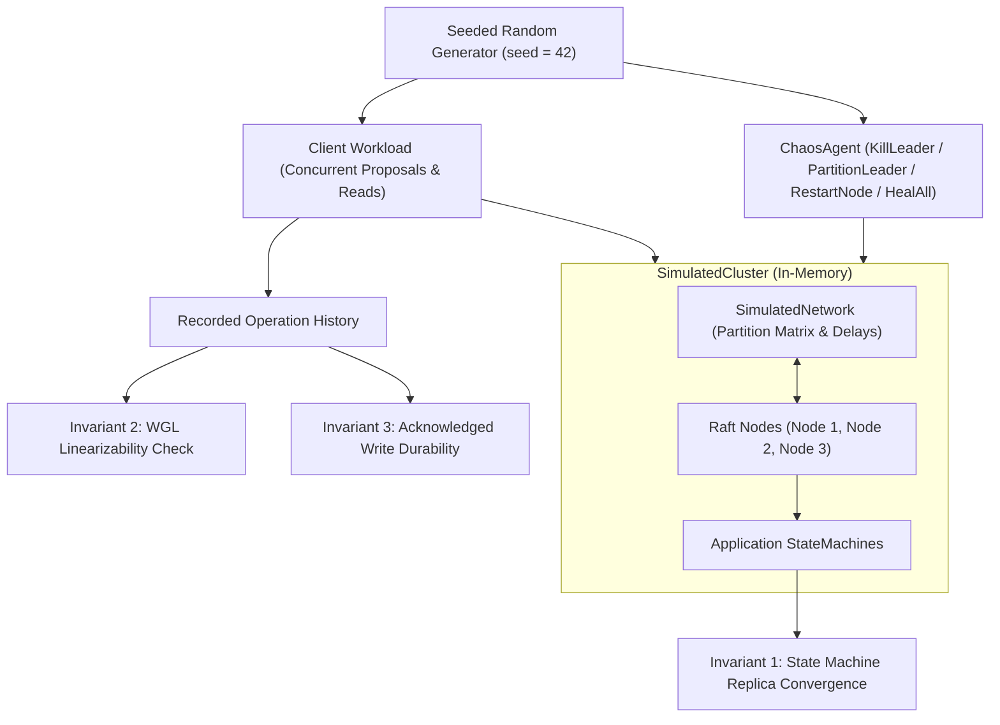

# Tutorial 12: Chaos Testing Your Raft Application

*How to verify that your state machine behaves correctly when networks fail, leaders crash, and clocks go haywire — before your users discover the bugs for you.*

---

## The Problem

Your Raft application works perfectly in testing: three nodes on localhost, no crashes, no partitions. Then you deploy to production and discover that:

- A leader crash during a specific write sequence corrupts your state machine
- A network partition causes two instances to diverge
- A snapshot restore loses client session data

The Raft library guarantees correctness of the **consensus protocol**. But your **state machine** — the application logic — can introduce bugs that break the assumptions Raft depends on. Chaos testing systematically injects failures to find these bugs.

## What Can Go Wrong in Your State Machine

| Bug category | Example | Consequence |
|-------------|---------|-------------|
| **Non-determinism** | Using `HashMap` iteration order | Nodes diverge after applying same commands |
| **Clock dependency** | Calling `System.currentTimeMillis()` in `apply` | Different timestamps on different nodes |
| **Missing snapshot data** | Forgetting to serialize session table | Client deduplication lost after snapshot restore |
| **Mutable state leaks** | Sharing a reference between `apply` and reads | Race condition between Raft thread and read thread |
| **Incorrect serialization** | Floating-point rounding differences | State divergence after snapshot restore |

## Building a Chaos Test Framework



### The simulated cluster

Use the library's in-memory infrastructure to build a fully controlled cluster:

```scala
import cats.effect.{IO, Ref}
import raft.state.{NodeId, ClusterConfig}
import raft.impl.{InMemLogStore, InMemStableStore, InMemTimerService}
import raft.RaftNode

case class SimulatedCluster(
  nodes: Map[NodeId, RaftNode[IO]],
  network: SimulatedNetwork,
  stateMachines: Map[NodeId, Ref[IO, YourState]]
)

class SimulatedNetwork:
  private val partitions = Ref.unsafe[IO, Set[(NodeId, NodeId)]](Set.empty)

  def partition(a: NodeId, b: NodeId): IO[Unit] =
    partitions.update(_ + ((a, b)) + ((b, a)))

  def heal(a: NodeId, b: NodeId): IO[Unit] =
    partitions.update(_ - ((a, b)) - ((b, a)))

  def healAll: IO[Unit] =
    partitions.set(Set.empty)

  def isPartitioned(a: NodeId, b: NodeId): IO[Boolean] =
    partitions.get.map(_.contains((a, b)))
```

### Fault injection primitives

```scala
enum ChaosAction:
  case KillLeader
  case PartitionLeader
  case IsolateNode(nodeId: NodeId)
  case SlowNetwork(delayMs: Long)
  case RestartNode(nodeId: NodeId)
  case TriggerSnapshot(nodeId: NodeId)
  case HealAll

class ChaosAgent(cluster: SimulatedCluster):

  def inject(action: ChaosAction): IO[Unit] = action match
    case ChaosAction.KillLeader =>
      for
        leader <- findLeader
        _      <- cluster.nodes(leader).shutdown
        _      <- IO.println(s"Killed leader $leader")
      yield ()

    case ChaosAction.PartitionLeader =>
      for
        leader  <- findLeader
        others  <- IO.pure(cluster.nodes.keys.filterNot(_ == leader))
        _       <- others.toList.traverse_(other =>
                     cluster.network.partition(leader, other))
        _       <- IO.println(s"Partitioned leader $leader from cluster")
      yield ()

    case ChaosAction.IsolateNode(nodeId) =>
      cluster.nodes.keys
        .filterNot(_ == nodeId)
        .toList
        .traverse_(other => cluster.network.partition(nodeId, other))

    case ChaosAction.HealAll =>
      cluster.network.healAll

    case ChaosAction.RestartNode(nodeId) =>
      for
        _ <- cluster.nodes(nodeId).shutdown
        _ <- IO.sleep(100.millis)
        _ <- cluster.nodes(nodeId).start
      yield ()

    case ChaosAction.TriggerSnapshot(nodeId) =>
      IO.println(s"Triggered snapshot on $nodeId")
      // Force snapshot via state machine
      
    case ChaosAction.SlowNetwork(delayMs) =>
      IO.println(s"Slowing network by ${delayMs}ms")

  private def findLeader: IO[NodeId] =
    cluster.nodes.toList.traverse { (id, node) =>
      node.getState.map(state => (id, state))
    }.map(_.collectFirst {
      case (id, state) if state.isLeader => id
    }.getOrElse(throw new RuntimeException("No leader found")))
```

## The Core Invariants to Verify

### Invariant 1: State machine consistency

After applying the same log, all nodes must have **identical state**:

```scala
def checkStateConsistency(cluster: SimulatedCluster): IO[Boolean] =
  for
    states <- cluster.stateMachines.toList.traverse { (nodeId, ref) =>
      ref.get.map(state => (nodeId, state))
    }
    allEqual = states.map(_._2).distinct.size == 1
    _ <- if !allEqual then
      IO.println(s"STATE DIVERGENCE DETECTED:") *>
        states.traverse_ { (id, state) =>
          IO.println(s"  $id: $state")
        }
    else IO.unit
  yield allEqual
```

### Invariant 2: Linearizability

Every completed operation should appear to execute at a single point between its invocation and response:

```scala
case class Operation(
  startTime: Long,
  endTime: Long,
  input: String,
  output: String
)

def checkLinearizability(history: Vector[Operation]): Boolean =
  // Simplified — production would use a linearization checker (Knossos/Porcupine)
  val sorted = history.sortBy(_.startTime)
  sorted.sliding(2).forall {
    case Vector(a, b) => a.endTime <= b.startTime || isConsistent(a, b)
    case _ => true
  }

private def isConsistent(a: Operation, b: Operation): Boolean =
  // Check that concurrent operations don't violate the sequential specification
  true // placeholder — implement based on your state machine's semantics
```

### Invariant 3: Durability

Once a write is acknowledged, it must survive leader failures:

```scala
def checkDurability(
  acknowledgedWrites: Vector[String],
  cluster: SimulatedCluster
): IO[Boolean] =
  for
    _ <- IO.sleep(2.seconds) // wait for election + recovery
    leaderState <- findLeaderState(cluster)
    allPresent = acknowledgedWrites.forall(write =>
      leaderState.contains(write)
    )
    _ <- if !allPresent then
      val missing = acknowledgedWrites.filterNot(leaderState.contains)
      IO.println(s"DURABILITY VIOLATION: missing ${missing.size} writes")
    else IO.unit
  yield allPresent
```

## A Complete Chaos Test

```scala
def chaosTestScenario(iterations: Int = 100): IO[Unit] =
  for
    cluster <- createCluster(3)
    chaos   <- IO.pure(ChaosAgent(cluster))
    history <- Ref.of[IO, Vector[Operation]](Vector.empty)
    random  <- IO(new scala.util.Random(42))  // deterministic seed

    // Phase 1: Write under normal conditions
    _ <- (1 to 50).toList.traverse_ { i =>
      submitWrite(cluster, s"key-$i", s"value-$i", history)
    }
    _ <- checkStateConsistency(cluster)

    // Phase 2: Write during chaos
    _ <- (51 to iterations).toList.traverse_ { i =>
      for
        // Randomly inject faults
        _ <- if random.nextDouble() < 0.1 then
          chaos.inject(ChaosAction.KillLeader)
        else if random.nextDouble() < 0.1 then
          chaos.inject(ChaosAction.PartitionLeader)
        else IO.unit

        // Submit writes (some will fail — that's expected)
        _ <- submitWrite(cluster, s"key-$i", s"value-$i", history)
              .handleError(_ => ())  // failed writes are OK

        // Periodically heal and check
        _ <- if i % 10 == 0 then
          chaos.inject(ChaosAction.HealAll) *>
          IO.sleep(3.seconds) *>  // wait for election
          checkStateConsistency(cluster)
        else IO.unit
      yield ()
    }

    // Phase 3: Heal and verify
    _ <- chaos.inject(ChaosAction.HealAll)
    _ <- IO.sleep(5.seconds)
    _ <- checkStateConsistency(cluster)
    _ <- checkDurability(getAcknowledgedWrites(history), cluster)
    _ <- IO.println("Chaos test PASSED")
  yield ()
```

## Common Bugs Found by Chaos Testing

### Bug 1: Non-deterministic Map iteration

```scala
// BUG: HashMap iteration order is not deterministic across JVMs
def apply(log: Log): IO[String] =
  val result = state.hashMap.map((k, v) => s"$k=$v").mkString(",")
  IO.pure(result)

// FIX: Use SortedMap or explicit sorting
def apply(log: Log): IO[String] =
  val result = state.sortedMap.map((k, v) => s"$k=$v").mkString(",")
  IO.pure(result)
```

### Bug 2: Wall-clock time in state machine

```scala
// BUG: Different nodes get different timestamps
def apply(log: Log): IO[String] =
  val now = System.currentTimeMillis()  // non-deterministic!
  stateRef.modify(s => (s.copy(lastModified = now), "OK"))

// FIX: Use the log index as a logical timestamp
def apply(log: Log): IO[String] =
  stateRef.modify(s => (s.copy(lastModified = log.index), "OK"))
```

### Bug 3: Incomplete snapshot serialization

```scala
// BUG: Session table not included in snapshot
def snapshot: IO[Array[Byte]] =
  stateRef.get.map(s => serialize(s.data))  // missing s.sessions!

// FIX: Include all state
def snapshot: IO[Array[Byte]] =
  stateRef.get.map(s => serialize(s.data, s.sessions, s.metadata))
```

## Test Taxonomy

| Test type | What it catches | Run frequency |
|-----------|----------------|---------------|
| **Determinism check** | Non-deterministic `apply` | Every CI build |
| **Leader kill** | Incomplete write handling | Every CI build |
| **Network partition** | Split-brain application bugs | Nightly |
| **Snapshot restore** | Serialization completeness | Nightly |
| **Long-running soak** | Memory leaks, log growth | Weekly |
| **Combined chaos** | Interactions between failure modes | Before release |

## Production Considerations

- **Deterministic randomness**: Use seeded `Random` instances so chaos tests are reproducible
- **Timeout budgets**: Allow enough time between chaos events for the cluster to stabilize — otherwise you're testing Raft's liveness, not your application's correctness
- **Assertion coverage**: Every state machine operation should have at least one chaos test that exercises it under failure
- **CI integration**: Run determinism and leader-kill tests in CI; run long-running chaos tests in a nightly pipeline

---

*Next: [Tutorial 13 — Monitoring & Observability](13-observability.md) — setting up dashboards and alerts for your Raft cluster.*
