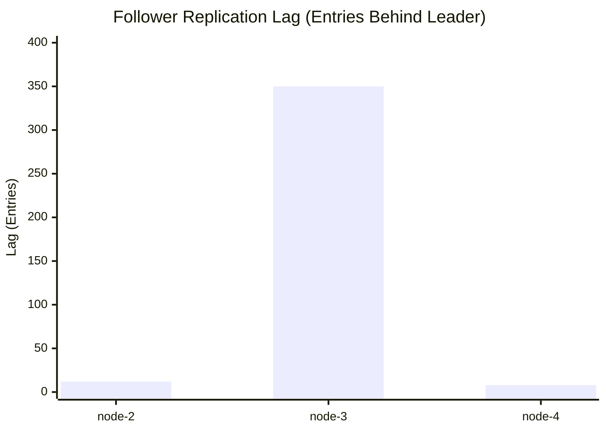
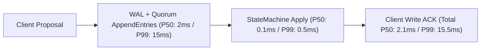

# Tutorial 13: Monitoring & Observability for Raft Clusters

*The metrics, logs, and dashboards you need to run a Raft cluster in production — how to tell if your cluster is healthy, and how to diagnose it when it isn't.*

---

## The Problem

A Raft cluster can appear healthy while silently degrading:

- A follower falls behind but the quorum still holds — until a second node fails
- Election storms cause write latency spikes that look like application bugs
- Log growth consumes disk space until the node crashes at 3 AM

Without observability, you're blind until the cluster is already broken.

## The Four Pillars of Raft Observability

### 1. Consensus Health Metrics

These metrics answer: "Is the cluster functioning correctly?"

```scala
import cats.effect.IO

trait RaftMetricsCollector:
  // Leadership
  def currentTerm: IO[Long]
  def isLeader: IO[Boolean]
  def timeSinceLastElection: IO[FiniteDuration]
  def electionsTotal: IO[Long]

  // Log
  def lastLogIndex: IO[Long]
  def commitIndex: IO[Long]
  def lastApplied: IO[Long]
  def logEntryCount: IO[Long]

  // Replication
  def followerMatchIndices: IO[Map[NodeId, Long]]
  def followerReplicationLag: IO[Map[NodeId, Long]]

  // Performance
  def proposalLatencyMs: IO[Histogram]
  def commitLatencyMs: IO[Histogram]
  def applyLatencyMs: IO[Histogram]
```

### 2. State Machine Metrics

Application-specific metrics — from the earlier tutorials:

```scala
trait ApplicationMetrics:
  // Configuration Service (Tutorial 1)
  def configKeyCount: IO[Long]
  def watchClientCount: IO[Long]

  // Task Queue (Tutorial 3)
  def pendingTaskCount: IO[Long]
  def claimedTaskCount: IO[Long]
  def taskProcessingLatencyMs: IO[Histogram]

  // Rate Limiter (Tutorial 4)
  def activeUserCount: IO[Long]
  def rejectionRate: IO[Double]

  // Client Sessions (Tutorial 10)
  def activeSessionCount: IO[Long]
  def duplicateRequestRate: IO[Double]
```

### 3. Infrastructure Metrics

System-level health indicators:

```scala
trait InfrastructureMetrics:
  def diskUsageBytes: IO[Long]       // log + snapshot storage
  def networkBytesInPerSec: IO[Long] // replication traffic
  def networkBytesOutPerSec: IO[Long]
  def goroutineCount: IO[Long]       // fiber count in Cats Effect
  def gcPauseMs: IO[Histogram]       // JVM GC pressure
```

### 4. Structured Logging

Log format that enables grep-based debugging:

```scala
import org.typelevel.log4cats.Logger

def logRaftEvent(logger: Logger[IO])(event: String, details: Map[String, String]): IO[Unit] =
  val kvPairs = details.map((k, v) => s"$k=$v").mkString(" ")
  logger.info(s"raft.event=$event $kvPairs")

// Examples:
// raft.event=election_started term=15 reason=timeout candidate=node-2
// raft.event=leader_elected term=15 leader=node-2 votes=2
// raft.event=entry_committed index=42000 term=15 entries=5
// raft.event=snapshot_taken index=42000 size_bytes=1048576 duration_ms=250
// raft.event=follower_lag node=node-3 match_index=41500 leader_index=42000 lag=500
```

## Dashboard Design

### Panel 1: Cluster Overview

| Metric | Visualization | Health indicator |
|--------|--------------|-----------------|
| Current leader | Single stat | Yellow if changed in last 60s |
| Current term | Single stat | Yellow if > 3 increments/hour |
| Cluster size | Gauge | Red if < expected |
| Uptime since last election | Timer | Yellow if < 5 minutes |

### Panel 2: Replication Health



- **Healthy**: `< 100` entries (`node-2`, `node-4`)
- **Elevated**: `100–1,000` entries (`node-3` at `350` entries — monitor disk/network)
- **Alert**: `> 1,000` entries (risk of snapshot fallback or quorum stall if another node fails)

### Panel 3: Latency Breakdown



| Path | P50 | P99 | P999 |
|------|-----|-----|------|
| **Proposal -> Commit** | `2.0 ms` | `15.0 ms` | `45.0 ms` |
| **Commit -> Apply** | `0.1 ms` | `0.5 ms` | `2.0 ms` |
| **Total Write** | `2.1 ms` | `15.5 ms` | `47.0 ms` |
| **ReadIndex Read** | `1.0 ms` | `8.0 ms` | `25.0 ms` |
| **Lease Read** | `0.01 ms` | `0.05 ms` | `0.1 ms` |

### Panel 4: Resource Usage

| Subsystem | Metric | Sample Value |
|-----------|--------|--------------|
| **Log & Storage** | Log entries | `42,000` |
| **Log & Storage** | Log size on disk | `128 MB` |
| **Log & Storage** | Last snapshot index | `40,000` |
| **Log & Storage** | Snapshot size | `12 MB` |
| **Log & Storage** | Disk free | `45 GB (82%)` |
| **Network** | Replication inbound | `2.3 MB/s` |
| **Network** | Replication outbound | `4.6 MB/s` |
| **Network** | Heartbeat rate | `5 req/s per follower` |

## Alert Rules

### Critical alerts (page immediately)

| Condition | Meaning | Response |
|-----------|---------|----------|
| No leader for > 30s | Cluster is unavailable | Check network, node health |
| Commit index stalled for > 60s | Cannot make progress | Check quorum, disk space |
| Disk usage > 90% | Imminent node failure | Trigger emergency compaction |
| State machine divergence detected | Data corruption | Stop writes, investigate |

### Warning alerts (investigate within hours)

| Condition | Meaning | Response |
|-----------|---------|----------|
| > 3 elections/hour | Leadership instability | Check network latency, tune timeouts |
| Follower lag > 10,000 entries | Follower falling behind | Check follower I/O, network |
| Snapshot duration > 30s | Snapshot too large | Increase compaction frequency |
| P99 write latency > 100ms | Performance degradation | Check disk I/O, network |
| Session table > 50,000 entries | Memory pressure | Reduce session TTL |

### Informational (log and track)

| Condition | Meaning |
|-----------|---------|
| Election completed | Normal leadership change |
| Snapshot taken | Normal compaction |
| Node joined/left | Membership change |
| Configuration change committed | Expected operational event |

## Implementing with the Library's RaftMetrics SPI

The library provides a `RaftMetrics` SPI for plugging in your monitoring system:

```scala
import raft.metrics.RaftMetrics

class PrometheusRaftMetrics extends RaftMetrics[IO]:
  private val electionCounter = Counter.build()
    .name("raft_elections_total").help("Total elections started").register()
  private val commitLatency = Histogram.build()
    .name("raft_commit_latency_seconds").help("Commit latency").register()
  private val logEntries = Gauge.build()
    .name("raft_log_entries").help("Number of log entries").register()

  def recordElection: IO[Unit] = IO(electionCounter.inc())
  def recordCommitLatency(ms: Long): IO[Unit] =
    IO(commitLatency.observe(ms / 1000.0))
  def setLogEntryCount(count: Long): IO[Unit] =
    IO(logEntries.set(count.toDouble))
```

## Debugging Playbook

### Symptom: "Writes are slow"

1. Check commit latency histogram — is P99 elevated?
2. Check follower replication lag — is one follower slow?
3. Check network latency between nodes
4. Check disk I/O on leader (WAL writes are on the critical path)

### Symptom: "Frequent elections"

1. Check heartbeat success rate
2. Check network packet loss between nodes
3. Verify `electionTimeout >> heartbeatInterval × 10`
4. Check for GC pauses exceeding the heartbeat interval

### Symptom: "Follower can't catch up"

1. Check follower disk I/O (can it apply entries fast enough?)
2. Check network bandwidth (is replication saturating the link?)
3. Check if the leader has compacted entries the follower needs → force snapshot transfer
4. Check application-side `apply` performance (is the state machine slow?)

## Production Considerations

- **Metric cardinality**: Avoid per-key metrics (e.g., "latency for key X"). Use per-node, per-group, per-operation-type dimensions only.
- **Log sampling**: At high throughput, log every 100th operation to avoid I/O overhead from logging.
- **Distributed tracing**: Attach trace IDs to client requests and propagate them through the Raft pipeline. This lets you correlate a slow write with its replication round-trip.
- **Runbook links**: Every alert should link to the relevant section of this tutorial's debugging playbook.

---

*Next: [Tutorial 14 — Multi-Datacenter Deployment](14-multi-datacenter.md) — running Raft across data centers with witness nodes and latency-aware configuration.*
