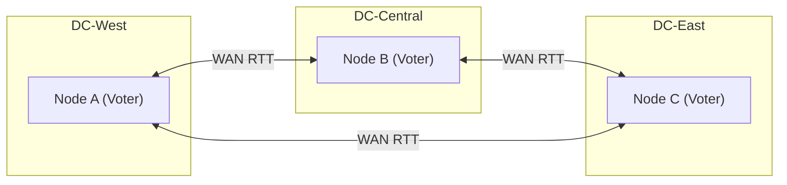
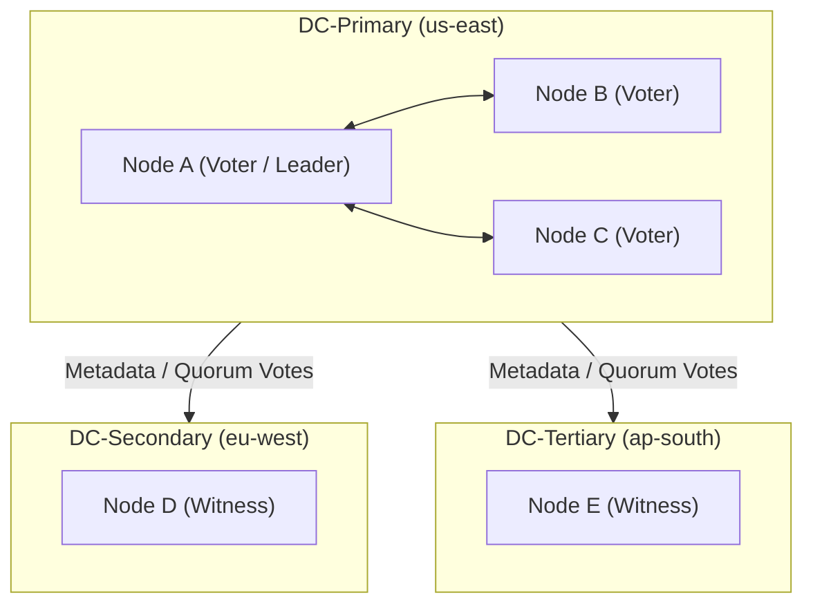
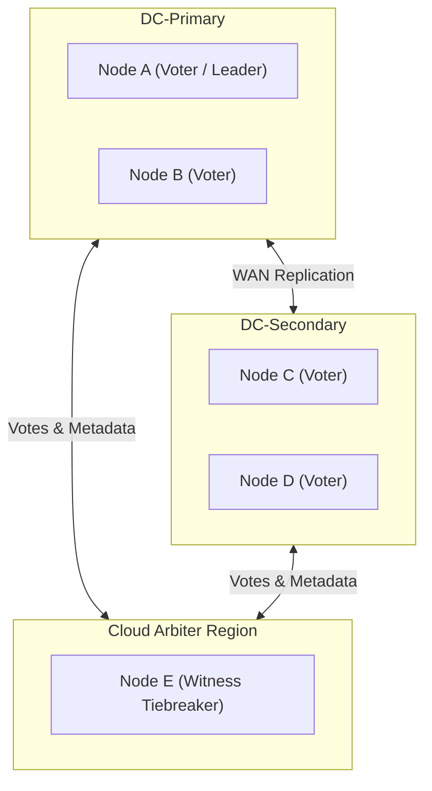
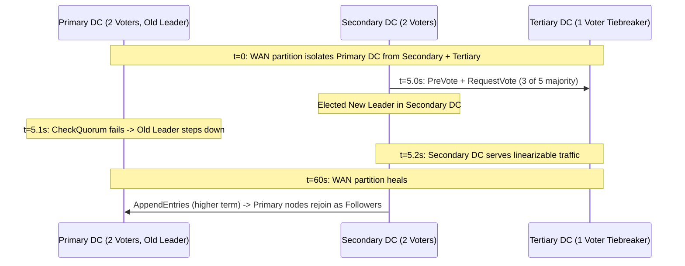

# Tutorial 14: Multi-Datacenter Deployment

*How to run Raft across data centers for disaster recovery — the trade-offs between latency, availability, and consistency, and how to configure your cluster for each deployment topology.*

---

## The Problem

A single-datacenter Raft cluster survives server failures but not datacenter failures. When the entire DC goes down (power outage, network backbone failure, natural disaster), your service goes down with it.

Spreading Raft across datacenters provides **disaster recovery** but introduces new challenges:

- **Latency**: Cross-DC round-trips are 10-100× slower than intra-DC
- **Network reliability**: WAN links are less reliable than LAN
- **Asymmetric failures**: One DC might lose connectivity while others remain healthy
- **Cost**: Cross-DC bandwidth is expensive

## Deployment Topologies

### Topology 1: Three DCs, one voter each (simplest)



- **Quorum**: 2 of 3 → survives loss of any 1 DC
- **Write latency**: `max(RTT to nearest peer)` ≈ 50–150 ms

**Trade-off**: Simple, but every write pays cross-DC latency. Best for low-write workloads where disaster recovery is critical.

### Topology 2: Primary DC with witnesses (recommended for low write latency)



- **Quorum**: 3 of 5 → survives loss of any secondary DC with zero write-latency penalty
- **Write latency**: intra-DC ≈ 1–5 ms (`Node A`, `Node B`, `Node C` form a local 3-of-5 quorum)

**Witness nodes** vote in elections and participate in commit decisions (`votingMembers`) without storing full state-machine payloads.

### Topology 3: Two DCs with cloud arbiter (common in practice)



- **Quorum**: 3 of 5 → survives complete loss of either `DC-Primary` or `DC-Secondary`
- **Write latency**: cross-DC RTT (must reach at least one remote voter or the arbiter for 3-of-5 quorum)

## Configuration

### Primary DC with witnesses

```scala
import raft.state.{ClusterConfig, NodeId}

val multiDcConfig = ClusterConfig(
  voters = Set(
    NodeId("us-east-1"),   // primary DC
    NodeId("us-east-2"),
    NodeId("us-east-3")
  ),
  witnesses = Set(
    NodeId("eu-west-1"),   // witness DC
    NodeId("ap-south-1")   // witness DC
  )
)
```

### Timeout tuning for WAN

Cross-DC latency requires different timeouts than intra-DC:

```scala
val wanConfig = RaftConfig(
  localId = nodeId,

  // WAN heartbeats — allow for cross-DC RTT
  heartbeatInterval = 500.millis,      // 5× slower than LAN default
  electionTimeoutMin = 5.seconds,      // 10× slower than LAN
  electionTimeoutMax = 10.seconds,

  // Pre-Vote prevents term inflation from partitioned DCs
  preVoteEnabled = true,

  // Leader stickiness prevents elections from WAN jitter
  leaderStickinessEnabled = true,

  // Optimize for WAN: batch more, pipeline less
  batching = BatchConfig(
    enabled = true,
    maxEntries = 100,     // larger batches amortize WAN RTT
    maxDelayMs = 50       // tolerate 50ms batching delay
  ),
  pipelining = PipelineConfig(
    enabled = true,
    maxInFlight = 2       // conservative for WAN (higher risk of reorder)
  )
)
```

### Latency-aware read routing

Route reads to the nearest DC for low latency:

```scala
enum ReadStrategy:
  case LocalLeaseRead     // fastest, clock-dependent
  case NearestReadIndex   // consistent, routes to nearest quorum
  case LeaderOnly         // strongest, always goes to leader

class LatencyAwareClient(
  localNodeId: NodeId,
  localDc: String,
  nodes: Map[NodeId, (String, RaftNodeApi)]  // (datacenter, api)
):

  def read(key: String, strategy: ReadStrategy): IO[String] =
    strategy match
      case ReadStrategy.LocalLeaseRead =>
        // Read from local node if it's the leader with valid lease
        val (_, api) = nodes(localNodeId)
        api.leaseRead(key)

      case ReadStrategy.NearestReadIndex =>
        // Find the nearest node that can serve a ReadIndex
        val nearest = nodes.toList
          .sortBy((_, (dc, _)) => dcDistance(localDc, dc))
          .head._2._2
        nearest.readIndex(key)

      case ReadStrategy.LeaderOnly =>
        // Route to leader (may be cross-DC)
        findLeaderApi.flatMap(_.read(key))

  private def dcDistance(from: String, to: String): Int =
    if from == to then 0
    else if sameRegion(from, to) then 1
    else 2
```

## Handling DC Failures

### Scenario 1: Secondary DC goes down

- **Topology**: Primary `[A, B, C]` + Witnesses `[D (secondary), E (tertiary)]`
- **Failure**: Secondary DC (`D`) is unreachable
- **Surviving Quorum**: `A, B, C, E` = 4 of 5 → majority intact, cluster continues with zero impact

### Scenario 2: Primary DC goes down

- **Topology**: Primary `[A, B, C]` + Witnesses `[D (secondary), E (tertiary)]`
- **Failure**: Primary DC (`A, B, C`) is unreachable
- **Surviving Nodes**: `D, E` = 2 of 5 → **no majority**, cluster stalls safely

With only witnesses surviving, the cluster cannot elect a leader because witnesses alone don't form a majority. This is by design — witnesses don't have the full log, so they can't become leader.

**Mitigation**: Deploy at least one full voter in each secondary DC:

```scala
val resilientConfig = ClusterConfig(
  voters = Set(
    NodeId("us-east-1"),   // primary
    NodeId("us-east-2"),   // primary
    NodeId("eu-west-1"),   // secondary (full voter)
    NodeId("ap-south-1")   // tertiary (full voter)
  ),
  witnesses = Set(
    NodeId("us-east-3")    // primary (lightweight tiebreaker)
  )
)
// Quorum: 3 of 5
// Primary DC down (us-east-1, us-east-2, us-east-3): eu-west-1 + ap-south-1 = 2/5 → still no quorum
// Need 2 voters + 1 witness per non-primary DC for true multi-DC resilience
```

For true multi-DC resilience, use 5 voters across 3 DCs (2+2+1):

```scala
val trulyResilientConfig = ClusterConfig(
  voters = Set(
    NodeId("us-east-1"), NodeId("us-east-2"),     // 2 in primary
    NodeId("eu-west-1"), NodeId("eu-west-2"),     // 2 in secondary
    NodeId("ap-south-1")                           // 1 in tertiary (tiebreaker)
  )
)
// Quorum: 3 of 5
// Any single DC failure: remaining 3+ voters → quorum maintained
```

### Scenario 3: Network partition between DCs



## Network Partition Strategies

### Strategy 1: Prefer availability (leader in any DC)

Allow any DC to host the leader. After a partition, the majority side elects a leader:

```scala
// Default behavior — no special configuration needed
// Leader will be wherever the quorum majority is
```

### Strategy 2: Prefer a specific DC (leader pinning)

Keep the leader in the primary DC using leadership transfer:

```scala
def enforceLeaderInPrimaryDc(
  cluster: RaftNodeApi,
  primaryDcNodes: Set[NodeId]
): IO[Unit] =
  for
    currentLeader <- cluster.currentLeader
    _ <- if !primaryDcNodes.contains(currentLeader) then
      // Transfer leadership back to primary DC
      val target = primaryDcNodes.head
      cluster.transferLeadership(target)
    else IO.unit
  yield ()
```

### Strategy 3: Read replicas in secondary DCs

Secondary DCs serve **reads only** (via lease reads or ReadIndex), all writes go to the primary DC:

```scala
class MultiDcRouter(localDc: String, primaryDc: String):
  def routeWrite(cmd: Array[Byte]): IO[String] =
    if localDc == primaryDc then
      localNode.propose(cmd)
    else
      // Forward to primary DC leader
      primaryDcLeader.propose(cmd)

  def routeRead(key: String): IO[String] =
    // Always read locally for low latency
    localNode.leaseRead(key)
```

## Production Considerations

### Bandwidth budgeting

Cross-DC replication consumes WAN bandwidth. Budget for:

$$\text{Bandwidth} = \text{write\_rate} \times \text{avg\_entry\_size} \times \text{num\_cross\_dc\_replicas}$$

- **Sustained throughput**: `1,000 writes/s × 1 KB × 2 cross-DC replicas = 2 MB/s`
- **Monthly egress**: `2 MB/s × 86,400 s/day × 30 days ≈ 5 TB/month` of cross-DC traffic

### Clock synchronization

Lease-based reads depend on bounded clock skew. Across DCs, use PTP (Precision Time Protocol) or Google's TrueTime-like bounds:

```scala
val crossDcLeaseConfig = RaftConfig(
  // Conservative lease — assumes up to 200ms clock skew between DCs
  leaseTimeout = 10.seconds,
  maxClockSkew = 200.millis  // much larger than intra-DC (10ms)
)
```

### Failover testing

Regularly test DC failover in staging:

1. Simulate primary DC failure (block all traffic)
2. Verify secondary DC elects leader within 10-15 seconds
3. Verify writes resume on secondary DC
4. Heal the partition, verify primary DC nodes rejoin cleanly
5. Optionally transfer leadership back to primary DC

### Monitoring (additions for multi-DC)

| Metric | Alert | Meaning |
|--------|-------|---------|
| Cross-DC RTT | > 200ms | WAN degradation |
| Replication lag to remote DC | > 5s | Bandwidth or network issue |
| Witness voting participation | < 100% | Witness connectivity issue |
| Leader in non-preferred DC | > 5 minutes | Consider leadership transfer |

---

*This completes the extended tutorial series. For API reference, see [Appendix A](../docs/book/appendix-a-quick-reference.md). For the complete book, see the [Table of Contents](../docs/book/README.md).*
