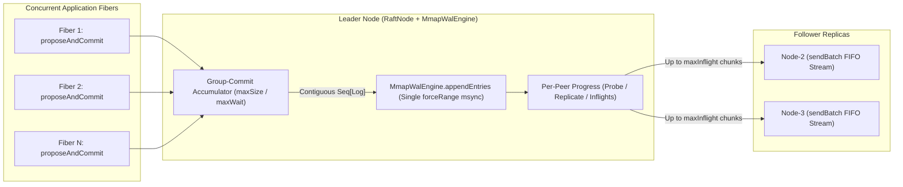
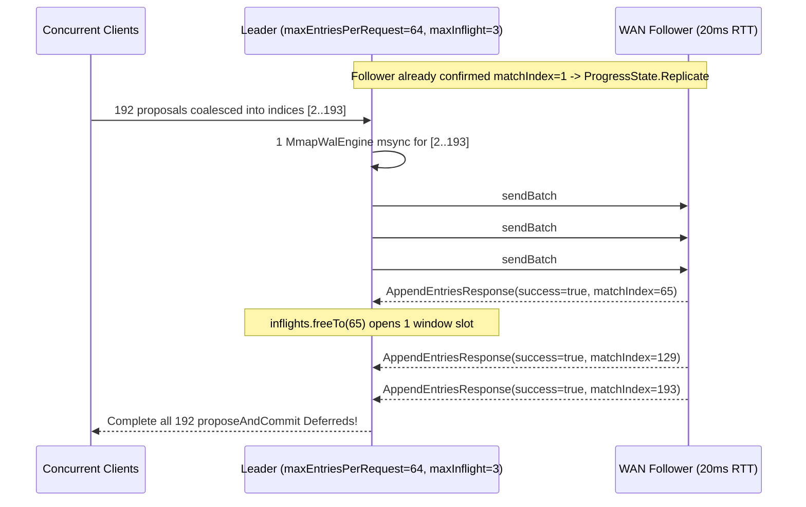
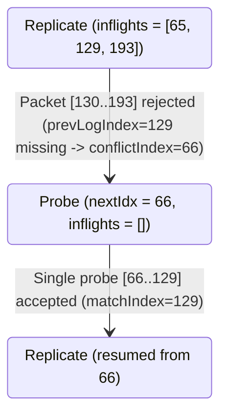

# Tutorial 15: High-Throughput Write Pipelines — Group Commit & Sliding-Window Pipelining

*A single-threaded stop-and-wait Raft log hits a hard throughput wall at `1 / (msync_latency + network_RTT)` — often fewer than 500 writes/sec across availability zones. In this tutorial, you will configure and benchmark **Group-Commit Proposal Batching** (`BatchConfig` + `proposeBatchAndCommit`) and **`Inflights` Sliding-Window Pipelining** (`PipelineConfig`) to scale write throughput by 20x–100x without sacrificing linearizability.*

---

## The Problem: Where Consensus Latency Goes

Consider 100 concurrent client fibers submitting writes to a 3-node cluster deployed across three availability zones (`RTT = 4ms`, NVMe `msync = 1ms`):

- **Baseline (`BatchConfig.enabled = false`, `PipelineConfig.enabled = false`)**:
  - Every fiber acquires the leader mutex individually, appends **1** `Log.command` (`1ms` `msync`), and dispatches **1** `AppendEntriesRequest` (`4ms` RTT).
  - Disk sync cost alone serializes 100 writes into `100 * 1ms = 100ms` (`~1,000 ops/sec` ceiling).
- **Group Commit + Pipelining (`BatchConfig` + `PipelineConfig`)**:
  - Concurrent fibers arriving while the previous batch is flushing coalesce into **1** `MmapSegment.forceRange` `msync` (`1ms` total for up to `maxSize` entries) and stream across up to `maxInflight` pipelined `AppendEntriesRequest` frames per follower without waiting for intermediate ACKs.



---

## Step 1: Configuring Group-Commit Batching (`BatchConfig`)

`BatchConfig` controls how `RaftNode[F]` coalesces concurrent `propose`, `proposeAndCommit`, and `submit` calls:

```scala
import scala.concurrent.duration.*
import raft.state.{BatchConfig, NodeId, PipelineConfig, RaftConfig}

val config = RaftConfig(
  localId = NodeId("node-1"),
  electionTimeoutMin = 300.millis,
  electionTimeoutMax = 600.millis,
  heartbeatInterval = 50.millis,
  maxEntriesPerRequest = 128,
  batching = BatchConfig(
    enabled = true,
    maxSize = 64,       // Flush immediately as soon as 64 commands accumulate
    maxWait = 2.millis  // Or flush partial batches after at most 2ms
  ),
  pipelining = PipelineConfig(
    enabled = true,
    maxInflight = 8     // Allow up to 8 unacknowledged AppendEntries chunks per follower
  )
)
```

### Choosing `maxWait`: Zero-Delay Smart Batching vs. Coalescing Window

| Workload Profile | `maxSize` | `maxWait` | Behavior |
| :--- | :--- | :--- | :--- |
| **Latency-critical OLTP** | `64` | `0.millis` (`Duration.Zero`) | **Zero artificial delay**: flushes 1st arrival immediately, then drains all proposals that queued while WAL `msync` was running |
| **Balanced microservice state** | `64`–`128` | `2.millis`–`5.millis` | Coalesces micro-bursts into 1 `msync` while keeping p99 tail delay under 5ms |
| **Bulk ingestion / event log** | `256`–`512` | `10.millis`–`20.millis` | Maximizes entries per `msync` and per gRPC `WireEnvelope` |

> [!TIP]
> Calling `propose` or `proposeAndCommit` on a `Follower` or `Candidate` **never** waits for `maxWait`: `RaftNode` performs an `O(1)` lock-free role check up front and raises `RaftError.NotLeader(leaderHint)` / `RaftError.ElectionInProgress` immediately.

---

## Step 2: Explicit Atomic Batches (`proposeBatch` & `proposeBatchAndCommit`)

When an ingestion worker, Kafka consumer, or HTTP batch endpoint already holds a collection of commands in memory, call `proposeBatchAndCommit` (or `proposeBatch`) directly. Even when `BatchConfig.enabled = false`, explicit batch methods append all commands in **1 `LogStore.append` call** with contiguous `(term, index)` coordinates:

```scala
import java.nio.charset.StandardCharsets
import cats.effect.IO
import raft.RaftNode
import raft.state.LogId

def ingestOrderEvents(
    leader: RaftNode[IO],
    events: Vector[String]
): IO[Vector[LogId]] =
  val payloads = events.map(_.getBytes(StandardCharsets.UTF_8))
  leader.proposeBatchAndCommit(payloads)
```

In Sans-I/O deployments using `raft-core` directly, `RawNode.proposeBatch` provides the exact same guarantee, emitting all entries in a single `Ready.entries` slice for your host event loop:

```scala
import raft.raw.RawNode
import raft.state.RaftError

def stepBatchOnRawNode(
    raw: RawNode,
    payloads: Seq[Array[Byte]]
): Either[RaftError, Vector[Long]] =
  raw.proposeBatch(payloads)
```

---

## Step 3: Understanding `Inflights` Sliding-Window Pipelining

When a burst of entries exceeds `maxEntriesPerRequest` (or when multiple group-commit batches flush within a single network RTT), `PipelineConfig` keeps the network pipe full using per-follower `Progress` tracking (`Probe`, `Replicate`, `Snapshot`):



### How Failure Recovery Works During Pipelining

What happens if packet #2 (`[66..129]`) is dropped by a router while packet #3 (`[130..193]`) arrives at the follower?



1. Packet #3 carries `prevLogIndex = 129`. Because packet #2 was dropped, the follower's last index is `65`, so it rejects packet #3 with `AppendEntriesResponse(success = false, conflictIndex = Some(66))`.
2. The leader receives the rejection, **immediately resets `Inflights`**, transitions that follower from `Replicate` -> `Probe` at `nextIdx = 66`, and sends a single probe (`[66..129]`).
3. What if **every** packet in a full `Inflights` window is dropped silently? On the next `heartbeatInterval`, `HeartbeatTimeout` detects that the follower's `matchIndex` has not advanced, rewinds the follower to `Probe`, and retransmits cleanly.
4. Meanwhile, `RaftNode` keeps conservative `Leader.nextIndex` (`matched + 1`) decoupled from the optimistic pipeline cursor, so concurrent `readIndex` quorum heartbeats never fail due to in-flight pipelined entries.

---

## Step 4: Full-Stack Wiring with `MmapWalEngine` and `GrpcTransport`

Putting group commit, pipelining, off-heap `MmapWalEngine`, and Netty `GrpcTransport` (`ProtobufMessageCodec`) together:

```scala
import java.nio.file.Paths
import scala.concurrent.duration.*
import cats.effect.{IO, Resource}
import raft.RaftNode
import raft.impl.DefaultTimerService
import raft.spi.{StateMachine, TransportConfig}
import raft.state.*
import raft.storage.{
  StorageBackedLogStore,
  StorageBackedSnapshotStore,
  StorageBackedStableStore
}
import raft.storage.mmap.MmapWalEngine
import raft.transport.grpc.{GrpcConfig, GrpcTransport}

def highThroughputNode(
    localId: NodeId,
    port: Int,
    peers: Map[NodeId, String],
    cluster: ClusterConfig,
    sm: StateMachine[IO, Unit]
): Resource[IO, RaftNode[IO]] =
  for
    // 64 MB memory-mapped WAL segments: appendEntries calls msync ONCE per flushed batch
    engine <- MmapWalEngine.resource[IO](
      dataDir = Paths.get(s"/var/lib/raft/${localId.value}"),
      segmentSize = 64L * 1024L * 1024L
    )
    grpcPair <- GrpcTransport.raftResource[IO](
      grpcConfig = GrpcConfig(
        host = "0.0.0.0",
        port = port,
        maxInboundQueueSize = 8192
      ),
      transportConfig = TransportConfig(
        localId = localId,
        bindAddress = s"0.0.0.0:$port",
        peers = peers - localId,
        connectionTimeout = 2.seconds
      )
    )
    (_, raftTransport) = grpcPair
    timerSvc <- Resource.eval(DefaultTimerService[IO])
    raftCfg = RaftConfig(
      localId = localId,
      electionTimeoutMin = 300.millis,
      electionTimeoutMax = 600.millis,
      heartbeatInterval = 50.millis,
      maxEntriesPerRequest = 128,
      batching = BatchConfig(enabled = true, maxSize = 128, maxWait = 3.millis),
      pipelining = PipelineConfig(enabled = true, maxInflight = 8),
      parallelReplicationEnabled = true
    )
    node <- RaftNode[IO](
      config = raftCfg,
      cluster = cluster,
      transport = raftTransport,
      logStore = StorageBackedLogStore(engine),
      stableStore = StorageBackedStableStore(engine),
      stateMachine = sm,
      timerService = timerSvc,
      snapshotStoreOpt = Some(StorageBackedSnapshotStore(engine))
    )
    _ <- Resource.eval(node.start)
  yield node
```

---

## Operational Sizing Checklist

1. **Bandwidth-Delay Product Sizing**:
   - Maximum unacknowledged entries in flight per follower is `maxEntriesPerRequest * pipelining.maxInflight`.
   - Ensure `(maxEntriesPerRequest * avgEntryBytes) < GrpcConfig.maxMessageSize` (default `4 MiB`) and `pipelining.maxInflight * peers < GrpcConfig.maxInboundQueueSize` (default `4096`).
2. **Observability (`RaftMetrics`)**:
   - Compare `onEntriesAppended(nodeId, count)` invocation rate vs. total `count` sum to monitor your live **average group-commit batch size**.
   - Monitor `onReplicationFailure(nodeId, followerId)` to spot followers frequently dropping from `Replicate` -> `Probe` due to packet loss or bounded-queue saturation.
