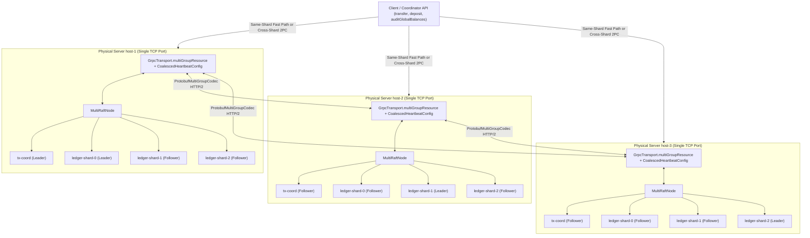
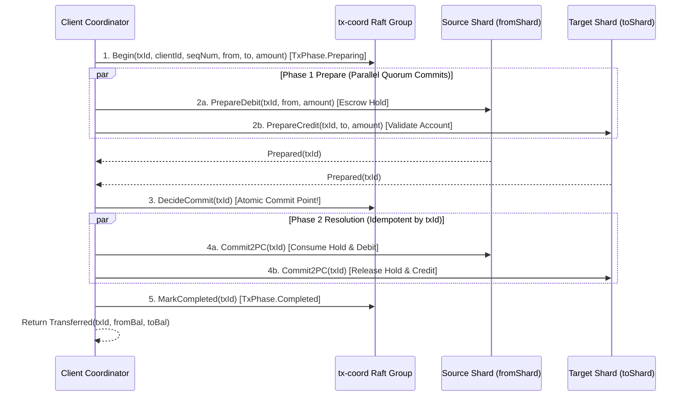
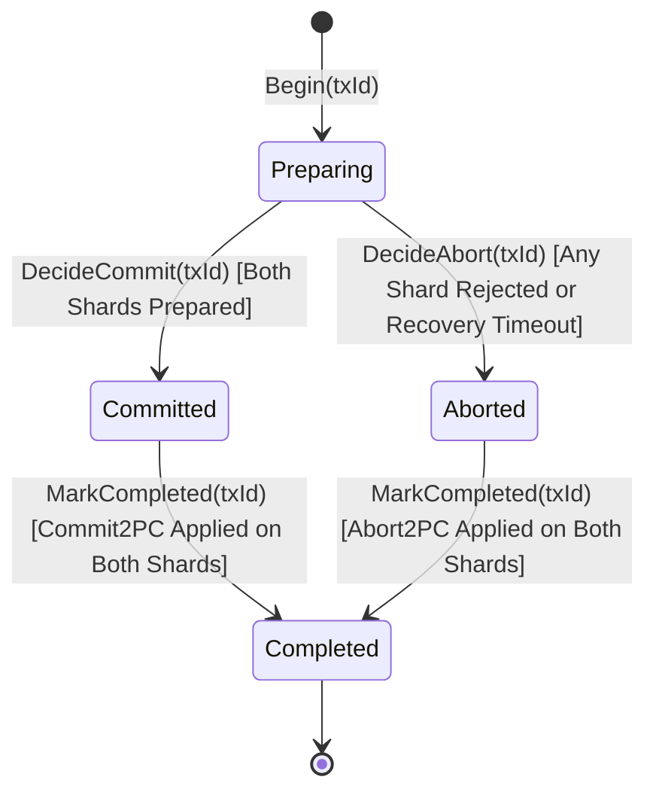

# Tutorial 16: Building a Multi-Shard Transactional Ledger with Raft-Backed 2PC

*Single-group Raft serializes every write through one leader and one WAL. Once your dataset or write rate outgrows a single node, you shard keys across multiple Raft groups — which immediately raises the hardest engineering question in distributed storage: **how do you execute atomic, crash-safe transactions across independent Raft shards without losing or duplicating money?***

---

## Real-World Problem

Suppose you operate a payment clearing ledger partitioned across three Multi-Raft account shards (`ledger-shard-0`, `ledger-shard-1`, `ledger-shard-2`). Transferring `250` units from `acct-1` (on `ledger-shard-0`) to `acct-5` (on `ledger-shard-2`) cannot be encoded as a single Raft log entry because the two accounts live in separate consensus state machines with independent leaders, terms, and WAL files.

A production cross-shard ledger must guarantee four invariants simultaneously:

1. **Global Conservation of Value**: Concurrent transfers, overdraft rejections, leader failovers, and node crashes must never create or destroy funds ($\sum \text{balances} = \text{constant}$).
2. **Isolation of Escrowed Funds**: While a cross-shard debit is mid-flight, concurrent withdrawals on the source shard must not spend the reserved balance.
3. **Exactly-Once Client Retries**: Network timeouts after commit must never double-debit or double-credit when a client or POS terminal retries with the same `(clientId, seqNum)`.
4. **Deterministic Coordinator Crash Recovery**: If the coordinator crashes mid-transaction, any surviving host must be able to inspect durable consensus state and deterministically roll back `Preparing` transactions or roll forward `Committed` transactions.

The complete runnable implementation lives in `examples.advanced.ShardedBankLedgerExample` (`modules/examples/src/main/scala/examples/advanced/ShardedBankLedgerExample.scala`), verified end-to-end by `AdvancedShardedLedgerE2ESpec`.

---

## Production Stack Architecture

Each physical server (`host-1`, `host-2`, `host-3`) runs **one** `GrpcTransport.multiGroupResource` Netty HTTP/2 listener and **one** `MultiRaftNode[IO]` coordinator multiplexing four Raft groups (`tx-coord` + three `ledger-shard-*` groups), each backed by an isolated `MmapWalEngine` directory:



> [!IMPORTANT]
> **Why replicate the coordinator itself over Raft?** Traditional Two-Phase Commit blocks if the single coordinator process dies after participants vote `Prepared`. By storing `TxRecord` transitions in a dedicated Raft group (`tx-coord`), the coordinator's decision log is fault-tolerant across any minority host failure.

---

## Fast Path vs. Cross-Shard 2PC Protocol

`ShardedLedgerCluster.transfer` hashes both account IDs (`(accountId.hashCode & Int.MaxValue) % shardCount`):

- **Same-Shard Fast Path (`fromShard == toShard`)**: Submits a single `LedgerCommand.SameShardTransfer` log entry via `proposeAndCommitToGroup`. Zero 2PC overhead, 1 Raft round-trip.
- **Cross-Shard 2PC Path (`fromShard != toShard`)**: Drives a Raft-replicated Two-Phase Commit across `tx-coord`, `fromShard`, and `toShard`:



---

## Escrow Holds, Idempotency, and Snapshot Survival

Every `LedgerShardStateMachine` tracks four durable structures inside `ShardState`:

| Field | Type | Role |
|-------|------|------|
| `balances` | `Map[String, Long]` | Settled account balances |
| `holds` | `Map[String, Hold]` | Active 2PC escrow reservations (`isDebit = true` reduces `availableBalance`) |
| `resolvedTxs` | `Map[String, Boolean]` | Completed 2PC outcomes (`true` = committed, `false` = aborted) for idempotent Phase 2 replay |
| `sessions` | `Map[String, (Long, LedgerResponse)]` | Per-`clientId` highest `seqNum` and cached response for exactly-once client retries |

### Available Balance Calculation

When `PrepareDebit(txId, acct, amount)` executes on `fromShard`, it checks `availableBalance(acct)` rather than raw `balances(acct)`:

```scala
def reservedFor(accountId: String): Long =
  holds.values.collect {
    case h if h.isDebit && h.accountId == accountId => h.amount
  }.sum

def availableBalance(accountId: String): Option[Long] =
  balances.get(accountId).map(_ - reservedFor(accountId))
```

If `acct-1` has a settled balance of `1,000` and an in-flight `PrepareDebit` hold of `300`, a concurrent `Withdraw` of `800` sees `availableBalance == 700` and is immediately rejected without corrupting the escrowed transfer.

> [!WARNING]
> **Snapshots must serialize holds and session tables!** If `CompactionManager` compacts the WAL while a 2PC hold is active — or after a client session commits — and `snapshot` only serialized `balances`, then a follower catching up via `InstallSnapshot` (or a crashed host restarting from disk) would forget active holds and session sequence numbers! `LedgerShardStateMachine.snapshot` and `restore` encode all four maps (`balances`, `holds`, `resolvedTxs`, and `sessions`) into a deterministic binary payload.

---

## Coordinator State Machine & Crash Recovery

Each cross-shard transaction moves monotonically through `TxPhase` inside `CoordStateMachine`:



When a client or host crashes mid-flight, `ShardedLedgerCluster.recoverInFlightTransactions` performs a linearizable `readIndexFromGroup(CoordGroup)` and resolves every non-`Completed` transaction deterministically:

- **`TxPhase.Preparing` or `TxPhase.Aborted`**: Commits `DecideAbort` in `tx-coord` (no-op if already `Aborted`), sends idempotent `Abort2PC(txId)` to both shards to release any locked debit holds, and marks `Completed`.
- **`TxPhase.Committed`**: Because the atomic commit point was already reached in `tx-coord`, recovery **never** aborts; it re-sends idempotent `Commit2PC(txId)` to both `fromShard` and `toShard` (a safe no-op on whichever shard already applied it) and marks `Completed`.

---

## Running the Demo and E2E Verification Suite

Run the interactive 3-host gRPC + `MmapWalEngine` cluster demo:

```bash
sbt "examples/runMain examples.advanced.ShardedBankLedgerExample"
```

Run the dedicated end-to-end verification suite (`AdvancedShardedLedgerE2ESpec`), which tests 24 concurrent transfers with overdraft rollbacks, client retry deduplication across WAL compaction + leader transfer, and mid-2PC physical host crash/restart recovery:

```bash
sbt "examples/testOnly examples.AdvancedShardedLedgerE2ESpec"
```
