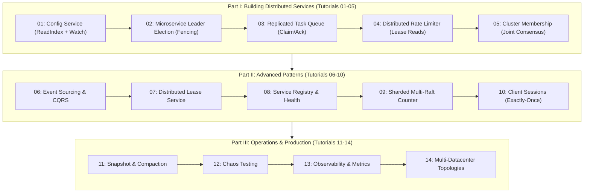

# Tutorials — Real-World Distributed Systems with the Functional RAFT Library

*Hands-on guides that solve production distributed systems problems using the Functional RAFT Library for Scala 3. Each tutorial tackles a specific real-world challenge, explaining not just **how** to build the solution, but **why** Raft is the right tool and **what happens** when things fail.*

---

## Prerequisites

- Scala 3 basics (pattern matching, sealed traits, opaque types)
- Familiarity with the library's core API — read [Chapter 6: Core API](../docs/book/06-core-api.md) and [Chapter 7: The SPI Layer](../docs/book/07-spi-layer.md) first
- Understanding of the pure state transition model — [Chapter 5: Design Philosophy](../docs/book/05-design-philosophy.md) explains the effects-as-data pattern



## Part I — Building Distributed Services

| # | Tutorial | Real-World Problem | Key Concepts |
|---|----------|--------------------|-------------|
| 1 | [Configuration Service](01-configuration-service.md) | Centralized config management with change notifications | Watch notifications, ReadIndex, versioned state |
| 2 | [Leader Election for Microservices](02-leader-election-microservices.md) | Active-passive failover — exactly one active instance | Leader detection, leadership transfer, fencing tokens |
| 3 | [Replicated Task Queue](03-replicated-task-queue.md) | Distributed work queue with exactly-once execution | Claim/ack protocol, deterministic scheduling, TTL expiration |
| 4 | [Distributed Rate Limiter](04-distributed-rate-limiter.md) | Coordinated request throttling across API gateways | Sliding window algorithm, lease reads for fast path |
| 5 | [Cluster Membership Management](05-cluster-membership.md) | Adding and removing nodes without service interruption | Joint consensus, learner promotion, safe removal |

## Part II — Advanced Patterns

| # | Tutorial | Real-World Problem | Key Concepts |
|---|----------|--------------------|-------------|
| 6 | [Event Sourcing](06-event-sourcing.md) | Ordered, durable event stream for CQRS architectures | Raft as an event log, consumer offsets, materialized views |
| 7 | [Distributed Lease Service](07-distributed-lease-service.md) | Time-bound, exclusive access to shared resources | TTL leases, renewal, epoch-based fencing |
| 8 | [Service Registry & Health Checking](08-service-registry.md) | Consul-like service discovery with health-aware routing | Heartbeat TTLs, client-side caching, health sweeping |
| 9 | [Sharded Counter with Multi-Raft](09-sharded-counter-multi-raft.md) | Scaling beyond single-group throughput | `MultiRaftNode`, `GroupEnvelope`, consistent hashing |
| 10 | [Exactly-Once with Client Sessions](10-client-sessions.md) | Guaranteeing retries don't cause duplicate execution | Session table, sequence numbers, composable wrapper |

## Part III — Operations & Production

| # | Tutorial | Real-World Problem | Key Concepts |
|---|----------|--------------------|-------------|
| 11 | [Snapshot & Log Compaction](11-snapshot-compaction.md) | Managing log growth in long-running clusters | Snapshot strategies, chunked transfer, compaction safety |
| 12 | [Chaos Testing](12-chaos-testing.md) | Verifying correctness under adversarial conditions | Fault injection, invariant checking, common bug catalog |
| 13 | [Monitoring & Observability](13-observability.md) | Running a Raft cluster in production | Metrics, dashboards, alert rules, debugging playbooks |
| 14 | [Multi-Datacenter Deployment](14-multi-datacenter.md) | Disaster recovery across data centers | Witness nodes, latency-aware reads, DC failover |

## How These Differ from the Book

The [book's case studies](../docs/book/README.md#part-iv--case-studies) (chapters 12–15) build complete systems — a KV store, lock service, counter, and transaction engine. These tutorials instead focus on **specific operational challenges** you encounter when deploying Raft in production:

- **Part I** builds real services, going deeper into read consistency, leader coordination, and exactly-once semantics
- **Part II** introduces advanced patterns like event sourcing, leases, and Multi-Raft sharding
- **Part III** is a production operator's handbook — compaction, chaos testing, monitoring, and geo-distribution

## Running the Examples

All tutorials reference code that runs with the library's in-memory infrastructure:

```bash
sbt test    # 527 tests — verifies all library functionality the tutorials depend on
```
